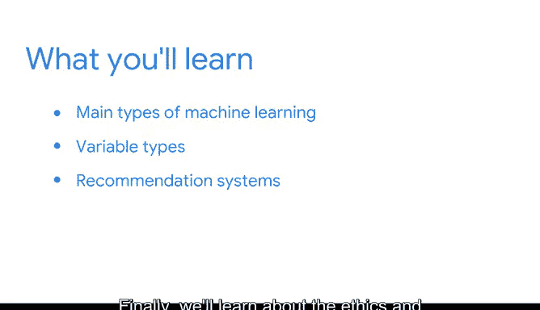

# 谷歌高阶数据分析6：《机器学习的基础知识》the-nuts-and-bolts-of-machine-learning（中英双字） - P3：03_01_05_欢迎来到模块1.zh_en - GPT中英字幕课程资源 - BV1GW4y1o794

Let's discuss some topics that we'll cover in this part of this course。 First。

 we'll consider the main types of machine learning。

 Then we'll review different variable types used for machine learning， like continuous。

 categorical and discrete。It's essential to have an understanding of these concepts so you can build an appropriate model。

Next， we'll introduce you to recommendation systems and explore how they use content based and collaborative filtering to make content suggestions Both types of filtering are important techniques for building many of the recommendation systems used today。

😊，Finally， we'll learn about the ethics and applications of machine learning。

 we'll examine the questions that data professionals must ask as they plan， analyze， construct。

 and execute models。

Because machine learning models are very powerful， it's important for data professionals to consider the ethical implications of their work coming up。

 we'll give you the tools to avoid some common mistakes that can mean the difference between a problematic project and a successful one。

 Now let's get started。