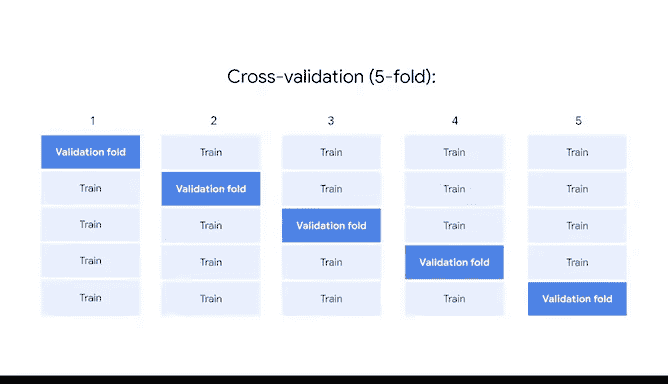

# 谷歌高阶数据分析6：《机器学习的基础知识》the-nuts-and-bolts-of-machine-learning（中英双字） - P41：41_04_03_使用验证验证性能.zh_en - GPT中英字幕课程资源 - BV1GW4y1o794

You now know about many of the tools involved with building some pretty powerful models。 Now。

 in this video， you'll explore model validation。Model validation is the set of processes and activities intended to verify that models are performing as expected。

 This is achieved with a validation data set， which is a sample of data that's held back during training。

 The validation data set is instead used to give an unbiased estimate of the skill of the final tuned model。

 Note that validation data is different from test data and must remain unseen until the very end of the process。

 In some of the models we've built so far。 We haven't been doing this。 But that's okay。

 We were just using those models to understand the process of building an evaluation。Previously。

 before training the model， we took our data and split it into two sets。

 one training set and one testing set。 These sets were used to train and test the model。

 respectively。With validation， the data is actually split into three sets。

 The first two are training and testing sets as before， but now there's an additional validation set。

 This validation set is used instead of the test set to evaluate the model。

 leaving the test set untouched。In addition， another popular method is cross validation cross validation is a process that uses different portions of the data to test and train a model across several iterations。

It works like validation， but with a slight twist。 Instead of having one validation set to evaluate the model。

 the training data is split into multiple sections， known as folds。

 Then the model is trained on different combinations of these folds。 For example。

 perhaps we want five folds。 First， the data would be split into the training and test data。

 Then the training data would be split into the five folds。

The first model iteration will train with folds 1，2，3， and 4。

 using the fifth fold to get metrics for the model。 The next will train with folds 1，2，3， and 5。

 using the fourth fold to get metrics。 This process repeats until every combination is done。

 and the evaluation metrics are averaged to get final validation scores。

Which validation technique you choose mainly depends on the data set you're working with。

Cross validation is particularly useful when working with smaller data sets as it maximizes the utility of the data available。

 more so than standard validation。However， cross validation is not necessary when working with very large data sets。

 Theres so much data that maximizing the utility is not required and actually can be problematic depending on the computing resources at your disposal。

 However， if limited computing resources or constraints in the data are not issues。

 then cross validation is almost always applied。Validation schemes are essential to building and selecting effective models。

 Data professionals working on these types of business projects are responsible for determining the best scheme to use。

This comes with experience， along with an understanding of the data and the available tools。

 you're well on your way to developing these important skills。

