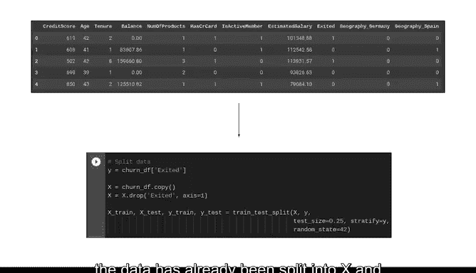
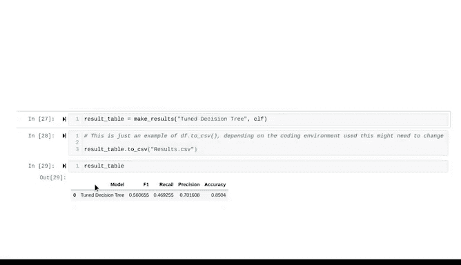

# 谷歌高阶数据分析6：《机器学习的基础知识》the-nuts-and-bolts-of-machine-learning（中英双字） - P42：42_04_05_用Python调整和验证决策树.zh_en - GPT中英字幕课程资源 - BV1GW4y1o794

Hello and welcome back。 In this video， we'll be taking the foundation we built when creating a decision tree classifier in Python and expanding on it to fine tune our models。

 If you recall， hyperparameter tuning involves changing parameters that directly affect how the model trains before the learning process begins。

 Different models have different types of hyperpara that are available for you to adjust。😊。

You've learned about two that apply to tree based models， max depth and min samples leaf。

 As a reminder， max depth defines how long a decision tree can get。

 and min samples leaf defines the minimum number of samples for a leaf node。

These are the hyperparameters that will be tuned on a single decision tree。

When originally exploring hyperparameter tuning， we also considered the steps for finding the optimal values for hyperparameters。

Randomly entering values won't produce the best results， which is why we use grid search。

As a refresher， grid search specifies a series of values for each hyper perimeter to be tuned。

 It systematically checks every combination of those values to determine which set produces the best results based on the selected metric。

Think of it as brute forcing the different hyperparameter values。

 Imagine forgetting your pin and trying every single number between 0，0，0，0 and 9，9，9，9。

 Sure it would take time， but eventually， you'd find it。This is how grid search works。Okay。

 now let's get into the code。 You'll work within the same framework as the other classification models you've created。

 We'll begin where we left off in the decision tree notebook。 Remember。

 we've already performed feature engineering， and the data has already been split into X and Y data。

 as well as training and test sets。

But now we're going to add a new function。 gridd search C is imported from the model selection package of Ps kitt learn。

 enabling the hyperparameters to be tuned。The CV in gridd search CV stands for cross validationidation。

Each time a set of hyperparameters is used， it's scored against a validation set。

 keeping the test data unseen。You'll use the validation scores when comparing models moving forward。

Note that you won't be comparing this tuned decision tree to the existing models。

 All the other models were scored and compared using test data。

 which is actually an improper practice。 When data professionals perform model selection in the workplace。

 the test data must always remain unseen to the models being worked on。

 that data is only used at the very end of the model development process。😡，As mentioned before。

 the parameters you'll tune will be max depth and min samples leaf。

A dictionary is defined where the key is the name of the hyperparameter。

 and the value is a list of numbers that will be tried as that hyperparameter。

While the grid search is based on F1 score， you still want to find out what the other scores are。

 So create a set called scoring with the names of each of the desired metrics。Next。

 create an instance of a decision tree classifier named tuned decision tree。

 The grid search C function is then called as arguments pass in the decision tree classifier object。

 The parameters， the scoring methods， the number of cross validation folds and specify the metric the search will focus on。

 Finally， fit the model to the data。😊，Check which hyperparameters the grid search identified by getting the best estimator attribute from the grid search object。

 you can observe the values it found。 So a max depth of 8 in a min samples leaf of 20 was best when using the F1 score as a measure。

Getting the best score attribute confirms the best average F1 score across the different folds among all the combinations of hyper parametersameter。

 Note that this model achieved a score of about 0。5607。

This final code block is a helper function to extract scores for the model。

 It produces a data frame that has the name of the model。

 along with the four scores you've been using。 Call this function at the very end and save the resulting data frame as a CV file for later use。

Right now， there's nothing to compare this score with。 However， note the model has an F1 score of 0。

5605。 And soon， you'll go on to create other more advanced tree based models and find scores to compare with this one。

With those numbers， you'll be able to determine which model is not only the best performer。

 but also the best in the context of the business needs。

