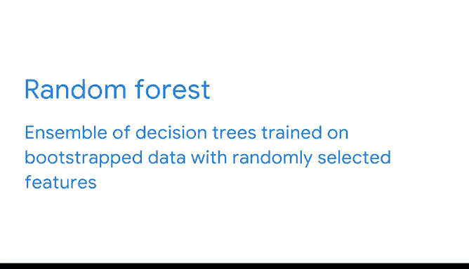

# 谷歌高阶数据分析6：《机器学习的基础知识》the-nuts-and-bolts-of-machine-learning（中英双字） - P43：43_04_01_自助聚合.zh_en - GPT中英字幕课程资源 - BV1GW4y1o794

At this point， you've learned that decision trees are useful because they're easy to understand and interpret。

 flexible with regard to the data they use and highly versatile Decion trees can be good predictors。

 but you also know that they're prone to overfitting and they're very sensitive to variations in the training data。

 how do we solve these problems。The answer is by using the wisdom of the crowd。

 Perhaps you're familiar with this concept because it can apply to everyday situations as well。

 If I have a jar filled with jelly beans and I ask a spatial math expert to examine it and guess how many jelly beans there are。

 their estimate will typically be less accurate than if I ask 1000 ordinary people to do the same thing。

 and then take the average of their guesses。We can apply the same concept to modeling。

 using a process called ensemble learning or simply ensemmbling。

Ensemble learning involves building multiple models and then aggregating their outputs to make a final prediction。

 Just like in our jellybean example， predictions using an ensemble of models are very accurate。

 even when the individual models themselves are barely more accurate than a random guess。

A best practice when building an ensemble is to use very different methodologies for each model it contains。

 such as a logistic regression， a naive base model， and a decision tree classifier。In this way。

 when the models make errors and they always will， the errors will be uncorrelated。

 The goal is for them to not all make the same errors for the same reasons。😡。

You could build an ensemble using the three models I just mentioned。

 You'd train each model on the same data， then use each model's individual predictions to make a final prediction。

 save by taking the majority vote。 if it's a classification task or averaging the results。

 if it's a regression task。But theres another way to build an ensemble。

 a way that uses the same methodology for every contributing model in this kind of ensemble。

 each individual model that comprises it is called a base learner for this method to work。

 you usually need a lot of base learners。 and each is trained on a unique random subset of the training data。

If the base learners were all trained on the exact same data。

 there would be too much correlation between the errors。

 this would affect the strength of the base learners。

 and if a base learner's prediction is only slightly better than a random guess。

 it becomes a weak learner。So to address this， data professionals do something called baggging in order to ensure random subsets of the data and strong learners。

 The word baggging comes from Botrap aggregating。 Let's break this down。

Remember from statistics that bootstrapping refers to sampling with replacement。

 that's what happens during bagging too。Each base learner samples from the data with replacement for bagging。

 this means the various base learners all sample the same observation and a single learner can sample that observation multiple times during training。

The aggregation part of bagging refers to the fact that the predictions of all the individual models are aggregated to produce a final prediction For regression models。

 This is typically the average of all the predictions for classification models。

 It's often which every class receives the most predictions， which is the mode。

When bagging is used with decision trees， we get a random forest。

 a random forest is an ensemble of decision tree based learners that are trained on bootstpped data。

The base learner's predictions are all aggregated to determine a final prediction。

 Random forest takes the randomization from bagging one step further。

 A regular decision tree model will seek the best feature to use to split a node。

 A random forest model will grow each of its trees by taking a random subset of the available features in the training data and then splitting each node at the best feature available to that tree。

This means that each base learner in a random forest model has different combinations of features available to it。

 which helps to prevent the problem of correlated errors between learners in the ensemble。

Each individual base learner is a decision tree。 It may be fully grown。

 so each leaf is a single observation， or it may be very shallow。

 depending on how you choose to tune your model。 Ensembling many base learners helps reduce the high variance that you typically get from a single decision tree。

Ensemble learning is powerful because it combines the results of many models to help make more reliable final predictions。

 Plus， these predictions have less bias and lower variance than other standalone models。 Coming up。

 we'll explore random forests in more detail。 Lots to come。😊。

