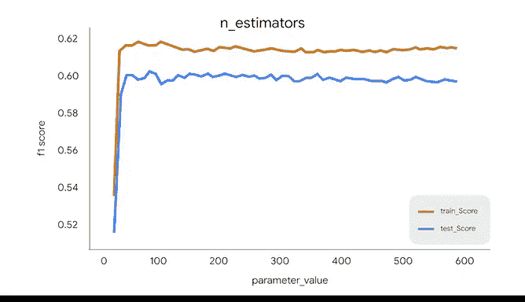

# 谷歌高阶数据分析6：《机器学习的基础知识》the-nuts-and-bolts-of-machine-learning（中英双字） - P45：45_04_05_调整随机森林.zh_en - GPT中英字幕课程资源 - BV1GW4y1o794

Hey， welcome back in this video we'll build on your understanding of how decision trees grow。

 this will be the basis on which we'll tune a random forest model。

You've learned that random forests make predictions by sampling features and observations to grow trees。

With decision trees， splits are decided by which variables and which cutoff values offer the most predictive power。

Now， let's consider that decision trees continue to split until one of a certain set of conditions is met。

The first condition has to do with the observations that a leaf contains when all of the observations belong to the same class。

 This means the leaf node is pure。 The second condition affecting where a tree splits is whether the minimum leaf size or maximum depth is reached。

 Also， a decision tree may stop growing if it achieves a certain performance threshold。

 The value and metric for this threshold can both be specified by the modeler。

 You'll recall that settings such as these are known as hyperparameters。

 and they can be tuned to improve model performance。

 directly affecting how the model is fit to the data。

 We demonstrated that one of the most important hyperparameters in a decision tree is its max depth。

😊，This specifies how many levels the tree can have and ultimately determines how many splits it can make。

 Remember， every time a node splits， your data gets separated into smaller subsets。

 The model is drawing another decision boundary。 We also introduce you to min samples leaf。

 which defines the minimum number of samples for a leaf node。 with min samples leaf。

 a split can only occur if it guarantees a minimum number of observations in the resulting nodes。

 Now， a new concept。 Min samples split can be used to control the threshold below which nodes become leaves。

 Random forest models have these same hyperparameters because they are ensembles of decision trees。😊。

These hyperparameters control how the learner trees are grown。

 but random forests also have some other hyperparameters， which control the ensemble itself。

 This first hyperparameter controls the randomness of the trees， and it's called max features。

This setting specifies the number of features that each tree selects randomly from the training data to determine its splits。

 For example， if you have a dataset set with features A， B，C， D， and E。

 and you build a random forest model with max features set to 3。

 your first tree might use features A， C， and E to determine its splits。

 and the next tree might use features B， D， and E， and so on。

The second hyperparameter number of estimators controls how many decision trees your model will build for its ensemble。

 For example， if you set your number of estimators to 300。

 your model will train 300 individual trees。 If you're building regression trees。

 then the model's final prediction would average the predictions of all 300 trees。

If you're building classification trees， the final prediction would be determined by whichever class received the majority vote from the 300 individual trees for random forest models。

 performance will typically increase as trees are added to the ensemble， but only to a certain point。

After this point， improvement will level off and adding new trees will only increase your computing time。

 This happens because the new trees will become very similar to existing trees。

 so they won't contribute anything new to the model as a final point。

 many data professionals build models without hand setting each hyperparameter。 In fact。

 when using Ps kitt learn， the model might perform well with no hyperparameters at all。

 That's because it has an effective default setting。

 And remember to make the most of grid search to help you iterate Data professionals know how to experiment with combinations of hyperparameters in order to build the model that makes the very best predictions。

😊。

