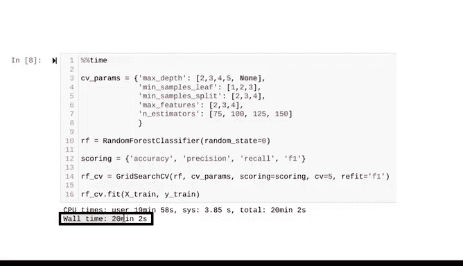

# 谷歌高阶数据分析6：《机器学习的基础知识》the-nuts-and-bolts-of-machine-learning（中英双字） - P46：46_04_06_用Python构建和交叉验证随机森林模型.zh_en - GPT中英字幕课程资源 - BV1GW4y1o794

Now that you're familiar with the logic behind random forests and some of its most important hyperparameters。

 you're ready to build a model in this video， we'll build a random forest model that uses grid search to cross validate and tune the hyperparameters。

 Let's open up a Jupiter notebook and get started。 Re that in this scenario。

 we're trying to predict which customers will close their bank accounts。😊，Import nuumpy and pandas。

 mapplotlib， grid search C and train test split。 Then all the evaluation metrics Also import random forest classifier。

 Note that we're using the classifier because we're trying to solve a classification problem。

 but we could also import the random forest regressor if we were predicting on continuous data。😊。

Remember that we've prepared our data by dropping the row number。

 customer ID and surname columns because they don't have predictive value。

 We've also dropped the gender column because we don't want the model to predict on the basis of gender。

 Then we dummy encoded our categorical variables to prepare for modeling。

The last step before modeling is to split the data into the training and test sets using Tra Test split。

We're going to compare our Model F1 score to what we got from our naive B and decision tree models。

 so it's important to split the data in the same exact way to ensure that all models train and test on the same data。

Therefore， we'll make sure that our test data is 25% of all the data。

 we'll also stratify based on our target column and set the random seed to 42 just as we did previously。

This splits our X and Y data into X train， X test， Y train and Y test。Okay， we're ready to model。

 Let's find out what happens if we tune our model using cross validation。

One thing you'll notice when we build ensemble models is that the training time will usually be much longer than what you've experienced so far。

 That's because instead of building a single tree， we're now building from 75 up to 150 trees for each combination of hyperparameters we specify。

😊，It's useful to know how long it takes a model to train。

 You can get a cell's run time by entering percent percent time at the top。

 This is called a magic command。 Magic commands， often just called magicics。

 are commands that are built into i Python to simplify common tasks。

 They always begin with either percent or percent percent。😊，Now， define the hyperparameter grid。

 tune 5 hyperparameters， max depth， min samples， leaf， min samples split。

 max features and number of estimators。 Notice that for max depth， none is included。

This means that one of the options allows the trees to grow without a specific limit on their depth。

Next， instantiate our classifier and assign it a random state for reproducibility。

And specify the metrics the model will capture。 Finally， instantiate the grid search object。

 It has two positional arguments， The classifier and the parameter grid。

 Tell it to use the scoring metrics specified above and set C V to5。

 This means the model will be cross validated using five folds。😊，Lastly， specify Refi equals F1。

 This is necessary when we've given multiple scoring metrics because it tells gridd search that even though we want to check a few different metrics。

 the one we care most about is the F1 score。As a quick refresher。

 F1 score is a combination of precision and recall， combining the two into a single metric。

In this instance， when we call the best estimator， it's the one with the highest average F1 score across all five validation folds。

Now， fit the model to the training data， depending on the processing power available。

 the number of hyperparameter combinations specified in the grid search。

 the size of the data set and the number of folds used to cross validate。

 This could take a long time。In this example scenario。

 the time magic tells us it took about 20 minutes to fit。

There's always a trade off between searching over a large hyperparameter space and good runtime。

The more hyperparameters you search， the better your model will be。

 but the longer it will take to fit。When models take a long time to fit。

 you don't want to have to run them again。 If your kernel disconnects or you shut down the notebook and lose the cell output。

 you'll have to refit the model， which can be frustrating and time consuming。

 The good news is that there's a method that enables you to save the fit model object to a specified location。

 And then quickly read it back in。 And in the next video， we'll discover how that works。

 Me you there。😊。