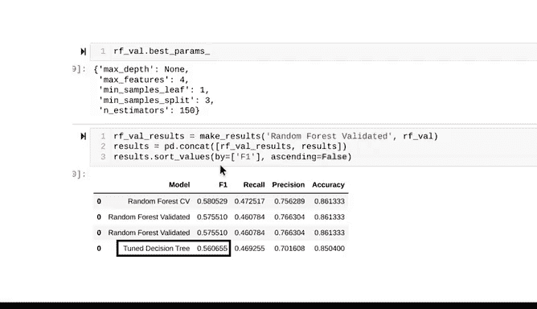

# 谷歌高阶数据分析6：《机器学习的基础知识》the-nuts-and-bolts-of-machine-learning（中英双字） - P47：47_04_07_使用验证数据集构建和验证随机森林模型.zh_en - GPT中英字幕课程资源 - BV1GW4y1o794

In the last video， we began creating a random forest model that used grid search to cross validate and tune hyperparameters。

 Now， we'll build on that by using a separate validation data set to validate a model。 But first。

 recall where we left off。 We discovered a common issue in the data realm。

 The trade off between searching over a large hyperparameter space and a good run time。😊。

As we observed， the more hyperparameters searched， the better the model。

 but the longer it takes to fit。When models take a long time to fit。

 it's inefficient to have to keep running and reffitting them again。

 Once you find a model you're happy with， you don't want to start from scratch every time you open your notebook。

 And that's where pickling comes in。Pickle is a tool that saves the fit model object to a specified location。

 and then quickly reads it back in。 It also allows you to use models that were fit somewhere else without having to train them yourself。

 So let's pick up where we left off and pickle the model。 First。

 specify a file path to the directory where the model will be saved。😊。

Then create a with open statement， passing to it the file path。

 Plus the name you want to use to save this model followed by dot pickle。

 This creates an empty pickle file。 The second argument， W B。

 gives permission to write to the file in binary， which is how pickling works。

Use as to assign the return value of open to a local variable named to right。

Call pickle dot dump and pass the fit model object to it， then the two right variable。

In the next cell， read back in the pickled model from where it's saved。

 The only difference in syntax is using RB to specify that we'll be reading binary and using pickle dot load to assign a new variable。

 which points to the fit model。Make sure you call this new variable by the same name you used for your fit model above。

 in this case， RFF underscores CV。If you comment out the line of code where you fit the model and the cell where you pickle the model。

 you can close the notebook， re it， and rerun all the cells without having to wait for the model to fit。

You can also send the prefit model to other people to use。Now。

 use the best parameterss attribute to identify the hyperparameter values of the model that had the best average F1 score across all the cross validation folds。

To find the average F1 score of the best model， use the best score attribute。

Then use the make resultss function to generate a table of all the results and concatenate that with the overall table to compare all the models。

Interesting， the cross validated random forest model has an average F1 score of 0。

58 across all five validation folds， which is a little better than the single tuned decision tree。

 It also has better recall， precision and accuracy， nice。😊，Okay。

 now let's use a separate validation data set to validate the model。To do this。

 split the training data into a new training set and validation set。 Use Tra test split。

 Remember to stratify the Y data， Use an 80，20 split。Don't forget。

 this is only splitting the training data， which itself is 75% of all data。

 This means that our new training set will be 80% of 75% of the data。

And the new validation set will be 20% of 75% of the data。 The test data remains untouched。

 This next part is a little tricky。Grid search C wants to cross validate the data。 In fact。

 if the C parameter was left blank， it would split the data into five folds for cross validation by default。

Because you're using a separate validation set， it's important to explicitly tell the function how to perform the validation。

 This includes telling it every row in the training and testing sets。

Use a list comprehension to generate a list of the same length as our XTR data。

 where each value is either a negative one or a zero。

Use this list to indicate to grid search CV that each row labeled negative1 is in the training set and each row labeled as0 is in the validation set。

 Call this list split index。Now， import a new function called predefined split from PsKt Learnear's model selection package。

Predefined split provides trained test indices to split data into training and testing sets using a predefined scheme。

The next step is almost identical to what you did before。

 Search over all the same hyper parametersameter and keep the syntax the same as when cross validating。

But now， pass the new split index list to predefined split and assign it to a variable。

 We'll call the variable custom split。 Finally， set the C V parameter of the grid search equal to custom split。

 Now， it's time to fit the model。 Use time magic to get the time it takes the model to train。😊，Wow。

 in this example scenario， the model took only about four minutes to train during cross validation。

 the training data was divided into five folds。 An ensemble of trees was grown with a particular combination of hyperparameters on four folds of the data。

 validating it against the fifth fold that was held out。

 This whole process happened for each of five holdout folds。

 Then another ensemble was trained with the next combination of hyperparameters。

 repeating the whole process。 This continued until there were no more combinations of hyperparameters to run。

😊，But now there's a separate hold out set for validation。

 An ensemble is built for each combination of hyperparameters。

 Each ensemble is trained on the new training set and validated on the validation set。

 But this only happens one time for each combination of hyperparameters。

 instead of five times with cross validation。 That's why the training time was only a fifth as long。

😊，All right。 Now， pickle the model again。 Run the cell where the pickle is written。

 Then go back and comment out the line of code， as well as the call to write the pickle。

 Remember to have a cell where the pickled model can be read back in。 Check the results。

 when you call best parametersms notice that the ensemble with the best F1 score used slightly different hyperparameters than the cross validated model。

 Now， the F1 score is 0。576， better than the single decision tree model。

 but not as good as the cross validated model。 Both would likely produce similar results。

 just keep in mind that the cross validated model is a little more reliable because it was more rigorously validated。

 In fact， if a different random seed had been used to create the validate set。

 It's possible that we might have gotten lucky and even had a model that performed a little better than our cross validated model。

😊。

But note that this doesn't mean it would be expected to perform better on the test data。

This notebook's purpose was to demonstrate the different processes involved in validating a random forest model using cross validation and validation with a separate data set。

In practice， it's unlikely that you do both。 Instead。

 it would be more effective to choose an approach based on time requirements。

 the amount of data and the number of different hyperparameter combinations to be explored。

 As always， the work that data professionals do requires thoughtful trade offs and adaptability。

