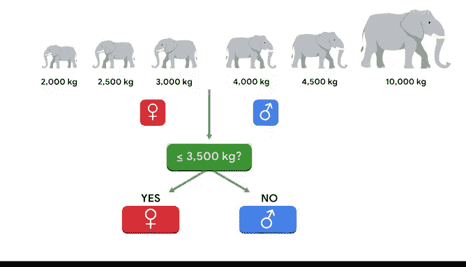

# 谷歌高阶数据分析6：《机器学习的基础知识》the-nuts-and-bolts-of-machine-learning（中英双字） - P48：48_04_01_AdaBoost提升算法入门.zh_en - GPT中英字幕课程资源 - BV1GW4y1o794

Random forest is one methodology for building tree based ensemble models。 Now。

 I'm going to introduce you to another related methodology called Boting。

Boosting is one of the most powerful modeling methodologies in the field。

 It's used in nearly every industry that relies on predictive modeling。

 Many winning models from Cale and other competitions use boosting。

 It's an essential tool in any modeler's tool belt。😊。

Boosting is a supervised learning technique where you build an ensemble of weak learners。

 This is done sequentially with each consecutive base learner trying to correct the errors of the one before。

 Remember， a weak learner is a model whose prediction is only slightly better than a random guess。

 and a base learner is any individual model in an ensemble。😊。

This practice is similar to random forest and bagging。 like random forest。

 Boting is an enssembling technique， and it also builds many weak learners。

 then aggregates their predictions。 But there are some key differences。Unlike random forest。

 which builds base learners in parallel， boosting builds learners sequentially。

 This is because each new base learner in the sequence focuses on what the preceding learner got wrong。

 Another difference from random forest is that for boosting models。

 the methodology you choose for the weak learner isn't limited to tree based methods。 However。

 we will use tree based implementations in this course。

 because these are common and effective ways of building boosting models。😊。

There are various different boosting methods available， but throughout this part of the program。

 we'll explore two of the most commonly used methodologies。

 The first is called adaptive boosting or add a boosting。

 Add a boost is a tree based boosting methodology， where each consecutive based learner assigns greater weight to the observations incorrectly predicted by the preceding learner。

😊，Here's the demonstration。At a boostt builds its first tree on training data that gives equal weight to each observation。

Then the algorithm evaluates which observations were incorrectly predicted by this first tree。

 It increases the weights for the observations that the first tree got wrong and decreases the weights for those that it got right。

This process repeats until either a tree makes a perfect prediction or the ensemble reaches the maximum number of trees。

 which is a hyperparameter that is specified by the data professional。

Once all the trees have been built， the ensemble makes predictions by aggregating the predictions of every model in the ensemble。

 because at a boost can be used for both classification and regression problems。

 This final step is a little different， depending on which type is being addressed。

For classification， the ensemble uses a voting process that places weight on each vote。

Base learners that make more accurate predictions are weighted more heavily in the final aggregation。

For regression， the model calculates a weighted mean prediction for all the trees in the ensemble。

 There is one disadvantage to note about boosting。 You can't train your model in parallel across many different servers because each model in the ensemble is dependent on the one that preceded it。

This means that in terms of computational efficiency。

 it doesn't scale well to very large data sets when compared to bagging。However。

 this generally isn't a concern unless you're working with particularly large data sets。

But there are many noteworthy advantages， including being one of the more accurate methodologies available today。

 Also， just like random forest， the fact that it's based on an ensemble of weak learners means that the problem of high variance is reduced。

This is because no single tree weighs too heavily in the ensemble。Boosting has a few key advantages。

 First， unlike random forest， it reduces bias。 It's also easy to understand and doesn't require the data to be scaled or normalized。

 Boosting can handle both numeric and categorical features， and it can still function well。

 even with multicollinearity among the features。Plus， it's robust to outliers。 Now。

 note that resilience to outliers is a major strength of all tree based methodologies。

 This is because the model splits the data the same way， regardless of how extreme a value is。

Here's an example。 Suppose you have six elephants。3 are females that weigh 225 3000gs。

 and three are males that weigh 40004500 and 5000 kgram。 If you grew a decision tree using this data。

 it would draw a decision boundary between males and females at 3500 kilos。

 The midpoint between the weights of the heaviest female and the lightest male。Now。

 suppose that instead of weighing 5000 kilos， the last male elephant weighed 10000 kilos。

 Your bottle would still divide males and females at 3500 kilos。

 It doesn't matter that the last elephant doubled in size。

Speaking of doubling in size， your experience and skills are growing at an enormous rate。

 I'm really proud to be taking this journey with you and can't wait to keep it up。😊。

