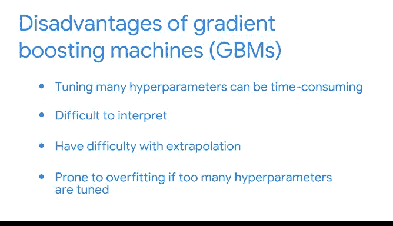

# 谷歌高阶数据分析6：《机器学习的基础知识》the-nuts-and-bolts-of-machine-learning（中英双字） - P49：49_04_02_梯度提升机.zh_en - GPT中英字幕课程资源 - BV1GW4y1o794

Previously， you learned that boosting is an enssembling technique that builds models sequentially。

 with each model in the sequence， focusing on the mistakes of the previous one。

 And you discovered that at a boost works by assigning greater weight in each model to the incorrect predictions of the model that preceded it。

😊，Now， we're going to explore gradient boosting。 Gr boosting is different from adaptive boosting。

 because instead of assigning weights to incorrect predictions。

 each base learner in the sequence is built to predict the residual errors of the model that preceded it。

😊，Here's the demonstration。This example uses a decision tree regressor。

 so imagine that the target is a continuous variable。Let's start with a set of features， X。

 and a target variable， Y。We'll train the first base learner decision tree on this data and call it learner 1。

Learner1 makes its predictions， which we'll call Y hatt sub1。

The residual errors of learner1's prediction are found by subtracting the predicted values from the actual values。

 Call the set of residual errors error 1。Now， train a new base learner using the same X data。

 But instead of the original Y data， use error 1 as the target。

 That's because this learner is predicting the error made by learner 1。Call this new base learner。

 learner2。Learner2's predictions are assigned to errored hats sub one。

Then compare learner2's predictions to the actual values and assign the difference to error 2。

 In this case， the actual values are the errors made by learner 1。

 This process will continue for as many base learners as we specify for now。

 repeat it just once more。Stopping here results in an ensemble that contains three base learners to get the final prediction for any new X。

 add together the predictions of all three learners。 If you like。

 pause the video now and repeat the process to review how it works。

Ensembles that use gradient boosting are called gradient boosting machines or GBMs。

 GBMs are among the most widely used modeling techniques today because of their many advantages。

 One of these is high accuracy。 As we mentioned earlier。

 many machine learning competition winners succeeded largely because of the accuracy of their boosting models。

Another advantage is that GB BMs are scalable， even though they can't be trained in parallel。

 like random forests， because their base learners are developed sequentially。

 they still scale well to large data sets。 GBMs also work well with missing data。

 The fact that a value is missing is viewed as valuable information。

 So GBMs treat missing values just like any other value when determining how to split a feature。

 This makes gradient boosting relatively easy to use with messy data。Also。

 because they're tree based， GBMs don't require the data to be scaled。

 and they can handle outliers easily。 Grant boosting also has its drawbacks。

 One is that GBms have a lot of hyperparameter， and tuning them can be a time consuming process。

Another drawback is that they can be difficult to interpret。 GBMs can provide feature importance。

 but unlike linear models， they do not have coefficients or directionality。

 They only show how important each feature is relative to the other features。 because of this。

 They're often called black box models。 This is a model whose predictions cannot be precisely explained。

 In some industries such as medicine and banking。 It's essential that your model's predictions be explainable。

 Therefore， Gms are not well suited for some applications。

GBMs can also have difficulty with extrapolation。 Extrapolation is a model's ability to predict new values that fall outside of the range of values in the training data。

For instance， if 1 loaf of bread costs $1，2 loaves of bread cost $2 and 3 loaves cost $3。

 a linear regression model would have no trouble predicting that $10 loaves cost $10。

But a GM wouldn't be able to unless it saw the cost of 10 lobes in the training data。 Finally。

 GBBMs are prone to overfitting， if not trained carefully。 Usually。

 this is caused by tuning too many hyperparameters。

 which can result in the trees growing to fit the training data。

 but not generalizing well to unseen data。

You're doing a wonderful job filling up your data toolkit。

 Everything we're exploring together is priming you for an exciting career。 Keep up the great work。😊。

