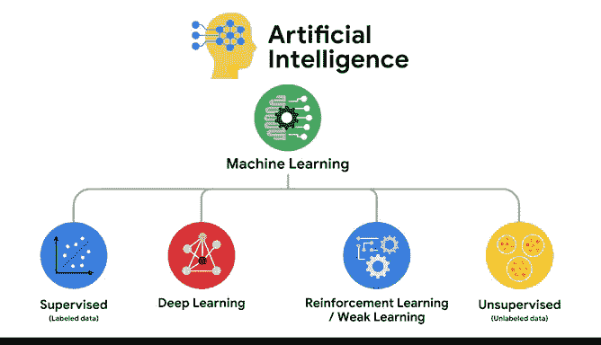

# 谷歌高阶数据分析6：《机器学习的基础知识》the-nuts-and-bolts-of-machine-learning（中英双字） - P4：04_01_06_机器学习的主要类型.zh_en - GPT中英字幕课程资源 - BV1GW4y1o794

Earlier in the program， you learned that logistic regression and linear regression have different purposes。

 For example， when you discover data points are grouped into two different categories in a dataset set。

 a straight line may not describe the data very well or be useful as a means of predicting outcomes。

 a logistic regression or sigmoid function is a better fit for a data set like that。

 particularly when new data points are introduced to it。As you've learned。

 linear regression is particularly good for data sets in which data points can be represented with a straight line。

With some data sets， simple regression models may not be sufficient for your analysis。 For example。

 this graph shows a distribution of three classes。 A simple linear regression model wouldn't be very useful if we didn't know what class our observations belonged to。

 and a simple logistic regression model wouldn't be able to predict a problem with three classes。

 This is where data professionals need more complex machine learning。

 But many machine learning models use regression principles as a foundational layer to begin the process of teaching a computer model to make decisions。

Depending on the type of data available and the kind of problem you want to solve。

 you'll probably select one of two machine learning types。

 supervised and unsupervised because supervised learning problems occur more frequently in the workplace。

 Data professionals use this type most often Supervised machine learning uses labeled data sets to train algorithms to classify or predict outcomes。

 Data professionals use supervised machine learning for prediction。

 labelbeled data is data that has been tagged with a label that represents a specific metric。

Property or class identification。 for example， imagine you need an algorithm to predict whether a bird is a penguin or an ostrich based on height。

 You have a data set of heights and an indicator that specified whether that measurement came from a penguin or an ostrich。

 The height value is the X data。 The indicator is the label or the Y data。 Here's another example。

 you own a restaurant。 And you have data on how many customers visit per month and how much revenue you generate per month。

 If X is the number of customers and y is the amount of revenue。

 then you can use an algorithm to predict next month's revenue based on the number of projected customers。

 whether you're measuring birds or predicting revenue。

 you need labeled data for supervised machine learning。 Next。

 think about the terms classify and predict as they apply to supervised learning。

 We can use our bird and restaurant examples to help。

 The bird example requires an algorithm that seeks to classify or collect。

Different types together into categories， classes or groups in the restaurant example about predicting revenue。

 the algorithm's goal is to forecast or estimate a value Given data that is already labeled to summarize supervised machine learning algorithms use data with answers already in it。

 and use it to make more answers either by categorizing or by estimating future data。

As a data professional， you will manually adjust these types of models to meet business needs。

 using your knowledge of data cleaning， statistics and regression， you will learn to train。

 tune and optimize complex models to deliver more accurate results。

 The other most common type of machine learning used by data professionals is unsupervised learning。

 unsupervised machine learning uses algorithms to analyze and cluster unlabeled data sets。

 In this type， data professionals ask the model to give them information without telling the model what the answer should be。

 At this point， you may have an idea of what unlabeled data means。

 Think back to the ostrich example we discussed earlier。

 Unlabeled data would describe a set of flightless birds and not contain any kind of labels。

 tags or categorizations。 When you receive a data set like this。

 The goal is to group the birds by their similarity based on patterns detected by your model without there necessarily being a correct answer。

 Once an algorithm is deployed。 unsupervised learning will manage data。😊。

As it comes in and classify or analyze it。 For example。

 when a news aggregator categorizes an article by topic or a media platform categorizes a video by genre。

 this is done by unsupervised learning algorithms。Later in the program。

 you will learn how these algorithms work on a conceptual level。

 how to implement them and how to apply them to data sets you'll encounter on the job。

 There are a couple of other types of machine learning。

 beside supervised and unsupervised reinforceforment learning is often used in robotics and is based on rewarding or punishing a computer's behaviors。

The computer will take action based on a policy or set of rules that it has learned。

If the action results in a favorable outcome， it will receive a reward in an unfavorable outcome。

 the computer will receive a penalty based on whether it received a reward or a punishment。

 the computer will update its policy， trying to optimize for rewards， or minimize penalties。

 This process will repeat until a satisfactory policy is found。Finally， there is deep learning。

 Deep learning models are made of layers of interconnected nodes。

 Each layer of nodes receive signals from its preceding layer。

 nodes that are activated by the input they receive。

 then pass transformed signals either to another layer or to a final output。😊。

Another term you often hear in connection with machine learning is artificial intelligence。

 Artific intelligence includes all types of machine learning。

 so we won't rely on the term for the purposes of this course。 Instead。

 will focus on supervised and unsupervised learning。

 These are the most common applications of machine learning。

 and having strong skills in these domains is valuable to potential employers。

 Supervised and unsupervised learning， use many of the same principles as reinforcement learning and deep learning。

 So you'll have the foundation you need to explore these topics further on your own。 Now。

 you're familiar with the machine learning landscape。 In this course。

 machine learning falls under the scope of artificial intelligence， which is illustrated on this map。

😊，Machine learning and artificial intelligence refer to the same principle。

 training a computer to detect patterns and data without being explicitly programmed to do so。

Under the category of machine learning， you'll also find all the other types of learning we've discussed Finally。

 there is one aspect of machine learning and data science that every data professional should know。

Quality is more important than quantity。 A small amount of diverse and representative data is often more valuable for data professionals than a large amount of biased and unrepresentative data。

