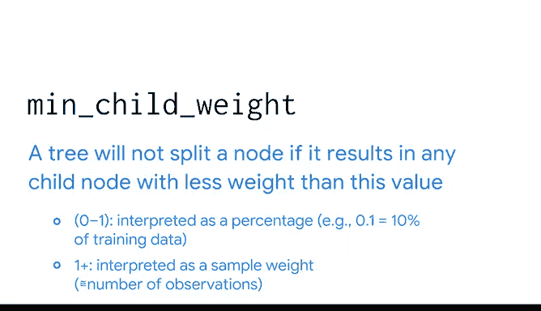

# 谷歌高阶数据分析6：《机器学习的基础知识》the-nuts-and-bolts-of-machine-learning（中英双字） - P50：50_04_04_调整GBM模型.zh_en - GPT中英字幕课程资源 - BV1GW4y1o794

There are numerous machine learning packages that include implementations of the boosting models we examined earlier。

 Most of them have many of the same tunable hyperparameters as decision trees。

 because the most popular ones use tree based learners。

They are also similar to random forests in that they have additional hyperparameters that control the ensemble as a whole。

 This video will explore some of these hyperparameters。

 So you'll be able to assemble models that fit well to your data and make accurate predictions。

 The implementation of GBM modeling that well be using from this point on， is called X G boost。

 X G boost stands for extreme gradient boosting。 X G boost is used widely in the field of predictive modeling。

 and as a data professional， you're likely to encounter it frequently。 If you work with models。

 Pci kit learn has its own GBM implementation， which is similar。😊。

But XG Boost is a commonly used gradient boosting package that has many useful optimizations。

These optimizations include fast training， effective regularization of features and tunable hyperparameters。

 which can improve model predictions。 Let's return to max depth。 As you'll recall。

 this was used both in decision trees and random forests。 It has the same functionality in X G boost。

 which is that it controls how deep each base learner tree will grow。

 The best way to find this value is through cross validation。

 The model's final max depth value is usually low。 Remember， the deeper the tree。

 the more a model learns feature interactions that could be very specific to the training data。

 but may not generalize well to new information。 Even short trees are powerful because of the ensemble。

 typicaly values for max depth are 2 through 10。 but this depends on the number of features and observations in the data。

 The second hyperparameter is N estimators。 which is the number of estimators or maximum number of base learners that the ensemble will grow。

 This is best determined using grid search。 for smaller data set。😊。

More trees may be better than fewer for very large dataset sets。 The opposite could be true。

 Typical ranges are between 50 and 500。 Now， let's investigate some hyperparameters that we haven't used before。

 This first one is very important。 It's called learning rate。

 You'll remember that each time an ensemble builds a new base learner。

 It fits the data to the error from the previous model。 In a basic implementation。

 The predictions of all the trees could then be summed to determine a final prediction。 In this case。

 each tree's prediction is considered equally important to the final prediction。 In practice。

 we use the learning rate to indicate how much weight the model should give to each consecutive base learner's prediction。

 Low learning rates mean that each subsequent tree contributes less to the ensemble's final prediction。

 This helps prevent overcorrection and overfitting。

Another common name for this concept is shrinkage because less and less weight is given to each consecutive tree's prediction in the final ensemble。

Think of it like riding a bike for the first time before you find your balance。

 you might move the handlebar too far in one direction， causing you to veer off course。

 So you need to make an adjustment。 but often you'll over correctrect。

 So you need to shift back the other way。 Each time you correct。

 you move the handlebar less and less until you're traveling smoothly in the direction you want to go。

 This is the same idea as what happens when you slow the learning rate。

 Each correction affects the prediction less than the one before it。 Also。

 if you use a low learning rate， your model will often require more trees to compensate。 Again。

 this is best determine using grid search。Typical values are from 0。01 to 0。3。

 The last hyperparameter we'll examine is very similar to min samples leaf from decision trees。

 but it has a different name。 It's called min child weight。

 A tree will not split a node if it results in any child node with less weight than what you specify in this hyperparameter。

 Instead， the node would become a leaf。 This is a regularization parameter。

 So values that are too high， cause the model to underfi the data。

 The range of this setting is 0 to infinity。 If set between 0 and1。

 the algorithm interprets this as a percentage of your data。 So 0。

1 would mean that a node could not split unless its children each have greater than or equal to 10% of the training observations。

 Generalally， think of values greater than one as being equivalent to the number of observations in a child node。

 So a value of 10 would mean no child node could contain fewer than 10 observations。

We're nearing the end of this course。 and you've learned so much already， As always。

 make the most of course resources and always feel free to return to any of these videos to keep practicing。

😊。

