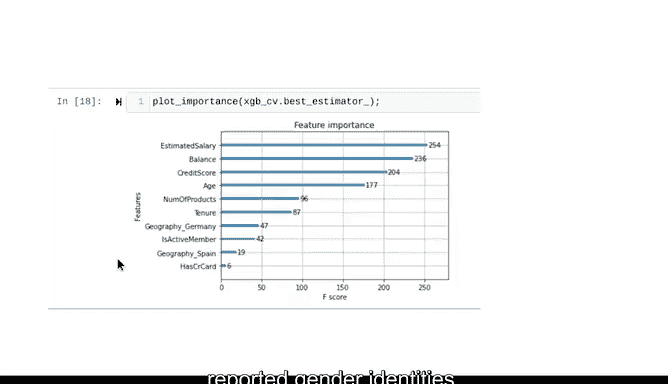

# 谷歌高阶数据分析6：《机器学习的基础知识》the-nuts-and-bolts-of-machine-learning（中英双字） - P51：51_04_06_用Python构建XGBoost模型.zh_en - GPT中英字幕课程资源 - BV1GW4y1o794

In this video， we'll demonstrate how to build and tune an XG boost classification model。

 we'll use this model to compare the performance of all our previous models and select a final one。

Let's return to the bank churn data， I most of the same libraries。

 packages and functions used in previous models， Numpy， pandas， Maplotlib， pickle， all model metrics。

 grid search and train test split。We have two new imports as well。

 XGB classifier and plot importance， both of which come from the XG Bo library。

 Remember that certain columns have been dropped， including customer I and gender。Also。

 the geography column was dummy encoded。Just as before。

 assign features and target data to variables X and Y。

 then use train test split to split it into X train X test， Y train and Y test。

 Stratify based on the target and set the same test size and the same random seed used for previous models。

 This helps ensure a direct comparison when evaluating model performance。 Now， begin modeling。

 Use grid search to tune some hyperparameters。Specifically， focus on max depth， min childil weight。

 learning rate and number of estimators。 Def the values that grid search will permeate as a dictionary called Cv parameterss。

 Next， instantiate the classifier。 Note the objective parameter was set to binary coal and logistic。

 This means that the model is performing a binary classification task that outputs a logistic probability。

 The objective would be different for different kinds of problems。😊，For instance。

 if you are trying to predict more than two classes or performing a linear regression on continuous data。

Now set the random state。Score in the same way as random forest， accuracy， precision。

 recall and F1 score。 And finally， instantiate the grid search。 Remember to set refit to F1。

 as this tells grid search to refit the model that had the best average F1 score when it finishes its search。

 Now， fit the model to the training data。 Use the handy time magic。

 So the cell outputs the time it takes to run。😊，This example scenario took nine minutes and 45 seconds。

Okay， now pickle the model。It's also possible to use models that were built in other notebooks。

 For example， to use the random forest model， import it to this notebook using another with open statement。

 Call it R F underscore C V。 Now， compare the models by using the best score attribute for both the new X G boost model and the random forest model from earlier。

 In this case， X G boost outperformed the cross validated random forest model by a very close margin of just  three00s。

 Now， use the make results function created previously to generate a results table for this model and append it to the overall results table。

 This makes it possible to compare the scores across all models。

 So the results on the F1 column in descending order。

The table clearly shows that our XG Bot model outperformed all other models when measuring on F1 score。

All right。 Now it's time to evaluate how the superior X G boost model performs when making predictions on the test hold out data。

 Use grid search Cv's predict method to make predictions on the X test data and assign the results to the variable。

 Then compare these predictions to the actual values contained in Y test and generate evaluation metrics。

Wow， the model performed better on the test data than on the validation data for all four metrics。

 This is always a possibility， but don't be alarmed if your model performs slightly worse on the test data。

 After all， test data is completely unseen by the model。

Successful data professionals know that a job isn't finished simply because they've produced a model that results in an effective performance metric。

It's equally important to interpret that model and make recommendations based on the findings。

 a confusion matrix is very helpful when assessing a model's variables and features， for instance。

 in our model from the 2500 people in our test data， there are 509 customers who left the bank。

Of those， our model captures 256。The confusion matrix indicates that when the model makes an error。

 it's usually a type 2 error。 In other words， it gives a false negative by failing to predict that a customer will leave。

On the other hand， it makes far fewer type1 errors， which are false positives。

Whether these results are acceptable depends on the costs of the measures taken to prevent a customer from leaving versus the value of retaining them。

In this case， bank leaders may decide that they'd rather have more true positives。

 even if it means also capturing significantly more false positives。 If so。

 perhaps optimizing the models based on their F1 scores is insufficient。

 Maybe we'd retrain them to focus on recall instead。What is certain is that our model helps the bank。

Consider the results if decision makers had done nothing。 In that case。

 they'd expect to lose 509 customers。Alternatively， they could give everybody an incentive to stay。

 That would cost the bank for each of the 2500 customers in our test set。Finally。

 the bank could give incentives at random， say by flipping a coin。

Doing this would incentivize about the same number of true responders as our model selects。

 But the bank would lose a lot of money offering the incentives to people who aren't likely to leave。

 Plus， our model is very good at identifying these customers。

 Another way to help explain our model is by checking the most important features。

 X G boost gives us a very useful function called plot importance to let us observe the relative feature importance of our model。

😊，After we've imported the function， we can use it to output a bar graph by passing to it the best estimator from grid search。

In our model， estimated salary， balance， credit score and age were the top predictors of whether a customer will leave。

 It would probably be useful to return and do another Eda focused on these features At this point。

 you might also want to add back in the gender column as well as a column of your final model's predictions to your original data。

 This would allow you to measure how evenly your model distributed its error across reported gender identities from linear and logistic regression to naive bays decision trees。

 random forest and X G boost。 You're now equipped with a powerful set of tools。

 They'll help you stand out as a professional in the exciting and rewarding data career space。😊。

