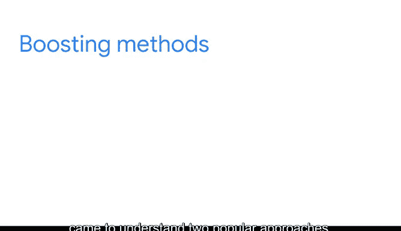

# 谷歌高阶数据分析6：《机器学习的基础知识》the-nuts-and-bolts-of-machine-learning（中英双字） - P52：52_04_01_总结_4.zh_en - GPT中英字幕课程资源 - BV1GW4y1o794

Out of all the models you've learned throughout this program。

 the tree based modeling techniques are going to be some of the ones you'll use most throughout your data journey。

 In this section of the course， you discovered why tree based models are often preferred over other supervised learning techniques such as naive bays and logistic regression。

 from there。 you explored decision trees。 You learned how they worked。

 how to build them and how they're used to make predictions on future events。

 Then you considered hyperparameter tuning with decision trees。

 You learned about max depth and min samples leaf， understanding how changing these hyperparameters affect how the model is trained and。

 in turn， affect your model's performance。 You then explored some more advanced tree based modeling topics such as ensemble learning。

 Two of these techniques in particular， bagging and boosting enabled multiple decision trees to arrive at a model that works better than any one tree ever could。

 You implemented one of the most popular bagging methods。 randomand forests。

 and observed how this technique compares to single decision trees。😊。

Then you learned several boosting methods and came to understand two popular approaches。

 adaptive boosting and gradient boosting After learning their differences and unique advantages。

 you implemented them in Python and again witnessed how they compared to random forests and single decision trees。

And for each of these ensembling methods， you discovered how hyperparameter tuning can come into play。

Whereas this made relatively minor differences and improvements with the single decision trees。

 you observed how tuning hyperparameters， such as learning rate and N estimators can take an ensemble learning model from good to great。

 These models are some of the most cutting edge in data science today。

 The skills you gain with these tools will absolutely make you stand out to potential employers。

 What you've learned will also expand your data science education and serve as a launchpa for you to really boost into the data world。

😊。

