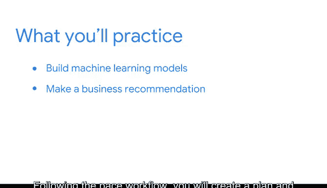

# 谷歌高阶数据分析6：《机器学习的基础知识》the-nuts-and-bolts-of-machine-learning（中英双字） - P53：53_05_01_欢迎来到模块5.zh_en - GPT中英字幕课程资源 - BV1GW4y1o794

Hi， it's great to be with you again。You might recognize me from the last course， I'm Tiffany。

 and it's time again to complete a portfolio project and apply what you've learned throughout this course。

Just as in the earlier courses， this portfolio project will guide you to complete several tasks and create artifacts that showcase your skills。

During interviews， you may be asked questions to test your understanding of different machine learning models。

Also， having projects on your resume can help you stand out to a hiring manager who may invite you to complete an interview。

During the interview， you can rely on your portfolio to discuss data science in general or explain modeling strategies more specifically。

In order to complete the portfolio project， you'll be presented with details about some business cases。

Choose one and use the instructions to complete a new entry in your PA strategy document and create machine learning models to solve the problem。

By the time you complete this project， you'll have machine learning models that you can add to your portfolio。

At this point， you're almost finished with this course and you have learned everything you need to complete this project and you're well on your way to advancing your career as a data professional。

In this project， you will solve a data problem using the models you learned in this course and then make a business recommendation following the pace workflow。

 you will create a plan and communicate your process for completing the project。

Ready。😊，Then let's get started。