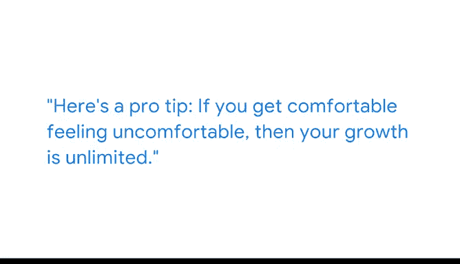

# 谷歌高阶数据分析6：《机器学习的基础知识》the-nuts-and-bolts-of-machine-learning（中英双字） - P54：54_05_02_Uri-用独特解决方案打动面试官.zh_en - GPT中英字幕课程资源 - BV1GW4y1o794

I'm Muie， I lead analytical teams in Google， leading data scientists and product analysts。So。

 I've interviewed。North of 500 people over the years。Always what I look for is problem solving。

 Often， I'll ask you about a project you did。 And you know， we're going to drill down。

 I'm going to ask you details。😊，And it's going to be something you've spent time with， right。

 You've went back and forth。 If you look at it from a different angle。

And I always want to see that I thinking about it as a few seconds， as you tell me about it。

 cannot come up with better answer than you。So always pick the ones that you know very well and you can almost teach me。

Give you some new insight about it。That is not obvious。 If you can teach me something new。

 that's a magical moment for me。 What you really want to show is that。You can solve problems， right。

 You took something， You kind of thought it through and you come up with something that is original。

 and you can communicate it out。I want to see you framing a problem。 Framing is about what is best。

 How do I measure it， How do I find data to help me。So you have to focus。

 I want to see that your project focus on something that is interesting and。Very importantly。

 this has to be communicated out and the best thing in my mind is visualization。

 You want to show how all of this translate to something that I understand。

 If you can kind of bring forward something nobody else did or explain it in a unique way。

 that's always going to stand out。Here's what I always look for。 Simple solutions to a heart problem。

If it's too hard。No I can do anything with it。 So simple solutions。Not obvious one。

 simple ones that are really a solution to a hard problem。Here's a pro tip。

 If you get comfortable feeling uncomfortable。Then your growth is unlimited。

 That's where you want to be。 Thats that means that you're stepping out of your comfort zone and doing the stuff that matters。

