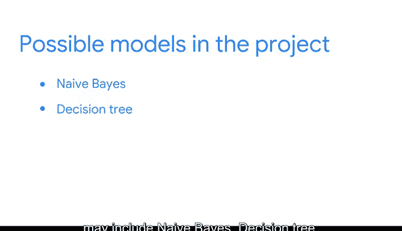

# 谷歌高阶数据分析6：《机器学习的基础知识》the-nuts-and-bolts-of-machine-learning（中英双字） - P55：55_05_03_课程6期末项目介绍.zh_en - GPT中英字幕课程资源 - BV1GW4y1o794

In this course， you learned about supervised and unsupervised machine learning models。

 how they work and how to build them in Python。In the previous course， you practice building。

 interpreting and evaluating regression models Up to this point。

 you've also been working hard to develop skills with Python data visualizations and statistics， too。

Now it's time to compile all of that knowledge as you complete this portfolio project。

Here you'll be presented with a business problem and a data set。

You will then go through the pace workflow to create a plan。 build machine learning models。

 document your work and select the model that would be the best solution to the problem。

All the models you build will be models that you learned in this course and may include nay， Bayase。

 decision tree， random forest， X G boost， and even Kmins。

You'll also select an appropriate evaluation metric to gauge your model's performance。

As you learned in this course， data professionals analyze and discover patterns and data。

 which inform the most appropriate models that are needed to solve business problems。

Then they communicate about their work and recommendations to colleagues and stakeholders。

And remember， building these models will require a bit of patience。

 You've done an excellent job developing your skills。

 and they will definitely be useful as you complete this project。

Please feel free to return to any of the other videos and course materials if you need a refresher on any of the content。

