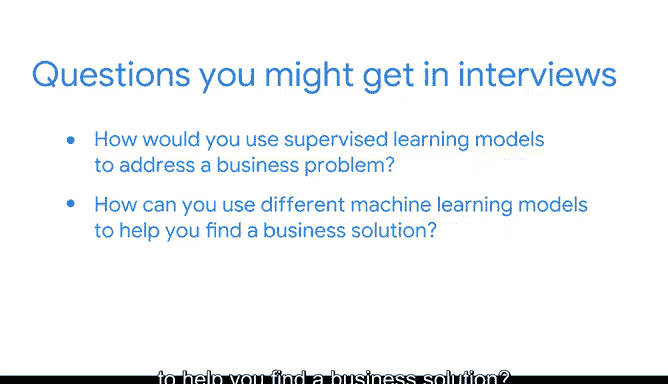

# 谷歌高阶数据分析6：《机器学习的基础知识》the-nuts-and-bolts-of-machine-learning（中英双字） - P56：56_05_01_期末项目总结与持续职业成功建议.zh_en - GPT中英字幕课程资源 - BV1GW4y1o794

At this point in your program progress， you've covered so many topics。

 everything from understanding the data career space to Python， visualizations， statistics。

 modeling and more。Your portfolio includes machine learning models on a data set to solve a problem。

 and your pace strategy document has a new entry where you explain your work at each stage of the process。

Through every step of this program， you created a number of artifacts to add to your portfolio that demonstrate your knowledge and skills。

There is so much to be proud of。There are multiple ways you can highlight your work and explain what you've done to potential employers and hiring managers in future interviews。

As I've mentioned previously， you'll want to dedicate interview time to talking about the tools you've learned about。

 the transferable skills you've developed and the experiences you've had in this program。

As a data professional， you may be asked to learn and adapt to new tools on the job。

 just as we have illustrated in this program。There are a lot of great tools out there。

 and different businesses use different tools and skills， depending on their needs。

As you apply for jobs， keep in mind that you have learned a lot of transferable skills that can be applied across different tools。

In this course， we discuss the importance of determining the most appropriate models to use based on the problem you' are solving and data available。

Along the way， you discovered you can use different machine learning models to help find a business solution。

And you acknowledged that it's important to explain your process when working with machine learning models。

During an interview， it may be the case that you are asked。

 how would you use supervised learning models to address a business problem。

How can you use different machine learning models to help you find a business solution？

Why is it important to explain your process when working with machine learning models？

I encourage you to consider what you have learned in this program to begin answering these questions。

Of course， there will likely be other points of discussion in the interview as well。

In this portfolio project that you just completed， you built different machine learning models using Python。

These models helped identify potential solutions to a unique business challenge。 Additionally。

 you recorded a new entry in your pace strategy document that details your thoughts。

 considerations and process steps for this project。

I'll also highlight that this project built upon the knowledge you developed as you progress through this program。

Now you're prepared to perform the tasks and responsibilities of a data professional。As a reminder。

 your interviewers have a business challenge， just like stakeholders and data projects。

They have an open job position。 they need to fill。Think about what they need to know about you to make a decision that solves that business challenge。

 just like you've been practicing in each portfolio project。Coming up in the capstone course。

 you'll bring together all of the content and skills from across the program and apply them in one project。

This will be an opportunity to apply skills from each of the portfolio projects in the earlier courses to solve a new business problem。

This will provide you with even more artifacts to add to your portfolio。

