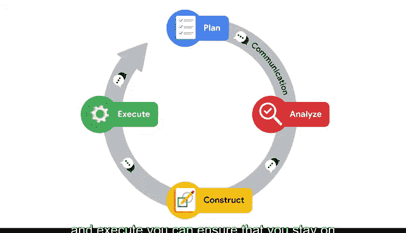

# 谷歌高阶数据分析6：《机器学习的基础知识》the-nuts-and-bolts-of-machine-learning（中英双字） - P57：57_05_02_课程总结.zh_en - GPT中英字幕课程资源 - BV1GW4y1o794

Congratulations， you just finished the final instructive portion of the program。

 and you're ready to move on to your capstone project。

 You've learned a whole lot throughout this final section。

 and you're now ready to take this new knowledge and move on in your data journey。

 whether your next steps are to continue your education or take what you've learned into industry。

 You now have a comprehensive foundation to build on or use。😊。

We started this section learning about the foundations of machine learning with a focus on the different types of models that are available to a data professional。

 You saw how different types of business needs require different types of models。 Additionally。

 you learned about recommendation systems and many of the most common use cases for these types of models。

 along with the different popular techniques and their advantages and disadvantages。 From there。

 you started building out your machine learning tool belt。

 Different integrated development environments， types of Python files and data oriented Python packages together give you the tools you need to approach any data driven problem。

The pace workflow is the framework in which you can put those tools to use by taking the time to follow the steps of plan。

 analyze， construct and execute， you can ensure that you stay on track to produce a model that will deliver meaningful results。

 The plan stage involved taking a close look at the business need and the data available and determining what type of model would be appropriate in the analyze stage。

 you applied many of the exploratory data analysis principles that you learned earlier in the program。

Additionally， you learned about a new subset of techniques called feature engineering that allow you to manipulate and prepare your data for modeling in a variety of ways。

 The construct stage introduced you to a new type of supervised classification model。 naive bay。

 you learned about and built this model， along with applying evaluation metrics to gauge the performance of the model。

 Finally， in the execute stage， you performed any needed validation techniques。

 further evaluated the model and made any needed tweaks to get the most performance out of it。😊，Next。

 you took a deeper look at unsupervised learning models。

 K means is one of the most widely used unsupervised learning techniques。

 And in this part of the program， you built a K means model and used common evaluation techniques to fully understand its results。

 Finally， you learned about tree based modeling。 tree based techniques are some of the most effective models that currently exist in the industry。

 You saw how single decision trees work， learning how they function conceptually。

 along with building one for yourself。 With this foundation。

 you were introduced to two ensembling techniques， Baging and boosting。😊，Within tree based modeling。

 you saw one of the most important aspects of using advanced machine learning techniques。

 Hyperparameter tuning is essential for building models in industry。

 allowing you to optimize models to fit your specific needs。In the next section。

 you'll be taking everything you learned throughout the entire program and applying it to a capstone project that will be an invaluable piece of your portfolio。

 See you soon。😊。