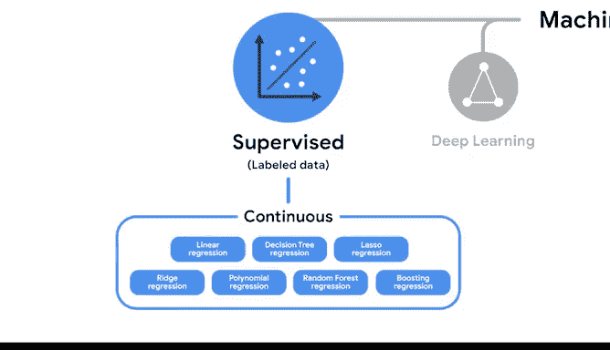

# 谷歌高阶数据分析6：《机器学习的基础知识》the-nuts-and-bolts-of-machine-learning（中英双字） - P5：05_01_01_确定特征何时为无限.zh_en - GPT中英字幕课程资源 - BV1GW4y1o794

The concept of infinity can be difficult to comprehend。

 whether we're cooking a meal or reading a book， Most activities humans partake in have a beginning。

 middle and end。In other words， they're finite。But as you've learned from previous courses。

 we data professionals deal with infinity all the time。

 and this is also true when building complex models。As you learned earlier in the program。

 continuous features can take on an infinite and uncountable set of values。

Understanding this concept is critical when selecting a machine learning model and choosing the measurements to check that model's utility。

Imagine you own a citrus tree farm and you want to learn the average weight of this year's yield of cuquats。

 The entire yield or population is 100 bushels。Using simple random sampling。

 you pull three cu quats from each bushel and weigh them individually。

The recorded individual weights of all these coquats are considered continuous data because the possible value of one comquat is infinite and uncountable。

 In other words， one coquat doesn't weigh 15 G。 exactly。 and out of the 300 coquts you weighed。

 Their weights may have been measured to 2 decimal places， like 15。76，16。09 and 15。56。

 but the measurement is continuous because the weights could be any infinite number between those measured points。

 like 15。762950。Simply put weight is a continuous feature because it has an uncountable set of possible values。

 Conversely， the total number of Comquats in your 100 bushels has a fixed quantity。 because of this。

 the total number of Comquats is not a continuous feature as a data professional knowing whether the features you input into a machine learning algorithm are continuous or fixed will be essential to choosing the correct model and the evaluation metric for that model。

Recognizing whether data features are continuous is not the only indicator to consider when deciding which machine learning model to use。

 but it is a very helpful one。Here's our machine learning map again。

 with some new information added to it。 beneath supervised。

 you find a block of models used to predict continuous outcomes， including several regressors。

Supervised learning models that make predictions that are on a continuum are called regression algorithms。

 Some of these models were introduced earlier in the program。

 Others will be defined later in the course。 For now。

 just know that data professionals use these types of models to work with continuous data。

The goal of these models is to predict outcomes or values based on the dataset sets provided。

The nature of a data professional's job in this case is to train the model to predict the values as accurately as possible。

 and that's what you'll learn coming up meet you there。

