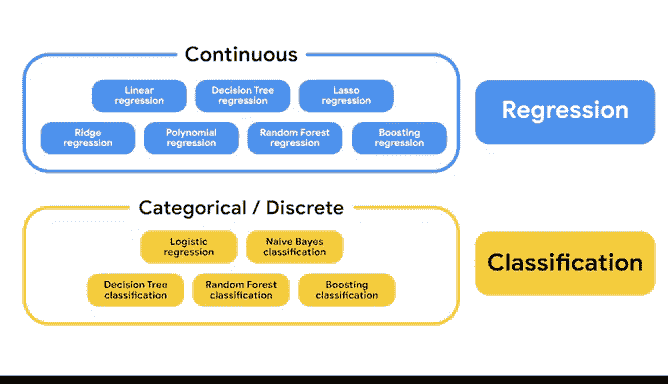

# 谷歌高阶数据分析6：《机器学习的基础知识》the-nuts-and-bolts-of-machine-learning（中英双字） - P6：06_01_02_分类特征与分类模型.zh_en - GPT中英字幕课程资源 - BV1GW4y1o794

Sorting candies by size and shape and color is pretty simple。

 So it may seem like teaching a machine to sort wouldn't be that difficult。

 whether or not a particular model is appropriate for a problem like sorting by characteristic is largely determined by what type of variable it must predict。

In this video， we'll review a few types of variables that are helpful for determining the right supervised machine learning model for your data。

As a reminder， continuous variables are variables that can take on an infinite and uncountable set of values。

 On the other hand， categorical variables and discrete variables are not continuous by nature。

 Rather， categorical variables contain a finite number of groups or categories。 For example。

 you might use a categorical variable to classify a vehicle type like car， motorbike or bus。Next。

 there are discrete variables which have a countable number of values between any two given values。

 In this way， discrete variables are unlike continuous variables。

 which are uncountable and have an infinite set of values。

 So the height of a tree is a continuous variable。 But the number of trees in a park is a discrete variable。

Discrete variables are able to be counted， and categorical variables are able to be grouped。

 For example， the paint color of a house is categorical。

 While the number of houses in a neighborhood painted lavender is discreet。😊。

Recall the definition of supervised machine learning。

 a category of machine learning that uses labeled data sets to train algorithms to classify or predict outcomes。

Categorical， classification and discrete variables are a part of that supervised learning definition。

Many machine learning algorithms are trained using large data sets that group data inputs into two or more groups。

Knowing what types of features you have in a data set and what outcomes you're looking for will help you to determine the most applicable machine learning model。

Let's consider an example from the manufacturing sector。

 You are the lead data scientist at a stuffed animal manufacturer。

 You're lucky to have an automated system which stuffs， stitches and tags。

 plush cats and dogs at the same time。The system was set up that way because the stuffed animals are sold in packs of two。

 one cat and one dog。But now， the retailer is requesting that cats and dogs be sold separately。

Rather than buying new parts to update the machine。

 the plant manager asks you to use a camera to identify the cats and dogs so they can be separated automatically。

The algorithm for grouping the cats and dogs based on images from a camera would use categorical data as part of a supervised machine learning model。

 The algorithm will ask， is this a dog or a cat。You'll train the computer using the visual data to recognize and separate the incoming dogs and cats。

With that problem solved， you're asked to build a model to predict how many shipping containers are needed to ship all of the stuffed animals。

This has a discrete target variable because you're counting a number of containers。 Now。

 let's revisit our machine learning map with the newly added categorical area。

 You'll find a few new terms。Classification is the broad category under which logistic regression。

 decision tree classifiers， naive bayes classifiers and some others reside。

 Notice that the decision tree， random forest and boosting models are present in both the continuous area and the categorical area as both regressors and classifiers。

Just like any other field of study， there are functions and applications which can't be categorized into just one group。

As you continue to develop your understanding of these models。

 the placement in both areas will make more sense。 We'll spend more time on these algorithms later in the course。

 And pretty soon， you'll be building some models of your own。

