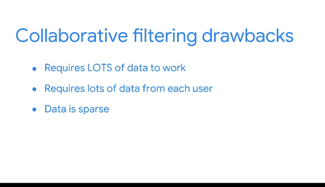

# 谷歌高阶数据分析6：《机器学习的基础知识》the-nuts-and-bolts-of-machine-learning（中英双字） - P7：07_01_01_用推荐系统引导用户兴趣.zh_en - GPT中英字幕课程资源 - BV1GW4y1o794

Now that you understand the different types of features used in machine learning models。

 let's investigate how they can be used together in a type of model you're likely very familiar with。

Have you ever been streaming your favorite new album？ And when you reach the end。

 something entirely new begins to play。 You've never heard it before， but you really like it。😊。

How did your streaming service do such a good job choosing a new song for you。

It used a recommendation system。Recommendation systems are a subclass of machine learning algorithms that offer relevant suggestions to users。

And as you probably realize， theyre everywhere。Just about any website or app that matches you with something。

 whether it's an outfit to wear or a recipe to cook， most likely uses a recommendation system。

The main goal of a recommendation system is to quantify how similar one thing is to another and use this information to suggest a closely related option。

 In this way， recommendation systems make it easier for users to find and connect with information。

 products and content that's relevant and enjoyable。 Let's examine how this works。😊，First。

 you selected a song on the music streaming service。 Then when the song ended。

 the service played more music related to your initial choice。

 This is an example of content based filtering in which comparisons are made based on attributes of content itself。

😊，In this case， attributes of the music you played are compared to attributes of other music to determine similarity。

To make this comparison， there must be data about each song that's a deconstruction of its attributes。

In other words， everything that makes the song unique is identified and labeled。

 like the artist's voice type， the rhythm or beat， or whether a certain instrument is featured。

 Then when you search for a song， the content based recommendation system will access the list of attributes for that song and every other song in its library。

😊，Finally， the system will compare them all using the same list of attributes。

 Good song recommendation systems compare hundreds of attributes。

 Content based filtering has benefits and drawbacks。

 Some of the benefits are that they're easy to understand。

 They help recommend more of what a user likes。 even niche things that few others are interested in。

 and they don't need information from any other users's to work。

 Another advantage is that the filtering is not limited to comparing items like songs。

 They can map users and items in the same space and then recommend things that are closest to a user's typical preferences。

😊，Interestingly， sometimes a benefit can also be a drawback and vice versa。 For instance。

 the fact that content based systems always recommend more of the same type of thing can be a drawback。

 Users won't be introduced to something that diverges from what they've selected in the past or learned something new。

😊，Another disadvantage is that the attributes often have to be selected and mapped manually for all the items。

 which is an enormous amount of work。Finally， content based filtering is ineffective at making recommendations across content types because the different content types don't use the same features。

For instance， a book doesn't have beats per minute。

 so the same streaming service won't be able to use your song preferences to recommend a new novel。

 so the use cases can be limited。Note that in this music streaming example。

 you didn't actually rate anything。 You just listened to your playlist and the algorithm found similar songs。

When you stream videos， on the other hand， you might rate or review something when you like it。

The recommendation system can also use your feedback to suggest other videos you might like。

In the video streaming example， you both viewed and actively participated in the feedback process by liking the videos you enjoyed。

 A drawback of this method of recommendation is that you probably like videos about various topics。

 but the system will use your feedback to only suggest similar videos to the ones you liked。😊。

Here's another example of how recommendation systems work based on your feedback called collaborativellabor Fing。

When a user actively likes content by rating it or giving it a good review。

 it leads to collaborative filtering， a recommendation system will use collaborative filtering to make comparisons based on who else liked the content。

Then it will suggest videos to someone else with similar preferences。

Collaborative filtering is different from content based filtering in that the recommendation system doesn't need to know anything about the content itself。

 All that matters is if you liked it。 It's a different flavor of recommendation system。😊。

Which brings me to ice cream。Perhaps we want to know which ice cream flavors David will enjoy。

A collaborative filtering system would compare past items that he has liked to what other people have liked。

 And because David's likes and dislikes are very similar to Fatias。

 The algorithm will predict that he'll enjoy Fudge Brownie， because Fatima does。😊。

Collaborative filtering works regardless of what the items are。 The flavors don't matter。

 It doesn't even matter that it's ice cream。 It could be cars or restaurants or hair products。

 All that matters is that David and Fatima have similar tastes。

The ability to recommend across content types is one of the main advantages of collaborative filtering。

 Other benefits are that it finds hidden correlations in the data。

 and it doesn't require tedious manual mapping。 Drawbacks of collaborative filtering are that these systems need lots of data to even start getting useful results。

 And every user must give the system lots of data。 Also， Collab filtering data is very sparse。

 which means it has a lot of missing values。 Let's use movies as an example。

 There are hundreds of thousands of movies in existence。

 but most people have only viewed a small fraction of them。

 So each person's movie data would have missing values for all the movies they haven't experienced。

A recommendation system would need to use advanced filtering techniques to manage all that empty space。

Most recommendation systems are highly complex and use hybridized models that make use of elements from both content based and collaborative filtering。

 But even in the simplest use cases， there are different needs。

 resources and strategies available for data professionals to use。

And it's the data professionals's job to recommend the best problem solving approach。

