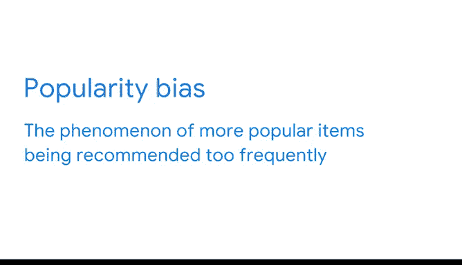
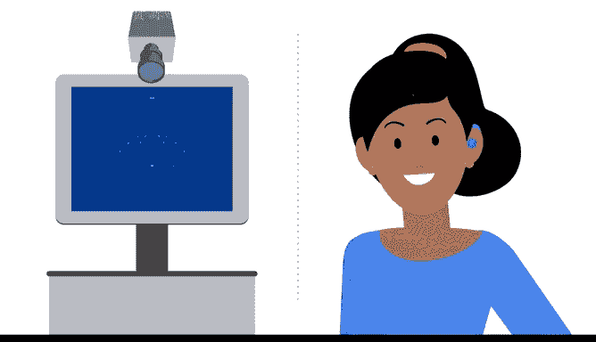
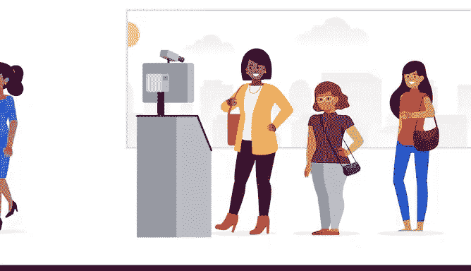

# 谷歌高阶数据分析6：《机器学习的基础知识》the-nuts-and-bolts-of-machine-learning（中英双字） - P8：08_01_01_机器学习中的公平与公正.zh_en - GPT中英字幕课程资源 - BV1GW4y1o794

Recently， you learned about recommendation algorithms and how they help users discover everything from new music to stream。

 to new hair care products to try， or new games to play with friends and family。

These algorithms can be extremely accurate， but。They can also miss the mark。For example。

 one limitation of recommendation tools is the problem of popularity bias。

 which is the phenomenon of more popular items being recommended too frequently。

 This leaves the majority of other items， which might be just as pleasing to users not getting the attention they deserve。

As machine learning becomes more accessible and its power applied to an ever broadening set of challenges。

 there's greater potential for models to have unintended and even harmful consequences。

So as a data professional， it's important that you prioritize fairness in the data that you have and use。

Part of this responsible data stewardship is taking steps to reduce the potential of unintended consequences of your machine learning applications。

Data professionals must also consider risk。They may need to make decisions that could expose a business and the people it serves to negative consequences。

Recognizing the potential for bias will help to minimize risk。

Bias in machine learning is particularly deceptive because it stems from human bias。

 but because a computer makes the prediction， it's easy for the result to seem objective。 Often。

 the bias is unintentional。 Let's consider an example of creating an unintentionally unethical model。

 Suppose you're building a facial recognition model to deploy as part of a service for a sunglasses retailer。

To generate a database of facial templates， you recruit people in your office to have their faces scanned。

Eventually， you have several hundred scans， which you think should be plenty to generate the templates you need。

You're excited to test what you've made， so you ask people from another department to act as a test group。

The test results exceed your expectations。 You even make the project open source so others can use it and build on it。

 But then the service goes live。 And it's not performing nearly as well as expected。

 One reason might be that you didn't consider the full range of people who would be using the service。

 If all the people you used to generate the templates were， say older than 30。

 perhaps the service didn't work well on young adults。

 or maybe you used far more people on one end of the gender spectrum。

Since your work was released to the public。 Other people might now be using your templates in their own models without realizing that there could be a problem with the template and the facial recognition model。

 None of this was caused by bad intentions。 The negative consequences were the result of bias in the training data。

 which was inherited from bias in the data collection process。 specifically。

 the faces used to generate the template didn't represent a wide enough variety of people。

 By using this repository to build your model。 You ended up with a data set with a data class imbalance。

In other words， the input data was biased before the modeling even began。

 This is just one example of how machine learning solutions have the potential to carry with them unintended consequences related to equity and fairness。

You'll learn about other examples later in this course。

You'll also learn some fundamental questions you can ask at each step of the modeling process to help reduce the risk of a model causing harm。

