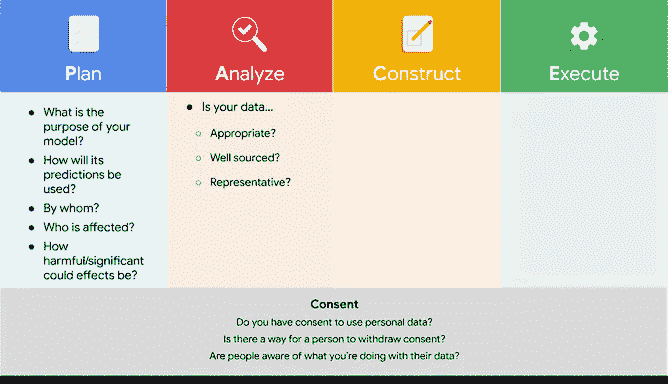
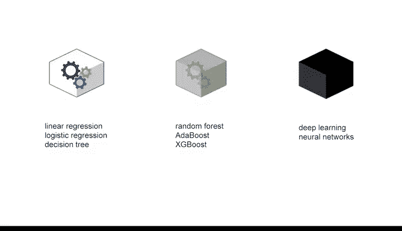
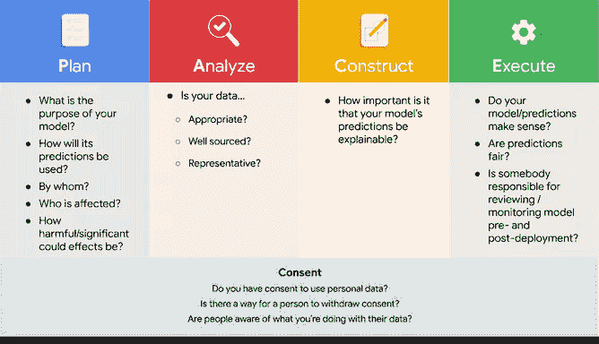

# 谷歌高阶数据分析6：《机器学习的基础知识》the-nuts-and-bolts-of-machine-learning（中英双字） - P9：09_01_02_构建伦理模型.zh_en - GPT中英字幕课程资源 - BV1GW4y1o794

Predictive models are central to machine learning and have the potential to do a lot of good。

 But with that potential comes risk。Therefore， it's critical for data professionals to ensure that their models are ethical。

First， let's consider what that means。 There's no simple guide for this。

 because there are so many different kinds of models that are applied to a variety of tasks。

As a data professional at any level， you'll probably have to make decisions about models that carry ethical implications。

 no matter what problem you're trying to solve。Nonetheless。

 it's always important to ask questions that help you consider the fairness of your model。

Let's explore some of the questions that you should ask during the planning stage of model development。

Right away， you should ask yourself what the intended purpose of the model is。

 How will its predictions be used and by whom， who is affected by the model and how harmful or significant could the effects be。

If your model uses personal information， have these people given their consent for you to collect and use this data。

 Is there a way for them to withdraw their consent。

Are they aware of what you're doing with their information？

A common application of machine learning is making predictions of merit。

 Who is eligible to receive something。 It may be a loan admission to a university or access to government services。

 These are ethically sensitive situations because models that make these predictions affect people's lives。

If you are designing a model to predict whether a bank should issue someone loan。

 who will use that information。What could happen if the model is wrong。

 What are the long term consequences if the loan is denied。Once you've considered these questions。

 the next step is to analyze the data。 this step carries its own set of questions。

 You must ask whether the data you intend to use to build your model is appropriate。

 Well sourced and representative。 to continue our example。 Does your loan data go back many years。

 If so， it's likely that marginalized and oppressed classes are underrepresented in the data。

 because previous measurements were influenced by bias or prejudice。

 There's a common saying in data science。 garbage in， garbage out。

 If there are problems with your data， then there will be problems with your predictions。

After you've planned your process and analyzed the data。

 it's time to construct the model and ask additional questions。 For instance。

 is it important that the model's predictions be explainable with some modeling methodologies。

 It may be difficult to know where the predictions came from。

 This is sometimes known as a black box model。

Neural networks are widely known for being difficult to explain， and therefore。

 they're not appropriate for many applications where transparency is important。

Algorithms like random For， add a boost， and XG boost aren't completely black box。

 but they may require additional efforts to explain and justify their predictions。

At the other end of the spectrum， linear and logistic regression methods are highly explainable。

 So are single decision trees。 Once you've planned everything out。

 analyze the data and built your model， there are more questions to ask before you complete the execute phase。

 First of all， ask yourself if you understand your model in its predictions。 Do they make sense。

 Are the predictions fair。 One way of evaluating model fairness is by checking to see how the model's error is distributed over a population。

 If the model only makes errors in particular cases that are similar。

 it could carry higher ethical risk。

Another question to ask is whether someone is assigned the responsibility of reviewing and monitoring the model。

 both pre and post deployment， to make sure it's performing well and to assess the potential for harm。

 Finally， make sure you're considering the issue of consent at each stage of the pace process。

As you can appreciate， there are a lot of questions to ask to ensure ethical model development。

 Few data professionals will be responsible for answering all these questions themselves。

 but nearly every data professional must answer some of them。

 So it's important for you to always keep in mind When you ask the right questions at each stage of the pace workflow。

 You help to ensure your models are good for business and good for everyone involved。

