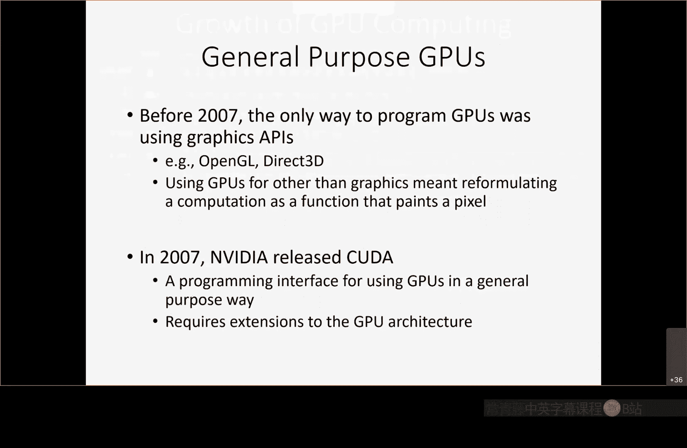
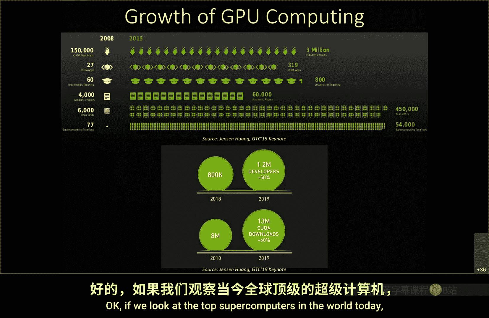
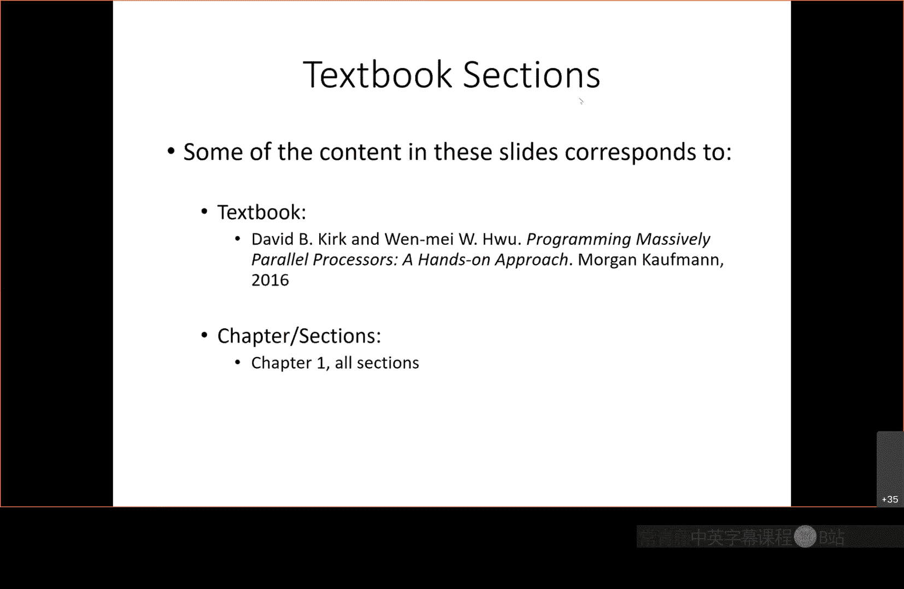

# 贝鲁特美国大学【中英⚡GPU计算｜CMPS 297S Spring 2021, GPU Computing】 p01 P1 引言 -BV1LD6BBPEjt_p1-

Hello everyone and welcome to our first lecture of Me This course is about GPU computing as you all know。

 and today I'm going to be giving kind of an introduction and a motivation for why GPU computing emerged and you know what is GPU computing and next time hopefully will get started with with the kind of learning about GPUs and writing GPU programs and things like that Okay let's get started and to start off。

 I want to talk a little bit about the history of how computers or computer technology has evolved over the past half a year。

 half a half a century。So we have a lot of EC students here and then also I know the computer science students should also be familiar with this so how many of you here know or remember what Moore's law is？

😊，An sister density in doubles every year。 It was。 it was every year。

 but then changed to every two years。 But now it's reachinging its end the。Right， exactly。

So Mooreore's law， it's not really a law the physics people with us probably cringe when they hear us calling it a law。

 it's not really a law it's more of a prediction， so it's a prediction that was made by Gordon Moore who was one of the cofounders of Intel and what Gordon Moore predicted is that and he made this prediction you know。

 early on he predicted that the number of transistors per unit area would double。

Every 18 to 24 months。 Okay， this was his prediction。

 He certainly did not intend for his prediction to last as long as it did。

 but it was kind of a self fulfilling prophecy and， you know。

 semiconductor companies started putting this as their target and and and so it was that over the past half a century。

 we've seen that the number of transistors per unit area has indeed been doubling every 18 to 24 months。

 Now， as as one of your colleagues has pointed out， this trend is coming to an end because we。

We are we are kind of coming close you know， these transistor devices are getting smaller and smaller。

 so they're getting to a point where they're just too small for us to be able to make them any smaller。

Nevertheless， because the transistors， the number of transistors have been doubling。

 the number of transistors we can fit per unit area has been doubling every 1824 months。

 when these transistors get smaller， it actually becomes easier and easier to switch them on and off faster。

And because it's easier to switch them on and off faster。

 what that means is we can increase the clock frequency in our processors faster。

 and that is why the processor frequency followed a similar trend where the frequency at which we were able to drive our processors also doubled every 18 to 24 months。

 and that continued up until you know 2005。 So in 2005。

 we kept on getting more and more transistors per area。

 the transistors kept on getting smaller and smaller。

 but we could no longer switch them on and off or we stopped to switch them them on and off faster。

 we stopped doubling our frequency every every 1824 months。 anybody knows why。😊。

I it because of the power power rule limitation， something like that， Right， exactly。

 It was because of power。 So when you switch transistors on and off faster。

 you're going burn more power。 And what's the problem with power with burning more power。Grated it。

Generates heat right exactly。 And what's the problem with heat。It nets the CPU。

Exactly the problem with heat is that if you don't cool it it mounts the CPU so what happened was that the reason that the frequency stagnated is because the CPUs got so hot that we could no longer our cooling technology was unable to cool them if we went beyond this。

😊，So in around 2005， what happened is we kept on getting more and more transistors on the chip。

But we could no longer switch these transistors on and off faster。So before 2005。

 if you bought a computer， you wrote a program to run on that computer。

 if you buy another computer two years later， that program is twice as fast without you having to do anything because the frequency was twice as fast。

But after 2005， simply running the same program on a newer computer you no longer gave you twice the speedup。

Now we still were getting a little bit more speed up， so the single thread performance。

 the single thread performance did not completely stagnate like the frequency did， it did increase。

 it did keep increasing。 it just didn't increase the rate that it was increasing before。😊。

And the reason the single TE performance kept on increasing is for two reasons。

 the first reason is compiler advancements， so compiler technology became more and more advanced and compilers were becoming better and better at optimizing code。

 but another reason is all these extra transistors that we were getting right so these extra transistors that we were getting。

 even though switch them faster， the fact that we had more transistors meant we could afford to do more and more sophisticated hardware techniques to get our threads to execute fast。

😊，And those of you who have taken advanced computer architecture courses are probably familiar with some of these techniques。

ulative all of these different speculative execution techniques like branch prediction out of order execution。

 ettera。😊，Okay， so so we kept on getting single threat performance。

 but you know it wasn't that that increase was no longer as dramatic as it was before what and because of this stagnation in single threat performance。

 we were getting more transistors but we were not getting that much better at performance。

 so what did people start doing with these transistors is more trans that we were getting that we can cannot switch faster。

Right exactly so around this time when we had the stagnation and frequency。

 this is where we saw an explosion and the number of cores on chips so this is where processors or mainstream processors of course we had parallel processors before this。

 but mainstream parallel processors this is the point where they switched from being single core processors where you just have one core in your processor or like one data path that's executing instructions to a large number of cores so this was the explosion of parallel computing stagnation and single type performance made parallel computing mainstream。

😊，And hardware designers started investing more cores into their processors。 And obviously。

 the software follows the hardware。 So when hardware folks said， hey。

 the only way we can give you better performance is by giving you more cores。

 the software people said， well， the only way we're gonna get more performance is we have to go and rewrite our program so they can run in parallel。

 So the free lunch was over。 You could no longer get free performance by simply rerunning the same code on the on at a CPU two years later。

 you had to now go and rewrite your code so that it runs in parallel。😊，Okay， any questions so far。

All right， great， so let's look at various design approaches for designing systems in general。😊。

If I want to design a system。That accomplishes some task or maybe accomplishes many tasks。In general。

 there's two different kinds of design approaches， there's latency oriented design。

And there is throughput oriented design。And this is not just in computer systems， by the way。

 this is in any kind of system that I would like to build to accomplish some tasks。

So an example of latency oriented design。Is a car。Okay， a color， for example。

 is designed to take you from one place to another place， you know， in a fast amount of time。

And if you compare that with a bus。😡，A bus is designed to take more people from one place to another。

 but every individual person gets there in less amount of time。So if you compare a car to a bus。

A car would be an example of a latency oriented design where I am minimizing the time it takes to perform a single task。

Okay。Whereas in throughput oriented designs， a bus is an example where you are maximizing the number of tasks。

 tasks that you can perform in a given time frame， even though each individual。

 one of those tasks is going to take more time。RightSo if I want to take one person from point A to point B。

 I'll probably use a car， if I want to take two people。

 I'll probably still use a car if I want to take four people from point A to point B。

 you know you know I'll probably also use a car， but if I want to take 20 people from point A to point B。

 that is where the bus starts looking like an attractive solution because if a car wants to take 20 people it's going to have to make multiple trips whereas the bus can take all those people in a single step。

😡，Okay。😊，So someone is asking why didn't they innovate the cooling technologies。

 so to be fair to our folks who work on cooling technologies。

 there are a lot of innovations that happen in cooling technologies。

 it's just a matter of you know the physics right at some point at some point you know it just becomes really。

 really hard to cool these things I mean when your chip when the heat of your chip know is as hot as the surface of the sun。

 you know cooling technologies start to start to not be so good at dealing with that。😊，Okay。

 I'm not saying they are， but if you know， if we kept on increased doubling our frequency more and more。

 we would eventually， we would not be too far away from getting。ok。😊。

Some things are just not within our physical capacity。I mean cost issues of course， right。

 so obviously if you were willing to spend a million dollars to cool your chip。

 then you can probably double your frequency more and more。

 but most people don't want to spend that much money on cooling their chip。Okay。

 so back to latntencyient design and throughput oriented design。

 we can so in the same way that you know we can design vehicles in a latency oriented way or a throughput oriented way。

 the same thing applies to processor。So the approaches to processor design are similar in this way。

 a CPUU is an example of a latency oriented design。

 and a GPU is an example of a throughput oriented design。Okay， in other words。

 if I wanted to accomplish one task as fast as possible， I'll probably use a CPU for that， not a GP。

But if I want to accomplish many little tasks within a certain timeframe。

 that is where the GPU becomes an attractive solution。

 and let's see how these two different design approaches impact how we design how CPUUs are designed and how GPUs are designed。

So there's different components of a processor， a processor has the ALUs， for example。

 that are responsible for doing a whole bunch of math。

 a processor has control logic that you know orchestrates the execution execution of different instructions and a processor obviously has caches cash on chip so that you can you keep the frequently used data on chip close to use so that you can access it frequently。

So one example of how CPUs are latency oriented versus GPUs are throughput oriented。

 as CPU typically has a few very powerful ALUs。😊，So these AluUs take up a lot of space because they're highly optimized to reduce the latency of a single operation right we design the AluUs in a CPU such that the ad operation is as fast as possible or even the multipier operation as as fast as possible those of you have taken a computer architecture course you've probably seen the difference between an Nbit multiplier that takes end cycles versus an Nbit multiplier that can be done in one cycle but uses much。

 much more hardware。😊，So AluUs and the CPU are very powerful。

 we invest a lot of area in these AUs in order for us to reduce the latency of every athtic operation as much as we can in contrast and GPUs。

 our ALUs are much smaller， they're much weaker， they take much longer to perform one operation。

 however we have many of them。😊，Okay we have many， many of these ALUs。

 but they each of them takes much longer to perform the same operation and because of that one thing we can do is we can pipeline these ALUs to improve the throughput of them。

 those of you who have taken computer architecture course。

 which I think most of you have are familiar with how pipelining improves throughput even though it's at the expense of latency。

So by having these small AluUs and pipelining them， we can have very high throughput of arithmetic。

 however each individual operation has much longer lead。😊，Okay。

 another example is caches so in CPUs we have large caches。

 why do we have large caches or we have large caches because we want to convert our long latency memory aes that go to DRM we want to convert them into short latency cash accesses。

😊，So by making our CPUs larger， we can reduce the by our cache is larger。

 we can reduce the miss rate in our CPU， and that allows us to have a shorter and shortened latency memory operation。

In contrast in the GPU， we actually have smaller caches and what that means is that we are more likely to have to we are less likely to hit the cache and more likely to have to go to memory to access data however。

 the advantage of having smaller caches is that we can dedicate more area compute to compute we can have more more of our silicon dedicated to ALUs instead of having caches and then we can。

😊，And you know， because of that， our memory access operations are going to take a longer time。

 but you'll see how we're going to deal with that to tolerate that later。

Similarly with control and CPUs， we do all kinds of you know magic in order for us to speed up our control so branch prediction reduce to reduce the control hazards data forwarding to reduce data hazards you know we also do crazy things like out of order execution in order for us to improve the latency of a single thread on a CPU or a single task and a CPU but all of that is expensive right to do branch prediction you need to have all this hardware branch prediction to do forwarding in the pipeline you need to all have all this hardware for hazard detection and the forwarding unit and to do out of order execution。

 you need all this additional hardware to do it。Right。

 so all of this takes up a lot of area on the CPU to improve。And contrast， the GPU。You know。

 we're going to have our operations is going to take longer。 our branches will take longer， you know。

 our data hazards， we're going to have to live with them right you might have some forwarding。

 maybe not Okay， but but all of this you're going to pay all this latency price in order for you to have more throughput。

Okay。😊，Questions so far。Is computer architecture freshen your memory or is it taking time for all of it to come back？

I need some time to remember these things。ok。Well， we're going to be talking a lot about this throughout the course。

 so hopefully if you're not following with me 100%， I think that's okay。

 you'll be able to kind of pick up on things quickly。Okay。

 so so let's talk more about latency versus throughput so in CPUs because operations are don't take you know don't take don't have high latency。

 we still have stalls in our pipeline but we don't have that many okay。

 relative to the GPU for example， so on the CPU what do people do on the CPU in order for them to hide stalls in your pipeline。

Scheduling。Sorry。scheduling， they schedule instructions in a way to， to hold these latencies。 Okay。

 so you can do all kinds of fancy compiler techniques to schedule your instructions to minimize you know。

 the the stalls。 But once once the software has done part。

 once the compiler has done its part and the hardware is executing what can the hardware do to to you know。

 fill to minimize the number of empty cycles that you have what does hardware do nowadays and CPUs or。

Right， you have out of order ROB exactly deep pipelines。

 but then there's also and I'm sure you guys are familiar with this' multi。

There's also multithreading so those of you have learned about superscalealrs so multithreading is one way to hide latency so you' use the same core to execute multiple threads and that way you have two different threads executing at the same time so if there's no instruction from this thread ready to execute you'll find an instruction from another thread ready to execute so by bringing in instructions from multiple threads。

From multiple threads， this is called multi threading， youre able to hide。

 you're able to use the stall cycles of one thread to execute instructions from another thread and vice versa。

So on CPUs， we have a modest amount of multithreading to hide latencies to fill these stalls or to make sure that our pipeline doesn't have any bubbles。

 any empty cycles， what's the typical number of threads that you would execute per core on the CPU？

对明。Or。For it's more typical two is more typical so two is more CPUUs are already designed to not leave many many cycles open so a typical number of threads that you would execute at the same time on the CPUs I'm talking about simultaneous multithreading or hyperthreading for those of you who are familiar with Intel so a typical CPU would have two threads running at the same time on the same core in order for you to be able to have access to two different instruction streams so that if one thread if you don't have any instructions available from one thread to fill your pipeline you can get instructions from another thread。

Professor yes， when you when you say that it's two threads per core， right， Yes。

 two threads per core。 Yes， yes， that's what I mean。Two threads per core。 If you have an8 core CPU。

 you're gonna have 16 hardware threads。 Okay， two threads in every core。 Yes。

 thank you for for that point。Okay， so you have a modest amount of multithreading in order to hide the short latencies now what do you expect for there to be on GPUs and GPU if I have these long latency operations right that means I'm expecting to have a lot of bubbles in my pipeline so what do you expect I'm going to do on the GPU。

Increase the number of transfer cord。Right， exactly。 So I'm on GPU。

 I'm gonna have a massive number of threads to hide the very high latency。

 And by massive number of threads， I don't just mean the fact that I have many more cores。

 and therefore， I have many more threads because I have the same number of threads per core。

 Not only am I going have many more cores， but I'm also going to have many more threads。

That are scheduled on the same core in order for me to hide these high latencies。

 so because my ALUs take a long time and because my memory ad take a long time and because my control decisions take a long time in order for me to avoid having to wait for all these operations to finish and stall my pipelines。

 I'm going to have many more threads that can execute on the same core at the same time that way instead of having a selection of instead of being able to select between two different threads if I have an empty cycle that I want to fill。

 I can select maybe between 32 or 64 different instruction streams。Okay。😊。

So this is another example of the difference between latency oriented design and throughput oriented design and then finally CPUUs have high clock frequency and GPUs have moderate clock frequency so GPUs are usually clocked at lower frequencies than CPUUs because GPUs already consume more power so in order for us to be able to fit all this stuff on the GPU and run it。

 we need to clockg it at a lower frequency。😊，Okay， any questions？Professor。

 one thing that I don't understand is if we're able to manufacture， for example。

s that are very performant， why wouldn't you want to put them in your GPU？Well。

 because they take up more area。So oneL one CPU ALU takes up as much area as multiple GPU ALUs。Okay。

 I see so the differences between so you can either have a large ALU that where you reduce the operation latency or you can have many small ones so that you can have higher throughput。

Okay。😊，Doctor。Yes。😊，In GPUs， do we call it the threads tasks， Well when do we call it tasks。

 when we see threads。So I'm using the word task here because I haven't really introduced what a thread is on GPU GPUs you have threads。

 you have warps， you have blocks， you have grids， so there's different there's different there's different notions of workers working in parallel so that's why I've been using the word task somehow。

 but it's definitely we definitely have threads on CPUs and we have threads on GPUs and we'll talk later about when we say thread on a GPU what we mean。

Okay。Okay， so having kind of gone through all this computer architecture stuff。

 let's go back and talk a little bit more about the history So where did GPUs come from so GPUs were originally built for graphics and that's where the name comes from GPU is a graphics processing unit。

😊，Okay and it was built urgently for graphics and the unique thing about graphics workloads is that they are massively parallel。

 So when you a GPU， you know when you when you're kind of doing you're computing these graphics workloads。

 you usually have to process a massive number of pixels in parallel and a lot of times these pixels are kind of independent from each other so you can you can that's why you know the GPU as an architecture is designed to have this massive parallelism and have this have this throughput right you care more know with a GPU。

 you care more about you don't care about one pixel being being rendered as fast as possible you care about having your thousands of pixels on your screen all appearing within a certain framem rate。

 So this is kind of the motivation for why GPUus have this throughput oriented design and where GPUs came from。

😊，Now what happened later on is before people realized that these GPUs。

 even though they were built for graphics， they were actually useful for doing other kinds of computations where you also cared about throughput and this started this trend towards general purpose GPU computing now when people realized this before 2007。

😊，The only way for you to program GPU was using these graphics APIs that the GPU vendors gave you。

 and these are things like Open GL Direct 3D for those of you who are familiar with graphics。

So people who wanted to do general purpose computing on GPUs。

 what they had to do is they had to somehow reformulate their computation in terms of functions that paint pixel。

So they had to take this computation that had nothing to do with graphics and then reformulated it as something that operates on pixels in order for them to use these APIs to leverage the GPUs to perform their general purpose computation。

Now when these GPU companies found that people were doing this， what NVIDdia did。

 NVDdia was kind of the pioneer， NVIDdia is a major GPU vendor， AMD also produced GPUs。

 you have other companies produce GPUs， but NVDdiaA is by far the biggest。So in 2007。

 what NviDdia did is it released Kuda and KUa was essentially a programming platform for using GPUs in a general purpose way。

 So you had now this interface where rather than calling these graphics functions to program the GPU you could simply write a general purpose program that ran on the GPU and of course it wasn't just about it wasn't just about creating a new interface。

 this new interface also required extensions to the GPU architecture so there was quite a bit of work involved in converting this GPU to a processor that can really run a general purpose workload and that's exactly what NviDdia did in 2007。

😊，And this switch in 2007 is what marked the beginning of the GPU computing era where more and more people started moving towards running their applications on GPUs in order for them to get high performance。

This over here is an image that I pulled from Jensen Juan is the CEO of NviDdia。

 he's also the co-founder and this is from his keynote speech at the GPU technology conference in 2015 and this kind of shows you between 2008 which is the year after KUDa was released and15 how much how much there was change an increase in GPU computing this here is the number of people who downloaded QUDa from 150002008 to 3 million by 2015 applications that use QUDa university courses that were teaching KUDa for research papers that were published related to GPU computing。

The number of GPUs that were used for non graphics workloads。

 so high performance computing workloads， and this over here is the number of tariff flops or tariff floating point operations per second that GPU computing was delivering to the community。

So from 77 supercomputing tariff flops to 54，000 supercomputing tariff flops and this is just 20 right by now it's much much higher。

 but unfortunately I wasn't able to find a graph that gave these trends up until 2020。

This over here is I pulled from the keynote speech in 2019 and this also shows you the trend more recently from 2018- 2019 so you had 800。

000 developers who were developing in PUDa and then one year later you had 1。

2 million developers who were developing in PUDa and a big a big。

A very important trend over here that influenced this was the increased adoption of GPUs for machine learning and know there's a whole history behind that that it won't get into but we are so viewing to see this huge move towards adopting GPUs for people to run their applications on and here you had 8 million CUA downloads in 2018 versus 13 million CUDA downloads in 2019。

Okay， if we look at the top supercomputers in the world today。

 you'll notice that many of them are also。

Running GPU so here there's a website called top 500 that tracks the top 500 supercomputers in the world and they publish their data I think every four months or so so this data is from November 2020 which is the most recent list that was published so the GPU Acce computers in 2020 the number one computer in the United States which is the number two worldwide its called Summit this computer uses GPUs as accelerators the number one supercomputer in Europe called Jus this is in Germany。

 it's also the number seven worldwide this uses GPUs the number one computer in the Middle East is also a GPU Ac supercomputer and it's also the number 10 worldwide it's called the Man7 this is actually hosted by Saudi Ar Ramco fixed out of the top 10 supercomputers in the world are GPU equipped supercomputers Summit actually used to be number one but this year。

Or in 2020， there's a supercomputer in Japan actually that became number one that's not using GPUs。

 but nevertheless you have six out of the top 10 supercomputers in the world using GPU。

Also interestingly is that the number one computer in the world in terms of energy efficiency is GPU equipped and there's this top 500 list includes another list。

 which is the green 500 and these are the energy efficient supercomputers and seven out of the top 10 energy efficient supercomputers are also GPU equipped。

 Why do you think you know GPUus actually have higher power than CPUs。

 those of you who are you know maybe be into gaming， you know that if you have a fancy GPU。

 you need to get the special power supply to power it So GPUs have you know consume more power than than CPUus So why do you think they would be more energy efficient if they consume more power Well if you take。

 for example， a typical one has maybe 128 cores So divide divide each core each core by sorry the power by the number of cores and it's going give you。

Much more energy efficiency， I guess。Okay， I think I know what you're getting at so the key idea here is that we're talking about energy right so if you consume more power。

 if you consume maybe one and a half times as much power but you finish 10 times faster right then overall you're going to reduce the total amount of energy you spend because energy is a function of both power and time so consuming one and a half times more power to finish 10 times faster is actually worth it。

If you care about energy， if you about if you just care about power and you don't care about energy。

 that's a different story and this is why this doesn't say power efficientff supercomputers this says energy efficientff supercomputers ultimately energy is really your bottom line because energy is what impacts the bill that you get at the end at the end of the month from the energy company。

Okay， and of course， more importantly， how much carbon you're releasing into the environment。Okay。

 so why GPUs， you know， there's all kinds there's all kinds of ways you can build a parallel processor。

 why did GPUs in particular succeed？Well， those of you who are familiar with chip design。

 you probably know that chips are very expensive to build。 They require a lot of engineers。

They require a lot of prototyping， a lot of testing。

 the fabrication of chipI has a very high fixed cost。

So chips are very expensive to build and in order for you to be able they have very high fixed cost and in order for you to be able to amortize this cost。

 you need to have a very large volume of sales。😡，And because of this reason。

The market of chips is actually very difficult to penetrate it。

 It's very difficult for you to come up with a new CPU or a new GP and penetrate the market just because the fixed cost is so high。

 So in order to be able to go on this endeavor， you need to have this guarantee that you're going to have a very large customer base ready to purchase this chip。

So when parallel computing became mainstream， GPUs already head start because they already had a large customer base from the gaming sector。

Right， so and that end。Because GPUus had this head start so they had a head start compared to other potential massively parallel accelerators。

 So when the switch the parallel computing happened。

 you could have imagined that some company would come and design this chip that was you know designed specifically for making scientific applications run as fast as possible in parallel and it was designed to you know be this parallel processor for scientific applications that was you highly customized to those The problem with that is that it would have a small customer base。

 whereas GPUs already had this huge customer base from the gaming sector。

 So when this switch towards parallel computing for general purpose applications happened。

 was it was easier for a company that was already manufacturing GPus to。😊。

Kind of adapt their GPUs to accommodate general purpose workloads as opposed to some new company coming and building a customized or not a customized but a parallel a new parallel architecture that that's designed for general purpose workloads and this is。

What made GPUus really able to become become mainstream。

 If you look at the market sector breakdown for GPUus。You have 58% and this is from 2019。

 you have 58% for gaming。24% for data center， 9% for professional visualization， this is things like。

 you know if you have movies， you're trying to render movies and things like that。

 automotive 5% and then other 4%。Okay， and then data Center itself is broken down into enterprise solutions。

 hyperscale and scientific computing， so this scientific computing part is where you know a lot of the folks in you know physics or geology。

 bioinformatics， nuclear engineering do all their simulations。

So if you were to come and design a chip for just this market sector， for example。

You are not going to have the volume of sales to amortize your cost that GPUs have because GPUs still get the majority of their revenue from gaming。

Another thing to keep in mind is that because the GPU has all these different target markets。

Oftentimes when GPU companies come and make decisions about how they're going to design the GPU。

 how they're going to you know what architecture improvements they're going to make。

 it's not enough for them to benefit one of these market。

 they need to make sure they don't hurt another market and this is an issue with a lot of research for example。

 that comes out related to GPUs but you have a lot of research sometimes it comes and says， hey。

 if we just make this small architecture improvement。

 it will improve the performance of scientific applications by this much。

But then if you go to NVDdia and say， hey， why don't you make this improvement to your architecture。

 well they'll tell you if this improvement is going to hurt。😡，Our performance and gaming。

 then we're not going to do it because gaming is our biggest our biggest customer base。

 so if something will improve the performance of scientific applications but hurt at the expense of the performance of our gaming workloads。

 then forget it we're not going to we're not going to invest。Okay。

 so this is just some of the history behind GPU computing。

 some of the reasons why GPU computing took off and some of the considerations that you know technical and also you know business considerations that go into how we design GPU Now in this course we're not going to be focusing on gaming we're not going to be focusing on graphics workloads。

 we're not going to be focusing on professional visualization。

 we're not going to be focusing on a lot of these things we're actually going to be focusing on how we can program GPUs in a general purpose way and a lot of the examples we're going to look at are from scientific computing and they're going to come from you know this data center this data center segment of the market。

How to take this GPU and program it so that we can make our physics simulations faster。

 how to take it to programgram it so that we can make our deep learning workloads faster， etc。Okay。😊。

Any questions？All right， so yes， I was just concerned that the deep learning and machine learning where does the fall scales in these scales？

It fall under the data center。think。Yeah。Okay， so at the end of every lecture。

 first of all our the textbook that we'll be using in the course is this book over here programming massively parallel processors。

 a hands-on approach by David Kirk and We Mehu and at the end of every lecture what I'll try to do is I'll try to have a slide that tells you what sections in this textbook the lecture corresponds to okay so this is a slide that I'll have at the end of every lecture so that you know where to look in the textbook if you would like to read more about the material covered and I do encourage you to go and read more about that material in the textbook because not every point made in the textbook I can cover in class so there's a there's a lot of additional things you can learn by reading the textbook of course any material that you kind of need for the assignments。

 any material that you will need for an exam for example will be covered in the lecture but there's a lot more to learn is a very。

Rich textbooks， there's a lot more to learn when you read the sections in the textbooks。Okay。

 and with that I'm going to stop the recording here and for the rest the remaining part of the class。

 I'm going to go through some of the logistical aspects of this semester's offering of the course。

Yeah。

