# 贝鲁特美国大学【中英⚡GPU计算｜CMPS 297S Spring 2021, GPU Computing】 p02 P2 数据并行编程 -BV1LD6BBPEjt_p2-

Hello everyone and welcome to our second lecture of GPU computing Today we're going to start talking about data panel programming and what that means and how we do it on GPU。

😊，So last time I gave a brief introduction of GPU computing。

 why and emerge and the history behind it and we set。

Even though Moore's law predicted that and indeed the prediction was fulfilled that we were getting more and more transistors almost double the number of transistors every year and we were able to switch those transistors faster for a while in 2005 we had a stagnation and how much we can increase the frequency of processors and that was because of power was because of the powerwall and because of that we were no longer able to get our processors to go faster and faster by by just by simply scaling frequency。

 so if we wanted to get more performance out of our hardware what the industry did is they went towards increasing the number of course。

So in 2005， when we hit them。不好意思。So an explosion in the number of course， in processors。

 I'm talking about CPU processors， but we also sawaw the emergence of parallel processors and most notably GPUs as a form of a massively parallel processor。

We saw talked last time about the difference between latency oriented design and throughput oriented design。

 we said that in latency oriented design， we design our system to minimize the time it takes to perform a single task whereas throughput oriented design。

 we design our system to maximize the number of tasks that it can perform per unit time。

 even if that means it's at the expense of the time it takes for a single task and a car and a bus or a nice example of that。

 if I want to get one person from A to B as fast as possible。

 the car is probably the better approach， but if I want to take 20 people from a to B as fast as possible and most likely the bus will be the better approach and the same。

Took。In between CPUs and GPs so a CPU is an example of a latency oriented processor whereas a GPU is an example of a throughput oriented processor。

 and we saw how this gets reflected in how these architectures are designed in CPUs we have a few very powerful ALUs that can finish a single operation very quickly。

 whereas in GPUs we have many small ALUs each take longer。

 but we have more of them so we can do more at the same time。Same thing with caches。

 we have large caches on CPUs to minimize the memory we access latency， whereas on GPUs。

 we have smaller caches in order for us to be able to dedicate more area to other things like computation on CPUs we have sophisticated control again to minimize the latencies so that we minimize how many stalls we have because of control operations。

 whereas on GPUs， we have much simpler control and also multithreading on CPUs。

 because we don't have a lot of latency to hide because operations are short latency we have only a few threads running per core whereas on GPUs。

 we have many more threads per core because we have more more stalls in our pipeline that we need to hide by having multiple threads and then finally CPUus have high clock frequency and GPUs have moderate clock frequency。

We saw our introduction。

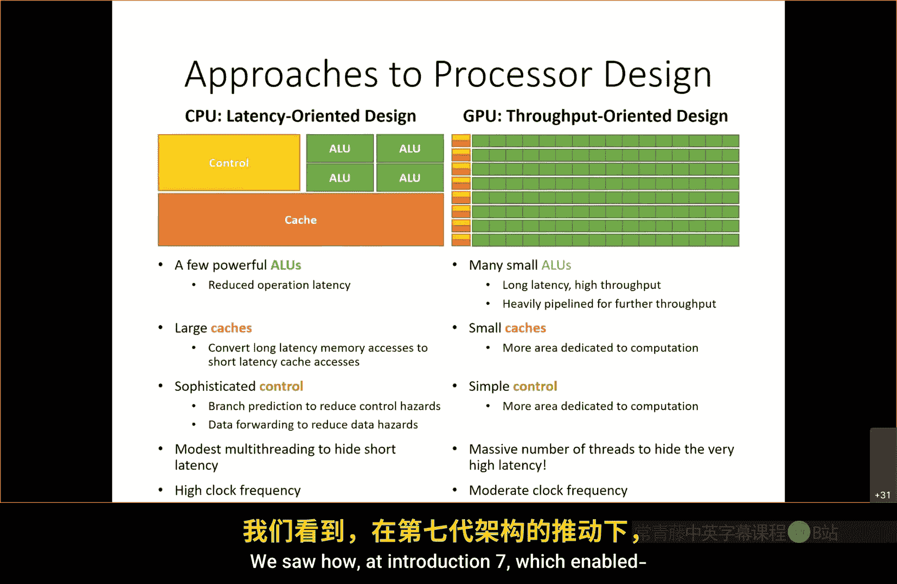

Seven， which enabled people to program GPUs in a general per。

 an explosion in the number of applications that used KudDa and then in general in the number。

Of supercomputingterraflps that GPus were providing and supercomputers around the world。

 and we also have seen an explosion in the number of developers who can develop in Quda。

 all of that because GPUs have have been shown to be so useful at extracting performance from applications。

Applications that have a lot of parallelism。And will be。

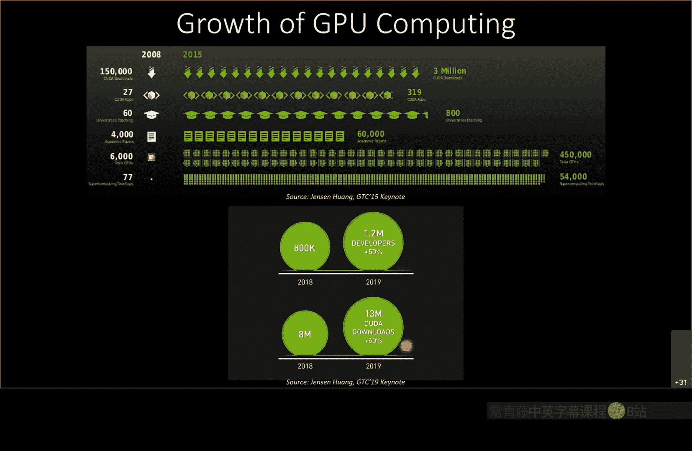

Down for GPUs。 And we said that， you know， even though GPUs are are。

Successful at paralyzing you know high performance computing applications， scientific applications。

 machine learning applications， that's actually only one of the market segments of GPUs。

 but there's all kinds of other market segments and all of this all of these other market segments are also important and they have an impact on the way GPUs are architected they have an impact on what goes in what doesn't go in at the GPUs and they also have an impact on the fact that these GPUs can the cost of manufacturing these GPUs can be amortized across a large volume of sales to make them affordable and this is。

And even though in the course， we are going to be focusing on mostly data center applications。

 scientific computing applications， maybe machine learning applications。

 really GPUs are used for a wide range of application domain。And with that， it looked at。

And I said that the first three weeks of the course are going to be spent talking about the fundamentals of GPU。

That you know the basic programming model we're going to look at the basic architecture of a GPU then the next seven weeks we will look at different parallel patterns。

 so common common computations that are performed in different applications and how we paralyze those computations and then in the final three weeks we look at some advanced features of GPU programming So this is what we covered last time anybody have any questions before we kind of jump into today's material。

O，王。Talking about data parallel programming and in particular。

 we're going introduce data parallel programming in the context of the KUuda programming model。

 which we will be using in this course。 KUuda is one of multiple programming interfaces available out there or Q as a platform KUa C which we'll be using in this course is one of the programming interfaces for programming GPUs。

 There are many others out there， but we'll be focusing on Kuda because of its popularity。

 So today we'll introduce data parallel programming using Kuda and we'll use an example。

这个 concept啊 that用。啊，不是。啊，不持。嗯，嗯，别人。我啲。嗯。V is B。access。是点灯。啊。And。I a very good。Professor。

 can we can't hear anything from your end。系啊。Oh。Can you guys hear me better now。Yes， yes yes， yes。

 yes。 Now it's good。 This better， okay。Okay， so the problem is that。

I'm connected to the university's VPN because I need to connect to a university server in order for me to demo some of the。

Some of the code that we're going to run in this lecture。And when I connected VPN。

 now all my internet traffic goes to the University of VPN， so it slows everything down。

so I hope this doesn't continue to I hope what it now just works。

 is it still lagging or is this better？No， it's it's working graphic to find。O O好。

I hope that works my VPN disconnected， let me make sure it reconnected one。That's reconnected， okay。

 so let's stop this race。The first major kind of category of parallelism or type of parallelism is task parallelism and the other kind of major type of parallelism is data parallelism and these are two different approaches of extracting parallelism from applications and you can do both of them together okay。

So task parallelism refers to when we have different operations that are performed on the same or on different data being done in parallel。

And data parallelism refers to when we have the same operation being performed on different pieces of data being done in parallel。

 okay， so an application may have multiple tasks。Some of these tasks may be independent。

 may be dependent on each other， or some of these tasks may be independent of each other and can run in parallel。

Okay， and that is an example of task parallelism。 So for example， if you have let's say。

 you know you're maybe you have a text editor or you're using Microsoft Word， for example。

And when you have when you're using Microsoft Word。

 maybe you have your editor that is editing the text and then you also have a spell checker that's running in the background so the spell checker can run in parallel with your text editing。

 for example， and that's an example of task parallelism。 You have two different tasks。

 These tasks do different operations and these different operations may be done in the same data orbit maybe be done on different data。

 but their different operations。 So this is referred to as task parallelism。Data parallelism。

 on the other hand， is an example of where you have the same operation being done on a very large amount of data and a very obvious example of this is you know something like a screen and that has pixels they need to compute the value of each pixel right so the operations you need to do to figure out the values of different pixels are very similar operations。

 but each of them is done on different input data in order to calculate different output data and this is called data parallelism。

😊，Now usually with task parallelism， you can only unleash a modest amount of parallelism because usually you know how many in any application。

 how many different kinds of tasks you typically do at the same time not that many right and you can imagine you know for every different kind of task you have in an application that means the programmer wrote a kind of different function or a different you know set of code that is going to run so obviously you're not going to have thousands or millions of different kinds of tasks each running different kinds of code available in your application so usually the amount of task parallelism in an application is small on the other hand。

 with data parallelism there is a potentially massive amounts of parallelism that can be unleash from a massive amount of data and this is the type of parallelism that's most suitable for GPUs why because。

😊，SoTo increase the amount of data parallelism in a program。

 you don't really have to write more code to do that。

 It's just that you're taking the same program and running it on a much larger data set， right。

 if I have a screen with higher resolution， I have more pixels and automatically have more data parallelism and really have to write new code for that。

 and that is why data parallelism。Has higher potential for releasing a massive amount of parallelism。

 And that's what makes data parallelism very suitable for GPs。

 That's not to say that we don't run applications with high amount of task parallelism on the GPUs。

 We could。 It's just that data parallelism is is the more natural fit for running on a GP。😊。

Now to show you kind of an example of data parallelism and how we can capture that on a GPU。

 I'm going to start with a simple。AK of computation， which is vector edition。

 So you can think of vector edition as the hello world of data programming。Okay。

 what is vector addition。 Well， vector addition is simply adding two vectors。

 So I have an input vector X and an input vector Y。

 And I add these two vectors to get the output vector Z。Okay。

 so how do I do how do I add x and y to get C while I add the first two elements to get the first output element。

 I add the second element from the two vectors to get the second element。

 I add the third element from two vectors to get the third element etc Okay Now if I wanted to program this sequentially how would I do what would I do Well very simply I will just write a loop that loops through these vectors okay and add adds each element and stores that result in the So we loop from the loop over the size of the vector and we load an element of x with an element of y we add them and we store that in。

And， let's actually do that just to kind of get familiar with the code that we write in class。

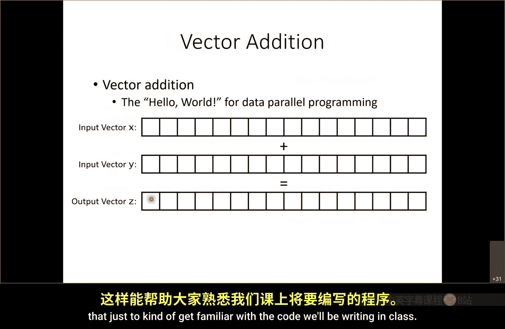

嗯。So this happened when my。When my VPN disconnected。Okay。

 so over here I just prepared some code for us to set things up here you know this is couta device synchronized don't worry about too much don't worry too much about what this is doing over here I have some code that allocates three arrays X Y and Z and that initializes x and Y to some random numbers。

Okay， and then after that， what I'm doing is I am calling a function V add CPU。

 that's going to add these two vectors on the CPU。 and I'm timing how long that takes。

 And then I'm going to add I'm calling V add GP which is going add these two arrays on the GPU and I'm timing how long that takes。

 Okay and then I'm freeing X y and Z。 So this is what this code here is doing。

 And what we're going do is we're going implement V add CPU。 and then we're gonna implement V add GP。

 Okay so we're going to see how to do the addition on the CPU and we're going to see how to do the addition on the G Okay so let's start with V add CPU。

 So here V add CPU and takes an array X and array Y and and add them together to produce an array Z and M here tells me the size of the arrays。

 Okay so how would I do this addition。 Well， it's very simple。 I'm simply gonna have a loop。

 I'm gonna write for。Un sine n， I equals0， I is less than n。Plus， plus I。ok。😊。

So I have this four loop that loops over the elements of the array。

 and then for every element of the array， I'm going to write z of I is equal to x of I plus y of I。

Okay。😊，Easy enough。Any questions so far。

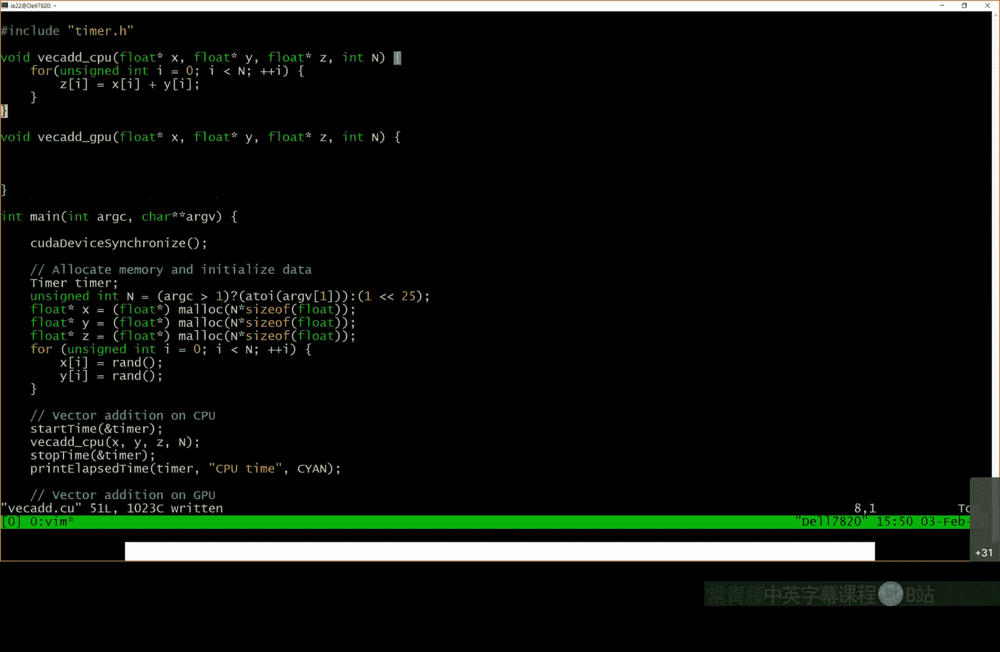

Okay great， so let's go back to our slides so this is the code that we just wrote and throughout the class whenever we write code together I'll try to have it in the slides for you guys so that you can refer to it later on。

😊，Okay， so so now you know what vector edition is， and now let's go and see how we can do this vector edition in parallel。

Okay how can we take this vector addition and rather than doing it on the CPU sequentially like I just did。

 send it to the GPU so that it can be done on the GPU in parallel and before we talk about that。

 I want to talk a little bit about how a system that has a GPU is organized。So a system。

 conventional system typically has a CPU。Okay， and that CPU has access to some main memory。

And in the context of Kuda and GPU programming， we're going to call the CPU the host。

And the reason we call the CPU， the host is because it's kind of like the main processor that's hosting the GP with it。

 Okay， and in the main memory， we're going to call that the host memory。

 because this is the memory that the CPU， which is the host， typically use。😊，Okay。😊。

AndNow this is a typical system。 You know， we have a CPU that has access to some memory。 Now。

 when we when we want to use GPU computing， we're also going to have a GPU in our system。

 So we're going to have a GPU， and maybe we have we can have multiple GPus。 But for now。

 we're just going worry about having one GPU。 Okay。

 so we're gonna to have a GP and the GP is called the device。😊，Okay。

 and the GPU has access to its own memory。Okay， this is the GPU memory。

 and we also call that memory sometimes global memory and the reason we call global memory is to distinguish it from other types of memory that the GPU has access to that we will talk about in a few lectures from now。

😊，Okay， but for now， we're just the only going to worry about this one memory that the GP has access to。

 which is the global memory。Okay， so the CPU and the GPU have separate memories and they cannot access each other's memories Okay。

 unless you use something like unified virtual memory。

 which is also an advanced topic that we will talk about later in the course， but for now。

 we can assume that the CPU cannot access the GP's memory and the GPU cannot access the CPU's memory Okay。

 so if I allocated these arrays in memory and I want to add them these arrays are going to be in the CPU's memory。

 not in the GP's memory。😊，So if I want to use the GPU to add these arrays， what do I need to do？

You send them through PCE。Right， what I need to do is I need to transfer the data from the main memory of the CPU to the memory of the GPU。

 And here to do this transfer， I'm going to have some kind of interconnect and you're right。

 one kind of interconnect is PCIe That's a very commonly used interconnect another interconnect is NV link which is specific to NviIDdia。

 but the general one is PCIE。Okay， so the main memory of the CPU is going to be connected to the GP memory or the global memory of the GPU using some kind of interconnect like PCIE and what we need to do now is we need to transfer the data from the main memory of the CPU to the global memory of the GPU okay。

So a typical， the typical sequence of。Offloading some computation from the CPU to the GP is one to allocate memory on the GPU。

2， to copy the data from the main of the CPU to the GPU。

3 to to perform the computation on the GPU and obviously to perform the computation。

 the GPU is going to have to access its memory to get the data that needs to perform the computation on。

And then four， copy the data from the GPU memory back to the main memory。And then 5。

 deallocate memory from the GPU。Okay， so we have to allocate， copy， compute， copy back， and Dalcate。

Okay， so these are five different things that we need to do and today we're going to look at how to do these five different things for the vector edition example that we are looking at。

Okay， and let's start with allocating memory。So can I ask a question， please， Yes， go ahead。

 I'm the physicist， So I have a simple question。 when you say main memory for the CPU is it is that just the Ram or yes。

 when I say main memory CPU， I'm referring to D Ram， You're right thanks。O。😊，Yeah， thanks。Okay。

All right， so somebody's asking if this is a standard workflow。

 this is the typical sequence of operations you do whenever you want to upload some work from the CPU to the GPU。

 this may not necessarily be the most efficient way of doing things and kind of we'll look at you know you know we'll look at how to make this more efficient in the future。

 but for now we can just go with with this workflow okay。All right， so ka memory management。

 How do I allocate memory on the GPU Well， there is there is a function that's part of kuda called kuda maloc that allows you to allocate memory on the GPU。

 So when I write kuda maloc ka maloc takes two arguments。

 a device pointer and this is a pointer to where I want to where I want to put the pointer to the memory I allocate it after I call kuda mallog And then again。

 the size of the data that I want to allocate。Okay。

 so let me go back to our code and see how we can use Kuda Maoc in order for us to allocate memory on the GPU。

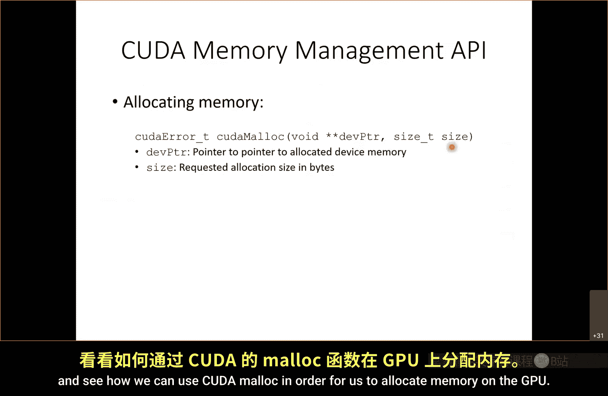

So now I want to go and I want to implement VecAd GPU and we said that the first step。😊。

Of implementing VA GPU is to allocate the GPU。Okay， so how are we going do that。

 We said we're gonna use Ka malllog。 So what I'm going to do is I have a pointer here。

 This X over here points to the data for x on the on the on the the on the CPU memory or the host memory that was allocated using Malog。

 same thing for Y is same thing for Z。 So what I want to do is I want to now allocate memory on the GP。

 So I'm going to declare。😊，New pointers， Okay， and there's a convention that sometimes we follow。

 you don't have to follow it， but that's just a convention that some people follow。

 which is that I'm going to call it X underscore D。

 So here X underscore D the underscore D refers to the fact that this pointer points to the device。

 I don't have to write underscore D， I just choose to do it because it makes my code easier to read and understand。

 I know if I see underscore D， I know that this points to something on the device。

So here I'm going to have x underscore4 D， another pointer， y underscore4 D， and another pointer。

 Z underscore4 D。Okay， and these three pointers I'm going to use for allocating them。

 So how do I do that。Well， I'm going to use Ka Mal I write ka。Ma look。

Okay and now kudamal is going to take x underscore d as an argument。

 but we know that functions cannot modify arguments。

 so if I want kudamallog to modify x underscore D， I shouldn't give it x underscore d I should give it a pointer to x underscore d so I'm going to give it a pointer to x underscore D and I'm going to tell it how much memory I want for it to allocate and the amount of memory I want for it to allocate is the same amount as the memory I want for x。

 which is n the number of elements in x times size of float。

 which is the size of each element of x okay so I'm going to write kudamal size of x underscore d size of load and what this is going to do is it's going to allocate n times size of load bytes in the GPU memory and then it's going to return a pointer to that memory by modifying the value of x underscore d to hold that pointer。

😊，Okay now I usually use the same coa analoglog to allocate all kinds of types。

 sometimes I allocate floating point arrays， sometimes I might allocate integer arrays so to be able to use the same coa malllog for all these different kinds of data types。

 the coalog actually takes a void pointer pointer as an argument so whenever I pass something to coa mall。

 a pointer to coa to allocate my data， it's good to cast it to a void pointer so that your compiler avoid void pointer pointer so that your compiler doesn't complain about the fact that you're passing a float double pointer to function that's expecting a void double。

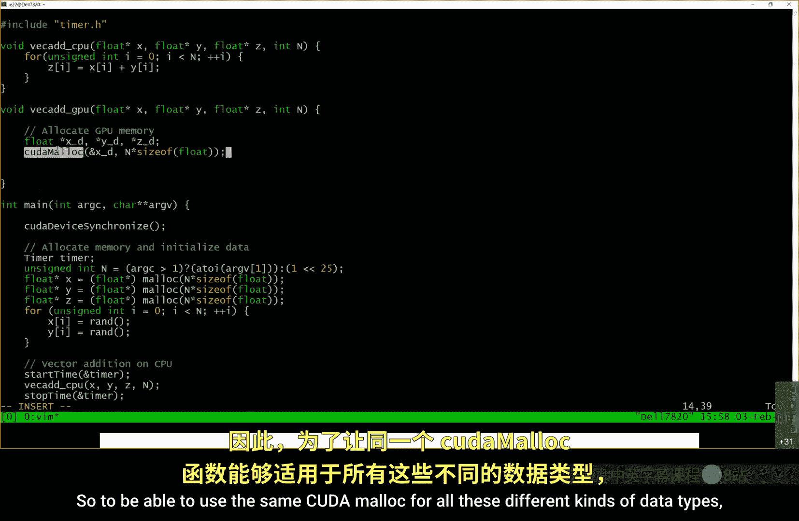

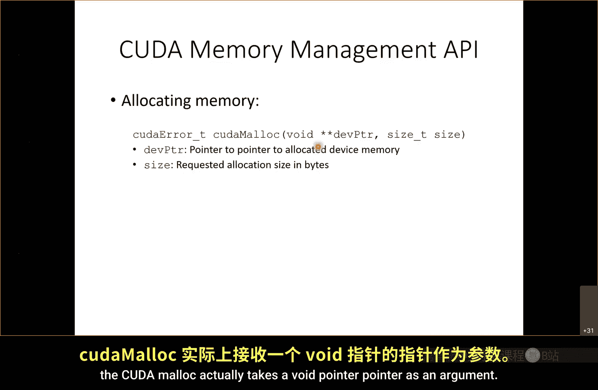

Okay。And then I'm going to use the same approach to allocate to Y and Z。

 so I'm just going to use putamal look because Y and Z they're all the same size and they're all the same types I'm going to allocate Y and Z in the same way All right。

 any questions。

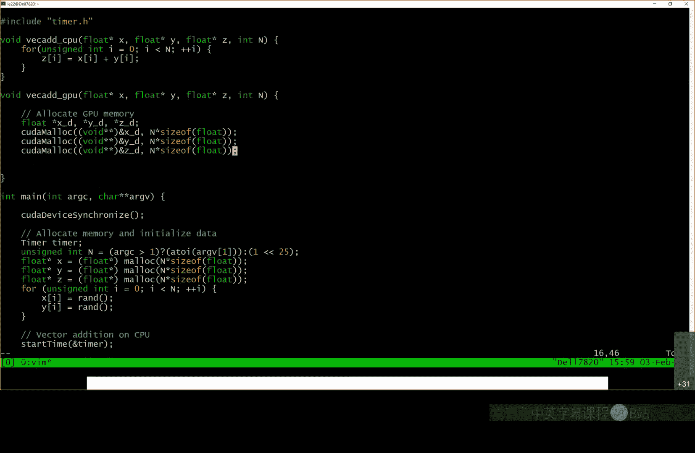

Right， so somebody is asking， does it return an error and you're absolutely right。 So this here。

 this return type couda error T， what it does is that if there was some kind of error when I why I'm trying to allocate memory then it's long to return an error。

 And we'll see later how we can check these errors。 But for now。

 let's you know confidently assume that we're not going to have errors and Ka Maloc because we're very good at using kuda Okay。

 but you're absolutely right。 So if there's an error， it's going to return an error。

 and the reason why were we're not doing x underscore D equals couda Maloc is because we want to use the return value as an error code and that is why were passing the pointer that we where we want the result to be as a parameter as opposed to what we did down here where we did X equals Maloc。

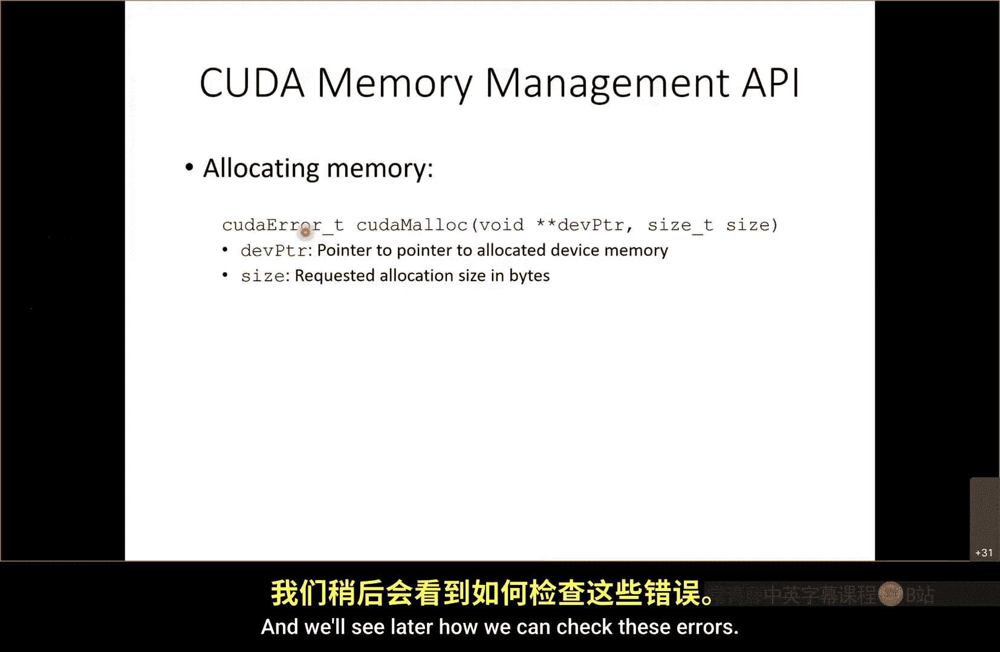

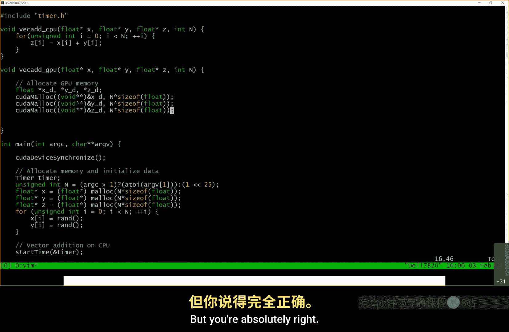

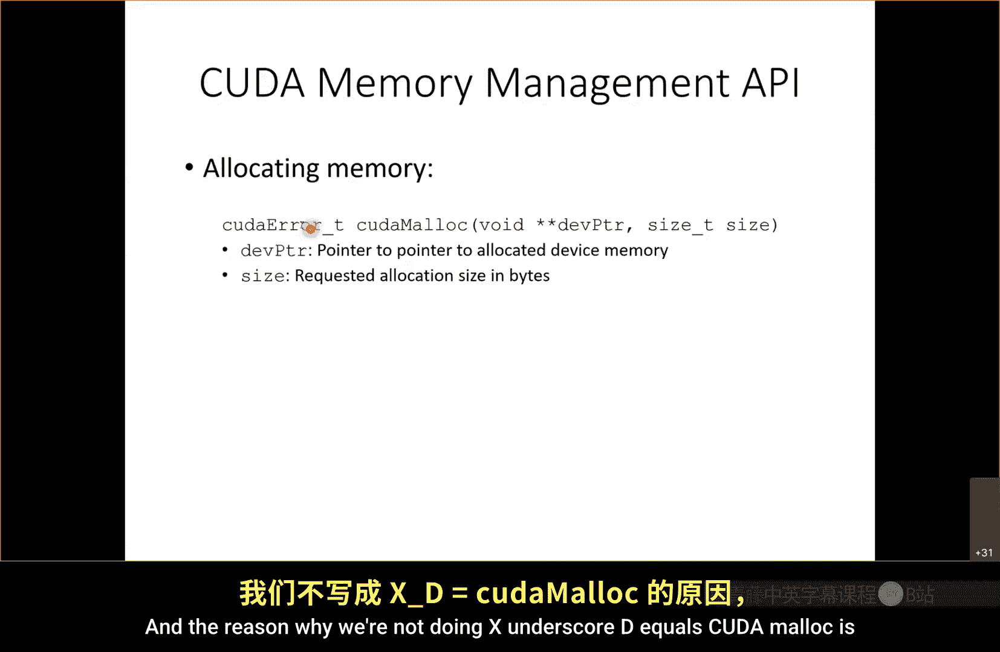

ok。😊，Somebody asked me to read what underscore D is here。

 underscore D is just a convention that I'm using to remind myself that this pointer x underscore D points the data on the device。

Okay， that's all what it is。 you don't have to use underscore underscore D， you can use underscore G。

 or you can just call it a， you can call it anything you like。

 I'm just using x underscore D because it helps me remember so that later on。

 if I want to if I if I access if I try to for example。

 do X underscore D of five then I know I'm doing something I can tell， oh。

 this is a function that runs on the CPU but but I'm trying to access data that should be on the GPU so I should not be doing this kind of D reference。

 so just to help me remind myself， but you don't have to use that convention if you don't want。Okay。

 so now we've seen how to allocate memory on the GPU。 Of course， just like we allocate memory。

 we also need to deallocate memory and there's a corresponding function for that called couda free。

 So here couda free takes a pointer to the array that you want to delocate and it delos that from the GPU And even though here we still need to we still need to copy to the GPU and we need to run the GPU code and we need to copy from the GPU。

 Okay， and then after that， we're going to deallocate。

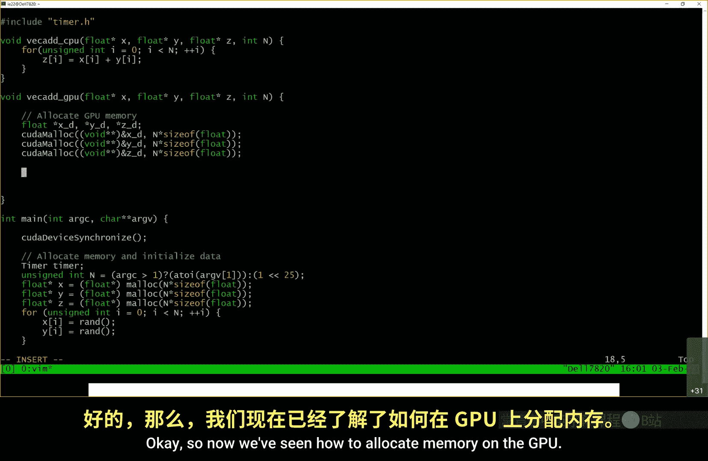

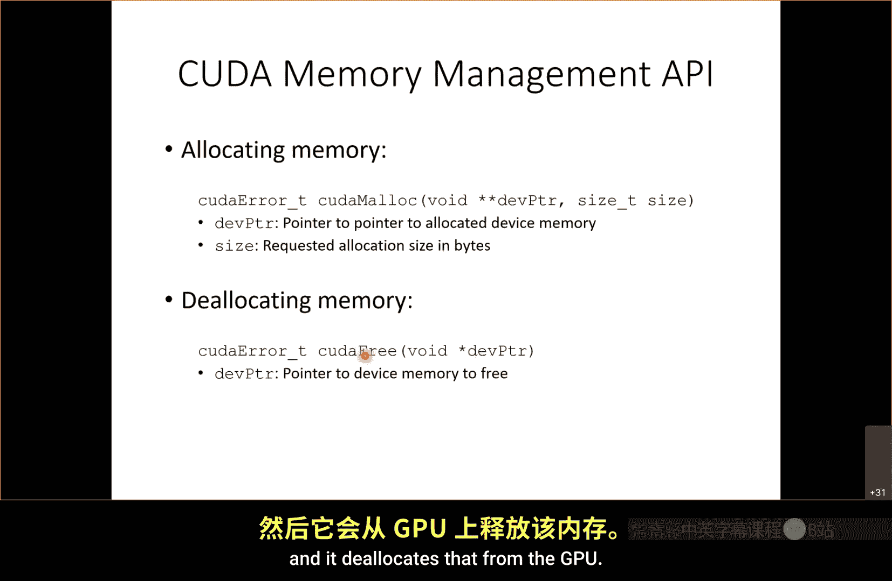

GPU memory。 I'm actually going write it down now， and it's it's good practice for you if you're if you're a C programmer or a C plus+ programmer。

 you're probably familiar with all the problems that come up from having to do manual memory management and doing allocating and then forgetting to free。

 So for me I find it a very good practice that every time I write a analog I write the corresponding free immediately。

 and similarly every time I write a couda mall， I write the corresponding ka free immediately so then I don't forget to free。

 So the way I'm gonna free after I'm done with doing all of this。

 the way I'm going to free X Y and Z is by calling Kuda free I called ka free。😊，X underscore D。

And I'm going to do the same thing for Y underscore D and z underscore D。O。

So now I've allocated my GPU memory。I'm going to do a whole bunch of stuff， copy， run and copy back。

 and then I'm going to delocate my GP unit。All right。

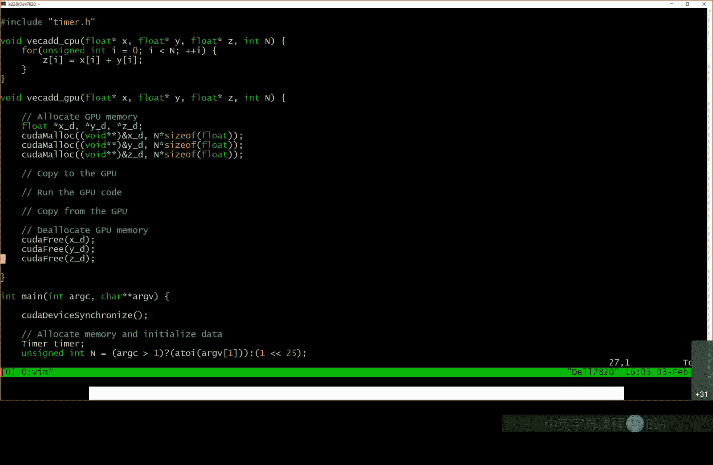

Okay， and as one of you mentioned， the return type for both Kuda Malk and Kuda free is indeed Kuda error T。

 and this is an error code， each these functions return error code that help us with error checking that we will talk about later。

Okay， so now that we know how to allocatecate and delocate data。

 the next step is to copy data to the GPU and copy data back from the GPU and the way to do that is by using a function called coMM copy so QM copy takes a destination address。

 a source address， the size of the data that I want to copy and then the direction I want to copy the direction of the copy and that direction could be the most common ones are host to device and device to host that's where I want to copy from the CPU to the GPU host the device or from the GP to the CPU it's device to host。

But other ones， other possible ones are host to host and device to device。

 so maybe I want to copy something from one place in the GPU to another place in the GPU。

 I can use device to device。

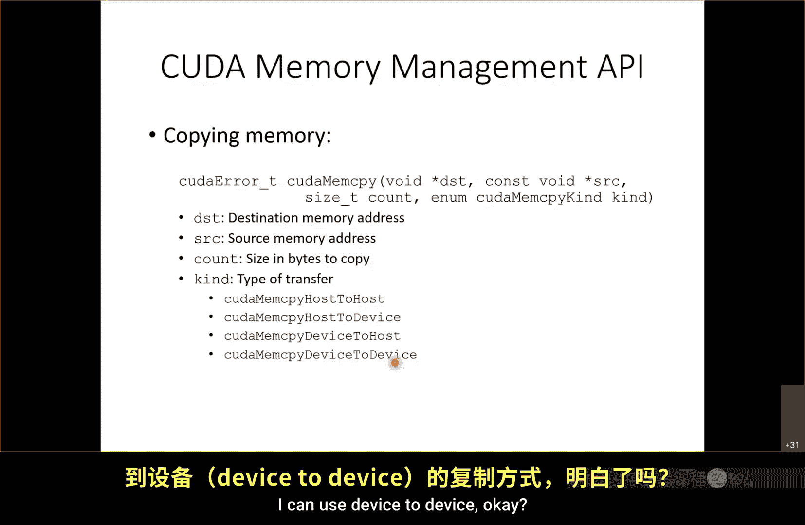

O。😊，Let's take a look at how we going we can use Sc copy， so here what arrays do I want to copy？

So I allocated X， Y and Z， What arrays do I want to copy from the CPU to the GPU， I copy all of them。

 right， I just need to copy X and Y。 So when I do that is I'm going to write kuda。

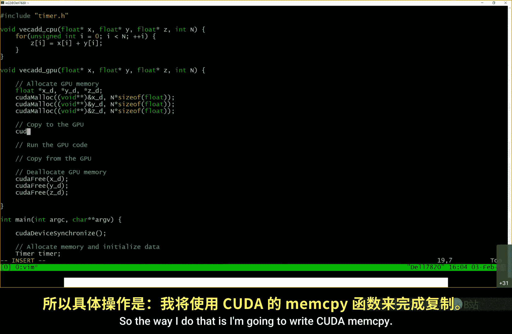

Mm copy。 Okay， the destination goes first and then the source。

 So what's the destination array in this case。

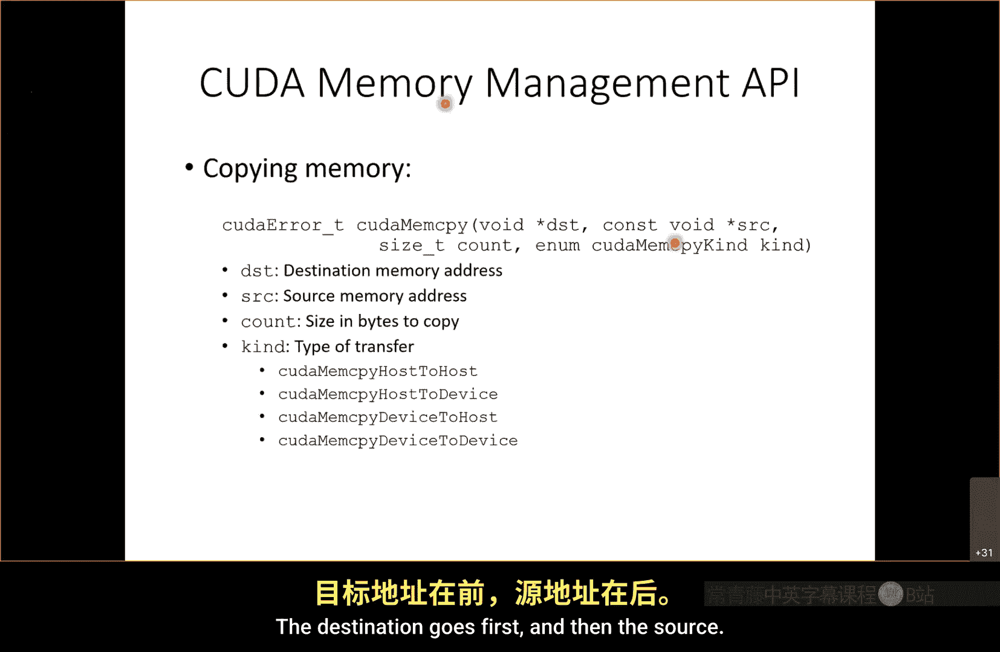

啊。If I want to copy x， I'm going to copy from x to x underscore D。

 so the destination is x underscore D， the source is x。The size is going to be the size of the array。

 which is this which is n times size of float and then third direction is going to be kuda mem copypi。

Post to。对吧。Okay。And then the same thing is going to happen for y I'm going to copy from y to y underscore D from y Okay so these two calls are going to copy data from the GPU to the CPU sorry from the CPU to the GPU and then somehow I'm going to run my code on the GP that does the addition and we'll see how to do that later and then I'm going to use the same co and copy function。

 but this time to copy that So I write kuda。Mam copy。And this time。

 what's going to be my destination， first of all， what array do I want to copy back？The result array。

 which is Z， so what's my destination pointer going to be？答案是什么。Right， it's going to be Z。

 So I'm going to copy it to Z from Z underscore D。 Okay。

 and the size is also going to be n times size of float。

And the direction is going to be what this time？It's going to be device。To vote。ok。Okay， great。

 So now I I have the code to copy my data to the GPU。 sorry to allocate my data on the GPU。

 copy it to the GPU and then copy back from the GPU and then delocate。 So now my data is on the GPU。

 everything set up。 Now all I need to do is somehow run this edition code on the GPU。

 and let's see how to do that。😊。

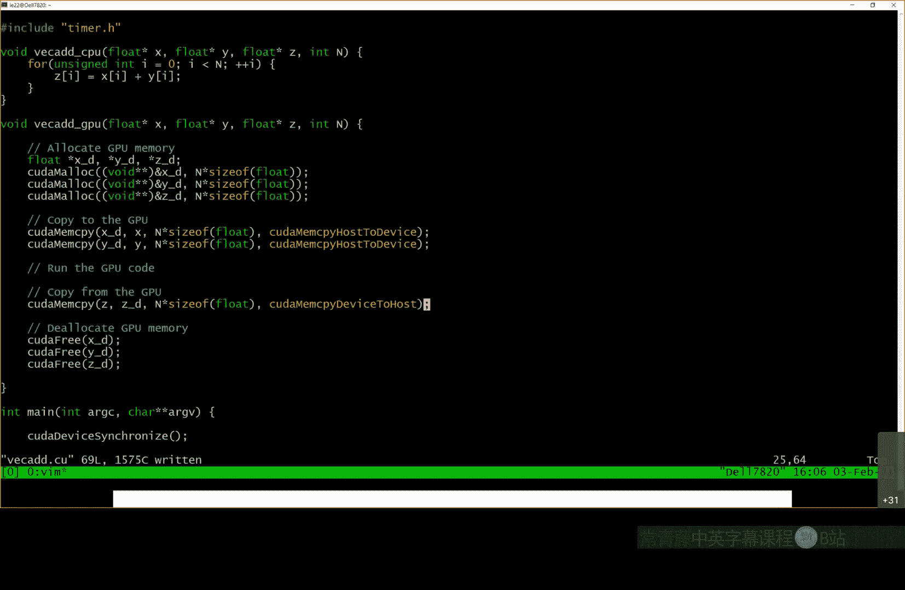

And by the way， this is the code that we just wrote together like I told you。

 I will try to always have the code for you guys to be able to refer to later on Okay。

 so can I ask a question yes question。Yes， sorry for cutting me off。

 What I've got instead of copying X and Y from。So when you initialize x and Y initially with a random function。

Those you initialized that in the sort of host memory， right， and then you're copying it， yes。

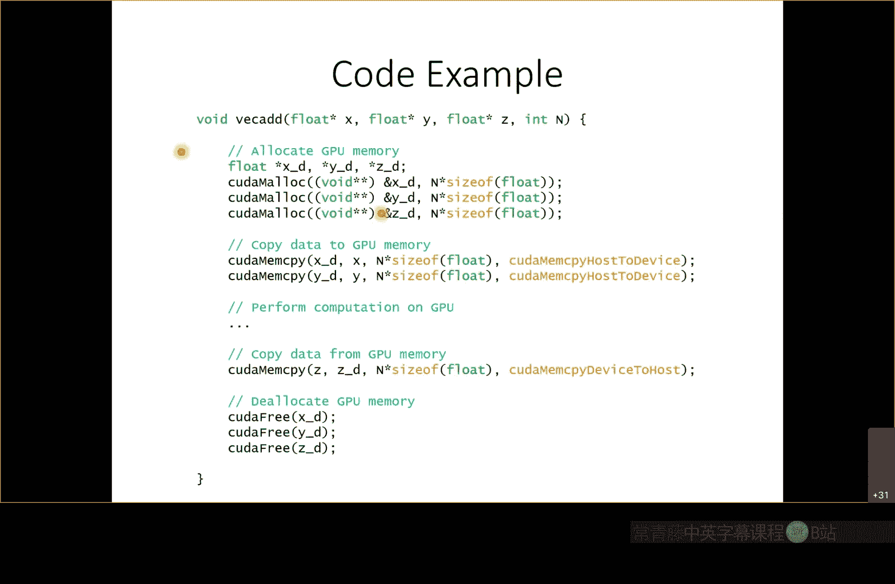

Can you initiate it in the device memory immediately？Yes， I mean。

 you can allocate can you don't have to allocate on the CPU。

 You can allocate on the GP and go initialize on the GPU。

 but a lot of times the data that you copy the GPU is data that you might have read from some file。

 So here I'm initializing it randomly。 but sometimes you might have read this data from some file。

 or maybe you receive this data over the network from some other computer and and you can't read from a file directly to a GPU at least not in current GPUus and that is why you know you normally wouldn't wouldn't do that for the for the very initial data you want to copy。

 But yes， if your computation as such that the actual data that you care about here is random numbers。

 you can definitely just allocate on the GPU initialize the random numbers on the。Okay。Get you。

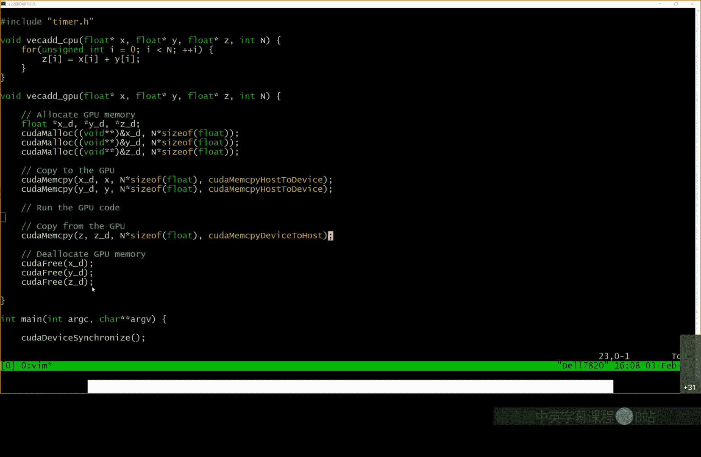

Okay， so now that I've done this now I want to I want to go back to my vector edition。

 and I want to do my vector edition in parallel。 I don't want to do it sequentially。

 We said these GPUus have all these massive number of threads that can run in parallel。

 So what I want to do is I want to do my vector edition and parallel。 Okay， so how do you。

 how do you think I can parallelize this vector edition。

 So if I want to add these two vectors in parallel to get the output vector， what's one way to do it。

😊，You have what's the most obvious way to do it。あがバッス。A thread consoles them。Right， exactly。

 So I can just launch as many threads。You know， as I have elements in my array。

 and then I can have every thread be responsible for adding one of these elements and storing the result。

Okay， so I assign one GPU thread per vector element。

 and then the GPU thread is going to load two elements and store the output result。Okay。

 so now what we still need to do is we have to write a program on the transnder GPU that assigns every threat to one of these elements to do the addition。

Okay。😊，Somebody's asking do we still need a look for that while we're going to see how to do it Okay。

 so kind of hold on for a little and we'll see how to do。Okay， so before I talk about how to do this。

 I want to talk a little bit about how threads on the GPU are organized。😡。

So an array of threads on the GPU is called a grid。So when we from the CPU。

 when we create a whole bunch of threads on the GPU to perform some operation。

 these threads are organized onto grid， so we say that we launch a grid on the GPU to and the grid is going to be an array of threads that are going to perform some computation。

And we actually have a two level hierarchies， so all these threads in the grid are just not going to be you know you know all you know。

 completely independent from each other， the threads are actually going to be organized or grouped in two thread blocks。

Okay， so I have a grid， which is an array of threads and these threads in the grid are going to be grouped into thread blocks。

And there's a significance for this that we won't see today， we're going to see later on。

 but later on we're going to see that there's the threads in the same block can interact with each other and collaborate with each other in ways that threads in different blocks cannot and this is why we organize our grid into blocks。

But you don't have to worry about that too much for now。

 I just want you to know that these threads are organized in too blocks。Okay。😊，Now。

 so what I would like to do is I would like to launch a grid of threads and to launch a grid of threads。

 I actually need to specify how many blocks I want in my grid and how many threads I want in each block in my grid。

When I launch a grid， the threads in the same grid all execute the same function known as a kernel。

Okay， the threads in all actually the same function known as a kernel。

And the way to launch a grid is by calling this special function。

 which we call a kernel and telling this function how many what what are the grid what's the grid size。

 In other words， the number of blocks in the grid that I want and what is the block size。

 In other words， the number of threads in each block I want， okay。

And I'll show you how to how to how to do this。 Let's go back to our code。 So over here。

 when I say run the GPU code， what I actually want to do is I want to call。

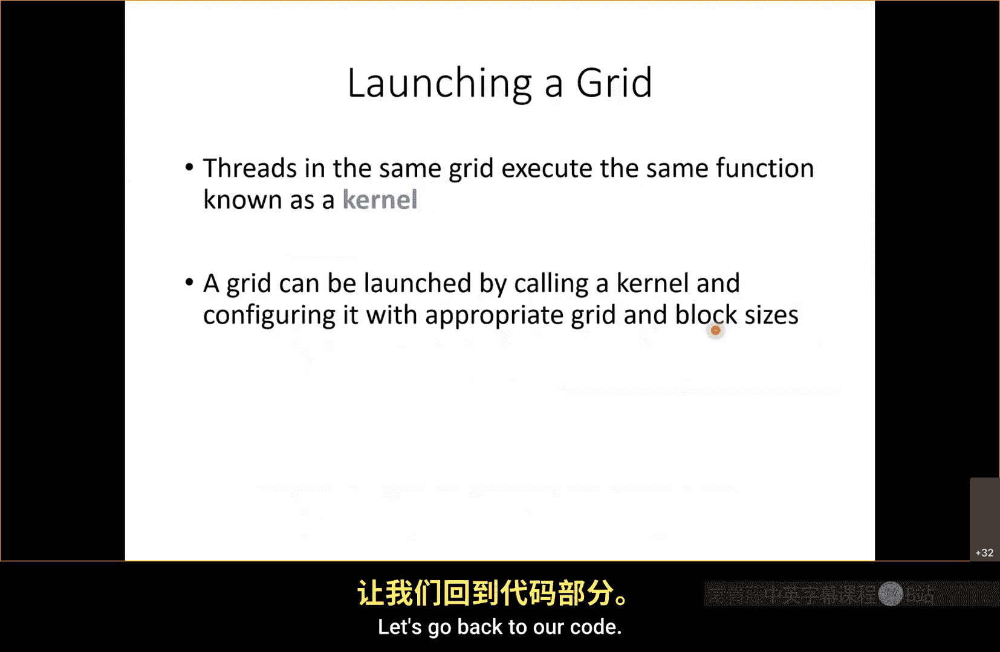

A GPU kernel function， and by calling a GPU kernel function， what this will do is it will launch。

A red。Right on the GP。Okay， so the way to do that is。

 let's assume I have some kernel function that does this vector addition in parallel。

 And I'm going to call that V add kernel。 and we'll see later on how we're going to implement V add kernel。

Okay， so I always say I have a function V addd kernel。What do I need to give this function， Well。

 I need to give it I need to give it the where define the data on the GP。

 I'm going to give it x underscore D， I'm going to give it Y underscore D。

 and I'm going to give it the underscore D。 So this way this kernel function knows where to find my data。

And I'm also get of an end because it needs to need to know the size of the array Okay。

 so this is the data that my kernel function needs to know to to to execute my my my。

My grid on the GPU。But what I also need to tell this kernel function is I need to tell it how many threads。

I would like for there to be okay， and that's going to have two parts of it。

 we said that threads are organized into blocks， so I need to tell it is how many blocks I want。

 and I also need to tell it how many threads per block I want。Okay， so I'm going。

 I'm going to write these andm going have con。On， it doesn't have to be constant。

I don't plan to change it later on the program， so I like to use cons where it should be used。

 So I'm going to have the number of。Threads。Her。Okay， and this can， you know。

 there's there's many different numbers， right， We're gonna do it according to end of course。

 So the number of threads per block， a typical number of threads per block is maybe 1024 threads。

512 threads，128 threads。 That's kind of a typical range。

 We'll see later the maximum number of threats per block that we can have on current GPUus is 1024。

 We will see later how to reason about what is the best number of threads per block to choose for our program For now。

 I'm just going set my number of threads per block to 512。Okay， so if I want。

 if I have a total of n elements in my vectors。That means I， I want to have end threats in total。

Okay， so if I have 512 threads per block， then how many blocks do I need？

The number of blocks I'm going to need is。if I want end threads and I have 512 threads per block。

Right I'm going to need n over 50 to 12 blocks。 Okay， so n over 5，12 blocks times 5。

12 threads per blocks give me a total Give me a total of end threads。Okay。😊。

Now the way that I tell my kernel to use this many blocks and this many thread per block is by using this special extension and now here we're going start going to start to see the things that are not part of C but that are part of Kuda。

 I'm going to have these triple triangle brackets。Okay， somebody's asking about rounding。 Yes。

 we will talk about rounding soon， but for now we can just assume that n is a multiple of 512。

 so don't worry too much about rounding for now。Okay。

 so I'm going to have these triple triangle brackets and then these triple triangle brackets I need to provide the what we call the configuration the configurations are basically the number of blocks and the number of threats per block。

 so I'm first going to provide the number of blocks。Okay， you don't have to put a space。

 I'm just a little bit。 I have particular way that I like to write my code。

 And so I like to put a space there， but you don't have to。

 And then I'm gonna tell the number of blocks and then the number of threads per block。

 And now what this does is it's going to create。it's going to create a grid on the GPU。

 This grid is going to have n over 512 blocks。 Each block is going to have 512 threads。

 and each thread is going to execute a this function called VAd kernel， which we haven't defined yet。

 and we will define。

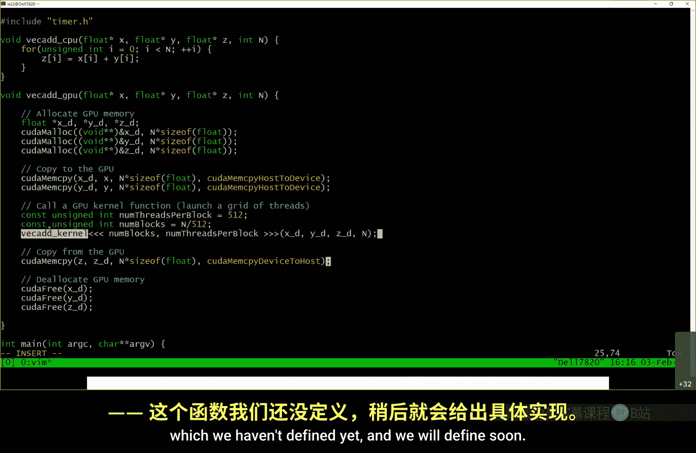

Okay。😊，So again， this is the code that we just wrote， we define number of setss for block。

 the number of blocks， and we call the kernel， provide the configurations。

 and then provide the parameters， which is the data that it。Okay， any questions so far？

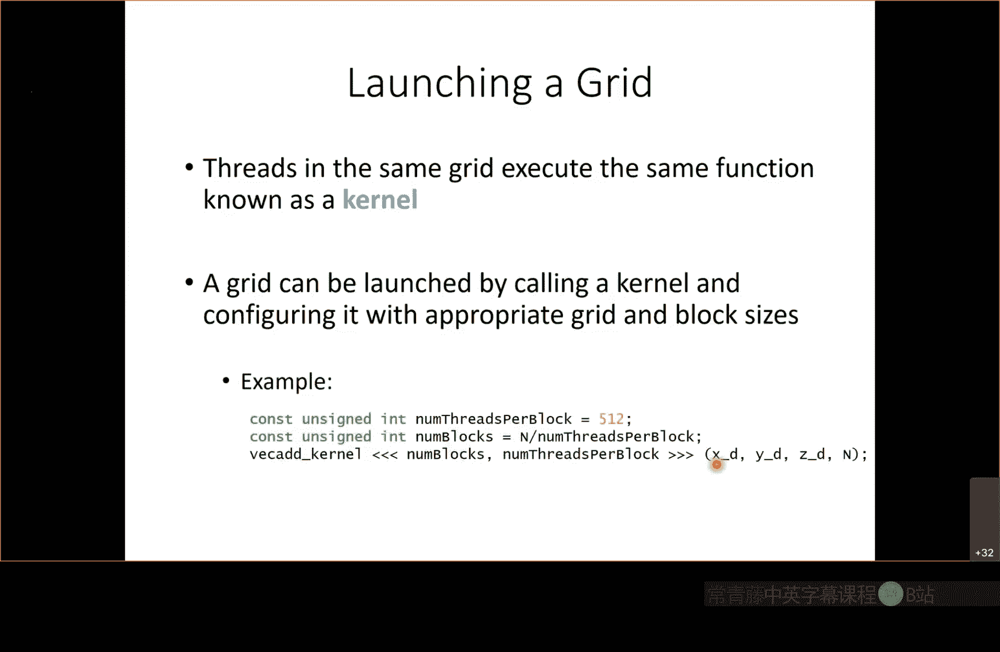

Okay， so someone's asking why is number of blocks 512。 Well。

 we said that we want a total of n threads。So if I have 512 threads in each block。

 then the number of blocks I need is n over 512 so that I will have n threads in total because n over 512 times 512 is n。

Okay， not exactly， somebody pointed out rounding issues and we will talk about them。

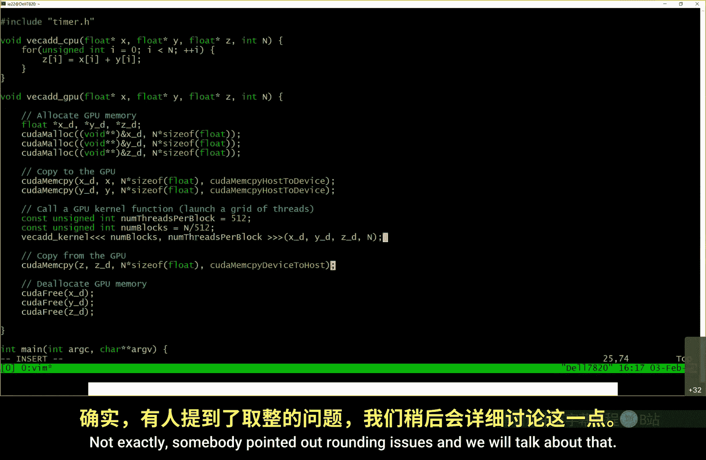

Doctor。Yes， can I repeat why threads are divided into blocks。 Is it just like。

 you know why divide into pages to avoid fragmentation or something。

 so I did mention this very briefly。 I said that the reason we organize threads in grid into blocks is because threads in the same blog are able to collaborate with each other in ways that threads in different blocks cannot。

 And that's not something I will elaboraterate further on today。

 we will talk about that in a lot of detail in a later lecture。 Okay， but for now。

 all you need to know is that these threads in the block can collaborate with each other in special ways。

 but we won't use that feature today。

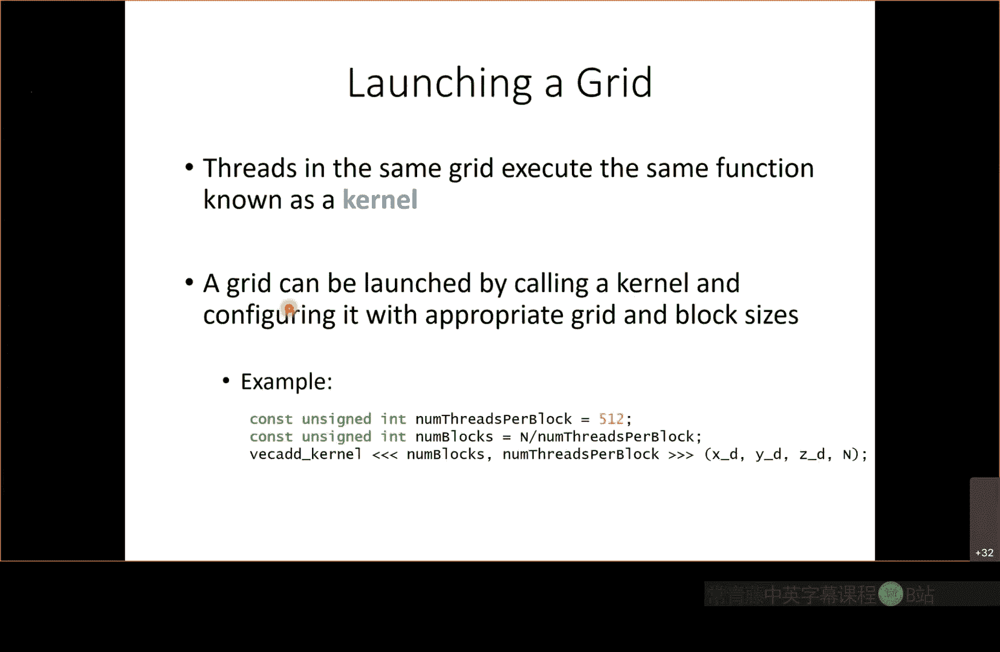

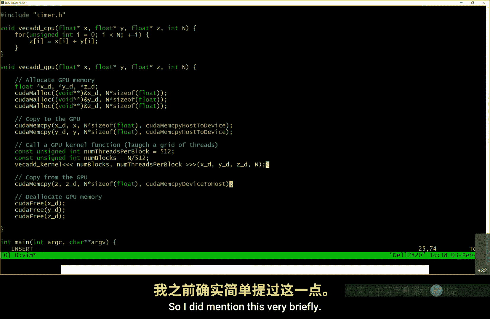

Okay。okay， next what we need to do is we need to implement this V ad kernel。

 So now we're calling this V ad kernel to launch a grid on the GPU。

 Now we have n threads running on the GPU。 These threads are going to are going to execute this V ad kernel。

 So how do we implement V ad kernel。 So a kernel is very similar to a C or C plus plus function。

 However， it is preceded by the keyword global to indicate that this is a kernel。Okay。

 and it's going to use some special keywords in order to distinguish different threads from each other。

 Okay， so this V ad kernel to implement it， I'm just going to declare it like a regular C functions。

 I'm going to write void。😊。

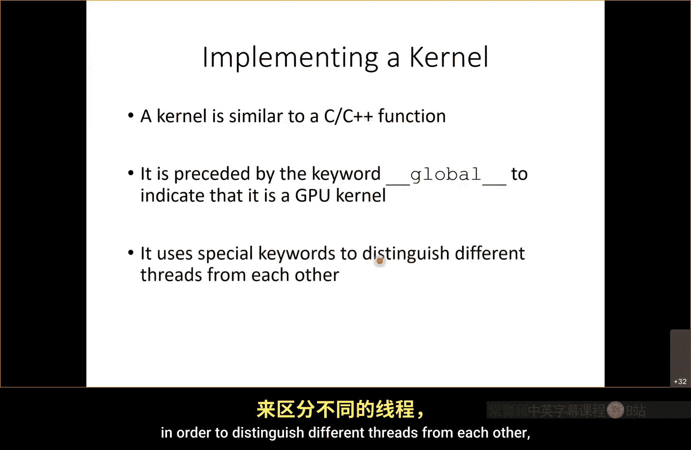

Be had Colel， and I'm going to give it。The same parameters I was giving。

 I gave to my V ad CPU function。Okay。But the key difference is that to indicate that this is a special type of function。

 it's a kernel， I'm going to pre the declaration with the keyword underscore underscore global underscore underscore are there's two underscores here okay so this keyword over here indicates that this function being declared as a kernel you don't have to write underscore kernel at the end of it。

 you can call it anything you can call it VA device you can call it deviceA you can call it I don't know ABC。

 you can call whatever you want， I like to use the convention of using underscore kernel after the names of the kernels。

 but you don't have to do that。Okay， so now that we've declared this kernel and now what we need to do is we need to write the code that each thread is going to execute because we said that all the threads launched by this call are going to execute this kernel。

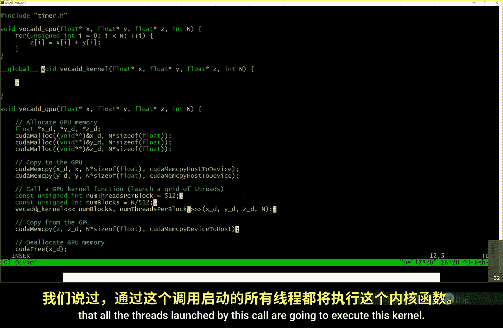

Now， in order for threads。In order for threats to execute what they need to do is they need to find a way to distinguish each themselves from each other。

 So thread  zero needs to know that it's thread 0。 thread one needs to know that it' thread one。

 thread2 needs to know that's thread2 so that they know what data to access。And for that。

 there are several keyword inside of Quda that assist threads in doing that。Griddm do ads。

Tells a thread what is the number of blocks in our grid。

 and we're going to see later on that we can actually have multidimensional grids。

 So today we're just using a one dimensional grid of threads。

 and that is that is why we're just going to use the dot X。 So dot X is the first dimension。

So grid De dot X will tell us the number of blocks in the grid。 Okay， In this case。

 that's going to be n over 5，12。 Okay， and then we have block index dot x。

 So block index dot X tells us tells us thread， what what is the index of its block with respect to other blocks in the grid。

 So any of these threads in this green block over here。 if they， if they call block index dot x。

 then they will get the value to。 So all these threads， their block index dot x is 0。

 all these threads， their block index dot x is one， all these threads their block index dot x is2。

 etctera， okay。Then we have block dimm doX， so block dim doX tells us tells a thread how many threads there are per block and again blocks can be multidimensional so that's why we have the dot x over here so in this case block dim the dot x would be four in reality here our block dimm dotX corresponds to the number of threads per block which is 512。

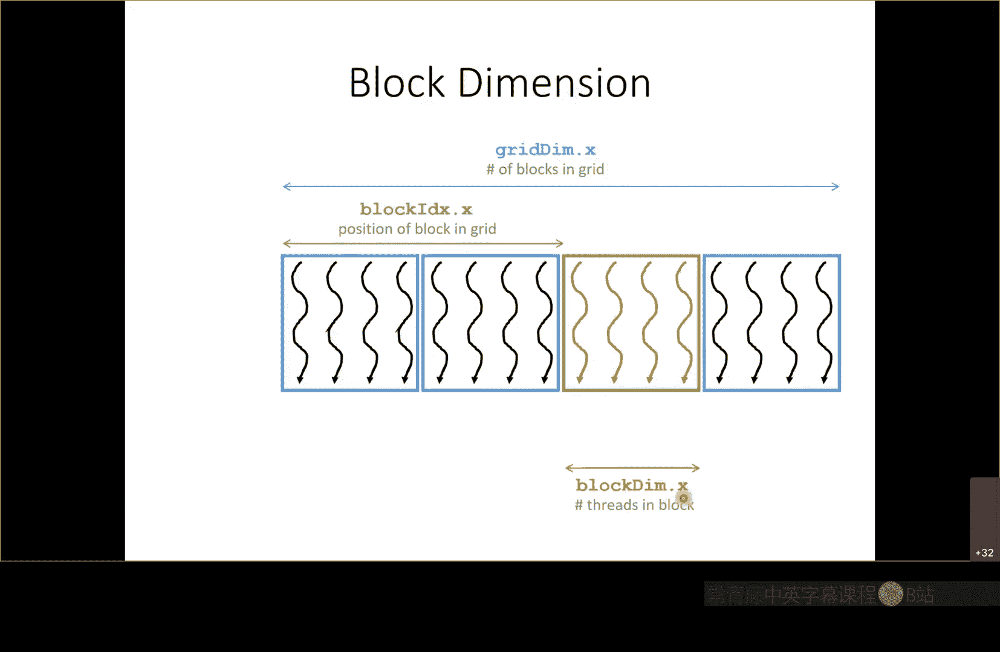

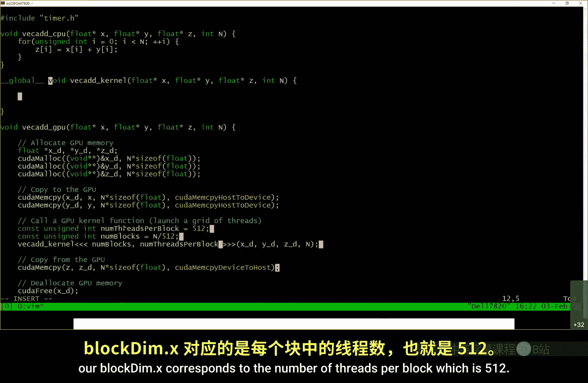

And then finally， our we have thread index dot X。 thread index dot X tells a thread what its index is relative to other threads inside of the inside of the。

😊，Inside of its block。Okay， so here for this orange thread， if the orange thread reads gridim dot X。

 the value will be4 because we have four blocks in the grid。 If it reads block index dot x。

 the value will be 2 because the index of its block is 0，1，2。If it calls blockdm do X。

 it will get four because there are four threads in the block， and if it calls thread indexdex dox。

 it will get one because it's indexed with respect to other threads in its block or is 01。Okay。

 now if I want to find the index of this orange thread with respect to the beginning of the grid。

 so in other words it's a global index， then in this case what I would do is I would take the block index。

 which is two， two blocks， multiply by the block dim。

 which is four that gives me eight threads and then I would add thread indexd do x which is one so the index of this thread would be9。

ok。And that's going to be important， why， Well because if we want to do parallel vector addition。

Then what we're going to do is were going we want to map each of these threads to one of these elements in the array。

 so each thread is going to have to compute its global index or its index from the beginning of the grid to find out the index of the element from the beginning of the array that it wants to access。

ok。So let let's see how to do that so inside a VC ad kernel。

 the first thing the thread needs to do is it to identify it needs to identify its global index。

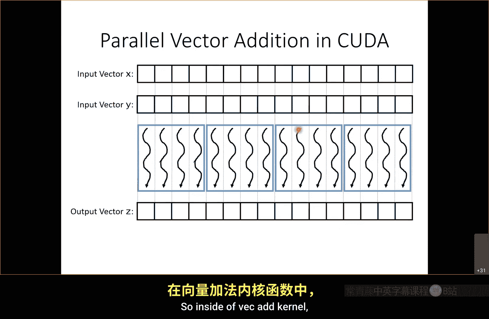

Okay， so it can， we can write unsigned。And。

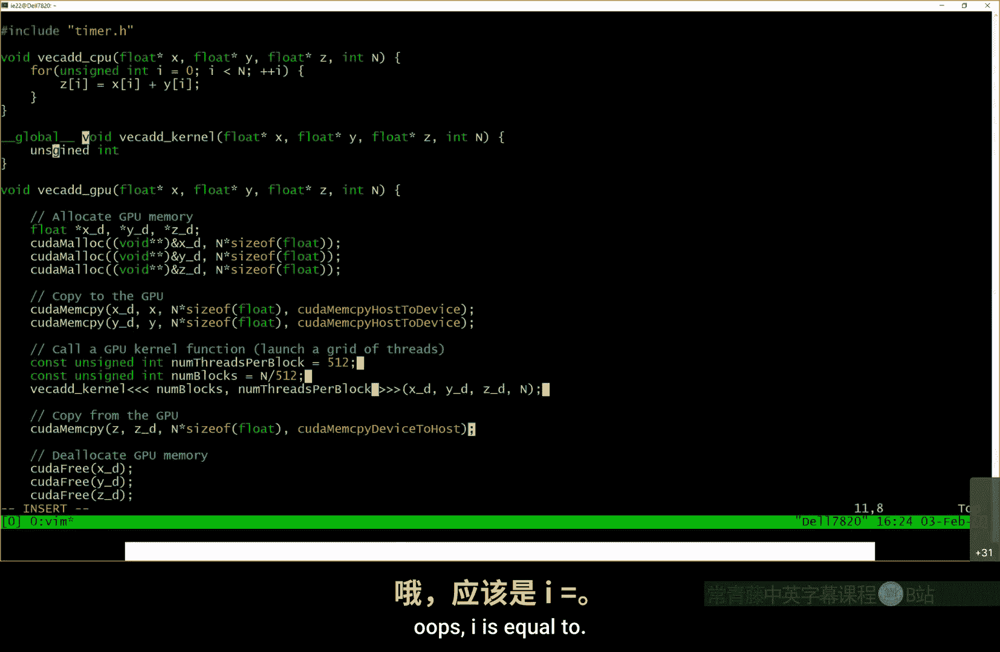

I is equal to And again， to identify the threads global index， we're going to do。

Then the size of a block。Times the number of blocks。Plus， the offset of the three。Okay。

 to get to this thread so the size of a block is。

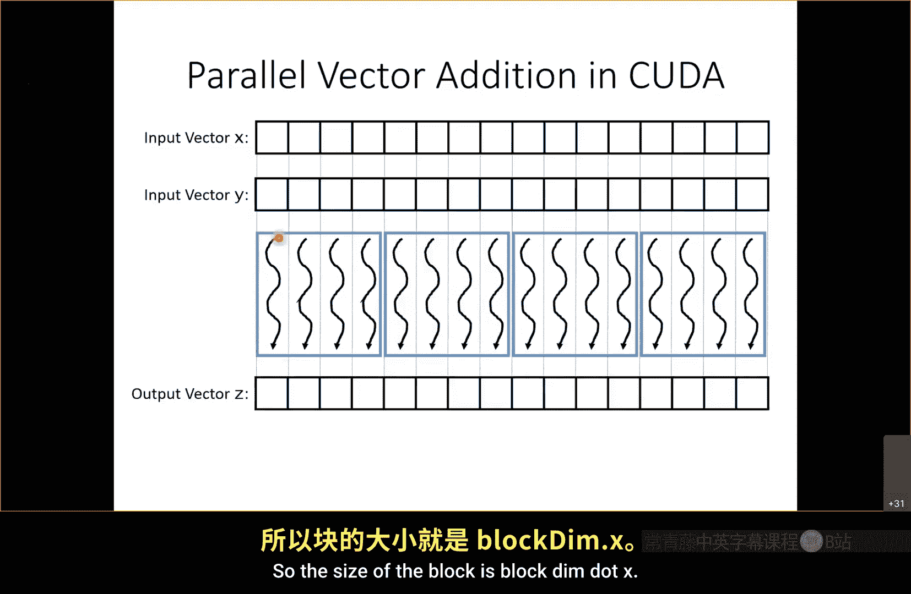

Blockdm dot X。Okay， the number of blocks is going to be。Bg index dot x。

 we have Bgged in log X times log index dot X。Okay。

 and then the number of threads from the beginning of the block。

 So the index of the thread from with respect the beginning of the block is going to be。

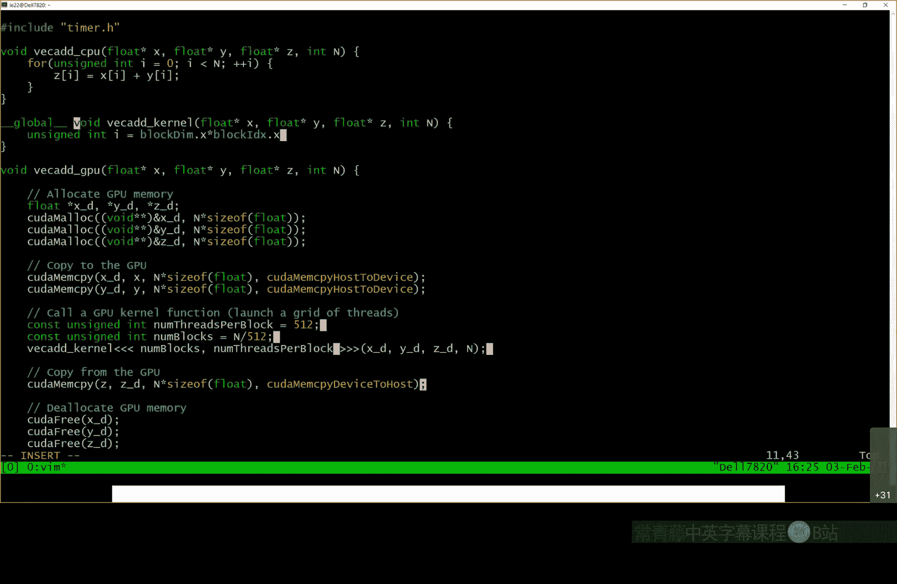

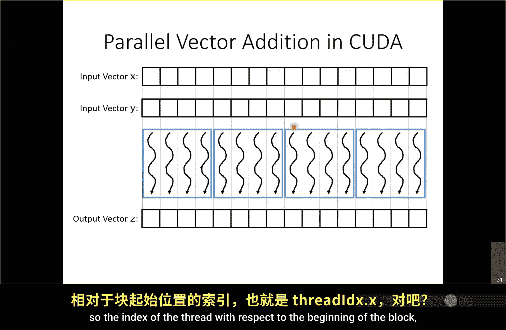

Plus。Thread index， Okay， and now here I is the index of the thread from the beginning of the block。

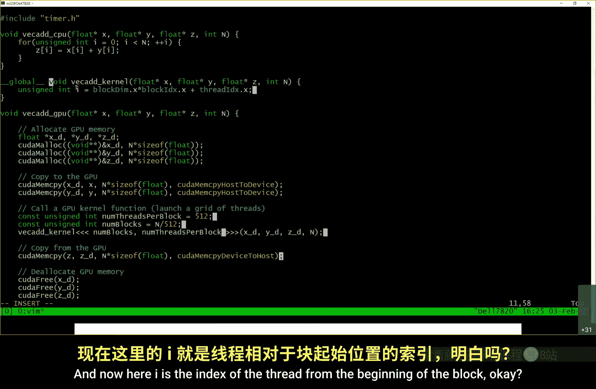

Okay， somebody is asking me why it needs to be global。

 What I mean by global is I want the index of the thread。

 the keywords that are provided to me in Kuda tell me the index of the thread with respect to the beginning of the block。

 not the beginning of the。Okay， but what I want is I want the index of the thread from the beginning of the grid。

 that's what I mean by the global index。Okay。Okay， somebody is asking is the X over here the same as the x over here。

 No， it's not here， this x is a pointer to an array here。

 this x over here is a field inside of the block in structure。

 So here block in is a structure it has X， Y and Z。

 but we're not going to worry about Y and Z for now we'll worry about them next time。

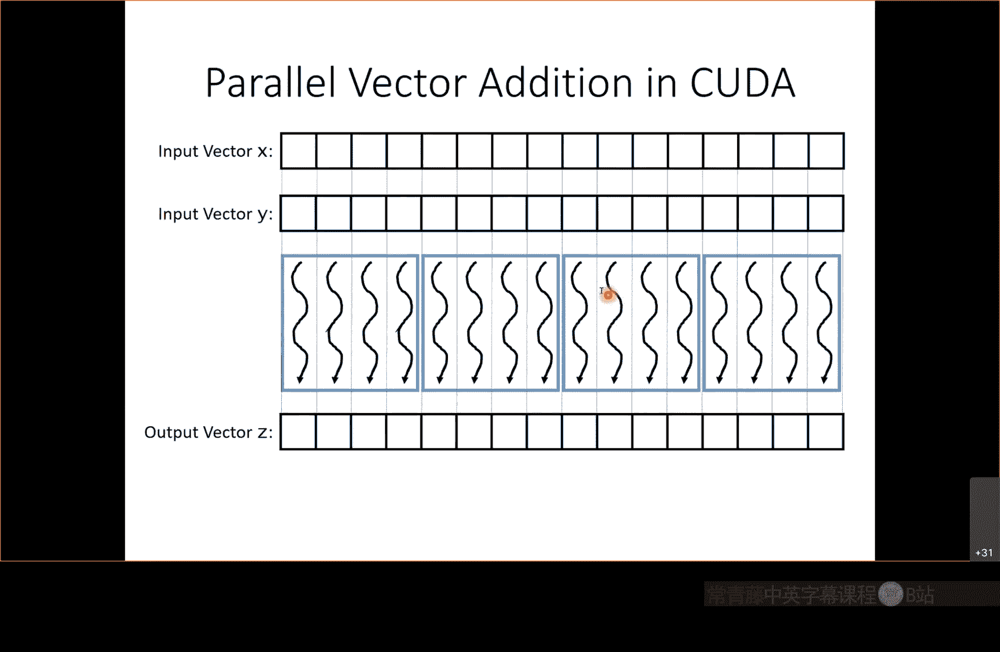

Okay。😊，Okay， so somebody's asking how is this code compiled to the GPU。

 I'll cover that later on in today's lecture， okay， so don't worry about that。For now。

 I just want to make sure everybody understands how indexX times block index x。

 plusstar index x gives me the global threat impact。Is that clear to everyone？O。

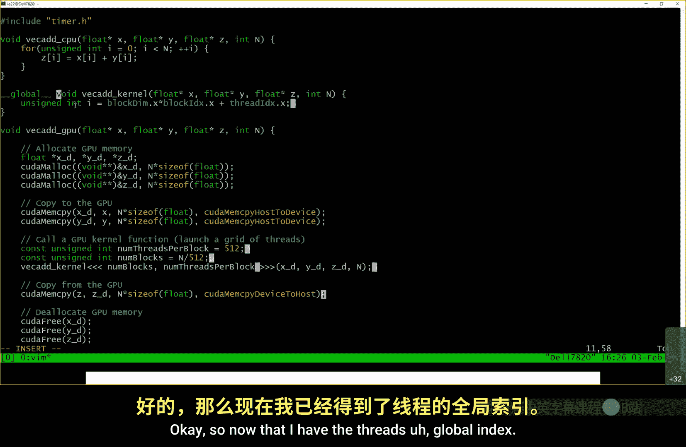

So now that I have the threads global index I。Now that I know the index of this thread with respect to the beginning of the grid。

 now what I can do is I can use this index to perform whatever operation I perform。

 So now that I have this index， what do I do here， is what what code is the thread going to execute？

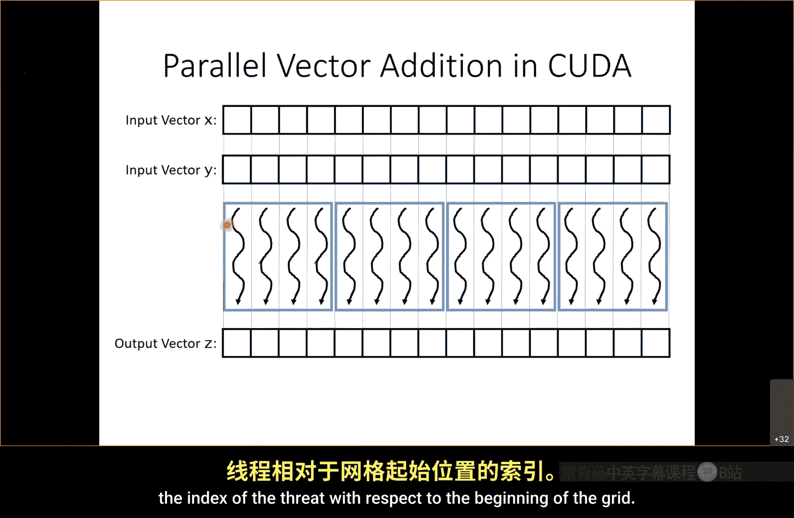

Well， I'm just going to do Z of I is equal to x of I plus y of I。Okay。

SoNow every thread and every thread that gets launched by this call is going to execute the same code over here。

 but each one is going to have a different thread indexex dot x and a different block index dot x and therefore each one will have a different I and each one is going to add a different set of element read different different x of I and y of I and store to a different is the of I and this approach to parallel programming is called single program。

 multiple data where you have a multiple threads， all executing the same program。

 but each one of them operating on a different set of data。Okay。😊。

For those of you who have taken a computer architecture class。

 you may be familiar with SPMD or single program multiple data， you may be familiar with that。Okay。

 so now what we've done is we have implemented vector edition on the GPU okay and it's nice and easy。

 we allocated data on the GPU， we copy the data to the GPU we called a kernel and told it how many threads we want and then each of these threads is going to come and it's going to execute this kernel function based on a different index。

 and then finally we copy the result back from the GPU and we free the GPU memory。Okay。😊，Professor。

 yes。Would it have been faster to write to X to save space Z？I mean， yes。

 maybe you can do things like that， you know you can write to X so that you don't have to you have to save space。

 but maybe this is part of a bigger program where you need X for other things okay so that just depends on the context。

So don't worry about the context in this case we just we're just trying to demonstrate how to read from two arrays and write back to one array。

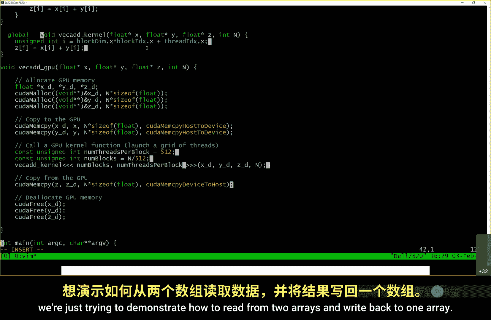

Okay， thank you。Yeah， you're welcome。 Okay， so then this is the kernel code that we just wrote。

 And the key thing here is that we have this expression block the X and block in index index plus3 index N X in order to identify the globals。

 the threads global index。😊，Now there's one thing that you guys have some of you have been mentioning which is this n divided by 512。

 some of you did not like that and that's a good observation so if you remember over here the way we got n threads is by having 512 threads per block and then doing n divided by 512。

But if n is not a multiple of numb threats per blocked， so if n is not a multiple of 512。

 what's going to happen？What does C do， what does division C do， it takes the floor， right？

D is going to take the floor。 So if if I do n over 512 and n is not a multiple of 512。Right，So。

 for example， if， if I have 1024 over 5，12， then my number of blocks is going to be2。

But if I have 1023 over 512。😡，That will evaluate to one because because division and C takes the floor so I'm going to only have one block and one block is only going to give me 512 threads。

 not 1023 threads so what should I do in this case？If I want 1023 threads， what should I do？😡。

You should don。Right， we should round up so we should take the ceiling。 So in other words。

 I want to want un take the ceiling and what the ceiling will do is that it will launch extra threads and then somehow in the code。

 I'm going to have to eliminate these extra threads and ask them not to do it Okay so in other words。

 if my array here did not have 16 elements like the original case if it only had 14 elements。

 But in this case， I want I only need 14 threads。 but I don't have a way to launch 14 threads because my thread block is4 so I'm going launch four blocks。

Which is going to give me 16 threads。 But then I'm going to have some kind of check to make sure that these last two threads don't don't。

Don't do any work Okay so let's go back to the code so here when I calculate the number of blocks we said that I don't want to just do n over 512 because if n is not a multiple of 512 I'm going to get the floor and I want the ceiling。

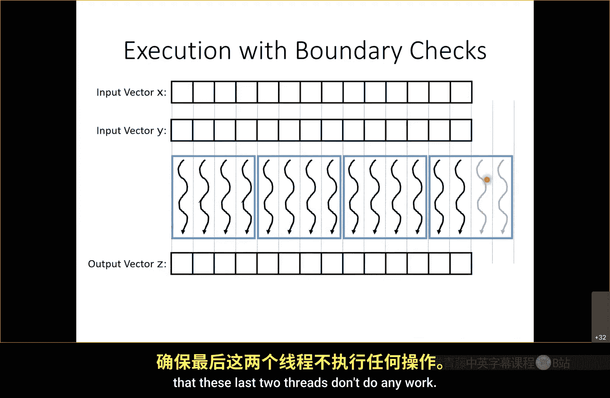

So instead I want to do the ceiling and the way to do the ceiling is there's many different ways you can do the ceiling。

 Some people will cast it to a float， do a ceiling division and then cast it back to an end。

 Some people just use some integer arithmetic。 So one thing you can do is you can do n plus 512-1 over 512。

And this calculation over here effectively calculates a ceiling division okay I'm not going to get into why you can go you know on your own and verify that this calculate this  athmetic over here will do a ceiling division by the way I'm writing 512 over here but it's actually good practice for me to actually use numb threads per block The reason is that if I come and change the number of threats per block I only want to change it in one place I don't want have to go and change it in three different。

Okay， so by doing this now I've taken the ceiling so I launched the ceiling number of threads and then I go back here to the code and to my GPU code now it could be the case that I have more threads then the array bounds so I want to make sure that these last threads don't access any memory because then their access will be out of bounds and the way I do that is by simply making sure that my thread index is smaller than the size of my array so here before doing z of I before doing Z of I equals x of y plus y of y I'm going to do if。

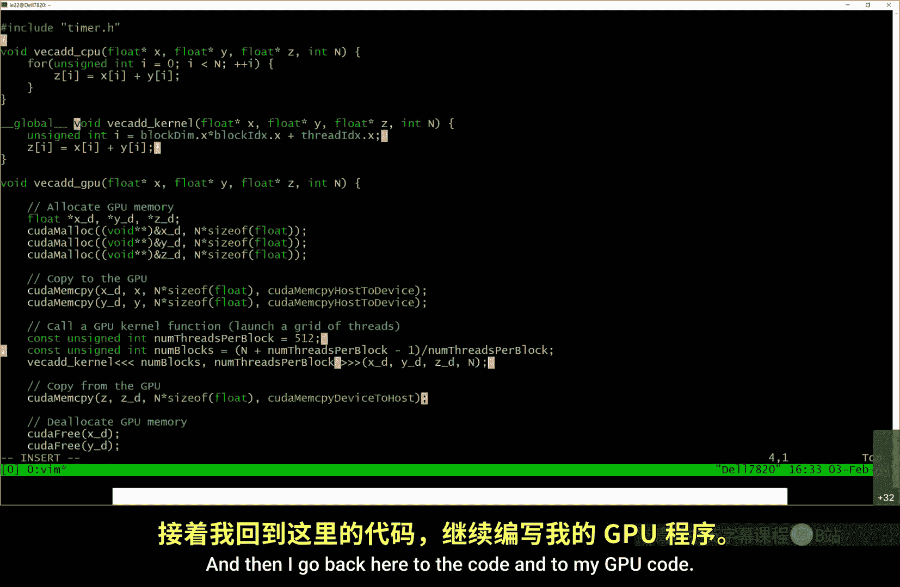

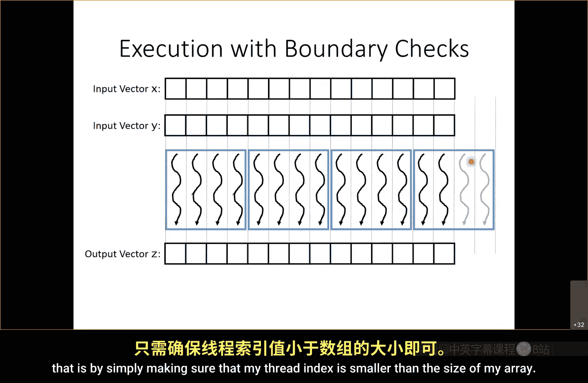

I is less than。Okay， and we call this a boundary condition because the only we don't need these threads。

 the only the reason we have them is because of the way that Ka forces us to organize our threads into a blog。

O。😊，Clear。I professor。Yeah。😊，Doesn't adding like the if condition add a lot of processing like there might be branches and so on wouldn't have been wouldn't it have been easier to just do another separate block for the last chunk。

So you have a tradeoff right， if you have a trade off between having this if statement that all the threads are going to execute versus having to launch。

 if you want to do a separate block for the last chunk。

 you're going to have to launch a whole new grid for specifically for that one block and launching a grid also has its own overhead。

Okay， so there's a tradeoff you have to make and you know。

 most likely the overhead of this if statement is going to be much less than the overhead of launching a whole new。

Okay， okay， thank you。Yeah有。somebodybody is asking does number of Fe per block have to be a power of two。

 it doesn't actually it can be any number， but it turns out that it's actually a good idea for this value to be a multiple of 32 and we will talk about that later on。

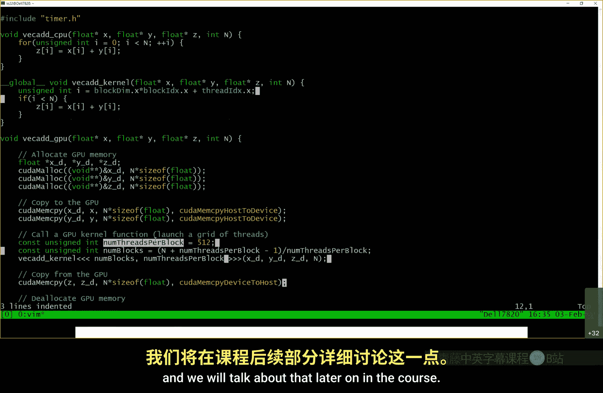

Okay。All right， so this is the code that we just wrote。

 the next step now that we have this code is compiling the code。

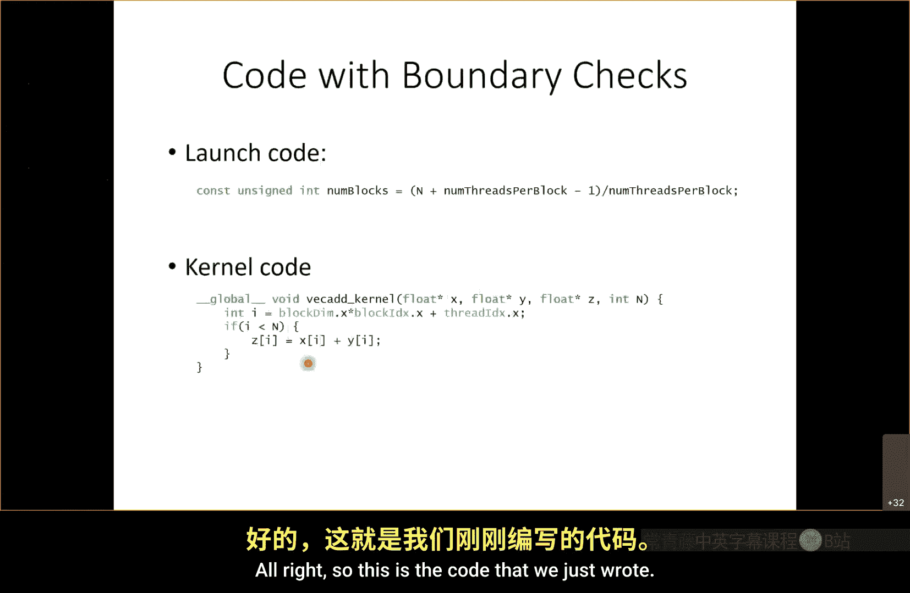

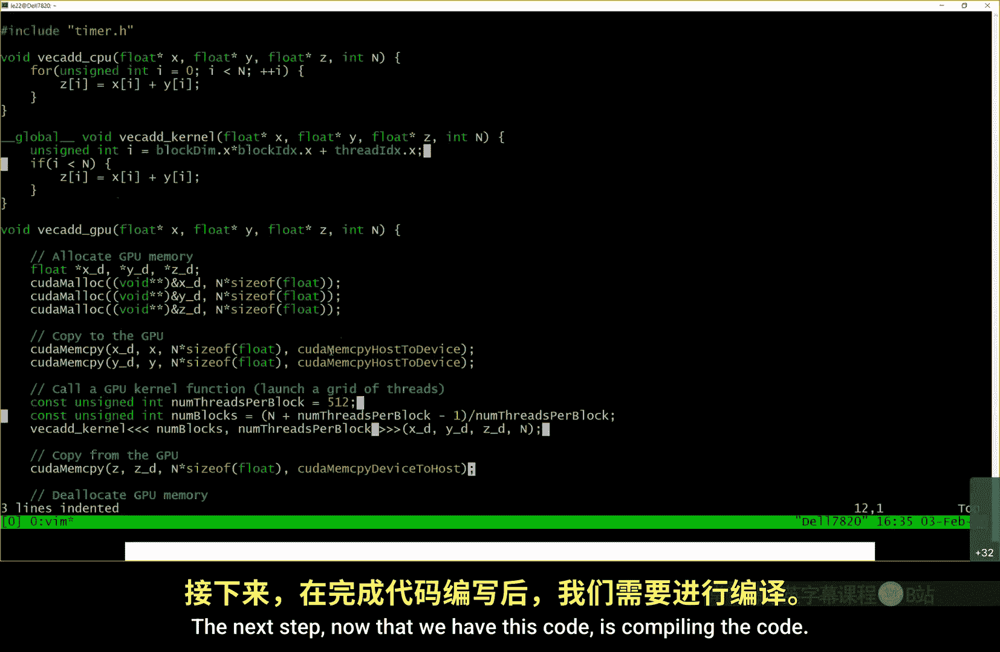

So somebody had previously asking about compiling， so now we'll see how we compiled this book。

So to compile this code， this code is on in a dot D U file。 So this， this。

 this file that I' have been editing is called Vec a dot C。

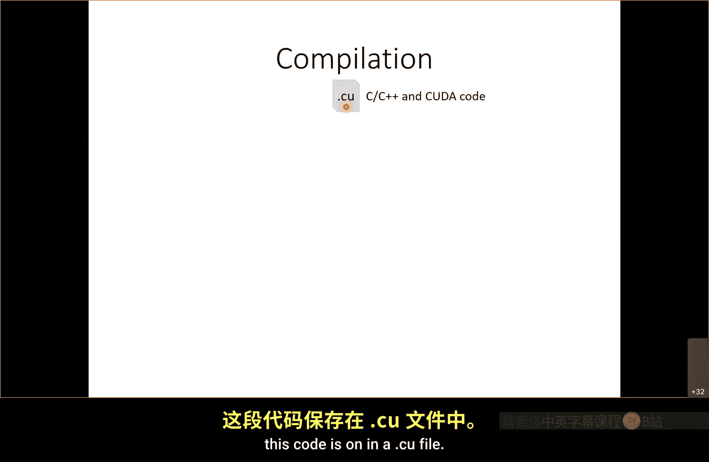

Okay。😊，So this VCA dot C that I just edited okay now what I want to do is I want to compile it so to compile it there's a compiler called the NviDA Kuta compiler or NVCC and what NVCC does is that you can use it to compile this scooa code and gives you a binary so I can write NVCC。

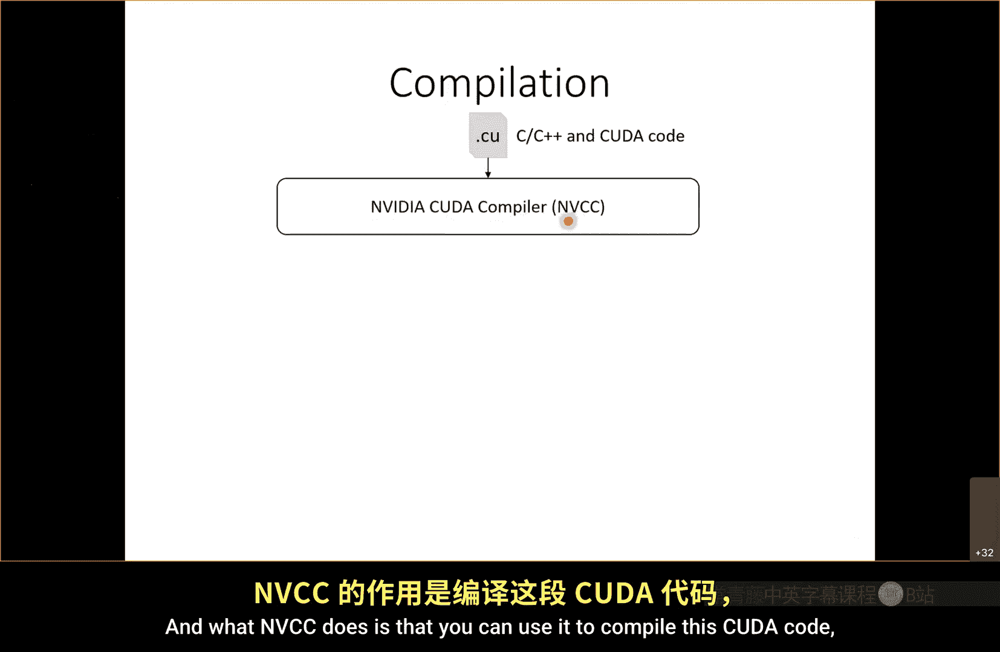

Okay， and I give it V add do couda and and write dash to tell it what the object it's similar to the interface of GB Remember dash when I can call my program whatever I want。

 I'm just going to call it V ad in this case So I compile and now I have this binary over here called V a that I can run。

Okay， now what does NVCC do when I call this， well let's see what it does。

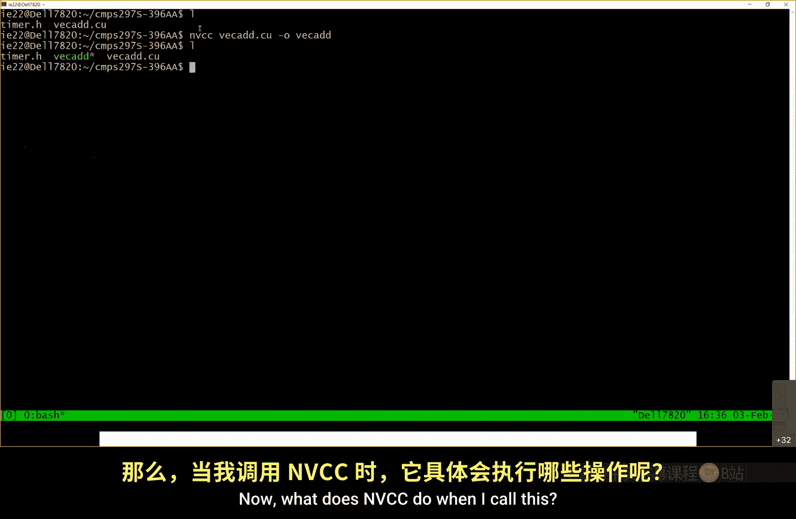

What NVCC is going to do is it's going to split our code into two parts's going to split it into the C C++ code and that code is going to be given to the host C or C++ compiler and the C or C++ compiler is going to use this C code to generate a host assembly file and this host assembly file is going to run on the CP。

On the other hand， some of the code in my Kuda file is not C code， some of it is KUuda code。

 so this kernel that I implemented that had understood through global before it and that was using this log index dotX and threaded X dotX key words。

 this is Kuda code and this was going to run in the GPU not on the CPU。

So the compiler is also going to separate that code out。

 so it's going to separate out the KDa code that's meant to run on the GPU and it's going to compile it down to something called PTX。

 which is a virtual ISA。Okay， and then there's a just in time compiler that will take this PTX and compile it down to the device assembly language。

 for example， SAS， okay and this happens when I run my program。Okay， and then and then finally。

 this device assembly code is going to be run on the G。

And what will happen is when I have this call to the kernel， where when my CPU code calls the kernel。

 what the CPU code is going to do is it's going to somehow go and call this device assembly code on the GPU to run on the G。

But for us we don't have to worry about any of this。

 the NVIDIA compiler does that automatically for us， it takes the code and one put a file。

 separates it into speed code and CPU code and GP code compiles the CPU code to the CPU compiles the GP code to the GPU and makes sure that the CPU code knows how to call the GP。

ok。😊，Whereer。How does it know someone is asking how does it know what code goes to the CPU and what code goes to the GPU well it knows from these function declarations and actually that was the next slide。

So we have keywords that differentiate where a function is intended to run。Okay。

 we saw the global keyword， the global keyword indicates that this is a kernel function that is called from the CPU and that or the host and that is executed on the GPU。

Okay， we also have another type of function， which is a host function and the host function。

 this is just， this is basically the regular C function。

 So if I don't write anything before my function by default。

 this is a host function that runs on the CPU。And then there's a third kind of function。

 which is a device function， runs on the which is a function that runs on the GPU。

 called the GPU and runs on the GP。Okay， so here if I， if I， if， if my。

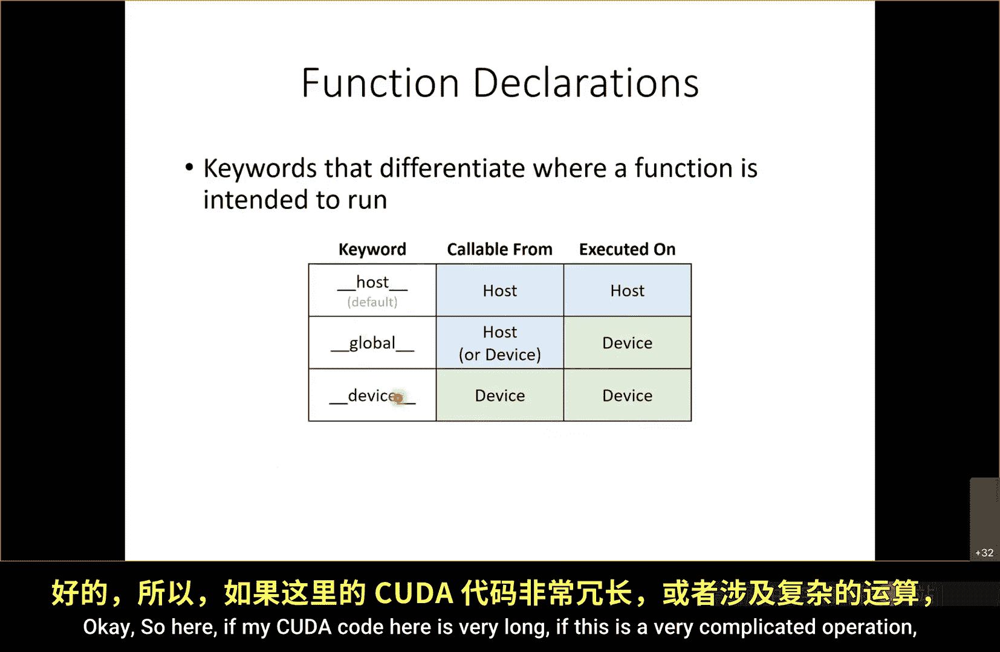

If my kUDa code here is very long， if this is a very complicated operation。

 I actually don't need to write put all this code in one function right it I can create a device function that does it for。

ok。😊。

So for and I'll show you an example in a little bit。

 but one question is why do I need the host keyword Okay why do I need the host keyword if if all my functions by default are host then why would I even need a host keyword in Quda and the reason the answer is that sometimes I might need to label something as host in order for me to be able to run it on both I might need to label something as host if if I want to label it as both host and device so let me give you an example of what I mean。

So let's say here， this ad operation was a very complicated operation。 Okay。

 and this ad operation is an operation that I'm doing in both my CPU version and my GP version。 Okay。

 so rather than having to replicate this code on both the CPU and the GP。😊。

What I can do is I can simply define a function。ok。I'm going to call divide， I can let me do this。

 I'm going to define a function。 I'm going to call it F。Okay， actually。

 it's going to return an end or a float。 I'm going to try define a function float F that takes two floats。

A。And B。Okay， and adds them and returns their sum。Okay。Okay， so here。

 instead of doing x of y plus y of I， I can do F of x of y y of I。Okay。

 so here this function F is going to add x of y and y of y， and similarly down here。

 I can call F of X I and Y， I。 Now I would like to be able to do this。Right， because if， if。

 if this operation is a very complicated operation。

 I don't want to have to copy the code inside of this loop was the same as the code inside of this room。

So I don't want to have to write this code， copy and paste this code down here。Okay。

 so one thing I could do is I could factor this code out into a function。

But the problem here is this function F。Is by default。

 only compiled for the CPU is not going to be compiled for the GPU。

 so the CPU function is going to be able to call it。

 but this GPU function is not going to be able to call it because the code for F is not going to be on the GPU。

So what we can do if we want the code for F to be on the GPU is write device。Okay。

 so now that I right device， now this function is going to be compiled for the GPU。

But the problem is that now the function will only be compiled for the GPU and not for the CPU。

If I want it to be compiled for both， then I will have to write this host device。

 so when I write host device before F， now the compiler knows to generate two versions of F。

 one version to run on the CPU for the CPU function to call and one version to run on the GPU for the GPU function。

Okay。😊，Is that clear？So really， this， this is only this is useful for for like a soft for software engineering reasons。

 just so that we don't have to duplicate our code。But professorfe。Yeah。I mean， typically， if。

 if you're implementing this function on the GP， it's because you don't want execute it on the CPU。

 right？ So， I mean， I don't see where this would be useful。 right， You're absolutely right。

 But you can imagine somebody， maybe， you know， some some of our physics colleagues over here who are attending this course。

 maybe they have this high performance code that they would like to run。

 And sometimes they run they have access to GPUs and sometimes they don't。Okay。

 right so they might want to sometimes run their code on GP。

 sometimes they want to run their code on the CPU， so rather than having to duplicate their code。

 they can simply use this approach to make sure they have this little code duplication as possible。

Thank you。O。All right， so now that we have this， let me compile it again。Okay。

 and notice it compiles if I didn't put host device。

 it would not have compiled and now and then this over here is the code that we just dropped so now we have a complete couda program that is able to do vector addition on both CPU and GPU and we also didn't have to duplicate this complicated code that does the addition we were able to have a function that we can execute from the call from both the CPU and GP and the compiler automatically generates two versions for it。

Okay， so the question is now that we have all this， how much faster？

How much faster does this execute？Okay， and to do that。

 I'm going to run this binary to see the performance improvement that I get。

Okay。😊，So I ran it， so the CPU time， remember， I had some timers inside of my code on the CPU it took 0。

22 seconds and on the GPU it took 0。12 seconds。Okay， so you'll notice that the GPU is faster。

But some of you are probably disappointed right now。

 you're probably expecting to be something like100 times faster and all you see is now you know less than two times faster。

Well， don't be too disappointed。 somebody is asking what was N in this case。

 It's a very good question。 So N， let me check， actually， just make sure。

So n in this case was2 to the power of 25， so it was around 32 million elements。Okay。Okay。

 so so you're probably asking， oh you know this is not that impressive and one thing to keep in mind is that this timing includes a lot of things。

 this timing includes the time it takes to copy from the CPUU to the GPU。

 the time it takes to do the allocation， the time it takes to do the copy the time it takes to run the code。

 the time it takes to copy back and the time it takes to do the delocation。

 but normally when you're running a program on the GPU。

 you don't copy data to the GPU and back for every function that you call you normally put your data on the GPU run a whole bunch of longrun operations and you call multiple kernels and then you copy the data back。

Okay， so let's go and take a look at how much does the computation take？Okay。

 so if I only wanted to call if I only want to see how long this kernel takes to execute。

 let me just time right in the new timer。Timer。And I'm going to do start time， by the way。

 KUD has built in support for timing things on the GPU that is more reliable。

 but for now I don't want to worry too much about that。

 so it's not the complicated pick so I'm just using some CPU timers that I define。Okay。

 so here I'm going to do stop time， and then I'm going to print elase time。

 and this is going to be the GPU。Tnal time。 And I'm going to color that。呃。Okay。😊。

And there's something I need to do over here to make sure that I time things correctly and I'll explain to you why I'm doing this。

 I'm going to have to call Kuda device。Synchronized。

 I will tell you why basically then what this is doing is it's waiting for this kernel to finish executing before it stops the timer again I will tell you I will tell you why we need to do that。

Okay， so now that I've done this， let me recompile。You can now let me run。Okay。

 so the kernel time actually takes 0。003 second， so now when you compare the time for doing the vector addition only to the time for doing the vector addition only on the CPU。

 you'll notice that it's much， much faster。So most of the time was actually spent doing the allocation and the copy。

 okay， but in normal programs， you don't do allocation and copy for every single function。

 you do that you copy the once at the beginning， you run your program which has taking you hours on the CPUU so that it takes you minutes on the GPU and then you copy the data back at the end。

Okay。😊。

Qu note about kernel as youous kernel calls， so by default when I call a kernel it's asynchronous so by default over here when I call。

VVc ad kernel what the CPU does it will call this kernel this kernel will go and start running on the GPU grid we launch a grid the grid starts running on the GPU and then the CPU actually continues on executing it doesn't wait for the GPU to finish and what this does is that it allows you to run things in parallel between the CPU and the GP so the CPU can do some things while the GP is doing other things。

So the reason I put now if we don't want the CPU to keep executing。

 if we want to wait for the GPU kernel to finish before we continue。

 then we have to call KUuta device synchronize so the reason I called Qa device synchronize over here is because I wanted to wait for the GPU kernel to finish before I stopped my timer okay so this is why I had coulda device synchronize over here。

Okay， so you can use KudDa device synchronize to synchronize to wait for for the kernel to finish finally error checking KUudDa has this error code co errorRT which we saw which which。

Wch is used to check for errors and the way we check for errors is like this so kuda error T and then we do if error equals does not equal kuda success then we can have some code for error handling so here if I wanted to check if my kernel had an error what I could have done is I could have written。

P的 underscore T。Eor， I can call it anything I want。

 and then it can do something like if error is not equal to the。Access， And then over here。

 I can do a whole bunch of things to handle this error。

 Let to check the reason why this error happened。 One thing I could do is call a function who to get last error that gives me information about what was the last error that that took。

Okay。😊，And with that said， you just learned tua。 Okay。

 so you just learn tua now you know how to take。Code that runs on the CPU and and copy the data to the GPU。

 run it in parallel on the GPU and then copy the result that the rest of this course is about parallelization strategies and optimizations that we can apply in order for us to get good performance out of our code。

 obviously if you if you're taking a app parallel programming course you care about performance。

 So I hope that you stay in this course， but if you took this course only because you wanted to learn how to write a QDA program then you already know how to do that now at the end of this lecture and in fact。

 after this lecture， we will release the first homework assignment where。

You will be asked to write a simple Ga program similar to the one that we wrote today。Okay。

 for more information about what we talked about today。

 you can refer to chapter two of the textbook and that is all for today and I will see you next time。

Yeah。Thank you， Thank you， Pro President。

