# 贝鲁特美国大学【中英⚡GPU计算｜CMPS 297S Spring 2021, GPU Computing】 p07 P7 性能剖析 -BV1LD6BBPEjt_p7-

Hello， everyone and welcome to our seventh lecture of。GPU computing Today。

 we're going to be talking about profiling。 In other words。

 how to profile our ka applications to see how well they're performing and where the bottlenecks。

So last time we spoke about DM banks。And we looked at how a DM bank is organized。

 we said we have these DRA arrays that consists of DM cells and we we the address。

 the memory address is divided into a row address that accesses the DM array and we read a whole row of the DM array and there's the slow process of you know going through the send amplifiers and putting it on the column latch。

 we also have to write it back because when we read we destroy it So this a whole process slope。

 but once we have that row in the column latch the column address is used to select。

Which part of the road that we read we want。 And this is a relatively faster process。

 And it turns out that if the next axis that comes along has the same row address。

 but a different column address， then we don't actually have to read the entire DM again。

 we can simply change the column address on the mugs to read a different part of the whole row that we read。

 and we call this and burst， this whole row that we read from DM， this is called the Dm burst。

 and if our axises land on the same D of consecutive axis land and the same Dm burst。

 then we are faster。 So the final line looks like this， if we have accesses the different Dm bursts。

 then we have we have all this time that we have to wait to read from the Dm。

 and then we have the part where we read the part of the burst that we want。

 And then if the next axis to is to a different burst。

 then we have to wait again until we read Dm and then we read from the burst the part of the burst that we want。

 however， if axises land in the same burst。Then we can simply read from the DM and then we read part of the birth and then if the next axis is in the same burst。

 then we just read the next part of the birth that it's much faster。And because of this。

 what we like to do when we access when we when we access global memory is we like threads that are in the same war to access consecutive memory locations because when threads that are in the same war。

 access to same memory locations， they're going to issue load instructions that are likely at the same time that are most likely going to hit the same DM birth and what the hardware can do is that it can combine accesses combine accesses to nearby locations into a single access such that only one DM transactions needed。

 and this is known as memory coales on the other hand。

 if threads in the same warp at the same time access memory locations that are far away from each other。

 then these accesses cannot be combined and each access will require。

Its own load load operation and the road warp will have to wait for all the load operations to complete。

 and this is known as memory divergent。We also saw how we usually have multiple DM banks。

 You can't have gigabytes of DM all in one DM array so we usually have multiple DM banks and we read from one of these banks at any point in time and what this does is that it gives us it gives us a way to hide the DM latency。

 So if if I'm reading from multiple Dran banks then then you know while'm while I'm waiting for one of the DM array from one of the banks。

 I can be reading from the births of the other bank。

 And then by the time I finish reading these births， then maybe the other bank is ready。

 I can read those births and by that time maybe there's a third DM bank that I was reading from the DM array and now it's ready and I can read those births and by the time we've done know I go back and then the other DM bank is also ready for me to。

Read its first So for me to effectively utilize my DM。

 I want to have many memory aes at the same time going to different banks in order for me to hide the latency up the different banks so that I always have data in my memory system ready for me to consume So we saw how having high occupancy in our SMs。

 not only helps us hide the latency in the core， but it also helps us hide it also helps us hide the latency in accessing our memory we then looked at it at another optimization。

 which is threat coening and we said that threat courening is an optimization where so far we've been assigning threads to the smallest possible unit of parallelism but we saw how the threat couring in the threat coing optimization we have a threat process more than one unit of parallelism and what this does is that it allows。

us to。Eliminate any redundant work across threads or any price that we pay for parallelism and an example we gave is with tile matrix multiplication we saw how you know different thread blockss that are processing different output tiles might be loading the same input tile so here the thread block assigned to the dark orange output tile and the other thread block assigned to the light orange output tile both read the same blue input tile。

Now， if these two thread blockss are going to be running in parallel。

 then find this redundancy is a price that we pay in order for us to get parallelism。 However。

 if these two threadlocks are actually going get serialized by the hardware because I have many more thread blocks and the hardware and simultaneously run。

 then maybe it's better for me to just have one thread log be responsible for these two output tiles and have this threadlock read this input tile and the green input tile and then compute this output。

 and then before proceeding to the next the next time of a。

 it's simply keeps the same tile of a and goes to another time of B and processes and different output tile And by doing this。

 what we've done is we've saved having to load a and then this time of a redundantly for both of this output time and this output。

And with that， this was a summary of the different optimizations that we've covered so far tuning resource usage to minimize occupancy。

 minimizing control divergence to get symptom efficiency。

 having uniform memory access patterns so that we have memory coalescing using shared memory tiling to capture data reuse and then threat coing to basically eliminate the price of parallelism。

 that price of parallelism could be redundant data that we load it could be redundant operations that we perform。

 or it could be something else like synchronization overhead that we will look at an example of later on。

And with that， we said that there exists a tension between these different optimizations。

 for example， when I maximize occupancy。😊，What I might end up doing is I might end up if I have the maximum amount of occupancy。

 the maximum number of threads on my SM I can possibly have， if these threads act with a lot of data。

 these threads may end up starting to compete for the cache， for example。

And they start evicting each other's data out and sometimes that's fine sometimes。

It's worth it for us to thrash our cash in order for us to maximize occupancy so that we can hide our latency。

But at other times， it might be the case that no， I prefer for my threads to I prefer to for me not to have too many threads。

 so not to operate at maximum occupancy in order for me to have better cash behavior so this is an example of where having too much maximizing occupancy might actually hurt performance。

Another example is shared memory telling so when I when I use shared memory piling every thread block needs to reserve a certain amount of shared memory and if I use more shared memory。

😊，That allows me to have more data reuse， however， if I use too much shared memory I could end up in a situation where my occupancy is limited because for example if my SM can take 2048 threads or so I create thread blockss than are 1024 that means my SM can take two thread blockss。

 however， if one thread block requests the maximum amount of shared memory on the SM。

 then because of the shared memory requirement the SM will only be able to have one thread block or 1024 threads running at the same time。

 even though theoretically it can have 2048 but the shared memory requests limits my occupancy。

 so this is another example of where there's attention between these different optimization and we also saw how thread cosing when we course when we have coing it reduces our redundant work。

 but threads when we co in every thread may require more resources which again may limit our occupancyup。

And based on this observation of there being a tension between the different optimizations。

 what we said is that we need to find a sweet spot that achieves the best compromise between competing optimization and important part of finding that sweet spot is understanding what is actually limiting the performance of my kernel right is if the memory or is it divergence or is it you know is it something else to understand what is limit so basically you need to know your bottleneck so a bottleneck。

Is basically a constraint that limits the performance of an application， right。

 Theres all kinds of different and different resources that we reuse when we execute on on a piece of hardware。

 And one of these resources runs out before the other。 Okay。

 so my may run out of bandwidth before I run out of fs or maybe I run out of flos and form out of bandwidth。

 or maybe I run out of thread slots before I run out of shared memory or maybe I run of shared memory before I run of thread slots。

 So there's all kinds of different different。Resources that that they limit my performance and the resource that limits the performance is called the bottleneck。

And when we when we this bottleneck， it depends on the application right because different applications use different amounts of resources。

 so the bottleneck is going to depend on the application。

 it also depends on the device because devices， different devices also have different amount resources。

 some devices have higher memory bandwidth than other devices。

 So the combination of the application and the device it dictates what the bottleneck is and the optimizations that we've seen so far。

 often trade off one resource for another Okay so usually when I apply an optimization I use more of one resource in order for me to use less of another resource。

 So for example， when I apply shared memory tiling。

 I use more shared memory in order for me to use less of my global memory bandwidth。

So knowing what but for example， if my application is not limited by global memory bandwidth。

 it's limited by occupancy because of shared memory。

 then obviously a solution to my problem wouldn't be to use more shared memory。

 a solution to my problem or a solution for me to optimize performance further is maybe to reduce the amount of shared memory。

So， you know， this just highlights the importance of knowing what your bottleneck is。

Before going and applying an optimization because you don't want to be to apply an optimization that trades off the resource that is actually the resource that is bottlenecking your performance okay。

 so it's important for you to be able to properly diagnose what is the bottleneck of your application so that you don't optimize for the wrong resource。

Okay。😊，Any questions about what we covered last time？

I know last time I kind of rushed the end because we were ran out of time。

 I think we also had some connection issues last time and that's why we were right out of time so does anybody have any questions about you know what we covered last time before I move on。

Okay， if there are no questions， then today， what we' will be talking about is how to know your bottle line。

 Okay， so today we'll be talking about how to know your bottlenecks and the answer is through profiling。

 So theda platform provides a pror that allows you to that allows you to know Pror application。

 See what's limiting your performance and analyze your bottlenecks in order for you to decide what is the best optimization to a point。

 So we'll be doing doing kind of an example of profiling today and we'll be referring to the vector edition application that we implemented you know in the second lecture of the course way back in the beginning of the。

😊，Okay， so let me switch to the terminal。

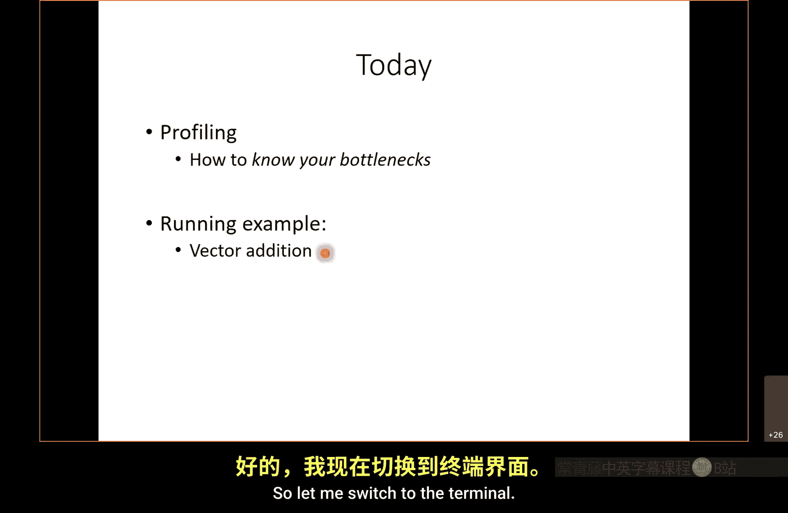

Over here， I have my vector a kernel that we implemented last time。

 let's take a look at it so here if you remember this was a vector edition kernel。

 there was basically a thread that was reading to output elements and writing to an input element。

Okay， there's two things that I changed in this file。

 The first thing I changed is I added this header file over here， Kuda profiler API。 and at the end。

 what I did。 So at the end of the main function。 I added this this call to Ka profiler stop basically what this does is when if you're profiling your code。

 it just makes sure that before the application exits。

 all the profiling information that was collected would be would be kind of saved before the application exits。

 So this is why I added this call okay。Everything else is the same we call like add on the GPU here we do our equipmentment copy。

 we call our kernel and then we do ament copy back and we do Ca free and then the kernel is also the same。

So let's get started， I'm going to compile this。Okay。

 and before you know you just we just run the vector edition and it runs and then it we had inserted certain commands in our in our code to print out the timing information Okay。

 well， it turns out we didn't have to do that because we could have actually let the profiler do it for us and here's how to do that。

 So the profiler that comes with the coda SDK is called NV prompt。Okay， so en V prof。

 the way you use it is you there's different ways of using it。 The kind of the。

 the simplest way is to write en prof and you provide your， your program。 your your binary。 Okay。

 so you run en profit and you run by binary。So I run en Prof and I run my binary。Okay， it runs。

And after it finishes running what it does is that it outputs all this information for me so this is a table and the table basically has the different calls that we made Okay so here it's the time that we spent copying from device to host here this is the time we spend doing a event copy from most of the device this is my actual VA kernel this is the co ofM copy API called notice here it separates things into GPU activities and then API calls these are API calls that we call from the CPUU and these are things that happen on the GPU。

So we call put them and copy on the CPU and put and copy on the CPU performs a GPU activity。

 which is copying from the device to host or from the host。Okay。

 so what this is telling us is that for each of these activities， so the MacAd kernel， the web copy。

 device synchronized， ka free， K analog， all these different things that we do。

 a lot of these things are happening without you without you knowing that they're happening because they happen under the hood。

😊，What it tells you is for each of these things， what is the time that it takes？Okay。

 it also tells you for some of these things how many times they're called。Okay。

 so here it has the time that it takes。If they're called multiple times， there's an average。

 there's a minimum there's an maximum， this tells you the total time that something takes and also tells you what percentage of the total execution time it takes。

And what you'll notice is that the times are actually very similar to the times that we timed up here so here you can tell that copying from the device to the host it us it takes382。

82 milliseconds up here we timed it as 384。2 milliseconds The reason is that over here we're using a CPU timer so here there's a little bit of additional things that the CPU is doing wireless timing this is probably a more precise timing for how long how much time we're spending copying from device to host。

Okay， and it also tells you what percentage of the total application time is spent doing this We spent 52% of our time copying from device to。

Okay，328 for copy from post the device are also similar here we have 329 our kernel execution took 13 milliseconds at 1。

8% of the total time and that's also similar to what we found over notice that there're always slightly less because this measures a little bit more than。

诶，真的真的。Then you know， then just the pure time to takes the uptake on the GPU because there's a little bit of overhead from the timers that I'm using。

 the CPU timers that I use。Okay， so this this is you know this is very convenient because when you write the CD application。

 if you don't feel like inserting all this code， you saw how you know there's a lot of code dedicated to just the inserting and inserting timers and the reason I did that is because I didn't want to have to run the profiler every time we do a demo demo in class but if you don't want to in yourku application have to insert all these timers everywhere you don't have to it's as easy as just calling M Prof with your application and it basically tells you how long everything is taken。

Somebody's asking how would MVProf work on the other machine that you guys are using which requires you to submit jobs and batches。

 but what you could do is you could submit a job interactively if you would like to run a DProf and when you're on your application and then we're also going to see today how we can use a DProf to also export more information about our code in order for us to analyze it using a visual profiler and we're actually going to do that do that next okay。

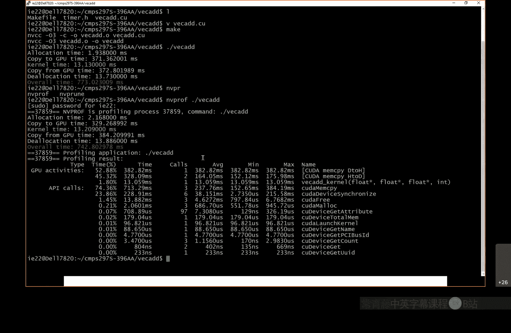

So this is the command to run enV Prof on vector edition this is an example of the output that we get。

 These timings are a little bit different from the timings I'm showing you because I obtained them on different machines than the I'm using for this lecture but the the trend be should be similar don't worry about taking notes all the commands that I'm going write in in the command line I will have in the slides for you so you can just sit back and enjoy know the lecture and the commands will be in the slides so you don't have to worry about taking notes of the command。

Did somebody have a question？Yes， I wanted to ask about what's happening under the hood with the profile。

 Is it like hardware counters？So it depends what you're profiling over here you're just finding the execution time of every call that the GPU does so this doesn't really need hardware counters。

 you have this notion of a stream and we will talk about streams later on in the course but you have this notion of a stream that has these tasks taking place and they wait for each other so inside of these streams what everyvPro does is that it simply times how long each activity each activity takes okay so it's quite easy for you to imagine that when you call put it that copy inside of couldn copy when when when it starts and when it finishes there's the runtime system is somehow taken care of starting a timer when you start and then stopping a timer when you stop later on what we'll see is we're actually gonna profile all kinds of things like the cache and occupancy and every bandwidth and all these things and these definitely use hardware counters and you see you'll see you actually。

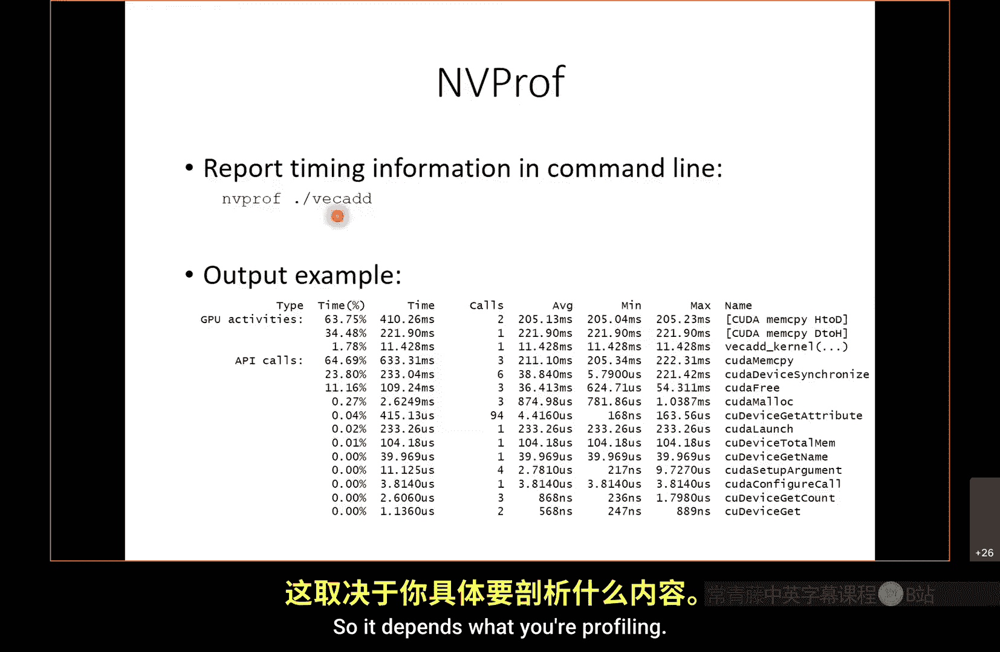

See kind of selfie going on that shows you that these hardware counters are being okay？

Okay you us do that， we're just about to do。So let's say I wanted so here it prints these timing results for me standard output。

 but let's say I wanted to export these values to a file so that I can I can analyze them more visually using a visual profiler well I can do that and the way to do that is like this so before what we did is we calledop we call envy Prof。

On our vector a our vector ad executable， if we want to export these timing results to some file。

 we can actually write dash。And provide the name of the timeline file that we want。

 So here we can write something like timeline dot Prof。 you don't have to say do prof。

 You can name anything you want。 I just like to call call it dot Prof to remind myself that this is a file that contains profiling information。

 okay。So I can run NVProf and provide it with and tell it that I want it to export all this information to a profiling file and it does that for me。

 so here I'm going to run it again and it runs and it's going to export the information。ok。Okay。

 and you see it tells us here that generated a result file and that this result file is at this location。

All right， now what this does is gives me timing information。

 but if I want other kinds of information related to things like occupancy。

 things like instruction count， things like memory bandwidth。

 I can actually also generate that information and to do that there's a command。

Which if I don't want the time of information， I want other kinds of profiling metricss。

 I can actually write dash。And I can specify one of the profiling metrics that I want here I'm just going write all because because I wanted to export all the profiling metrics。

 but you don't have to write all what you can do is you can you can look in the documentation。

 see what profile metrics are available and you can maybe maybe you're interested in a specific profiling metrics and you can just export。

Okay and and now what it's going to do when I write dashM all is that it's going to output not the timeline。

 not these time results， but it's going to output these profiling metrics to the profiling file now I don't want to overwrite my timeline Pro file so I'm going to call this something else for example I can just call something like metrics。

 Pro。ok。😊，Now now you notice that when I run this， these profileing metrics that we're about to collect about things like occupancyC。

 cash and delivery band things like that， they use hardware counter and obviously there is an overhead to using hardware counter。

Because when you use when you start when you start profiling， you're interfering with the execution。

 the actual kernel， because profiling takes time you're spending more time gathering all these statistics about the about the cash。

 all these statistics about you know， occupancy and things like that。 so because。

We don't want to interfere too much with the the performance of our application as we profile it。

 because then our profiling is not going to be accurate。

 What M Pro is going to do is that it's actually going to run our kernel multiple times。

 And each time it's going to collect a different set of profiling metrics。

 So you're going to see that happening right now。 So I run this， it says M Pro is profiling， right。

 And then。So here we use those sense says replaying kernel， replaying kernel， replaying kernel。

 and every time it collected a different different。Okay。

 and I notice how the overall time took longer， the reason is that this is actually running many money kernel is not just one。

 so the timing information we're getting to hear is not reliable。

 but the profiling information that we get is hopefully reliable because we ran a kernel many times and each time we collected a different set of profiling information。

Okay， so now we have our profiling our timeline and timeline Prof and our metrics and metrics Prof now what we would like to do is we would like to you know take a look at timeline Pro and metrics。

 Pro and see what information they give for。And the best way to do that is using the visual profiler。

 There's also something called endsight that comes as with different IDs。

 if you're using visual studio or eclipse， you can use use something called endsight that's you know also a very powerful profiling tool。

 But for simplicity here， I'm just going be using the NviIdia visual profiler。

 And to run that I'm going to run and。😊，So XZVP， now the Infinia visualual profiler uses a graphical user interface。

And since this is a command line， it doesn't display graphical user interfaces I'm connected to a remote machine via command line here so what I've done is when I connect it to this machine I actually enable something called X forwarding that allows you to forward the graphical user interface that's running remotely on this machine the2 be displayed on your local machine so here NVVP is actually running on the server。

 but it's going to send me the graphical user interface so that I can display it on my computer in which I'm using to to teach the lecture okay so I'm going to run NVVP okay。

I'm going to put this at the end so that I can keep using my command line。

 This tells this tells it to run it in the background so that that doesn't so that I can keep using my command line after after I went。

The running VVP。It takes a while to run it be the graphical user interface here tells me to specify where I want to put the temporary files the profiler is using and ispress OK。

And now it's launched the profiler， and this is what the profiler looks。

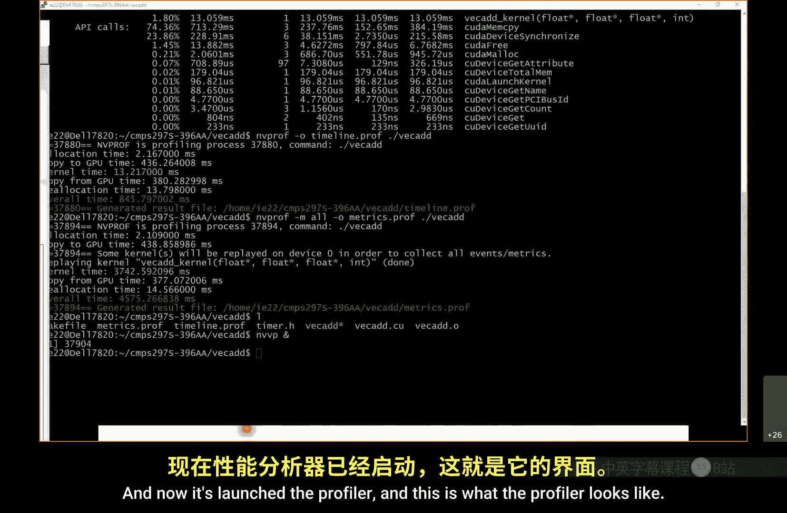

So here you can create a new session and this you can create a profiling session where you can use the visual profiler itself to profile the application or you can import profiling files that you you generated using enV Prof which is what we do so what I'm going to do is I'm going to click hit import and I'm going to specify that the importing files that were generated by NV Prof I hit next you can profile multiple processes we just have a single process I'm just going keep in a single process the hit next。

And then here it asks me for the timeline file and also ask me for the metric file。

 so I'm going to browse to find the timeline file here， my timeline file is over here。I L Prof。

 then I've been browsess to find the metrics file and here the metrics file is metrics Stop。Okay。

 we're going hit finish。 And what this does is that let me maximize this。

 So now what it has done is it has。

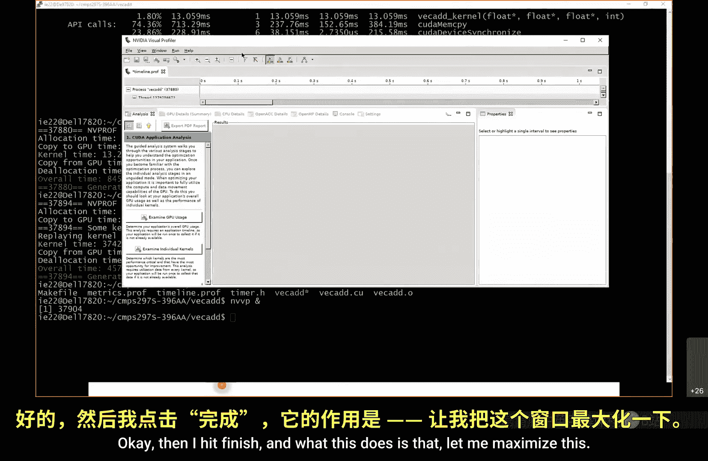

Put the timeline over here and then the metrics we can take a look at down here。

s first let's take a look first at the timeline。So here what the profiler does is that it has this timeline notice up here you have seconds and over here on the left you have the different activities that take place so we have things like Men copypy host a device。

 things like Mencopy device to host things like compute so here we have the VAD kernel that we executed and then you also have something like streams everything we'll look at streams later but basically everything we're doing now。

Is going into the default streams we will see all of these things overlaid with each other and the default stream So over here this is the good device synchronized execute at the very beginning and then here you don't see anything over here because this is the time that the CPU was spending generating the data So and then later on once the CPU was done generating the data over here we can see our our actual。

Our actual timeline， so you'll see what what's happening here is that you'll see the time that is spent doing KaM copy。

Okay， so it tells us it's doing KM copy here。 and then there's also a little bit of time over here if you can see it。

 this is the time that it's done its using Kma Okay。

 and then here you do K M copy and then over here you're doing another K M copy。Here remember。

 we copied two arrays， not just one array。And then over here。

 this is the time it took for the vector Ed terminal check。Yes， let me have you， if you guys。

So here North how here it says could copy So this host a device。 This is could copy device to host。

 So that's their corresponds to this。 This over here is the vector edition kernel。

 So that corresponds to this。 And then this here shows you the stream where everything's overla。

 So we will see what the time and the time it's taking。

 So here tells you spent this much time doing could copy host device and then this much time doing another could copy host device and this much time in the vector a kernel and this how much time doing couldn copy device。

And this over here at the end is also doing the couta free stuff。Okay， notice down here。

 if you take a look at what's showing up over here， it'll show you that the depends could are free。

It tells you the start end time safety over here， it'll show you that it's safe could amount for。

Okay。😊，Any questions about the timeline？So this is this is a prettier way of visualizing how where time is being spent in your application compared to this know old school way of using the profiler the enV Prof to just throughout all all these numbers and also you know these are for different purposes。

 this is quicker over here you just get the numbers quickly okay but this is if you want to do a more in- depthth analysis and spend more time on it。

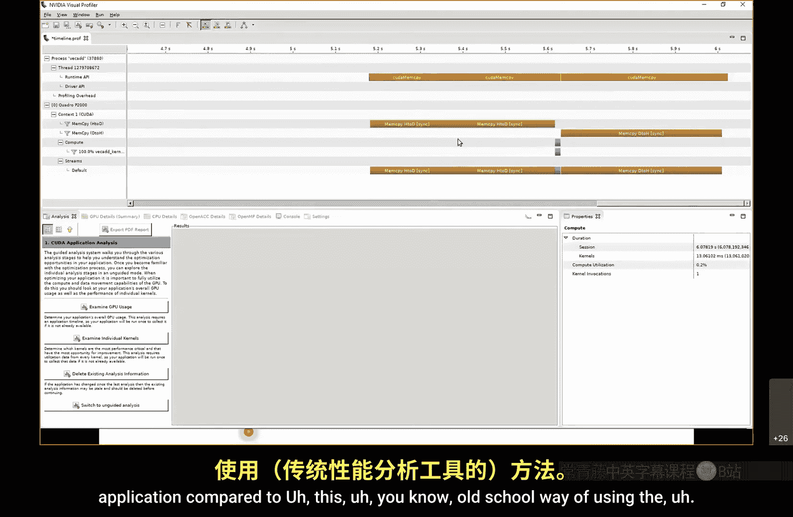

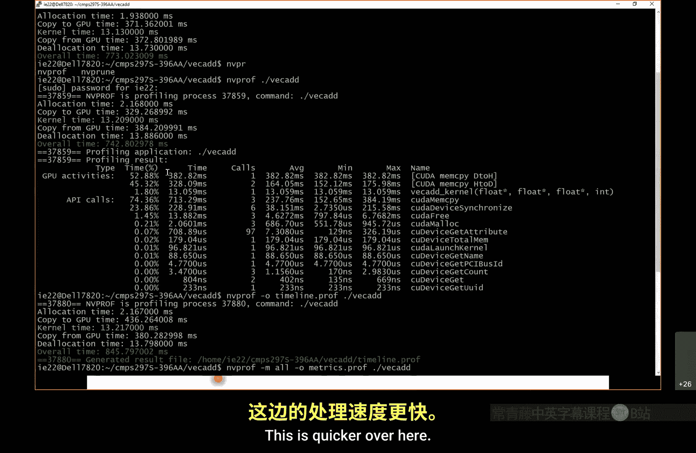

Any questions？So doctor， but this doesn't tell us if our application is memory bound or right we'll get to that next So this is just the timeline and we're just about to look at the profiling the profiling the profiling of the metric。

I just wanted to see if anybody has questions about the pipeline。

 I think it's fairly straightforward right maybe how many people have questions。Okay。

 so next let's now take a look at the profiling results。

 I'm going to hide the timeline a little bit and here but we can write something like examine GPU usage。

And when the write example GP usage， it tells us some high level information about the overall GPU usage of our application。

The whole application。And you'll notice that it tells us oh， there's a low them copy efficiency。

 there's low them copy an overlap， basically you can actually overlap multiple calls to them copy so just telling us that we're not doing that。

 we're not doing that and we are doing that because we haven't learned how to do that yet。

 but later on hopefully we learn how to do these things。😊。

It tells us low kernel concurrency because you know it says the percentage of time when two kernels are being executed in parallel is low so we can actually call multiple kernels to run at the same time on the GP。

 but we also haven't seen how to do that So that's why it's telling us this and you know it tells us know low computer utilization etc ce Now what we can do our program。

Could consist of multiple kernel。And what we can do is we can go and examine individual kernels now in our case we just had one kernel which is the vector addition kernel so we click on Ex individual kernels here there's just one kernel but if you if you run many kernels you would see many different kernel so when I click on this。

First it gives me some high level of information over here on the left。

 it tells me when the kernel started executing， when the kernel finished executing。

 it tells me the grid size number the number of blocks in the kernel tells me the block size。

 the number of threads per block， it tells me the register usage so how many threads are used by how registers are used by each thread tells me how much shared memory is used by each block。

Okay and here it also tells me stuff about occupancy。

 So it tells me how much occupancy is has been achieved by the kernel Okay and this here tells me what is the the theoretical the peak occupancy that my kernel can achieve So in my case。

 when I call this vector edition kernel and the number of threats per block is 512 So that's usually large enough for me to not be limited by the block size。

When it comes to occupant。Also， the number of registers for thread is low。

 I'm not using any shared memory， so there isn't really anything that can limit my occupancy over here and that's why my theoretical achieved occupancy is 100% I can reach 100% occupancy in the way I've configured my kernel The actual achieved is 88。

1% and that just has to do you know you can never be 100% occup there's always you know different things that happen that may result and you not always fully utilizing yourM that has to do with some runtime things that happen at runtime in the device and just basically how things are schedule。

Okay， so now what we can do is we can go and look at more detail at the kernel Okay so here we can write something like perform。

A kernel analysis， so I can click perform kernel analysis。

And the first thing that I get is the utilization and this utilization is divided into compute and memory。

 so it tells me how much am I utilizing my memory system。😊，And how much am I utilizing my course？

And from looking at this， does it look like this application is compute bound or is a memory mode？

Computer bound。我出 the来。RightSo I'm not utilizing my compute。

 I'm fully utilizing my memory right so what is what is the what factor is limiting what factors not being utilized and what factor is limiting you from utilizing the other factor。

It's swimming bound becauses。I think a lot more memory than complete so。Right， you're right。

 it's memory bound。 So remember this is vector addition right so we analyzed vector addition before and we observed that vector addition does very little operations per byte。

 So vector addition is memory bound and we can see this over here because we can see that the memory system is always busy。

😊，Right it's more than 80% busy the memory system and that's pretty high。

 right it's very hard for you to utilize the memory system 100% okay？

You're going to has to be perfect and run perfectly in order for it to utilize the nervous system 100% so 80% is actually pretty high so your memory system is fully utilized Okay。

 the compute so the cores are actually not not utilized that much。😊。

RightSo I'm only utilizing my course a little bit more than 10% of the time。

What that means is that the remaining 80，80% to 90% of the time is the cores are not doing anything。

 they're id。And so that shows you that I'm really underutilizing my compute I'm fully utilizing my memory。

 so obviously my kernel is memory bound。And the provider is actually smart enough to tell you that。

 so if you read up here it says kernel performance is bound by memory bandwidth。

A kerneldal pers is bounded by memory bandwidth。So a very quick way of figuring out if your kernel has every boundary compute mount。

 if you don't want to sit there and count all the loads and reason about them in your code is by profiling group。

Now， another nice thing is that over here when it tells me how the cores are utilized。We train。

So here when it tells me how these cores are utilized。

 it actually tells me when the cores are being utilized， how this utilization is being broken down。

So what this is saying is that it's this dark purple is the amount of time it spends doing arithmetic operations。

 this steel color is the amount of time it spends doing control flow operations and the light purple is the amount of time it spends doing memory operations right because when we execute in our cores。

 we execute instructions Some of these instructions perform arithmetic。

 some of these instructions that prefer control flow like the F statements and things like that and some of these instructions are going to be load as store instructions。

😊，So here you can tell that most of the instruction most of the instructions executed by the core are memory instruction。

 there's a very little amount of control flow instruction and there's also a fair amount of arithmetic operation and this is not surprising right because every thread is doing one every thread is doing one if statement so it has a branch instruction and every thread is doing two loads at a store so and it's doing one addition is doing two loads at a store so it's August that there's going to be more memory instructions than arithmetic instructions and there's going to be a very little amount of control flow operation。

Okay， any questions about this， we'll go into more details now。

 but any questions about this plot over here？Okay， so since our there's three different kinds of analyses that we can perform。

 there's memory bandwidth analysis， compute analysis， and also latetency analysis。

And since our kernel is limited by memory bandwidth what the profiler does is that it recommends for us to use to do the memory bandwidth analysis first it it says the most likely bottleneck to performance is the kernel is memory bandwidth so you should first perform memory bandwidth analysis to determine how it is limiting performance and later on if we really feel like it we can also do compute analysis weightency analysis okay。

As let's start with memory bandwidth analysis when we click on memory bandwidth analysis what the profiler tells us is it tells us how much each part of the memory system is being utilized so here you'll notice that this table here is broken down into shared memory L2 cache there's something called a unified cache and then there's also the device memory which is the global memory and the system memory has to do with you know the CPUU memory。

So what do you see over here， What you notice， So what is， what is what。

Part of our memory is fully utilized and what other parts of our memory are idle。

The device memory is utilized to the shared the caches are not very utilized。 exactly。

 So here you learn that our device memory is fully utilized， right， very high utilization。

 almost to the max。 Okay， it even tells us that every bandwidth that we are achieving。

 It tells us where we are achieving a every bandwidth of124 gig per second。Okay。

 and also tells us that， you know， obviously， we're not using shared memory。Okay。

 our L2 cache is idle most of the time， it's not fully utilized。

we spend most of the time waiting on our device delivery。Okay， add， etc cea。

Another thing we can see is we can see this nice image that tells us you know shows us the inter connections between all the different memories and it tells us on each of these connections what the utilization。

 how many requests were made so here here reflects the vector Ed kernel and it tells us this is shared memory。

 this is texture memory， local memory， global memory。And what you can see is all the requests。

To your shared memories， texture memory， local memory， these are all zero。

 and all the actual requests are are to be global memory。Okay， so here at this global area。

 it actually tells the number of requests。And then shows us how you know。

 go to unified cache L to cache and then the device that here it tells us these you know how much each of these links is achieving。

Okay。😊，好。So this is not surprising right， we knew that vector edition was limited by global memory bandwidth。

 but this kind of verifies what we expected and when you're writing very complex applications it becomes harder and harder to reason about what's limiting your performance so profiling becomes even more and more important。

ok。😊，Let's go now and take a look at computes so obviously obviously if we're profiling and in order to optimize our code。

 it's very obvious that what's limiting our bandwidth here is what's limiting our performance as global memory so we have to go and optimize that but let's now take a look at what else what other kind of information we capable look getting so we could come back here and we perform the compute now。

So here if I write performform compute analysis， it gives me different kinds of information。

 It tells me things about functional unit utilization。

 so it tells me each of the functional units in my core how utilized are there so there's a load store unit。

 there's a unit for doing single precision arithmetic floating point arithmetic so this is what single says there's a unit for doing control flow right so this is this is what this says and you'll notice that we're utilizing them all pretty low and the reason obviously is that this is not a compute bound application it's a bandwidth it's bound by memory bandwidth。

This over here tells us the utilization。 This down here tells us。

The execution counts the instruction count so it tells us how many FP32 instructions we have。

 how many integer instructions we have， how many control flow instructions we have how many load store instructions we have etc Okay so this is what this over here tells us and this count here tells us the types of floating point operations that we're performing so obviously here vector additions are doing F ads so it tells us that we're just performing F add we're not doing FP mu for example。

 or FP mu add diffused multiply addd Okay or any special instructions like sine and cosine and things like that。

So this is nice， it tells us you know what are the different instructions we're executing and how much utilization we're getting from our different functional units inside of the S okay any questions about this？

Professor， where do the integer instructions come from。

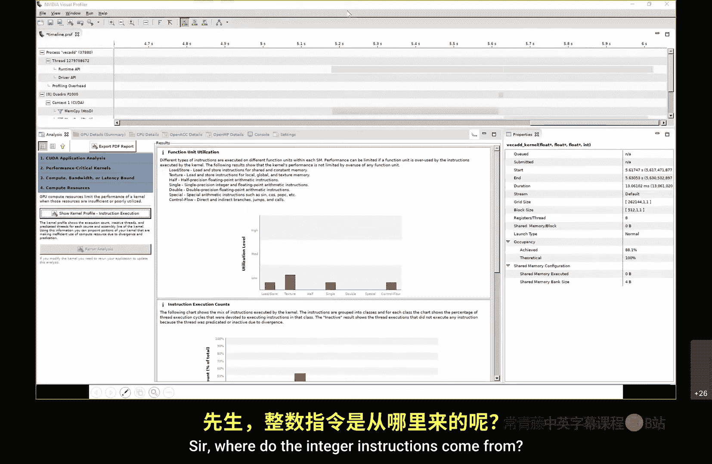

Great question， so let's go back to our code。So over here。

 it's related to memory addresses and right， right exactly over this stuff。

 this index computation is all inger arithmetic。Right this comparison here I less than n。

 this is an inte operation right if the branch that branch is if this condition is true is a control throw instruction。

 but i less than n itself is an arithmetic construction and then as somebody was saying when you do Z of I。

 what this does is this translates into several instructions that are're going to calculate the address because you're going to take the address in z and then you're going to add I2 to it before adding I you need to multiply by the size of the elements you're going to do I times4 because the floating point number is4 then you're going to add it to the base address of z and then you're going to do the store。

So each one of these memory aes involves several integer arithmetic operations that calculate the address。

Okay。不ear。

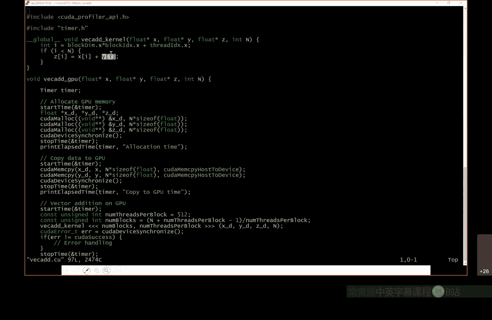

Yes， thank you。Yeah， you welcome。Okay， so now that we've seen the compute utilization。

 let's also go to our latency analysis so we can do latency analysis。And here with latency analysis。

 remember how we said that the most effective way of hiding latency is having high occupancy because when we have high occupancy。

 we're able to hide the latency of our applications by filling into these pipelines。

So here when we do latency analysis， it tells us that occupancy is not limiting thermal performance Okay。

 so you don't have to worry about occupancy。And we already saw here on the right that our occupancy was high。

But the nice thing here is that it us more information so it tells us the theoretical number of blocks we can achieve for SM and the device limits so we're under the device limit so we're not worried we can see that our number of active warps are a number of active threads are fully utilized and this is what we care about right so ultimately we care about having the maximum number of threads slash wars executing because the threads and the warps are behind blade。

And then here it tells us that our achieved occupancy is 88%， our theoretical occupancy is 100%。

 obviously the device limit is 100%。So we have nothing that's limiting occupants it also tells us you know the different resources so things like threats per block。

 boards per block and a none of these are are kind of have reached their limit so we're safe in terms of occupancycc be down here it has these nice plot that help you reason about oh if I change my block size how will this affect occupancycc or if I change my shared member usage。

 how will this affect occupancycc。So here it basically tells you that if you increase the threats per block。

 if you vary the threats for block， you get this change in occupancycc。

And notice how you have these intermediate values where the occupancy is lower than 100%。

 but then it goes back up。 These are basically the situations where yourre。

Total number of threads is not divisible by your threads per block。

 so here you wouldn't have full occupancy because of that lack of div visibility remember we saw an example of this before。

Okay。One final thing we can do is we can do something called PC sampling and I think the device that I havet actually device that doesn't actually support PC sampling。

 however in the slides I've included some profiling that I've done on a different device that shows you what information you get if you do but actually switch decides to show you that。

By the way， I have a screenshot of all the different things that we saw today in the slides if you guys would like to refer to it later on。

 you can also refer to the video this is what we would get we when we do the PC sampling so what this tells us is it tells us the reasons behind the stove。

Okay， so it tells us that if whenever we have latency， whenever we have stalls in our。

And you know wars stalling and tell us the reasons why these wars stall to Lord that for vector addition。

 the most common reason for a warp to stall as what。

 it's memory dependence so it's basically waiting it's stalling because it's waiting for some memory operation to come。

And this is obvious， right， So inor edition， it's memory bound。

 So there's not the curls don't do much besides weight for for memory。 Okay。

 so so here memory dependency is。Is the most common source of stalls another one for example is execution dependency so this is probably because of the branch that we have we are doing the check right because we have the branch that compares that does the boundary check so we to wait for the branch result to get resolved so because of this subors will stall until the branch gets resolved。

Okay， and these are other things that are just minorr things that happen here and there and you know。

 depending on what your application is， one or thing or the other may be big and that will help you reason about what's limiting your performance and what you should do。

Okay， any questions about this？Professor why was there only， Why was there only four blocks active。

 And like couldn't we have used more， Is it because the size of the array we gave it is below。 Okay。

 so the reason is that my block size is 512 threads。Okay， and my maximum number of threads is 2048。

 so 2048 divided by 512 is four blocks。So this is why I have four blocks active。

But the fact that I don't have the limit I don't reach the limit in the number of blocks is not really an issue right it's not an issue because what I care about to hide my latency is fully occupy having the maximum number of warbs orre threats。

So whether I achieve 2048 threads using four blocks that are 512 each。

Or if I achieve the maximum number of threads using eight blocks that are 256 each doesn't really matter。

 it might matter for other performance metrics， but for the sake of occupancy。

 it doesn't really matter if I use four blocks or eight blocks that are smaller or 1 succeed blocks that are even smaller。

Right。Now， if I set my block size to 32， for example。

 and the maximum number of blocks I my lab is 32， then my occupancy will be limited because then the block size will limit me before the maximumimal threat count does and that's actually exactly what I was planning to do now。

As let's go。Professor， yes yes question。Yeah， I just wanted to follow up so since the number of active blocks is the number of active threads divided by the number of threads per block。

 it means we have not occupied all the SMs like because if had we occupied all the SMs then the blocks would have。

Then or can we have more than one block on MSM or not？Yes， yes。

 So you can have more than one third block on NSM。 This information pertains to to NSM， right， It。

 It doesn't mean were we， you know， you， we have many blocks。 We have this many blocks up here。

So we have enough blocks to fully occupy all the of them。

What we care about when we talk about occupancy and hiding latency。

 we care about having achieving the maximum number of threats possible。Okay。

 but if if like we had filled all the Ss and still there were some blocks that had not been assigned to some SMs。

Right， so those blocks are simply going to wait turn until other blocks finish and then they will be assigned to a DS。

Okay， but would we see like eight active blocks per render， they would it would still be four。

 but they were like it would take longer。this doesn't mean that only four blocks run the S run on an S for the entire execution。

 this means that four blocks at a time will run on the S。Okay， I see， thank you。坚nderwork。2， yes。

A significant part of the PC， like not the significant。

 but no A non negligible part of the PC sampling of the stall time was related to， to branches the。

I don't know what was， what was called exactly， but we， we， we have no branch prediction。

 not even a simple one or speculative execution， Not at all。 so， so how much， you know。

 how much whether or not there' is branch prediction and how sophisticated it is is something that is。

 is not necessarily public information。Oh， okay， however， even if there was branch prediction。

 it would definitely not be as complicated as that on the CPU。reason the reason being that， you know。

 the reason being that you know， GPUs you care more about throughput and laency。

 you don't care about the， it's fine if the branch takes a high amount of latency because you have many。

 many other warps that you can execute while waiting for the branch to get results。Okay。Okay。😊，不要有わ。

Okay， so let's take her with this a little bit let' let's nice with our profiler and let's see what happens if we set our thread block size to underutilize the GPU so here let's say so before I had set my thread block number fetch up to 512。

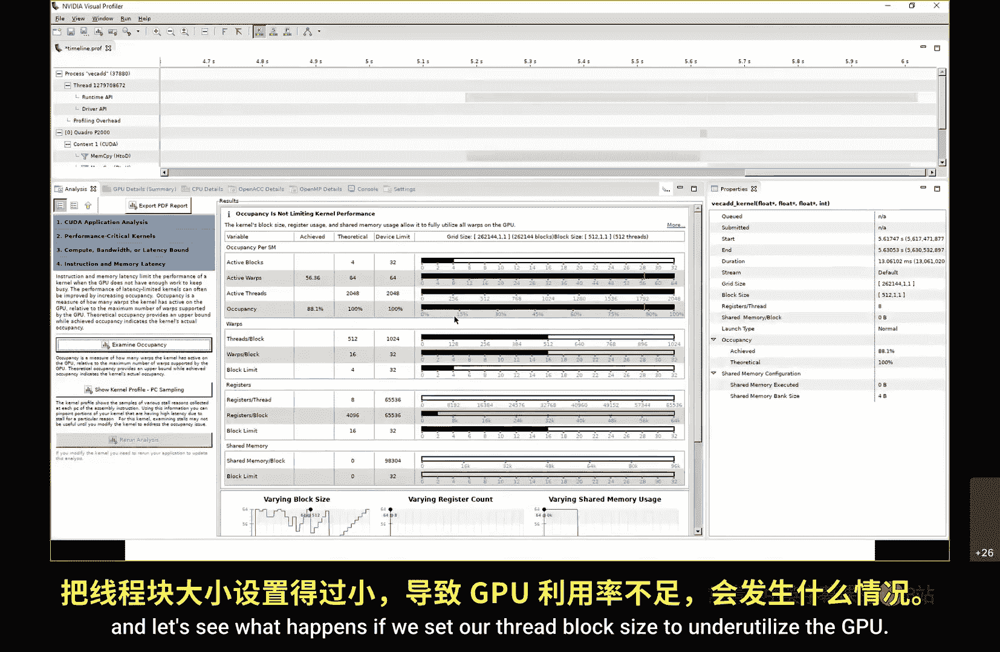

Okay， now if I set my number of threats per block to 32， for example o。没有。落黑一闭。Okay。

 if I think my number says which is happening again？Okay。

 so if I set my number of threads per block to 32 for example。

 what we can expect here is we can expect to underutilize the GP right because if I have 32 threads per block and I have a maximum of 32 blocks allowed that means say I'm going to have a maximum of 2024 threads that I can schedule on the S but the S can support 2048 so here I'm expected to not reach for occupancy and let's verify that so I'm going to compile this。

Okay， I'm going to run my profiling commands again， So I'm going to profile with the timeline here。

 I'm going to just write dash O to remember that this is the this is the。

The example where we were limiting occupancy。Okay， by the way。

 notice how our performance goes down right so before it was 13 mill seconds now it's you know it's almost twice as slow why because our occupancy is half what it used to be。

So that's why it's twice as slow， so your thread do size does really matter and then we'll also degenerate the metrics。

Im also going to call this matrix dash buck。You notice how it runs many times They replace the kernel。

 Okay， and now we have generated these these。The metrics and the timeline for the occupancycc。

 so let's go back to our profiler and lets let's import these new files so we do go next。

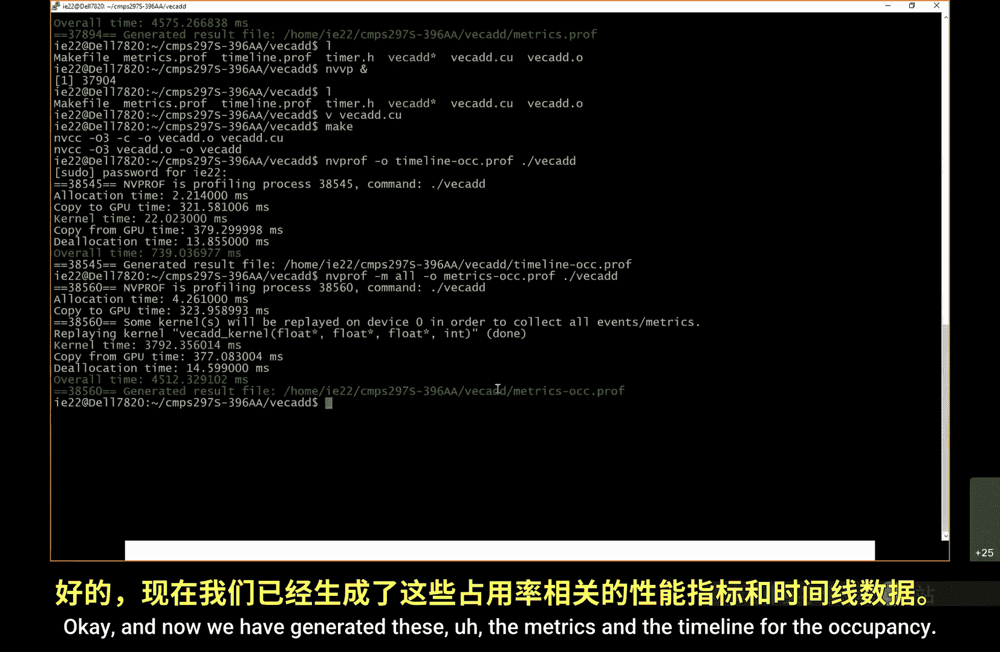

Next。this time， I'm going to get。Timeline dot org dash og that。Metrics dashg。Go' to hit finish。Okay。

 so now if we go and we examine GPU usage and then we examine individual kernels。

 we press on the kernel， now what you notice you notice that we have actually I want to go back actually sorry I rush this So when I click on Ex GPU usage okay。

 it tells us do the same thing when we write examined individual kernels。

 we press on the kernel okay what you'll notice is that over here on the right。

 it tells us that our block size is 32 and it tells us here that our occupancy at the achieved occupancy is 35% and it tells us that the theoretical maximum occupancy that we can achieve is 50%。

Okay， so it tells us that as law and if this application logs perfectly on the GPU。

 it won't be able to achieve more than 50% occupancy and it tells us that the factor that's limiting our occupancy is the block size。

 which is what we expect。And here if we run performform kernel analysis， again。

 the kernel is still limited by memory bandwidth as we expect， but if we runperform latency analysis。

 now us it it gives us a different message up here。

 it says GP utilization may be limited by block dies and notice here how the block limit is in red because the block limit now is higher than the maximum。

 it tells us that the theoretical blocks that we can have is 32 and now it tells us that the active threads。

 the theoretical maximum number of active threads we can have as 024 even though the device limit is 2048。

All right。Okay， so this tells us， this gives us some information about maxim。Okay。

 I notice here how it's highlighting our threads per block and points to 32 over here to showing us that。

 hey， look， you're down here， if you change your thread block size a little bit you can come up to of a higher occupant。

ok。😊，Is this clear to everyone any questions about this？It's pretty neat right。

 the profiler it really helps with identifying what your bottlenecks are。

So this here is the you know。An example of occupancy analysis this here is an example of occupancy。

ok。😊，And that's all。 does anybody have any final questions。

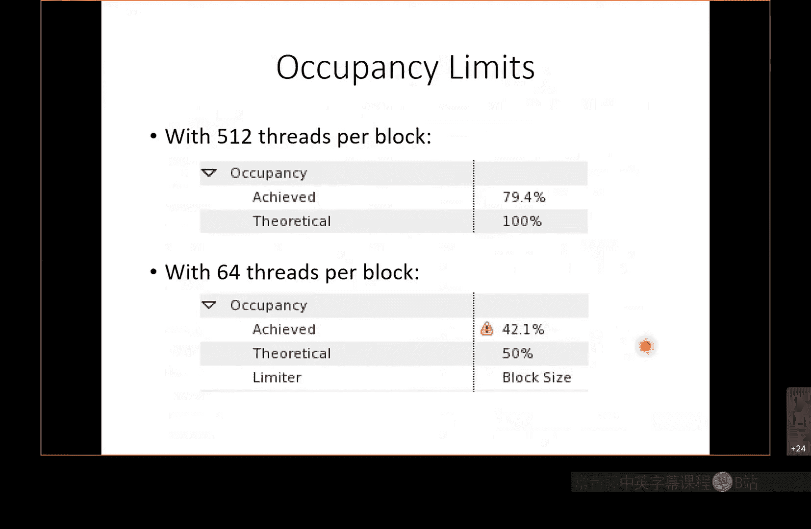

Okay， well then， if you don't have any final question。

 that is all for today and I will see you next time。翻迎新问。

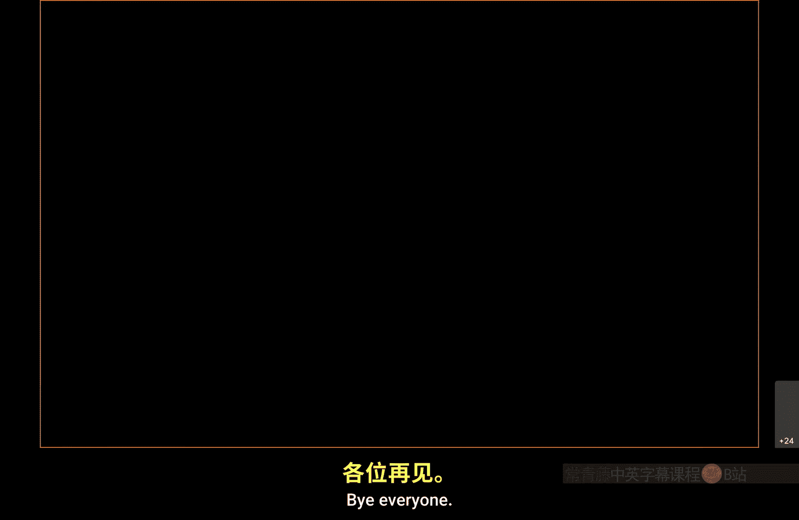