# 贝鲁特美国大学【中英⚡GPU计算｜CMPS 297S Spring 2021, GPU Computing】 p18 P18 图处理 -BV1LD6BBPEjt_p18-

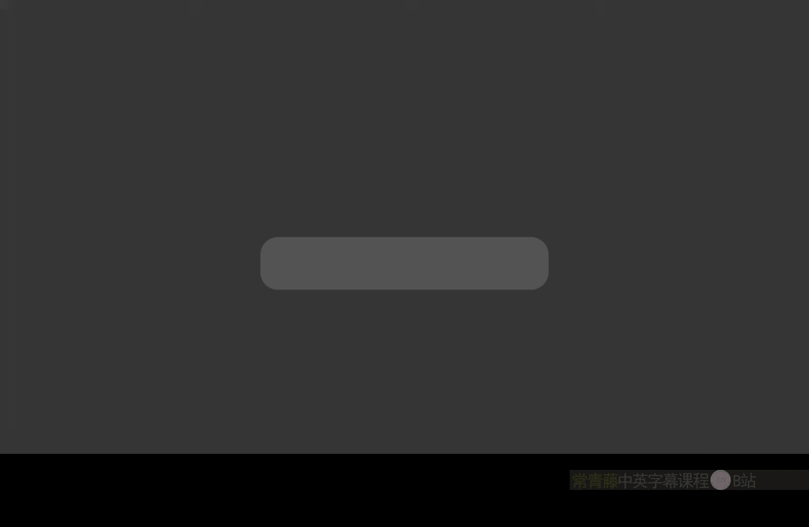

Hello everyone and welcome to lecturec 18 of GPU Computing Today we're going to talk about graph processing。

😊，So last time we spoke about sparse matrix computations it was the second lecture in a series of two lectures about sparse matrix computation in the first lecture we had talked about two formats。

 COO and CSR and last time we talked about two more formats which were the ELL format in the JDS format so the ELL format looked like this what we did is we grouped the non-zeros of the matrix similar to what we did with CSR。

 however instead of kind of linearizing them in row major order like we did with CSR we actually added padding so that all the rows have the same number of non-zes if you include the padding and then we stored this table and column major order so we stored it we stored the non-zes along the column followed by the next column followed by the next column and what they gave us is an array like this with the values。

 non-zero values and the column in the these and the nice thing about this is that when each thread goes to access the first element of the row。

😊，That it is responsible for when doing the SPMV， we can see that the threads are accessing nearby data elements。

 so the memory access these are coalesced。However， we saw that one of the problems with ELL is all this overhead added from padding and if we have these extra long rows like here we have this second row and the second tele row are pretty long compared to the others。

 we end up adding a lot of overhead from padding and this take up a lot of space so one way to regulate the padding or to minimize the amount of padding that we have is to have a hybrid ELL COO format where we have enough enough columns in this compressed table for most of the rows。

 but then for the very long rows we have an additional CO COO representation just for the extra nonzeros in these rows and by doing this to what we did is we were able to get the benefit of ELL format when it comes to memory coalescing but then minimize the padding by processing the non-zes in the very long rows separately。

😊，And then after that， we went to and looked at the packet diagonal storage format。

 which aimed at minimizing control divergence because ELL still has control divergence。

And to do that what we did is similar to CSR and ELL what we did is we grouped the nonzes we grouped the non- zeros of the rows like this together。

 but then what we did to minimize control divergence is that we sorted the rows and we kept this permutation vector that reminded us what the original row index each of each new row is and by sorting the rows now when threads process adjacent rows。

 they're going to process rows of similar length and this is what helps us reduce the control divergence so and then in order for us to achieve good coalescing what we did is we stored these rows in know in column major order so we went in this direction so when we linear array as we can see we have the values we have the columns we have the original row。

 we also have these offsets that tell us the beginning of each section or each。

And now when all the threads go to access the first element of their corresponding rows。

 as we can see the aes are coalesced， but not only that also the threads that are that are in the same warp。

 so here the green and the orange thread down here if you look at the rows that they're processing these rows are of similar length and is this is what enables us to also have low control divergence when it comes to using the JDS format so this was an overview what we covered last time any questions about last time's material before we move on。

Okay so then today what we're to do is we're going talk about graph processing and to talk about graph processing I would like to first talk about how we represent graphs so a graph you guys are familiar with graphs we have a bunch of vertices and they're connected with edges and the way we can logically represent a graph is using an adjacency matrix so an adjacency matrix is a way to represent a graph and what we have is every row in the matrix represents the adjacency list of a source vertex and and the columns represent the destination vertices and when I have a one in one of these Sts in the matrix what this says is that there's an edge from row0 to sorry there's an edge from vertex zero to vertex 1 when I have a one over here this says that there's an edge from vertex1 to vertex3 now the adjacency matrix is usually very sparse。

😊，So what can we do to represent them？We just finished talking about sparse matrices。

You want to convert it to one of the formats right exactly so we can because the adjacent matrix is usually the very sparse。

 we can use the same storage formats that we talked about with sparse matrices to also represent graphs so we can store the adjacency matrix of a graph using any of the sparse storage formats that we looked at previously。

Now what we're going to focus on in today's lecture just to keep things a little bit simpler is we're going to focus on unweighted graphs and what since the graphs are unweighted it means that all all the values inside of this adjacency matrix are going to be one so we're not going to need to store them we just care about whether there's a zero or a non-zero if it's a non-ze than if so on so we're not going to store any values in our representation if this was a weighted graph then we would have needed to store some more values in this representation so we would have needed somehow to represent them but because we're focusing on unweighted graphs we're not going to store the values we're just going to keep track of whether there is a nonzero or if there isn't a nonzero over there the next thing is we're going to focus ondirect undirected graphs and what that means is that these matrices are going to be symmetric okay so we'll be focusing on undirected graphs。

😊，But a lot of the concepts that we are going to talk about today equally apply unweighted to weighted graphs and they equally apply to directed graphs。

 but for simplicity we're just going to be focusing on unweighted graphs and undirected graphs。

Now let's we said that the adjacency matrix can be usually represented using the storage formats that we talked about so far so let's see how we can do that for example we could do COO to represent the graph in this case the CO remember with the COO and a sparse matrix matrix we have the row index the column index and the value a COO representation of the graph is going to have the list of edges right so like in the sparse matrix representation we have list of non- zeros so for a graph we have a list of edges and the arrays are we going to have the source vertex of each edge。

 the destination vertex of each edge if it was a weighted graph we would have also had a third array with the weight of each edge but it's not a weighted graph so we're not going to have that array so here what this says is that I have an edge from zero to1 because I have edge from  zero to1 here I have an edge from zero to1 it says they have an edge from zero to2 an edge from1 to0 an edge from2 to0 and。

😊，Three two one， et cetera， okay？So this is a CO representation of this graph we can also represent the graph using CSR or CSC so in this case if I wanted to do a CSR representation then rather than having the source vertex inice Cs we would have source pointers and these source pointers would point to the beginning of the edge the outgoing edges of the vertex in this destination next array so here what this is saying is that for the source vertex0 for the source vertex0 it its edges begin at index0 in the destination array and they end at2 because this says here that the vertex1 its edge its neighbors begin at2 which means that source for source vertex0 its neighbors are going to go from zero to2 not including two so here's zero source vertex0 will start at zero and its neighbors are going。

be one and two as we can see zeros neighbors are one and two here zeros neighbors are one and2 this is saying that vertex2 its neighbors begin at index2 in this array and they end at index5 not included so here the neighbors of vertex 1 are going to start at two and they're going to be0。

2 and three and the fifth one is not included and as you can tell one has the neighbors02 and3 year one has the neighbors zero。

2 and three。Okay， so this is how we can use CSR to represent a graph。Now， like I said。

 we do not need to store any values because the graph is unweighted but if the graph was weighted。

 we would have needed a third array in each of these representations to track the weight of each edge and then also one thing to note is that CSR and CSC are equivalent because the matrix is symmetric right this matrix is symmetric because it's undirected so the CSR and the CSD representations are equivalent because if I transpose this matrix that's going to be the same if the matrix was not symmetric then the CSR and the CSC representation would not have been equivalent today we're going to take advantage of the fact that CSR and CSC are equivalent in one of the optimizations that we can apply and that's the reason why I'm making the assumption that the matrix is symmetric but this is not necessary if I did not make this assumption I could have simply kept around both a CSR and a CSC representation of the mix。

Did somebody have a question？Yes， so since the types of matrices we could have as input are so varied。

 how do we choose one method over the other， is there a measure of the matrix that can tell us which would be more efficient？

So good question so like we saw with sparse matrices the format that we choose to represent the sparse matrix has high impact on the approach that we use sorry the format and sparse matrices the format that we use to represent the sparse matrix as a high impact on how we implement the kernel to process that sparse matrix or to do the SPMV which was the case that we're looking at so similarly the format that we're going to choose to represent the graph is going to have an impact on on how we go about processing this graph in parallel so yes。

 the choice the choice of the properties of the graph are going to impact what is the best parallelization approach to use to process this graph and naturally that's going to have an impact on the choice of storage format that we have and we will see examples of that throughout our lecture okay。

😊，Okay， so having spoken about how we represent graphs using the sparse matrix storage formats that we've seen before。

 the next question is， how do we parallellyze graph processes？😊。

And I'm going to talk about in general various approaches to paralyzing graph processing and then we're going to take these approaches and we're going to apply them to a specific graph problem which is going to be Bre's first search okay。

 but let's first start and talking in general about approaches to paralyzing graph processing。😊，So。

 there's。Not only two， but there's two major approaches to paralyze a graph process。

One approach is the vertex centric approach。 And what the vertex centric approach does is that it assigns a thread to do something for each vertex。

Okay， so if I have a graph algorithm， I'm trying to paralyze what I do is I assign a thread to do something for each vertex and these threads operate on these vertices in parallel。

 obviously they might need to communicate with each other。

 obviously I might need to have global synchronization。

 but the principle behind vertexcentric parallellyization。

 is that I have a thread do something for each vertex in my graph。

Now when I have a thread do something for each vertex。

 naturally that thread is going to want to visit the neighbors of the avertex to look at who are the neighbors of the avertex so if I want a thread to be able to go through the list of neighbors in a vertex。

 what's the best what's the best format for me to use is it COO or CSR。😡，诶 c o。Okay， think about it。

 I want a thread to be able to go and find all the neighbors of the vertex。😡。

This is similar to a thread wanting to find all the non zeros in a particular row。

So if I want a thread to be able to loop through all the neighbors of a vertex。

 would I want to represent it as DOO or CSR CSR？Right。

 CSR because CSR is what gives me all the nonzes of particular row together in one chunk right so typically if I am using a vertex centric parallellyzization。

 I typically use the CSR or the CSC format because with a CSR or CSC format。

 this gives me the accessibility of given a vertex， it's easy to find all the vertex's neighbors。

And by the way， depending on the computationut， we might also use ELL or JDS as optimizations。

 I'm not going to look at that today， just for simplicity。

 we're going to be just looking at COO and CSR， but just keep in mind that in some cases where you're using CSR。

 you might even be able to use ELL or JDS to further optimize your access pattern。Okay。

 the next the other alternative to vertex centric parallellyzization for graph processing is edge centric parallellyization and in an edge centric parallellyzization。

 the way we go about paralyzing the operation we're performing on the graph is by assigning a threat。

😊，To do something for each edge Okay so a assign of thread to each edge and that thread has to perform some operation that involves that edge typically this would involve looking at the source vertex and the destination vertex of the edge so in this case。

 if I'm going for an edge centric parallellyization。

 what format would I probably want to use theO or CSR。Right COO。

 so here I would typically want to use COO why because COO and Sprse matrices CO helps me with given a nonze find its row and column index and graphs what that's equivalent to is given an edge。

 COO makes it easy to find the source and the destination vertices of that edge。😊，Okay。

 so there's two major approaches to paralyzing graph processing。

 one of them is the vertex centric approach which typically uses the CSR or CSD representation of the graph if the graph is symmetric。

 these two are equivalent or there's the edgecentric paralyzization approach which typically uses a COO representation。

Okay， now in some cases， in some cases， I may actually need to keep around both a CSR and a COO representation。

 this is called a hybrid representation and an example of this is in sub graph algorithms I might need for example。

 to go go at look at an edge。And for that edge。Find the neighbors of its source vertex。😡。

And find the neighbors of its destination vertex。Okay so given an edge find the neighbors of the source vertex and find the neighbors of the destination vertex so here I need to be able to find the source and the destination of the edge and for the source of the destinations I need to be able to find their neighbors so in this case if i'm doing a computation that requires me to do something like this then I would need to use both a COO and a CSR slash CSE representation okay。

😊，Now Bret's first search which we're going to look at today does not require this。

 so we're not going to look at this hybrid representation today。

 but who knows an example of a graph computation that would require me to do something like this。

Look at an edge， find neighbors， and then at an edge， find its endpoints。

 and then find the neighbors of the endpoints。What's for search。

Nowreterson doesn't really require this， but are you guys familiar with triangle counting？

Or K cl decomposition。So with triangle counting， for example。

 I usually want to find the number of triangles that an edge is participating in and what that means is I need to find the intersection of the common neighbors of the edges endpoints because the common neighbors edges endpoints each form a triangle so to do that I need to intersect the adjacency lists of the edges endpoints so in this case I would need to be able to find the edges endpoints which I would need COO for and then intersect the edges endpoints which I would need CSR for so that is where we might need to have。

We want to have both representations， but we actually we're not going to look at that this kind of computation today today what we're going to do is we're going to look at BFS and we're going to look at vertex centric and ecentric parallellyzizations of BFS okay。

😊，So any questions about this before I start talking about BFS？

somebodybodys asking where is triangle counting use。

 so triangle counting is used in places where you trying find you're trying to find， for example。

 communities inside of graphs。A triangle is a special case of something called a triangle is a three cliqueek。

 it's also a three truss， so it's a special case of trusses and cliques which are different ways of finding communities inside of graphs。

 so vertices in the graph that are all very close to linked to each other。高铁丝。

Yes in the vertex centric approach approach I understood。

 and know you're trying to basically model the graph itself using each using each thread but in edgecentric what are you trying to do or you're trying to follow the path algorithm with the execute in Okay I'm not modeling anything here all I'm saying is that when I do a vertex centric paralyzization。

 I do something for each vertex I do an edgecentric paralyzization I have a thread for each edge and I do something for each edge what that thing is depends on the computation on the specific graph algorithm that I am applying Okay and I will do an example using breakfast search of both of these so hopefully that will make things more clear。

All right， yeah， you're welcome。Okay， so let's start with B first search so what is the objective of Bth first search the objective of Bth first search at least the breadth first search that we're going to look at today is to find the distance or the level of each vertex from some source vertex so given a source vertex I want to find how many edges all of the other verte C is R away from this source vertex okay this is one one possible thing I might want to do with BFS maybe I want to other things I might want to do is maybe construct a BFS tree so here the level would be the depth of that vertex in the tree but what I'm going to do is I'm not going to keep track of of the whole tree all I'm going to do is I'm going to keep track of the level of each vertex that I visit during my BFS traversal anything else I would like to do I can easily just extend what I'm doing to do it。

😊，ButFor simplicity， all we're going to do is we're going to find the， the level of each vertex。 or。

 in other words， the the distance or the number of edges it is away from the source vertex。Okay。

 so how does BFS work， well we're going to start with some source vertex。

 let's say this is my source vertex here and so this source vertex is going to be level zero。😊。

And what I would like to do is I would like to find the level of all the other vertices in the graph。

 okay， I will initialize all the other emergeertices in the graph to have level infinity。

 which means that they're not reachable from this vertex。😊。

And then what I will do is on the first iteration， I will visit all the neighbors of the source vertex and label them as having level one。

 so all these neighbors are going to be level one。😊，Okay， and then on the next iteration。

 I'm going to visit all the neighbors of these neighbors。 Okay， and。

 and I will label those as level 2。 So everything that's readable from the neighbors is going to be labeled as level 2。

😊，And then on the I'm going to keep doing this until there are no more no more vertices visited。

 so on the next iteration I'm going to visit all the neighbors of these level two vertices and I'm going to label those as level 3。

Okay on the next iteration， I'm going to try and visit all the neighbors of level3 but there aren't going to be any neighbors that are visited。

 so that is how I know that I am done doing my BFS and any remaining vertex that I haven't visited is going to be considered unreachable so the remaining vertices are going to be remain at a distance infinity which also means that they are unreachable okay。

So this is what we're going to do Now the question is how do I do this in parallel let's recall there's different different approaches to paralyzing BFS One of them is the vertex centric。

 the other is the edge centric so the well sorry there's different approaches paralyzing graph algorithms vertexcentric edge centric we're going look we're going to apply this to BFS so we're going to start by looking at a vertex centric approach for paralyzing BFS and there's actually two versions of this there's two different vertex centric approaches for paralyzing BFS。

😊，The first vertex centerric approach for paralyzing the FX is called the top down approach and the way this approach works is on every iteration。

 I'm going to launch a thread for every vertex。😊，And I'm going to check if that vertex was in the previous level。

I am going to go through the abertexist neighbors and I'm going to check all the unvisited neighbors and mark them as being part of the current level。

😡，ok。😊，And the reason we call this top down is if you think of BFS as constructing a BFS tree。

 then what we're doing is we're assigning a thread to every parent in a vertex in the tree。

 and that parent vertex is finding all its childrens vertex in the tree so it's making its way from a top level to a bottom level。

 this is why we call this a top down approach。Okay。

 so let me show you what this looks like in an illustration， so here if I'm on the iteration。

 that is where level one is the previous level and I want to find all the level two ver disease。

What I will do is I will launch a thread。For every vertex。

So I have a thread assigned to every vertex in the graph。This thread will check。

If the vertex is a level 1。And if the vertex is in level1。

 so here these four threads over here are the ones that will find that the vertex they own it is in level1。

And if for these vertices that are in level one， what the thread will do is it's going to loop over the neighbors of these vertices and if the neighbors are not visited it's going to mark the neighbors as being part of level2 so this thread here is going to go through its neighbors。

This neighbor is not visited， so marks it as level two。

 this neighbors already visited so it doesn't do anything。

 this neighbors already visited so it doesn't do anything。Okay。

 this thread over here is going to mark look at this neighbor it's going to market as level two because it hasn't been visited it's going to look at this neighbor market as level two it's going to look at this neighbor and market as level2 by the way here these two threads both find that this neighbors neighbor is level two but that's okay okay as long as one of them finds it that's fine if both of them find it and label it as level two that's okay that's not a problem。

All right， so this is how the vertexcentric top down BFS works each thread will find if its vertex is is in the previous level in this case that's level1 and if it is it's going to go through its neighbors and if they're not visited marked them as being part of level2 which is the current hub okay so having said this let's go and implement this using kuda so I'm going to switch over to the code terminal over here。

 I've already set up the code to do all the host management stuff for us so here I'm allocating I have a CSR graph that's already been read from a file I'm allocating it on the GPU and then I'm copying it down here to the GPU。

😊。

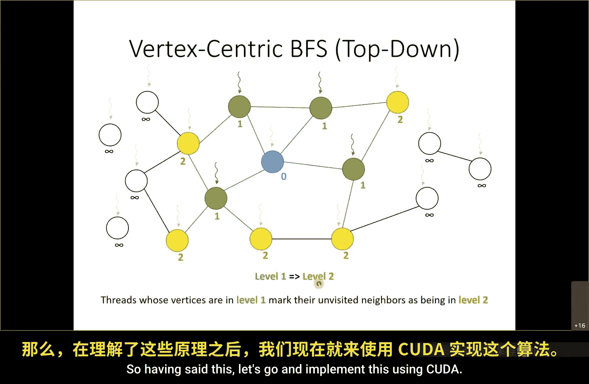

Okay， and then down here I'm going to have a loop that's looping over the levels and that calls a kernel to process each level Okay。

 the reason is that I need to have a global synchronization across the different level。

Okay so I'm going to have a kernel called for every level and this kernel will process that particular level and I'm also going to have this new vertex visited flag that's going to tell me whether a new vertex was visited on a particular iteration so that I can know when I stop iterating across level Okay so up here my BFS kernel I'm going to take a CSR representation of the graph I'm going to take again。

 the reason into the CSR representation of the graph is because I'm using a vertexcentric parallellyzization I'm going to have the level of each vertex So this is kind of a label that tells me whether the vertex visor or not and what level is I'm going to have this flag that I need to set when if I visit a vertex so that I know when when when I should stop iterating and I'm also going have the current level that I'm processing so in this case the current level is going to be level2。

😊。

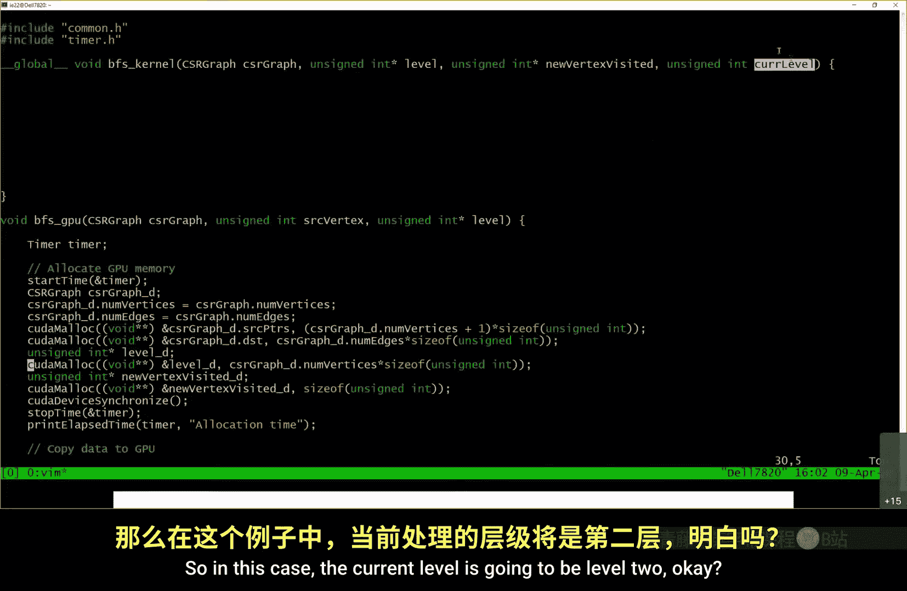

ok。😊，Meaning I'm finding out all the verticies that are in Okay， so let's start by implementing this。

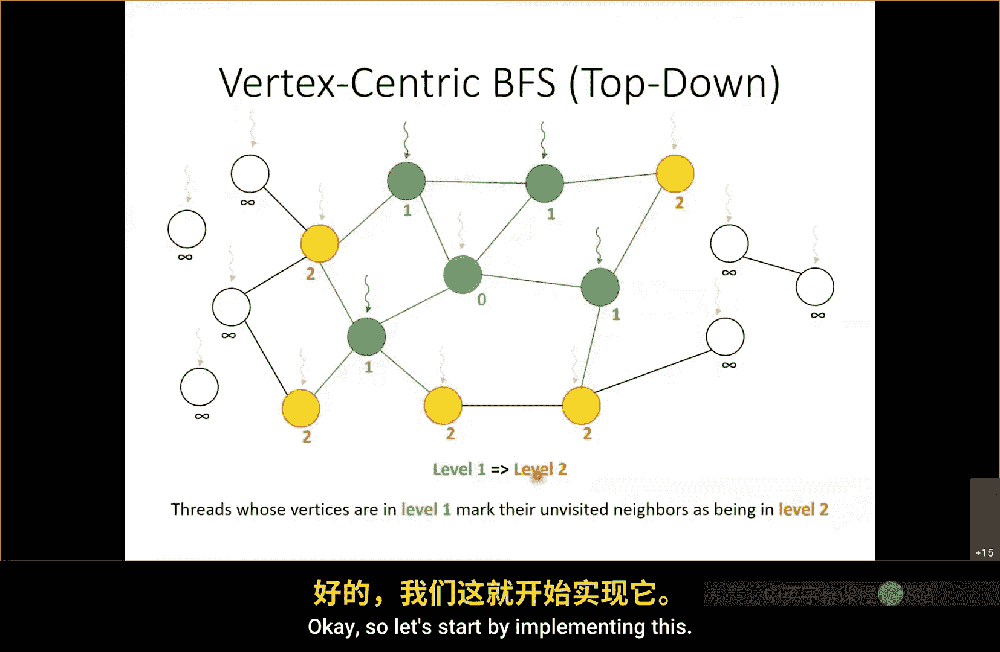

So what we said is in the vertex centric approach， we're going to assign a thread to each vertex so down here when I called this kernel。

 when I configure the number of blocks， the number of blocks use the number of vertices to determine how many blocks I'm going to launch okay so I have enough threads to process each vertex so my first step is to for the thread to figure out which vertex it's responsible for and to do that I'm going to write。

Unsigned in vertex is equal to I'm going to use the thread index。S the vertex number Okay。

 so thread zero is going to be responsible for the vertex 0 thread one is going to be responsible for vertex 1。

 thread2 responsible fort 2， et cetera。 So I'm going to write uns in vertex is equal to block index dot x time lock in dot x plus thread index dot x you guys should be familiar with this by now and of course。

 because I could have。I could have excessive threads in the last block any time a boundary check。

 so I'm going need I'm going to need to check if this vertex is actually within bounds to do that。

 let me go and look at how the CSR graph is represented and what information it gives me So here I'm going to open。

This is how the CSR graph is represented， I have the number of vertices。

 the number of edge the source pointers， this tells me where the neighbors of each vertex begin and then the destination which tells me the neighbor of each of the source vertices okay so here I'm going to check if the is within bound I'm going to write if。

Vertex is less than graph。Dot number vertices。ok。😊。

And now that I have assigned a thread to each vertex in the what does this what does this vertex need to do well first the vertex needs the thread needs to check whether the vertex that it's responsible for is in the previous level okay because only the threads in the previous whose vertices were in the previous level are going to do for their neighbors to add them to the next level to the current level。

 all the other threads are not going to do anything so here I'm going to need to check if the level of my vertex。

😊。

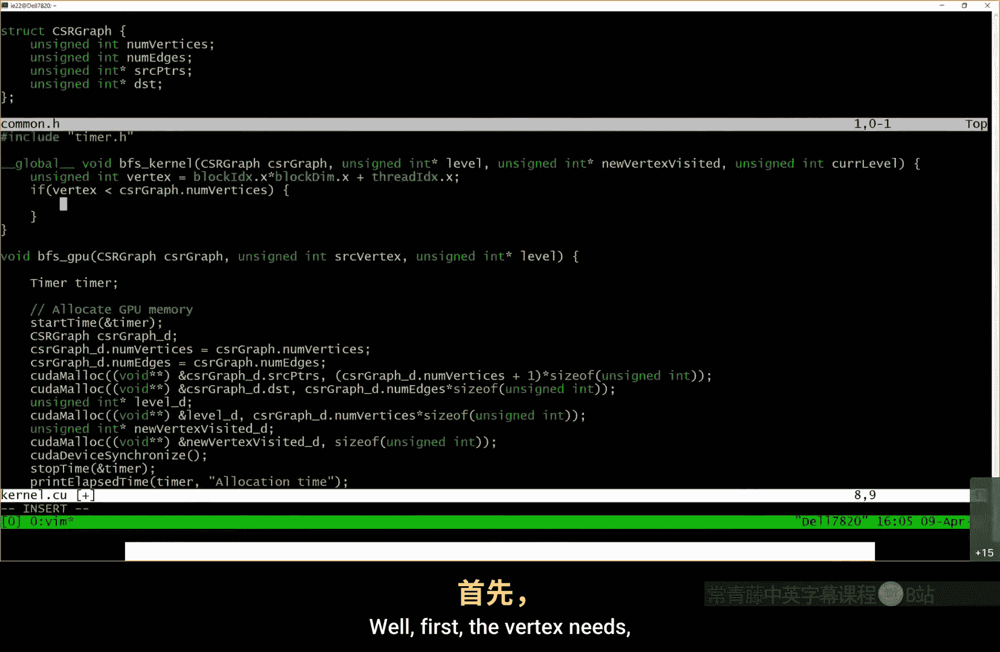

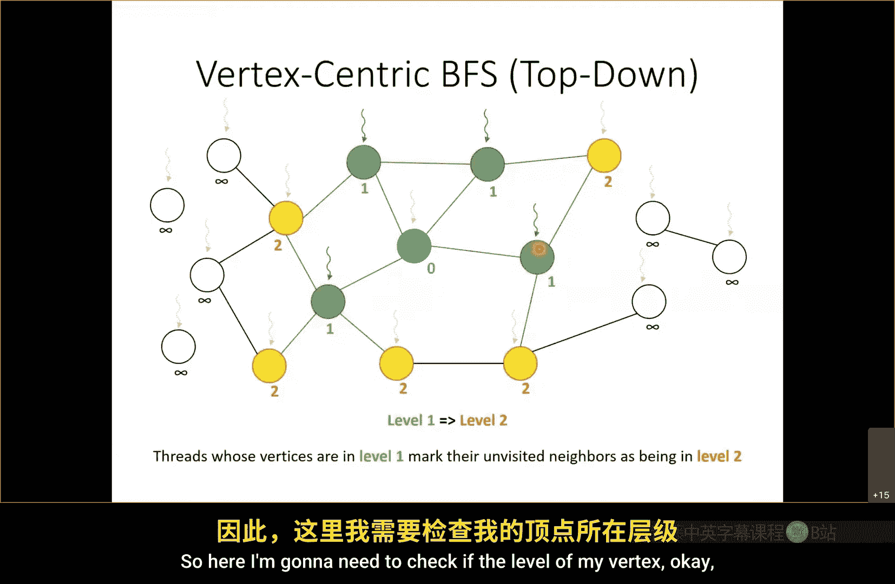

Okay， it's equal to the current level。Okay， so if the level oh sorry to the current level minus1 because here the current level is level2 so I want to check the I want to check I want the threads to be assigned to the vertices in the previous level So any thread whose vertex is in level one is in the previous level I'm going add its neighbors to the current level So here I'm going to check if level of vertex is current level minus1 if this is the case。

 then the thread needs to loop over its outgoing edges and visit the neighbors at the destination of the outgoing edges so how do I loop over the outgoing edges where do I find where my outgoing edges start and end what do I use。

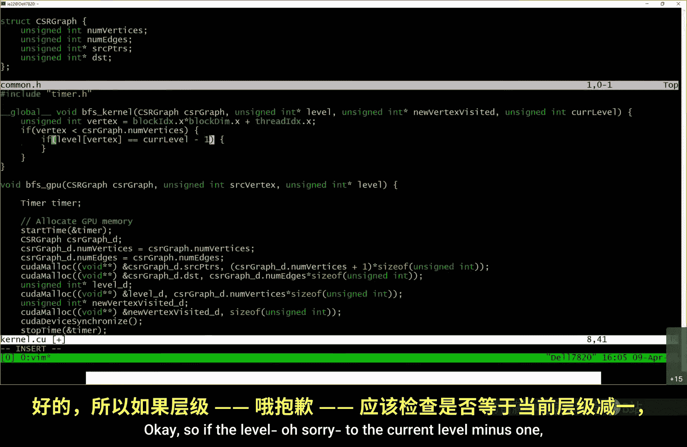

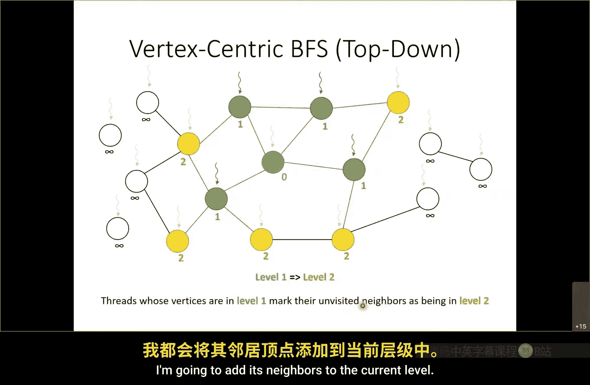

From up here。So remember， this is a CSR representation of the graph。

So the source pointers are going to tell me where the neighbors of some vertex begin or some source vertex begin。

Okay。😊，Yes。So I will do is， I'm going to。Loop over the name the outgoing edges。

 So I'm going to write for unsed int edge is equal to。CSR graph dot。Soource pointers of。Vtex， okay。

 so this。Tll me where the neighbors of the vertex begin of the source of vertex begin。

 how do I know where the neighbors of the source of vertex end？It's the next vertex -1 right。

 it's where it's where the then the it's where the neighbors of the next vertex begins。

 So so I'm going to write edge is less than CSR graph dot source source vertex。

Soor pointers of vertex plus1。Okay， and then plus plus edge。All right。

 so now here I'm looping over the outgoing edges。Okay， now for each outgoing edge。

 I want to find the neighbor that that edge takes me to How do I know the neighbor that the edge takes me to。

 Well， that's part of the destination array， This destination array tells me the destination of the edge。

Okay， so I'm going to write unsigned end。Neighbor is equal to。PS SR graph， the destination of。

So here now I have the vertex I have I'm looping over its neighbors Okay。

 and now what I need to do is I want to check if the neighbor was visited。

 if the neighbor has already been visited， I'm not going to do anything if the neighbor has not been visited。

 then what do I want to do。I want to add it to the current level。

 So I'm going to check if the neighbors visit to do that。

 I'm going to look at the level of the neighbors。 So if the level。

Of the neighbor is equal to infinity and here I'm representing infinity as u and max。

 okay U and max is the largest possible unsigned end value。Okay， so if the level of the。

 if the neighbor has not been visited， okay， then what I want to do is I want to add the neighbor to the current level。

 I want to mark the neighbor as being part of the current level。Okay。

 so I'm going to write level of favor。Is equal to the current level。

And what I need to do is I need to set this new vertex visited flag in order to indicate that I have visited a vertex so that I can tell the host that we're going to have to do another iteration because we visited a new vertex。

😊，Okay， so I'm going to write I'm going to set the new vertex into the flag to one。Okay。

 so to summarize， I assign a thread to every vertex， I check if the vertex is in the previous level。

 if the vertex is in the previous level level I loop over its neighbors and for each neighbor I check if the neighbor has not been visited if the neighbor has not been visited I mark the neighbor as being part of the current level Okay。

 any questions about this is it clear to everyone。😊，Yes， professor， just one question。

 this algorithm seems like it has a lot of if and for and the for loop is not looping all the time up until the same value。

 So won't we have a lot of。How is it called。Are dirgence？You're absolutely right。

 We will have a lot of control divergence and we will talk about that。 you're absolutely right。Okay。

 yes， if it's a fully connected sorry good， if it's a fully connected graph。

 this algorithm would be very， very efficient or it doesn't matter。Um， if even if it's a， well。

 if it's a fully connected graph， then your BF is just going to end in one iteration， right。

 because everythings。😊，But I mean if there if there's high connectivity in the graph。

 then what's going to happen is you're going to have a lot of control divergence because because because you know this is going to be a very long loop for some vertices but not others Okay and we will talk about that so please hold on to that question and I will I will definitely revisit this topic。

😊，Okay， so now let's go and compile this code and run it and see what kind of performance improvement we get。

 so I'm going to compile。And Im going to run。Okay， and as you can see。

 the kernel times is actually quite slow， even slower than the CPU， by the way。Okay。

 and that's not including copy time， so the kernel time is actually quite slow for this。Okay。

 so let's see how let's see how the how we can improve on this。

 Let's see how the other approaches are going to compare， okay。😊，As I said。

 we looked at the vertex centric top down approach， okay。

 and this is here this here is the code that we wrote。

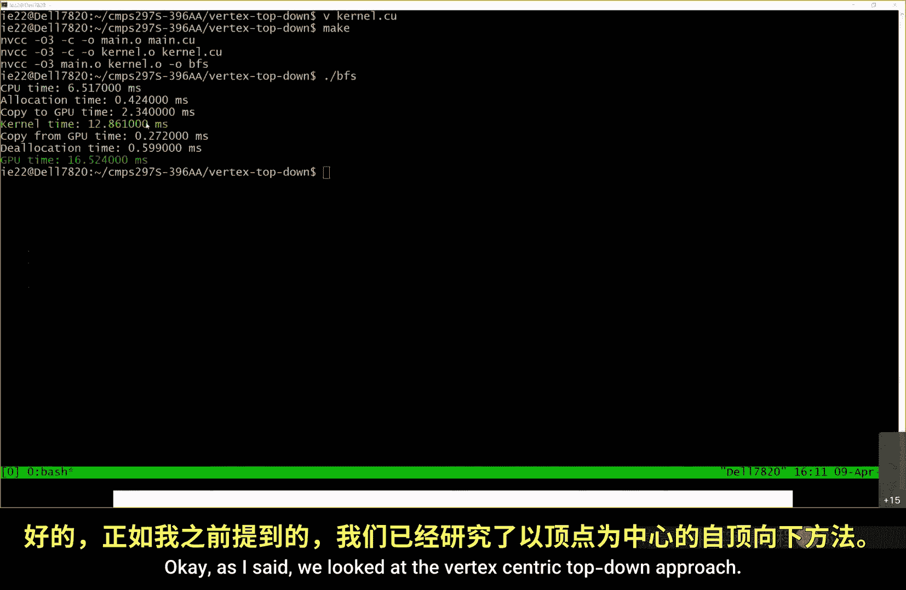

The other approach， the other。Approach besides the vertex centric top down approach is the vertex centric bottom up approach and what what the bottom up approach does is for every vertex。

It checks if the a vertex has not been visited。And if the avertex has not been visited。

 it's going to check if any of its neighbors are in the previous level and if any of the neighbors are in the previous level。

 it's going to add the avertex to the next book。😡，Okay， so the top down approach。

The the threads were responsible the threads that were active were the ones that were that were assigned to the to vertices that were just visited。

 whereasas now the threads that are gonna work and the threads assigned to vertices that have not been visited and they're gonna find out whether these vertices should be in the next level。

 So here my threads are working on the vertices that are in the previous level here my threads are working on the ver vertices that are potentially in the next level。

 And the reason we call this bottom up is here， you can think of the threads are being assigned to every potential child vertex in the BFS3 and figuring out whether this vertex looking towards the vertices parents to find out if any of the vertices parents were in the previous level。

 Okay， so we're kind of at at the bottom， looking up at the previous level。

 And this is why we call this the bottom up approach。Let me illustrate what I mean by。

In the bottom up approach， what's going to happen is I'm going to assign a thread to every vertex。😊。

But then the threads that are going to work are the threads that are assigned to vertices that have not been visited yet。

 Okay， as opposed to the vertices that are in the previous level。

 I'm going to assign threads to all the the threads that will work are the threads assigned to vertices that have not been visited yet。

 And what these threads will do is they will go through their neighbors and they will find if any of their neighbors are in the previous level。

 and if they are， they will add the vertex to the next level。

 So here this thread will find that one of its neighbors is in the previous level。

 And when it does that， it adds in a vertex is responsible for to the current level。

And notice that the minute this thread finds that one of its neighbors is the previous level and it adds its vertex to the current level。

 it actually doesn't need to continue looking at all the other neighbors。Okay。

 because that's not really going to help。 So the myth that the thread establishes that this vertex in is in the current level。

 it can stop。 It doesn't have to finish going through all its neighbors。

 which is different from the top down approach。In the top down approach。

 if a Vertex was in the previous level， I had to go through all of its neighbors to find out if they were going to be in the current。

But what you will notice here is that I have these other threads out here are assigned to vertices that are not going to be on the current level。

 so these threads will actually loop over all of their neighbors and they will find out that none of their neighbors are in the previous level。

 so they will not add the vertex they're responsible for to the current level。

 but they will have to loop over all of the neighbors。ok。😊。

Is the bottom up approach clear to everyone is to clear what every thread is doing？

And is it clear how this is different from the top end？Yes， question。Yes。

 so bottom up is less work efficient than top down right。Because you're doing useless work。

Work efficiency is related to work efficiency is a different concept。

I think what you mean to say is that the bottom up， the top down approach。

 sorry the bottom up does more redundant work than the top down， is that what you mean to say？Yeah。

 maybe okay， I was confused and it actually depends it depends how many vertices the amount of redundant work done depends on the graph it depends on how many vertices have already been visited and how many vertices have not been visited it depends on the number of vertices in the previous level so this sub depends。

 but I don't want you to confuse redundant work with work efficiency work efficiency was about。

Given the sequential algorithm。The parallel algorithm do as much work as the sequential algorithm or not Okay。

 so I could implement a sequential algorithm that does exactly this。Okay， and in this case。

 the work efficiency will be the same。All right， so it's here it's not about it's I think you're observing that there's redundant work happening。

 which is true there is and we are going to also address this topic later on in the lecture。

 but that's a different concept from work efficiency。Okay。

 but good observation that there is we doesnt work。Any other questions about the bottom up approach。

 is it clear to everyone？And professorfess， I just wanted to know how do you make sure the graph that the search is complete。

 I disconnected at that moment。Okay， so remember how we had a flag。

 I showed it before when I implemented the top down kernel and I' show it again when I implement the bottom of kernel。

 but remember how we had a flag that where we set it to one if we visited if we visited a new vertex。

 so by setting that flag， on the iteration that we don't visit any new vertices。

 that is how we know that we're done。Oh okay， thank you Okay。

 so I'll point out that flag again when we implement this this version。Okay， thank you。Okay。

 all right， so let's go now and implement this version。 So I'm going now and I'm going to go to。

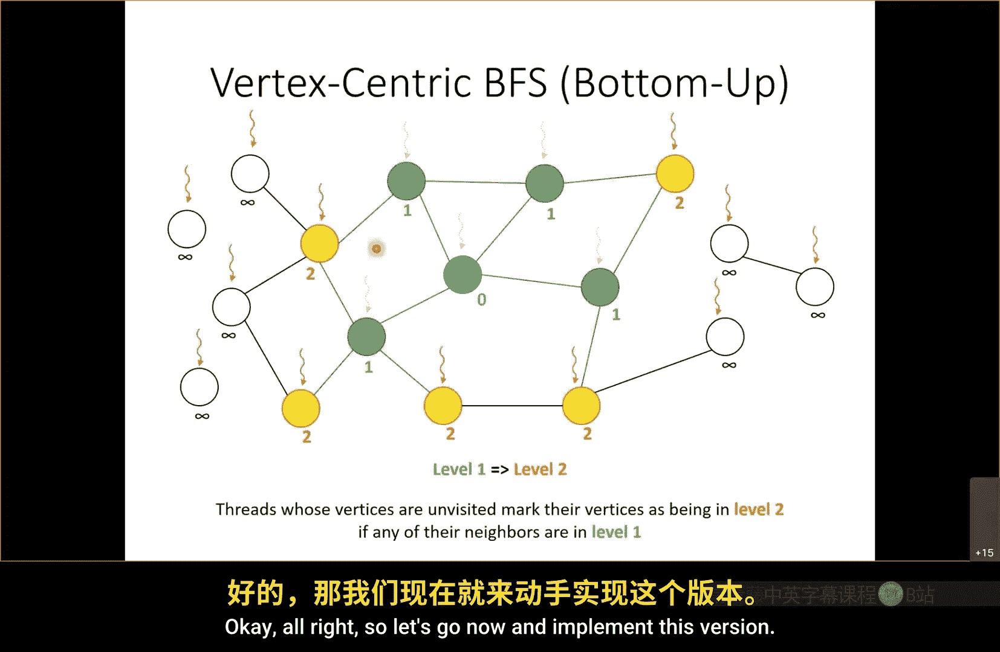

Vtex centric。bottomom up。And let's implement this term。Now。

 this kernel the source the source code is going to the host code is going to be all the same。

 we create the graph， we copyied the graph。 we launch as many vertices as there are sorry we launch as many threads as there are vertices。

 but the difference here is what the vertices are going to do。

 So the only difference is going to be the kernel itself Okay so like with the top down approach I'm going assign a thread to every vertex。

 So I'm going to use the thread Id as the vertex number thread 0 will be assigned to vertex0 thread one will be assigned to vertex 1 etc。

 So I'm going to write。😊，Unsci end。Vertex is equal to block index dot x times block dimm dot x plus red index dot x。

I'm going to check that my vertex is within bounds。 again， let me。let me open。The CSR graph。

 so we're still using the CSR representation because this is also a vertex centric approach and here I'm going to check that the vertex is less than the number of vertices in the graph。

ok。😊，All right， so now that I've checked that now that I've assigned a threat to a vertex。

 now what I need to do is I need to check if。

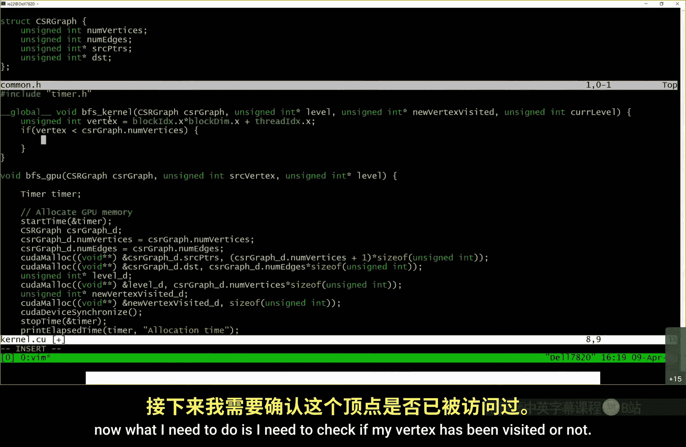

My vertex has been visited or not， if my vertex has been visited。

 I don't need to do anything if my vertex has not been visited that's where i'm going to loop over my neighbors to check if any of them are in the previous level So here i'm going to check if。

😡。

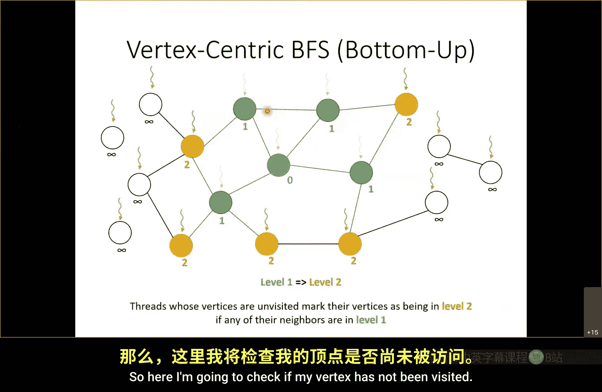

VertSo if my vertex has not been visited in other words。The level of my vertex is equal to U max。

Okay， so if my level is still un next that means the verdict has not been visited in this case I want to loop over my neighbors and check if any of them are in the previous level so how do I do that well same thing we did before for unsigned and edge is equal to CSR graph do。

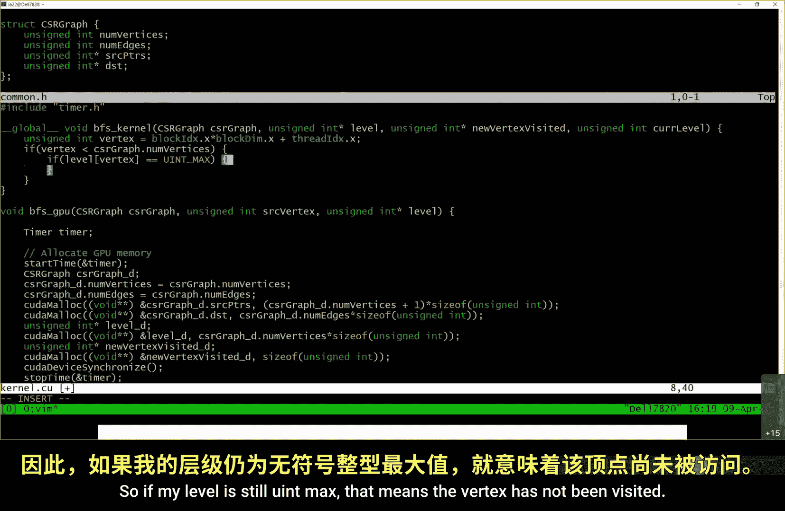

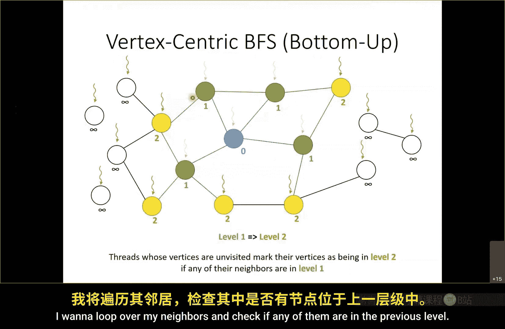

So source pointers of vertex。Edge is less than。PSSR graph does source winterters of vertex plus1 and then plus plus edge。

And then for each edge， I'm going to find the neighbor at the destination of that edge。

 so I'm going to write unsigned。Unign end。Neighbor is equal to。CSR graph。The destination of edge。

And now that I have the neighbor， what do I need to check。

 I need to check if my neighbor is in the previous level。

 if my neighbors in the previous level I'm going to mark myself as being part of the current level。

 if my neighbor is not in the previous level， I'm just not going to do anything okay， so if。😡。

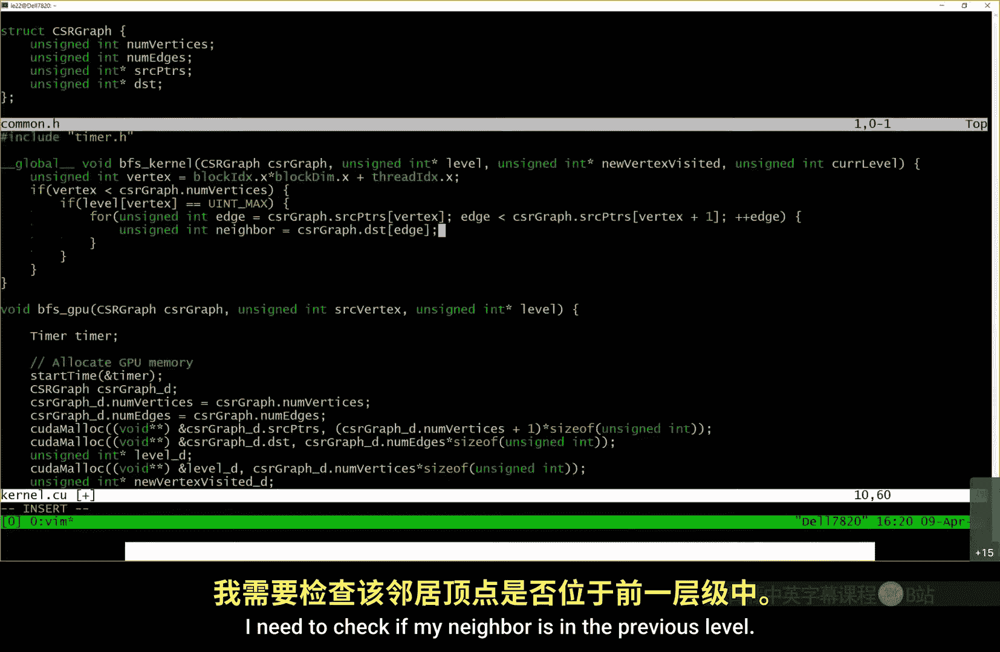

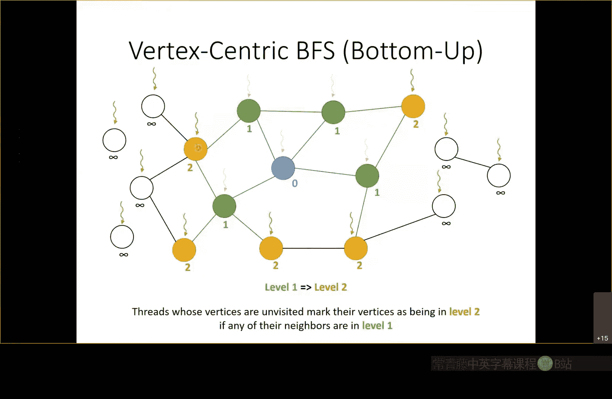

The level of my neighbor is equal to the previous level， which is current level-1。

Then what I will do is I will mark myself as being part of the current level。

 so I will write level of vertex is equal to current level and this answers the question that you asked I have this flag over here that I need to mark to indicate that on this iteration I have visited a new vertex okay if if I don't visit a new vertex on this iteration。

 that is how I know that I am done。 So if this flag is never get stepped that means no new vertices were visited this iteration which means my BFS is done but as long as this flag is set。

 it means I'm going to have to launch this kernel another time in order for me to。😊。

To do the next iteration。Okay， now one additional thing I can do。

 which I haven't done before is the minute that I find a neighbor that's in the previous level and I mark myself as being in。

😡，Level I don't need to continue going through my neighbors。

 So here if this thread checks this neighbor find the neighbors the previous level it can mark this its vertex as being in the current level。

 it doesn't have to go and check the other vertices anymore So what it can do is it can breakke。😡。

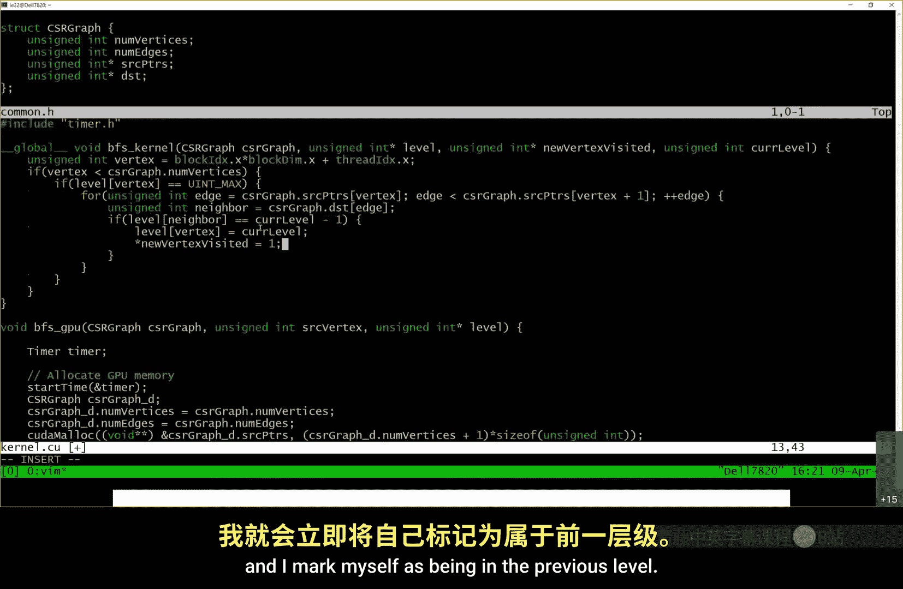

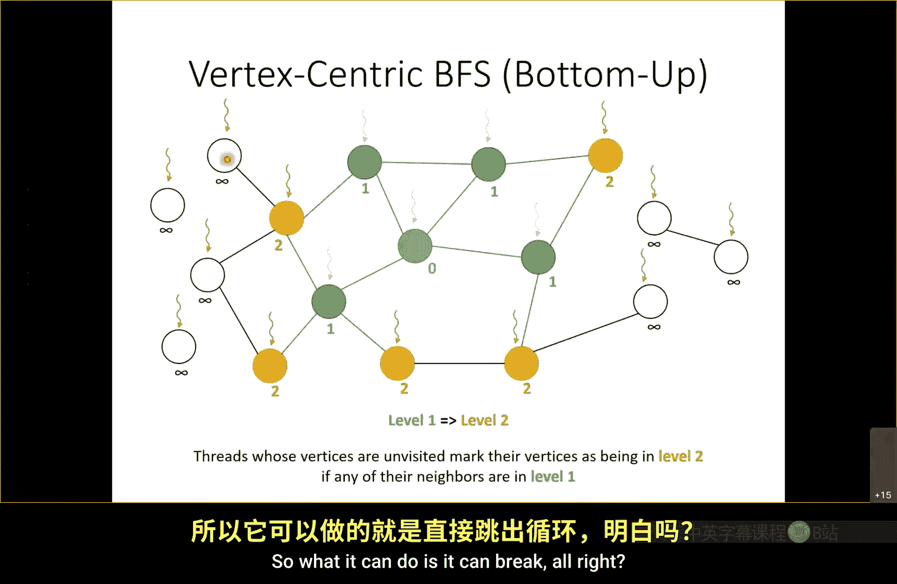

Alright， so what we can do is we can break。 Now， when we break over here。

The advantage of this is that I'm going to exit the s early。😡。

Which means that I'm going to have less control divergence than I had with the top down approach。

In the top down approach， the thread loop over all the neighbors whereas involved on my approach I only look over the neighbors until I establish that I am in the current level and I can bring right the threads that will loop over all their neighbors are going to be the threads that are not in the current level。

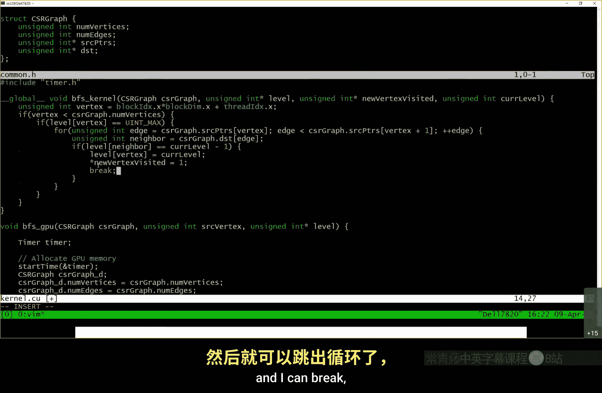

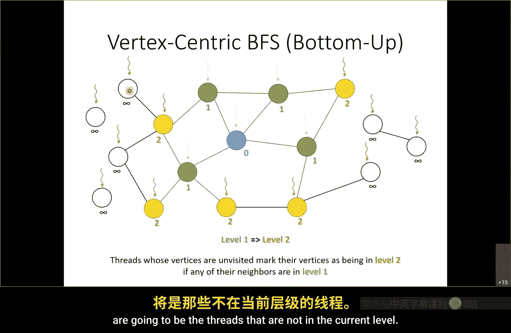

对呀。Any questions about this？Professor， I don't see how this guarantees。

Less control divergence because I mean， even though you're breaking from the loop。

 like the other threads might not be might not be breaking from the loop or they might be breaking at a later time so。

Like for me， it's still the same or even worse。Yes， yes， you're right。

 but think of think of the for example， think think of a vertex that has a very large neighbor list。

In the top that approach， when that vertex is turned to be processed。

 you're going to have to loop over all that entire neighbor list。In the bottom of approach。

 when that vertex is turned to be processed。You're going to loop over because you have a very large neighbor list。

 you have a high probability that one of these neighbors has been visited。

So you're most likely not going to have to go through that entire neighbor list。Okay， thanks。Yeah。

 you're welcome。 So So this performs very well when you have， for example。

 one row that is quite large compared to the others。

Let's let's wait and see I'm going I'm going to yes this will perform better when you have high degree vertices and let's let's wait and see how well this performs。

 but yeah yes what you're saying is accurate。Okay， so let's comparison and run it。Okay。

 so as you can， just as a reminder， the top down approach took 12 milliseconds。

And now we're going to run the bottom up approach and this time we took 2。9 milliseconds。Okay。

 so it's significantly faster than the top down approach。Okay， because as we saw。

This approach is able to exit early， it doesn't have to look over all of the neighbors。Okay。

All right， so this here。

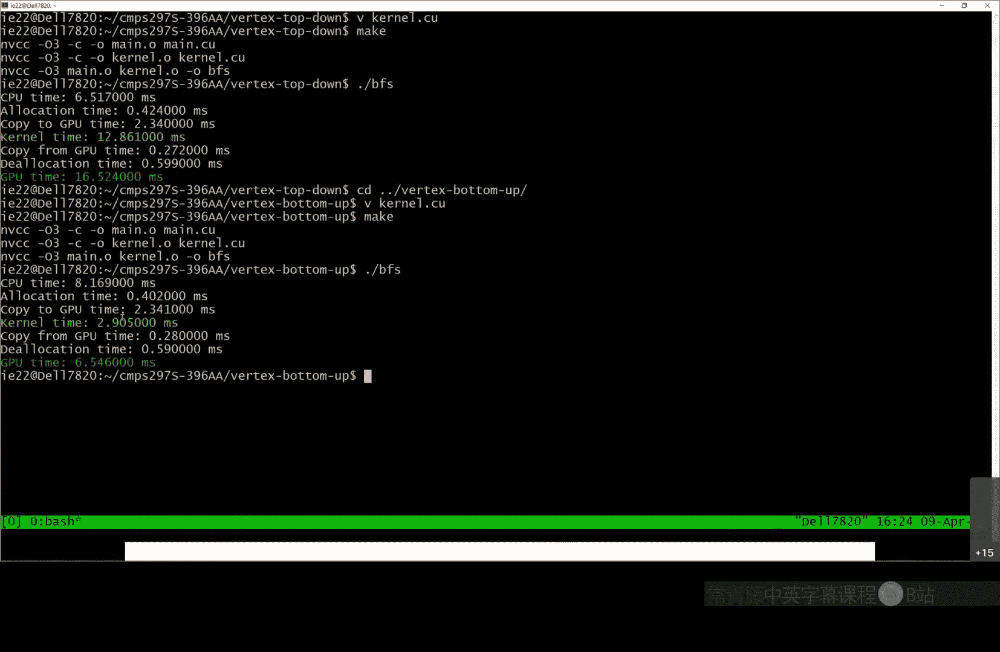

The code that we wrote。Now， one thing to keep in mind， when I said vertex centric。

 I said there's two versions， there's actually another version which is not really a different version。

 but we have something called a direction optimized BFS and the direction optimized BFS does a hybrid of these two。

And the direct。is that it starts with a top down approach and then switch us to the bottom up approach。

 why。For the top down approach。When I have a small number of neighbors in the previous level right I'm going to do a little bit the top end approach only goes through the neighbors in the the neighbor list of the neighbors in the previous level so in the initial iterations I have very few neighbors in the previous level so the top end approach is going to do very little work。

Whereas in the initial iterations when it had very few neighbors in the previous level。

 the bottom up approach is going to do a lot of work， why because the bottom up approach。

Is going to check for all the unvisited vertices whether any of their neighbors are visited well when I'm at the beginning I have very few visited vertices。

 so I'm going to have a lot of vertices that are not visited that the final approach is going to go through their neighbor list and because they have few vertices that have been visited。

 there's a high probability that these vertices that whose neighbors I'm going through are not going to find neighbors that have been previously visited。

😡，So in the initial iterations， the bottom of approach performs poorly。Okay。

 the bunup is inefficient at the beginning because most vertices will search all their neighbors and not find any neighbors that are in the previous level。

Whereas in the initial iteration， the top down approach is going to do very little work because there are few vertices in a previous level。

 so it's only going to loop over the neighbors of those vers。

So a direction optimized VFS starts with a top down approach and then switches to the bottom of our approach later on。

So let's go see how well the direction optimized version performs。

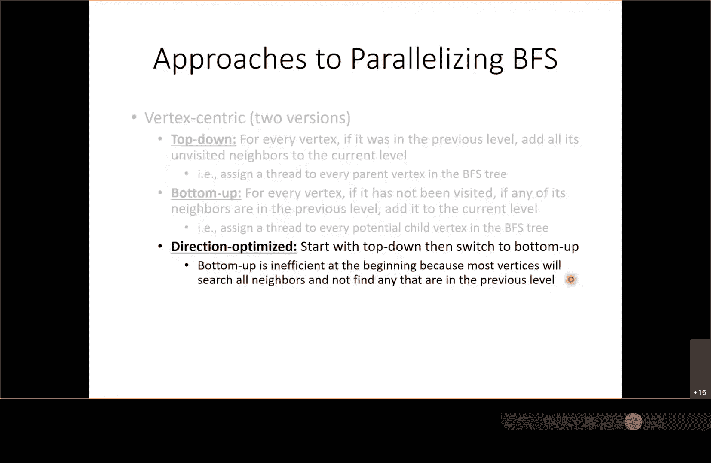

So here I'm going to go to the。Direction optimized version， I've already set up。

The code for the direction optimized version， there's nothing additional to implement in terms of the kernels。

 we have the top down kernel that we implemented and the bottom up kernel that we implemented。

 and if we scroll down here the loop that's looping over the different levels and calling the kernels it calls the top down kernel for the first level and then it's going to call the bottom up kernel for the remaining levels。

Okay， so let's compile this code and we will run it。

And as you can see the direction optimized version performs substantially better than the top down version over the bottom up version set on their own because the top down version does substantially better than the bottom up version in the first iteration or the earlier iterations whereas the bottom up version does better on the in the later iteration。

 why because as we said in the beginning， most of the vertices have not been visited yet。

 so in the bottom up version in the beginning most of the vertices are going to search all of their neighbors and they're not going to find any neighbors in the previous level。

 so they would have done all that work for nothing whereas in the beginning。

 the topdown version is just going to loop over the neighbors of the one source vertex or if it for it's the next level you know a few source vertices and and it's going to visit their neighbors。

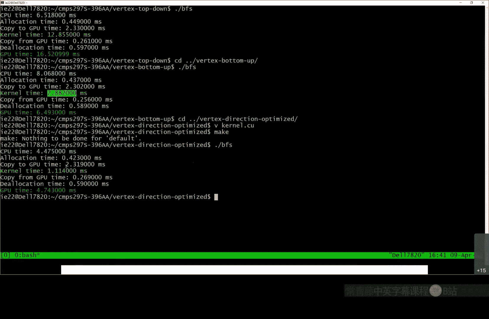

That is why the top down version does better in the initial iterations。

 while the bottom up version does better in the later iteration。Okay。😊，Any questions about this？

Alright， now let's move on to the edgecentric approach so in the edgecentric approach for BFS what we're going to do is we're going to launch a thread for every edge and then for every edge we're going to check if the source vertex of the edge is in the previous level then we're going to and the destination vertex of the edge has not been visited then we will add the destination vertex to the current level so in other words here' when I'm when level one is my previous level and level two is my current level then what I'm going to do is I'm going to assign a thread to every edge in the graph。

And the threads that are going to， to do the the kind of the main work are the threads that are assigned to a vertex whose previous that are assigned to an edge。

 whose previous vertex is in the previous level， whose source vertex is in the previous level and whose destination vertex is has not been visited。

 So in this case， this thread will find that it source vertex is that sorry。

 this thread for its edge。 It'll find that the source vertex is in the previous level level1 and it's destination vertex has not been visited。

 So this thread will mark its destination vertex as。😊，Part of the current level。

 which is level two okay， is it clear？All right， let's go and。送紧你。

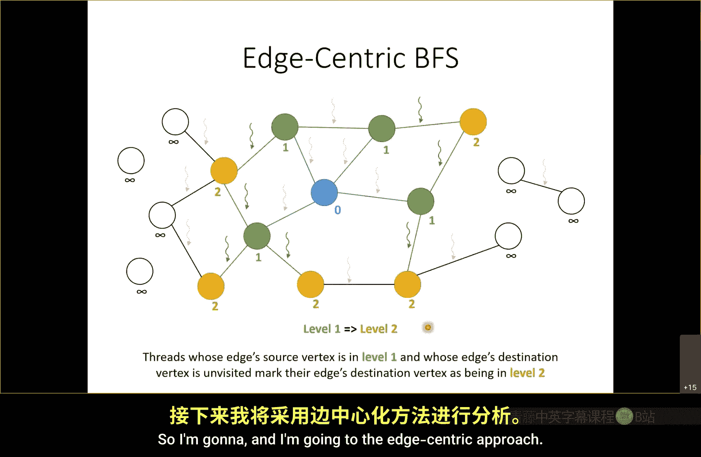

And I'm going to the。The ecentric approach。We're going to open the kernel。

And we're going to implement this。 So here， again， the host code is is very similar。

 except that I'm going to be using a COO graph instead of a CSR graph。

 So here when I allocate and copy the graph， it's a COO graph。 Why is it a COO graph。😊。

Because you are using edges， it's more efficient， we can find right I'm using the edge centric approach。

Right I'm using the edge centric approach So given an edge I want to find the source in the destination vertex。

 So a CO graph gives me that that accessibility。 So here just let me recap on what the CO graph entails here the CO graph is going to have the source vertex and the destination vertex for each vertices I don't have any source pointers Okay。

 if I scroll down over here you'll find that when I am launching the BFS kernel This time the number of blocks is configured based on the number of edges as opposed to the number of vertices but I'm assigning a threat to every edge instead of a threat to every vertex so I will start。

😊，By assigning a threat to every edge so threat zero will process vertex 0 we process edge 0 thread one will edge1。

 threat2 will process edge2， etc cetera so in general。

 my edge is going to be equal to my thread index so my edge is equal to block index dot x times block dim but x plus。

R indexd dot x， and then I need to make sure that the edges and bounds， of course。

 I'm going to do if edge is less than CO graph do nu edges。So here， if my edge is within bound。

 now what do I need to do？Well， I need to find my source vertex。

 I need to find my destination vertex。 Okay， so I'm going to find。Unsigned and。Be vertex。

Is equal to GO graph dot source， the source vertex of the edge。 I want to find the neighbor， Okay。

 so I'm going to have unsigned in。Neighbor is equal to CO graph do destination of edge Okay。

 so the vertex is the source of the edge， the neighbor is the destination of the edge and now if my vertex。

 if my source vertex is in the previous level， I want to mark the neighbor and the neighbor has not been visited。

 I want to mark the neighbor as being part of the current level so how do I do that。

 I'm going to check。If my vertex is in the previous level， so if level of。Pect。

Is equal to the previous level， which is the current level。-1。And if my neighbor。

Has not been visited。 So if the level of my neighbor。诶。You and Max。

 this means my neighbor has not been visited oop。And in this case。

 what I would like to do is I would like to mark my neighbor as being part of the current level。Yes。

 I'm not going to write。Level of。Neighbor is equal to the。Current level。And I need to of course。

 set the flag that indicates that I visited a new vertex on this iteration to make sure that I launched another another iteration later on Okay。

 so I'm going to set this flag to one。And what you notice here is that there are no loops。

Every thread is responsible for one edge， so either it visits an neighbor or it does not visit a neighbor but it's not looping over any neighbor。

And you can probably expect that this approach will have less controlled divergence。

 just like when we use COO to paralyze SPMV， it had less control divergence than when we use CSR。

Okay so let's compile this and run it so I'm gonna so remember my top down vertex centric approach was around 12。

 something milliseconds my bottom up approach was 2。

8 something milliseconds notice these times are a little bit different from what we saw at the beginning of the lecture just because I had to run them again because we had a glitch in the middle level we had a connection problem in the middle of the lecture so I apologize for that and then here I have 1。

1 milliseconds so now I'm going to compile this code that we just wrote and I'm going to run it。😊。

And as you can see we have around 1。68 milliseconds so the edge centric approach is better than the top down and the bottom up approaches Okay amount so this was the time for the top down this is the time for the bottom up so the edge centric approach was better than the top down and the bottom up approaches direction optimized actually did better than the edge centric approach。

 but you can tell that the edge centric approach does fairly well。Okay， any questions about this？

Professor when we looked at the source and destination of the edge。

Is there an entry for both directions since the graph is undirected？Yes。

 there is an entry for both directions。m yeah， so I haven't。

 I'm not storing only one direction of each other， I'm storing both directions。So here， in fact。

 I'm glad you asked。

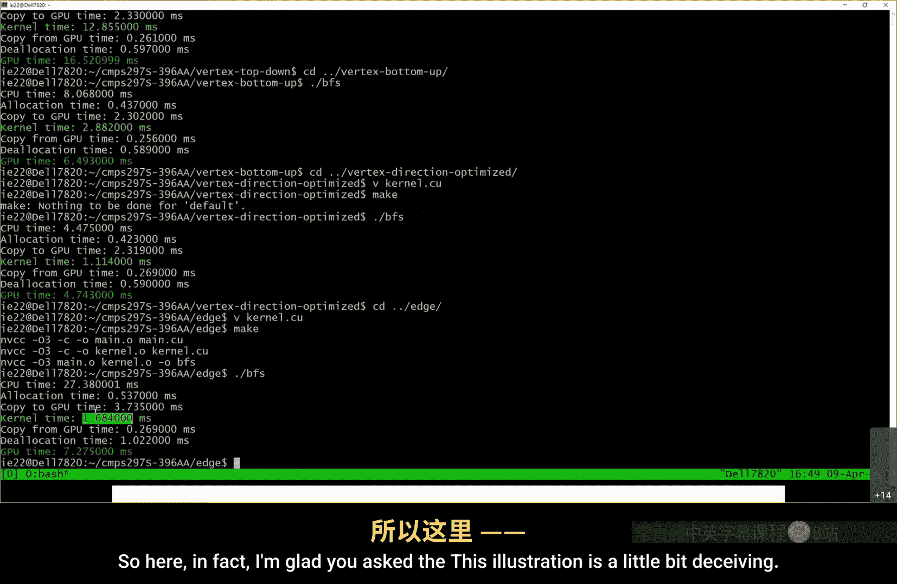

This illustration is a little bit deceiving， there's actually going to be two threads here。

 there's going to be a thread for this direction there's going to be a thread for the other direction。

 so thank you for asking that， but I'm only including one thread here for simplicity。

 but you're right that there's going to be two directions， there's going to be two edges。

 one in each direction and there's going to be two threads， one for each edge。

Professor using this approach， aren't you exhausting the number of threads very fast。

 Because you might have for each note，2，2 or more。Edges。 So。

 so each time you're adding to two times  two times  two times2。 So。

 so it will exhaust all the threads very fast， no。So you're right these approaches are using a lot of threads and a lot of times a lot of these threads are not doing anything。

 they're just checking and realizing that they're not relevant for this iteration and they're exiting。

 so I will talk about that。😡，So hold on that question and I'll revisit this topic。Okay。

 so so this was。

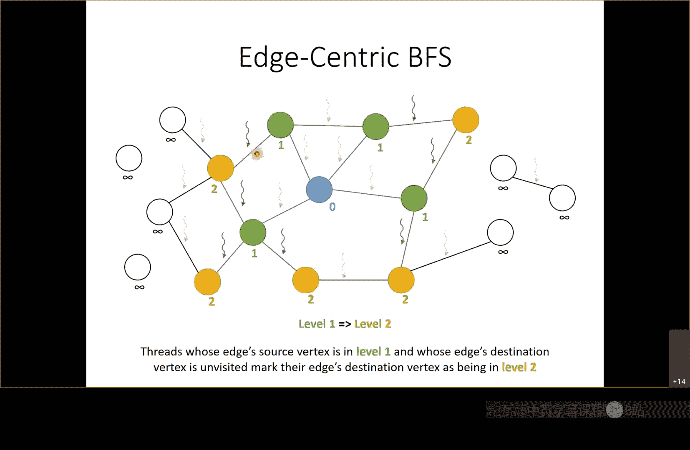

So as you can tell， the edge centric approach and the bottom up approach did pretty well。

 the top down approach did not do that well， the direction optimized approach did pretty well and this is the code that we just wrote。

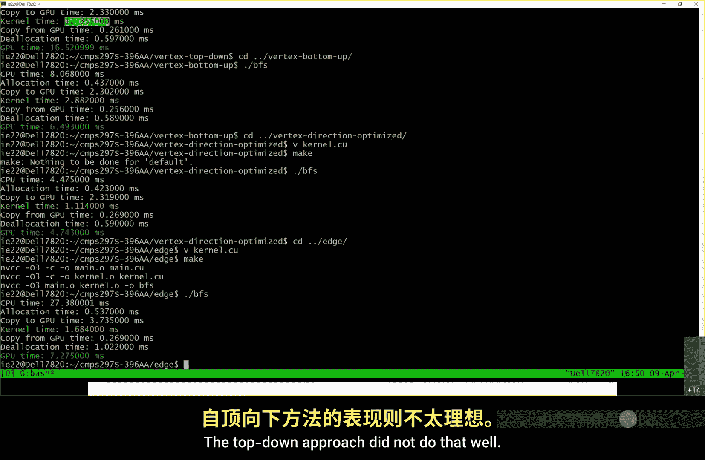

So now we want to talk about the data set implications。

 so this is something that you guys have been alluding to。

 which is that oh doesn't the shape of the graph some of you asked。

 doesn't the shape of the graph affect the choice of storage format。

 the choice of parallellyzization and it does so the best parallellyzization approach depends on the structure of the graph。

The graph that I've been using in since the beginning of lecture is actually a it's a social network graph。

 so it's a high degree graph。Okay， you have a lot of these high degree neighbors and the vertex centric bottom up approach。

 as well as the edge centric approaches are better on high degree graphs such as social network graphs where you have where you have these celebrities。

😊，And the reason they're better on high degree graphs is that they're better at dealing with load imbalance。

On the other hand， the vert eccentric top down approach。

 which we saw performed pretty badly on the high degree graph that we've been using actually performs better on low degree graph。

Okay， and what's an example of a low degree graph， where do we find low degree graphs you like？A map。

Right exactly a map and in fact I have a map graph over here that that that we can use so let me go back and show you how each of these versions performs on a road graph so I'm going to go back actually we'll do the edge first I'll do them in reverse order so here I'm going to do BFS。

😊。

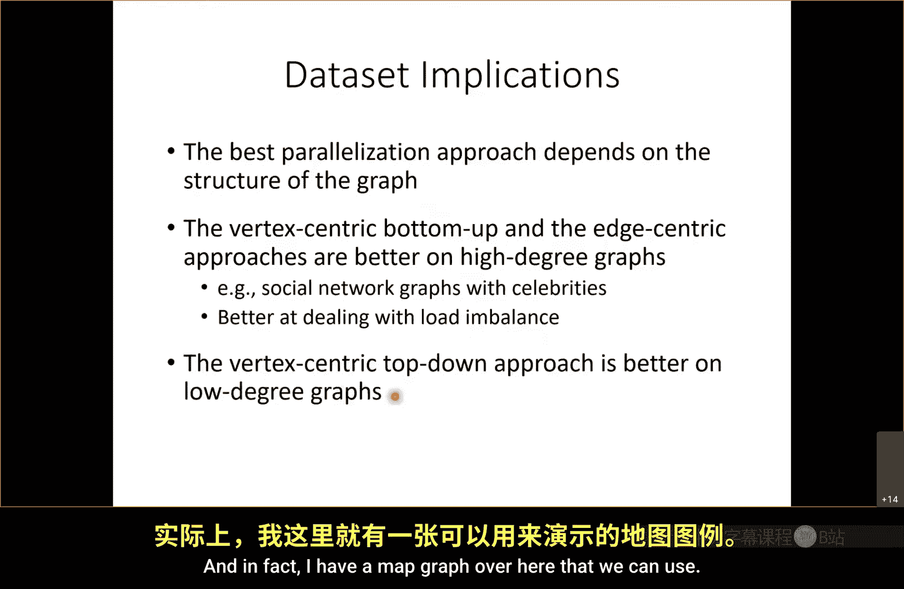

But this time I'm going to do it on a road graph， this is the road graph for California。

 so I'm going to run BFS on the road graph， this is a bigger graph than the one I had before so going to take a little bit longer to run。

Okay， so we have 234 milliseconds for the edge centric approach。

 let's go to the direction optimized approach。Remember the direction optimized approach was doing top down for the first iteration and then bottom up for the rest of the iteration。

 so most of it is just bottom up so here I'm going to run BFS on the roadmap。Again。

 we have around 228 milliseconds， so a little bit better than edge centric。

 let's go to the vertex centric bottom up approach。

And again we have around 200 formally seconds so it's a little bit better than the edge centric approach remember top for the high degree graph edge centric was better than the bottom up vertex centric here the vertex centric。

 the bottom up is better than the edge centric Now let's look at the top down approach。

And what do you notice？It's significantly faster。So this vertex centric top down approach that was much slower for the high degree graphs。

You know， almost four times slower for the high degree graphs or four to 12 times slower for the high degree graphs is actually much faster than these other approaches for the low degree graph。

诶。😊，And the reason is that with the low degree graphs。

 you only do work for the vertices that have been visited on the previous iteration and with the low degree graphs。

 the number of vertices that are visit each iteration are very small because my graph has low degree they're not necessarily very small。

 but they're smaller than the case with the high degree graph you have more iterations and fewer vertices per iteration and that is why the top down approach does better in the case of low degree graphs here the vertex centric top down approach is better on low degree graphs for example maps of roads in a geographic area。

😊。

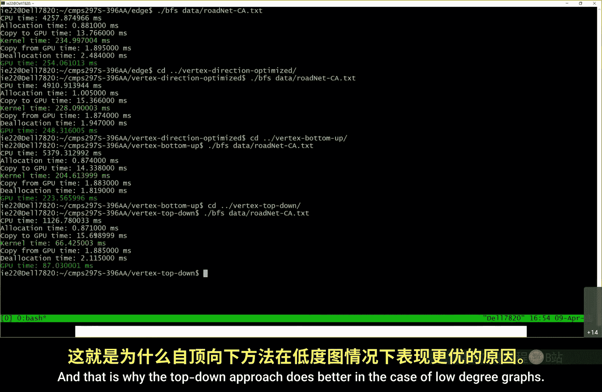

Okay， and in fact， when applying vertex centric to high degree graphs。

 there's actually an additional optimization that we can do。

 which is we can launch whenever we encounter a high degree vertex。

 we can launch more threads to process the neighbors of high degree vertex And we'll cover later how we can launch more threads。

 But the key takeaway here is that the choice of the best graph depends on the data。

 sorry the best graph algorithm best approach depends on the data。

 So there's no best BFS algorithm that's good in all the data。

 you really need to consider what kinds of data sets you're running on when picking the algorithm you want to use okay。

😊，Allright， another important topic I would like to talk about today is the similarity between BFS and SPMV。

 So just like when we store graphs in a similar way to how we store sparse matrices。

 I want to talk about how BFS is similar to SPMV in how we access data So let's go back and look at what SPMV does in SPMV。

 what we did is we loop over the rows for every row So here we maybe we we're doing these rows in parallel for every row and then for every non-zero in that row。

 we looked up for that non-zero the element at of course the vector the element of the input vector at the column index and then we updated the element and the output vector at the row index okay。

😊，So here's what we did with SPMB， well let's look at what we were doing with BFS and in particular I'm going to look at the vertcentric bottom up approach of BFS。

So in the vertex centric bottom up approach of the Fx， the Fx， what did we do。

 did what we did was for every vertex。Which is kind of like for every row in SDMV。

And then for every edge of that vertex， So for every edge。And a vertex。

 which is like for every non-zero in the row。ok。😊，We looked up the old level。At at of the neighbor。

Okay， which is like looking up the input vector at the column。

 and then we updated the new level at the vertex for the vertex itself。

 which is like updating the output vector for the row at the row index。

You can tell that these two ways of going through my data。😡，Okay， are actually very similar。

And in fact， there are also corresponding ways of performing SPMV that look similar to the vertex centric top down approach as well as the edgecentric approach of performing BFS。

Okay。😊，So and you know having seen this， you can tell there's a very close correspondence between sparse matrix operation and graph operations。

 particularly here between SPMV and BFS and this brings to the topic of the linear algebraic formulation of graph problem with a few tweaks we can actually formulate BFS exactly as SPMV to do that what we would need to do is we would need to use the visited list as the input vector and the output vector to SPMV and we would I need to have a few other vector operations to get exactly what we want but in general SPMV would remain the dominant computation if we want to formulate BFS as SPM Now what's the advantage of us formulating BFS as SPMV。

😊，In fact， many graph problems can be formulated in terms of sparse linear algebra computations。

 not just BFS and the advantage of formulating graph problems in terms of sparse linear algebra computations is that there are many linear algebra many sparse linear algebra libraries out there。

 so when you formulate your graph problems as a sparse linear algebra problem。

 what you can do is you can leverage mature and well optimized libraries for doing high performance sparse linear algebra。

😊，Okay， so this is an advantage of linear algebraic formulations of graph problems and also linear algebra operations tend to be very nice and easy parallel now the disadvantage of this approach is that it's not always the most efficient efficient approach to solve a graph problem and this brings me to a topic that you guys have been mentioning throughout the lecture which is redundant work。

😊，So the approaches that we've discussed so far， what they do is they're checking every vertex or edge on every iteration。

 So the vertex centric approach checks every vertex on every iteration。

 So we launch a thread for every vertex on every iteration。

 The edge centric approach is launching a thread for every edge on every iteration。

 So the approaches we've discussed so far check every vertex or edge on every iteration to see whether they are relevant for this iteration or not。

😊，The advantage of this is that this is easy to implement。 It's highly parallel。

 It's very easy to extract parallelism this way。 And also， we don't have to。

 we don't have to synchronize across thread。Okay， all the threads here were operating completely independently of each other。

 none of the threads had to top to the other threads and synchronize with them and communicate with them to figure out what they were doing。

😡，The weakness of this approach， like you guys have been observing。

 is that we are doing a lot of unnecessary work because many threads will just find that their vertex star edge is not relevant for this generationeration and they will exit。

So what we will do next time。So this lecture is to be continued。

 What we will do next time is we're going to see another approach for paralyzing BFS but this time what we will try to do is we're going to try and avoid launching threads for irrelevant vertices or edges instead what we're going to do is we're going to construct the frontiers of the edges that are relevant and we're going to try and only process the vertices or the edges that are relevant for that particular information and we're going to try and only launch threads for the vertices or edges that are relevant for that iteration and this is going to reduce the amount of redundant work。

 but of course because we need to be constructing these frontiers it's going to require more synchronization across threads so there's going to be the straightoff between parallelism and avoiding synchronization and between reducing redundant work and we will look at the straightoff next time okay so you can read more we covered today in sections in chapter 12 of the textbook and we will。

😊，Continue the later sections of chapter 12 in next time's lecture。

 does anybody have any final questions before we conclude？Right， if not。

 then that's all for today and I will see you next time。Bye， everyone。

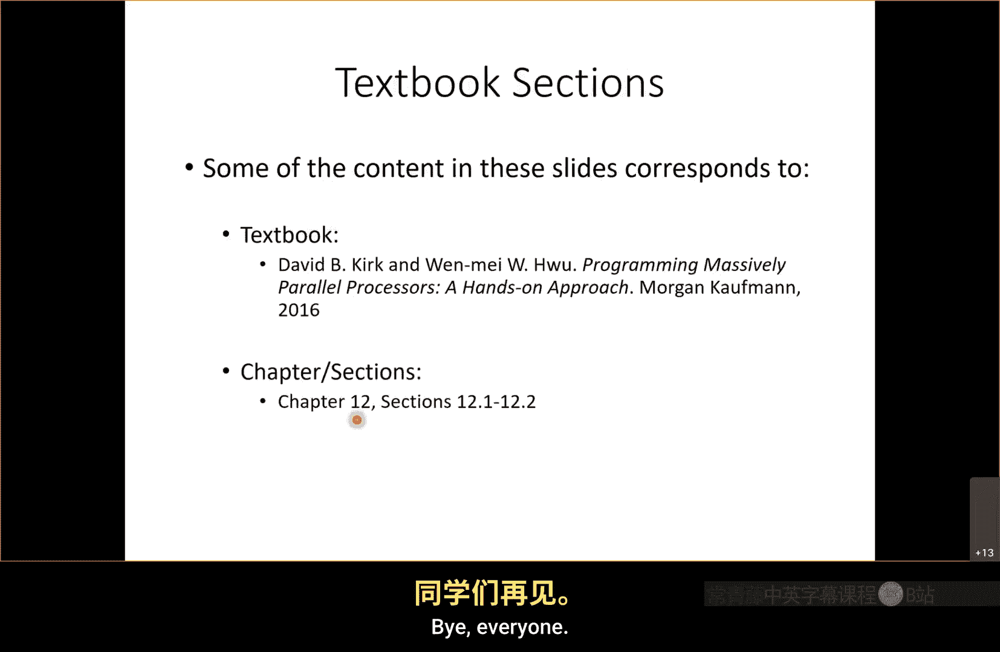