# 贝鲁特美国大学【中英⚡GPU计算｜CMPS 297S Spring 2021, GPU Computing】 p20 P20 线程束内同步 -BV1LD6BBPEjt_p20-

Hello everyone and welcome to lecture 20 of GPU computing today we're going to talk about an advanced programming technique and that's interwarp synchronization so as a recap of what we've done so far in the course。

 we started out the course in the first three weeks where we looked at some of the fundamentals of GPU computing。

 looked at the architecture of GPUs， we looked at the basics of the co programming model and we also looked at the various key optimizations that people apply in different four different applications and then we took what we learned and we spent around seven weeks going through various parallel patterns to see how we parallellyzed different applications with different patterns and we used a lot of the techniques and the optimizations that we learned in the first part of the course。

So I hope by now that you've gotten a good idea of how we go about taking a particular application and then starting from scratch。

 doing a basic parallellet implementation and then incrementally optimizing it until you get an optimized version and in fact this is what you guys have been doing in the project and you know with the。

We in the next part of the course， we will be looking at new patterns but we're looking at some advanced features and maybe some of these will help you with some of the advanced optimizations you'll do in the project so we're done talking about parallel patterns and today we're going to begin talking about some advanced features that GPU programmers might use to optimize their applications and today in particular we're going to talk about intra war synchronization and here intra warp be within a warp we're talking about synchronization within threads of the same in the same warp。

So if you remember when we spoke about worksps， we said that warps are the unit of scheduling in an SM and that the size of the warp is device specific。

 but it has always been 32 threads and the unique things about threads within a warp is that they execute following the S model。

 which means that we fetch one instruction and we execute it for all threads in that warp and these threads execute on the SM on the course of the SM at around the same time。

Now， because warps execute following the S model， because the threads in the warp are executing at the same time on the S。

 we can take advantage of that bychronizing synchronizing between them more efficiently then。

 for example we synchronize across threads an entire block using sync threads and this brings us the topic of intra warb synchronization。

 so we can take advantage of the special relationship between threads in the same warp to synchronize between them quickly。

And KUuda actually has several built in functions to synchronize between wars and there's two kind of major categories of functions。

 We have functions that share data across threads we call these shuffle instructions or shuffle intrinsics so and basically what we're doing here is we're shuffling data across threads。

 what mean by sharing data across threads， obviously threads can already share data through shared memory。

 but here what we need is actually sharing registers or register values across threads。

 So if thread can take a value in one of its registers and send it to another thread directly without going through shared memory。

 as long as that other thread is in the same warp。We can also do things like voting across threads so maybe you different threads have you know some threads have you know different threads maybe check some conditions some of them or have true evaluate true for that condition others evaluate to false so if you want to figure out how many threads evaluated true and how many evaluated to false or false or even which threads were true and which threads were false or something else like checking which threads are active inside of a certain divergent part of the code all these kinds of intrinsics fall under voting voting across threads so these are the two major types of intra warp synchronization sharing data or voting。

So what are the different let's start by talking about the shuffle instructions so what I'll do this lecture is I'm going to do two examples I'm going to do one example where I'm going to show you how we can use shuffling on a pattern that we've seen before and then I'm going to also do another example where show I'll show you how to use voting。

So let's start with Warp shuffle instructions。 The built and Warp shuffle instructions enable threads to share data with other threads in the same board。

 Now， previously， when we wanted to share data across threads in the same block。

 what we had to do is we had to declare something in shared memory。😊。

And then one thread would write the shared memory。 and then we sync threads and then the other thread that we will read from shared memory。

 And that takes a long time。 So if we want to， if you want to share data just between threads in the same board。

 we can avoid that。 So we will using the workshop for instructions。

 And that's going to be faster than using shared memory and think。😊，Now。

 there are different variants of the war shuffle instruction。

There's shuffle sync and what shuffle sync does is that copies from specific it copies data from a specific lane or I'm going to use lane here to refer to one of the threads in the warp so if the warp has 32 threads that executed 70。

 we can refer to each of these threads in the warp as as a lane in the warp。

 you can think of it as a lane in our 70 or vector unit okay so we can copy directly from a lane from one lane to another lane。

 in other words from one thread in the war to another thread in the warp。

There's shuffle up and notice how there's underscore sync here and the reason there's underscore sync is because when we use shuffle instructions。

 we're kind of synchronizing across threads in the same form。

And this distinction is actually important in the late generations of the GPU architecture where they started enabling different threads to take different paths simultaneously。

 so we have different threads might have different program counters and that's something that we didn't really cover。

 but this is part of the reason why we have undersourcing。So another one is shuffle up。

And with shuffle up sync， you shuffle from a lane with a lower ID relative to the thread you're shuffling to there's also shuffle down sync and that's where you copy from a lane with a higher ID relative to the color and then finally there's another example where you have shuffle exor sink where you copy from a lane using some bitwise exor of your own lane now。

Having told you about shfle， this idea of a thread wanting to get a value that was produced by another thread。

Where have we seen this before， which pattern did we look at where we had different threads。

 you know， producing values that later on another thread would read。Hisstogram， maybe。

Now with histogram， you were all the threads were autoomically incrementalcrement in the same value。

 It's not what I'm looking for。 I was looking for what are the patterns where one thread and you have different thread use the values going And later is some of them read it。

 What did you say。Is it gone？A scan， right， scan， exactly。 So scan and reduction。

 So reduction is a simpler version of scan。 So you're absolutely right。 reduction or scan。

 I'm going to focus on reduction because of simpler。 in reduction。

 while we had the way reduction worked is that we had these threads all execute read some values and then produce a set of values。

 Okay， and then in the next step， some of the threads would read the values that different threads on the previous iteration produced。

 So here， thread5 over here produce this value the next it then we had to do a sync threads。

 and on the next iteration， thread0 was reading the value that thread5。诶。😊。

And because we wanted to all these threads to produce a value and then we want to wait for them to finish before the threads can read these values。

 we had to do a sync threads in between each of the iterations of the scan。

Now when we looked at what what that looked like at the warp level at the warp level。

 if we have a thread block has four warps on the first iteration。

 half the wars drop out and we have we' were left with two warps on the next iteration。

 you know half the warps keep dropping out again until we're down to one warp okay so between each of these steps we synchronize because we have threads in one warp or need to read data that was produced by threads in a different warp on the previous iteration but when we're down to one warp。

Now when we're down to one workp for the remaining steps。

 the threads are going to be reading data that was produced by threads in the same morp on the previous iteration so here in this warp I have threads  zero。

 one， two and3 right on the next iteration thread zero is going to read the value that was produced by thread2 thread one is going to read the value that was produced by thread3 okay。

So when one war remained。Okay， the threads are reading values from the same work。

 so what we can do is we can actually use shuffle instructions to do this instead of using shared memory and same threads。

Okay， in the previous implementation of production， what we did is on every iteration。

 we would store a shared memory and we would do a global sync threads。 Okay。

 but what we can do when we get down to the same warp is rather than using shared memory and sync threads。

 what we can do is we can simply shuffle the data from one thread to another thread。

 So here each of these threads。😊，Well add two elements and produce four values and then in the next iteration。

 this thread， thread zero can shuffle the value from the register of thread2 to the register of thread  zero without having to do anything threads and without having to go through shared memory。

Okay， is this clear？Any questions about this， I'll show you how we implement it。

 but conly is it clear to everyone。Doctor， why is it different because thinks in sync threads。

 the other threads are they're not doing anything Islam。W is it， Why is it faster。

 Let no shared memory slower than there's two aspects。 There's two things。 So obviously。

 when we go when we reach from registers faster， than reading from shared memory。

 But the key thing is that when I think threads， what that means is I need to wait for all the wars。

To reach that sink thread before I can proceed。Okay。

 all the warps need to execute that same threads before you can proceed， whereas when we shuffle。

 we're only synchronizing across threads within the same warps。

 so we don't really care about what other warps are doing we don't have to we don't have to make sure all the other warps reach the same threads。

They were just thinking within the war。That's why it's faster because because you know。

 it's trivial to sink across threads within the war because they're all executing in simply。

 they're all executing at the same time， we all just reach the barrier at the same time。

Or they all synchronize quickly because they're scheduled together。Whereas when we do a S threads。

 these other wars are not scheduled and they need to get scheduled to execute the S threads and all that stuff。

Okay， okay， I go ahead， thank you。So the fact that the threat of the same War bar and executing in lockstep makes synchronizing between them faster because they're executing at the exact same point。

Okay， so let's go see how to implement this I'm going to switch the code over here and this is the code that we wrote previously for the reduced journal each thread took a segment that's twice as large as the number of that's twice as large as the number of threads that it had and each thread was performing a reduction so we started by loading the two halves the input segment adding them and putting them a shared memory and then we continued by going from stride is blocked in over to until the stride is one so greater than zero and on each step of the way what we did is the threads that we less than the stride would add。

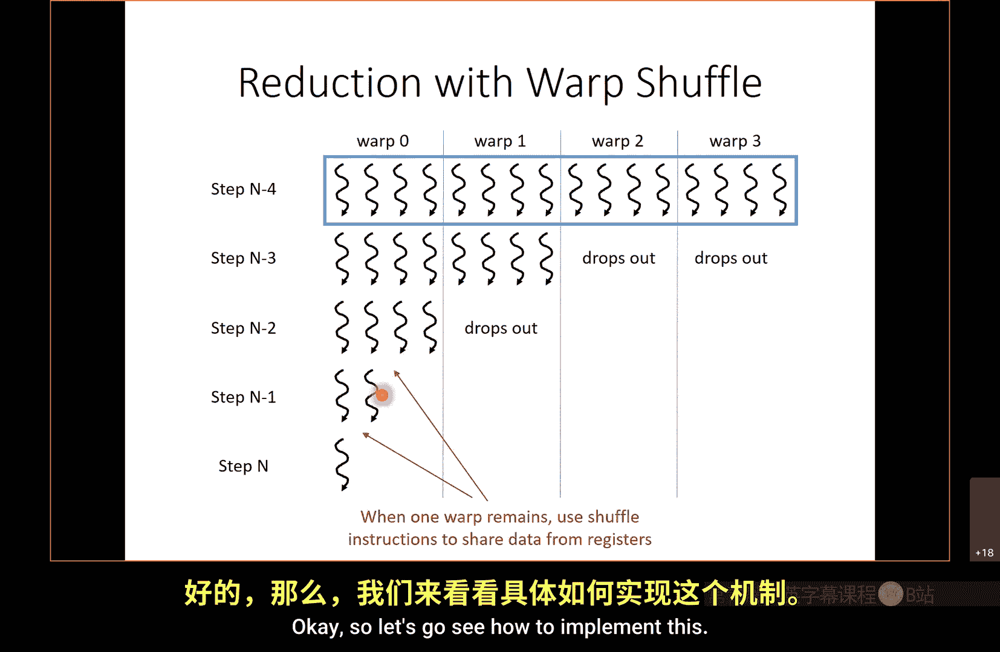

The value that was dried away to their right and at the end。

 thread zero was responsible for storing sum of the total sum of the thread lock and into the partial sums and we dealt with the partial sums later on in a different way。

 either using by calling a reduced kernel again or by simply adding them on them。

So what we want to do。Is we want to change this reduction tree code so that instead of going all the way to strideide one。

 using shared memory and sync threads， we want to go until the stride is greater than the warp size。

 which should remain sync threads and once the stride is equal to the warp size。

 what we want to do is we want to read those values to register and then continue in the registers and using shel instruction。

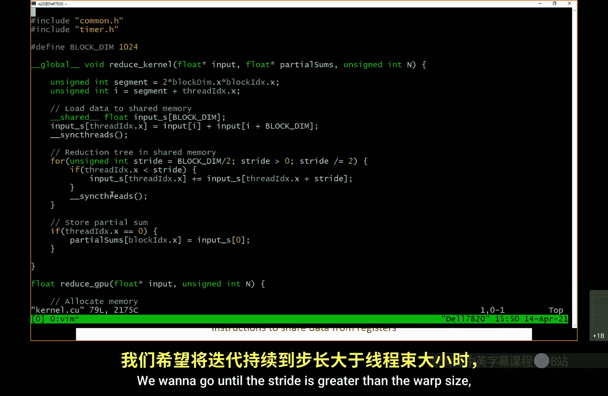

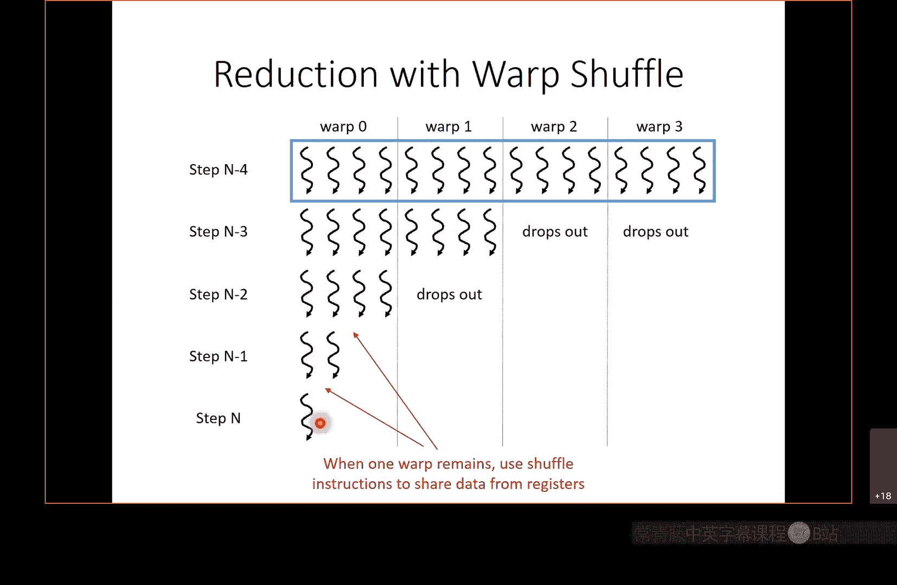

Thiss all you would like to do。So here's how we're going to change the code So here。

We're going to do the reduction tree in shared memory， but we're going to stop。

Once the stride reaches warb size， we're going to go until actually。

 let me first let me first define a macro here that tells you what the warb size。pon define。

Borth size。诶。😊，Okay， so what I will do is rather than stopping at zero， I'm going to stop at。

Forb size。Okay， and now at the end of this iteration， what we have is we're going to have。

 we're going to stop when the warp size is 64 and this input underscore S is going to contain 64 different values that I need to continue the reduction on。

So what will happen is it is。And each thread is going to load two elements from shared memory。

 add them， and then that becomes the thread's partial sum。Okay， so now we're going to continue。

By doing the reduction tree。Using。Shuffle instructions， okay， and going to initialize a value sum。

And that value sum is going to be so here when' down to a single work。

 each one of these threads is going to learn the value from the previous thread in the same orp and the value for previous thread in the previous from shared memory but each thread will two values from shared memory。

 and that will become the partial sum that this thread will produce。

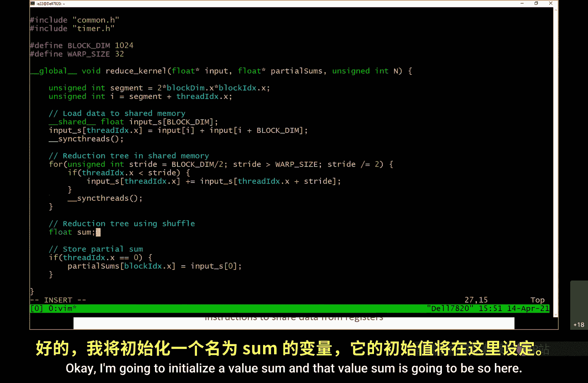

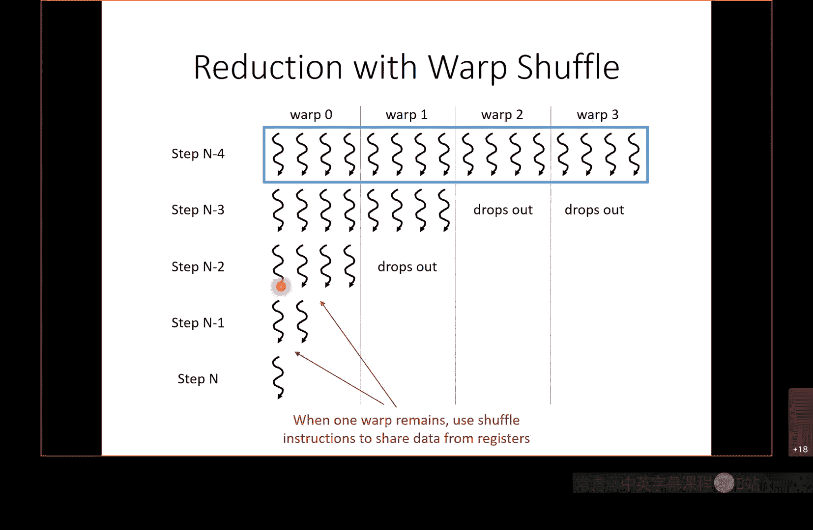

So here I'm going to start， I'm going to write， I will only want the threads in the first word to compute。

 I'm going to write if。Trend index IX is equal to zero。And then these threads。sorryrry。

 sorry not equals0， I apologize I did that out of't habit if for x x is less than the orb size。Okay。

 so here I've excluded all the threads that are greater than work size。

 meaning I kept only the threads that are within the same form， the first 32 threads。Okay。

 now if the threadex exercise the works size what I want the thread to do is I want to it below load the value from the previous thread as well as the previous thread that's 32 away。

 and I wanted to put that inside of some variable what I will write is I will write。

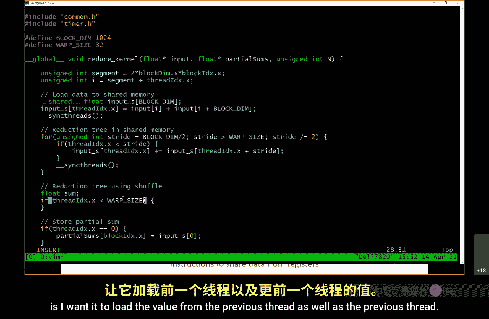

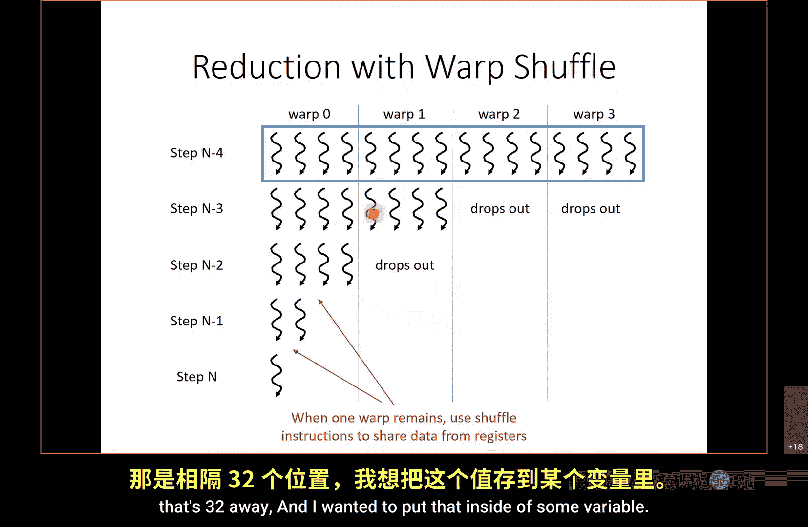

咁。Ass equal to。Input underscore square S of。确 next好的。Yes。Andput underscore as。Bd index。大系 plus。

W of them。嗯。So this here is basically the iteration for when stride is 32 so here we went from stride block ni over two to two until the stride was greater than 32 and then now here I did the iteration where stride is 32 and while doing this iteration I loaded my two values for shared memory and then put them in a register okay and then from for the remaining strides until we get to the last stride which is stride one what we will do is we will read from the register and write to the register so here we read from shared memory and wrote to shared memory here we read from shared memory and wrote to the register and then from the remaining iteration we're going to read from registers and write to registers using shuffle instructions and we don't have to sing。

All right， so we're going to do the remaining iterations now we're going to do four。

Usci and pride is equal to what it's going to be equal to war。Size over two， right。

 because we did lock them over to until until two times warp size here and then we did warp size here and now we're going to continue from warp size over two。

Okay， and then stride。Is greater than 0。ok， and then。Driry。Is divided by two。

And then for each one of these iterations， what we did before is we did input of x x plus equals input minus square x to x plus by。

 So we added the value that was stride away。 We're going to do the same thing here。

 We're going to add around that stride away。 but rather than getting that value from shared memory。

 we're going to shuffle it from the other thread and this is how we do that。

 we're going to write some。😊，Plus equals。And regard we have multiple shuffle instructions。

 we have shuffle we have just shuffle where we get from the a specific index lane or we have shuffle down or we have shuffle up in this case。

 we want to shuffle down because we're shuffling from a thread that that is that is that has a higher index so I'm going to write some plus equals and then we will write shuffle。

有。喂。😊，Okay， and then we read for my mask， I'll tell you what that is later。

 and then we're going to provide the value that we want to shuffle and in this case， its done。Okay。

 so each thread wants to shuffle its thumb。And whats going we're going to provide the stride that we want to shtle by。

 which is going to be right。Okay， so here what happens is when I write shuffle down sake some stride。

 each thread will shuffle the sum value of the thread that is stride away from it。Okay。

 each cat will shuffle the sum value of the thread that is straight away from it。

 and this value will be returned by the shuffle downstream instruction， and now the thread will take。

There's sum value of a thread that's dried away from it and it'll use it in this case can accumulate it to its own stuff。

Okay， now there's one thing left， which is this over here。 This first field here specifies a mask。

 and this mask is going to specify what threads are going to be active during the shuffle down sink because it's possible for me to only have some of the threads doing the shuffle down sink and the others not do it。

 In my case， I'm just going to have all those threads do it。 Okay。

 I'm not going to worry about about about keeping track。

SoI'm going to have all the thread shuffle down， so I'm going to just provide a mask that's all ones and hence the desktop that's going to be at。

はは。Professor， you're cracking up a little bit。 I'm not sure if it's from my side or yours。

It's fine for me。everyone else hears me fine。OK。Okay， so we said that the here， when we say S。

 we say that we're saying that all threats of the war are going to be active。Now， some threads。

 for some threads that if we go straight away from the thread。

 that value is going to be out of bounds。 So in this case。

 the threads there are are just not going to be not going to do anything。 Okay。

 so here we're going to say that all threads are active。

 but then the threads where where the threads that are trying to shuffle from a thread that's out of bounds are just not going to not not not going to do it。

Okay。😊，So by the end， what's going to happen is I'm going to keep doing this until I reach the last thread。

 And now the last thread will have the result inside of its sum variable。

 So now I go down here for indexex。F asset that x will equals zero。

 so thread zero will have this value in sum， so here rather than storing this value from shared memory or reading it from shared memory and storing it。

 we're going to just store the value that's written in。Okay， is this clear to everyone？你个先。Doctor。

 here， where are the when index or text less than website。 So when we're in one word。

 where are the threads dropping out， shouldn shouldn't the mask change。

So what's going to happen is well， first of all， some of the threads are just going to be loading access data from out of bound so those are not going to getting any useful data。

 but also even if the threads don't don't even if the threads shuffle and garbage data at the end were going we're only going to use we're only going to use the sum for threads zero so even if the other threads in the war execute the shuffle instruction we're not using their result。

Okay， so we don't really need that boundary to check over here。And'm professor。Yes。

Before we aligned the threads in such a way to reduce divergence， a control divergence。

 but now that we have this shuffle， shouldn't we revert back where we can use shuffle on every workp at the beginning and keep the tree as it was before。

So I see what you're saying so what you're saying is we can do a we can have each war do its own local reduction using the shuffle instruction。

And then each war produces a partial sum and then we have one war reduce that partial sum using a shuffle instruction。

 is that what you're saying？Yes， because now there is no more divergence since every thread is doing the shuffle with garbage data。

 but it's still doing it。Yeah so you could you could do that that's perfectly fine if you think about that each warp is going to have its own local divergence happening right so here we drop out half the warps every iteration。

When we do it this way， we're dropping out half the works every iteration。

Whereas if you want to do a local shuffle each warp and then do a shuffle of the partial sums of each warb。

 all the wars are going to be active on each it。Okay。

 so we haven't really gotten rid of diverges here in the sense that some threats are going to be doing some work。

 but that work is not going to be used。Right， I see。Yeah。Okay， no。

 I'd rather have half the threads work and half the threads drop out than to have all of them work using chocolate instructions and not sync at all。

Maybe if you want to implement that other version and try it and see you know how well it performs the president。

 that would be that be interesting exercise。Professor。

 can you just repeat what the shuttle down sink does。

So what shuffle down sync does is that it takes a value from a thread that is dried away and shuffles it down to use some threat。

Okay。So here， what shuffle down sink will return is the sum register of the threat that is stride away from me。

Within the War War。What's the， what's the0 X F FF。 So again， this is the flag， the flag。

 It's a mass that crifies what threats in the war are going to be active during this shuffle operation。

Okay， in this case， I'm just making them all active because I'm not going to use the results of the。

 the result of the threads that I don't need。ok。😊，ok佢。Yeah。

You'll see another use of this mask later on。When you look at voting。Okay。

 so let's let's compile this and run it and see how it performs。

 And I just realized that I actually forgot to compile it and run it before I implemented this。

 You know， let me do that undo。😊，ok。And a save。I'm going to compile。

 this is the old code just to show you the performance of the old code。Okay， so it took around 2。

1 milliseconds in the old code now let me go back and open this。I'm going to read you。ok诶。

And I'm going to close an assignment going to compile。And I'm going to run it。And as you can see。

 we have significant performance improvement compared to the version of that shuffle instruction。O。

 somebody just notified me that my screen is frozen。 Can you see， can you see now。ok。

So this was the the performance that we got when we ran the version without without。

Without shuffles and this is the performance that we got when we were this is the performance that we got and ran the version with shuffle Okay。

 so as you can see， the execution time with shuffle is much faster than the execution time without shuffle。

Okay。😊，Is it clear any questions？This is the quote again。O。

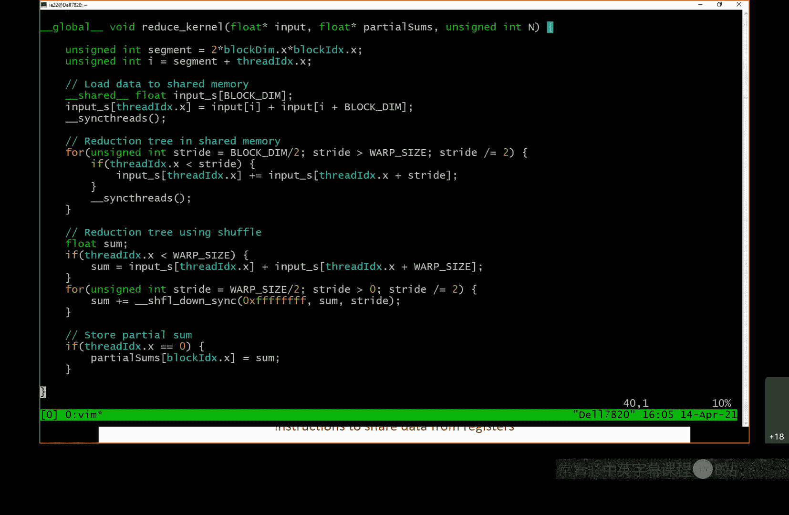

So that is kind of one example and one popular example of where we can use structural instructions whenever we want to share values across different threads of the war。

 especially if we're trying to have these threats collaborate and perform some kind of reduction could be a sum it could be a man could be a max et ce and here this is the code that we just wrote。

The next category of intertroor synchronization instructions is the war vote instructions。

And the built in warp vote instruction functions enable threads to vote on which threads in the warb satisfy some condition and there different variants of the word vote。

 one of them is all sync。Which takes a mask of the threads that participate in shuffle instruction。

 a predicate and checks if the predicate is non zero for all the participating threats。诶。😊。

So it checks if all threads in the war satisfy some condition or their values satisfyises some。

There is any sink and any sink is it also takes the amount to participate as a predicate and checks if one of at least one of the threads in the thread satisfies the condition。

 or it checks if the predicate is not zero for some thread in the world。

so here we check if all the threats satisfy some condition here we check if any of the threats satisfy some condition another one is ballot sync and what ballot sync does is that it takes a mask again of the threats that are participating in app predicate and it returns a mask。

That has a bit set for each thread that evaluates the preddicate to non zero。He。

 so it gives me a 32 bit and a jerk。And a 32 bit value is going to have one bit that corresponds to each thread in the war。

 and that bit will be set to one if the predcate is non zero it will be set to zero if the predicate is zero。

Okay， so this just tell me which threads satisfy the predicate， it also tells me I sorry。

This doesn't just tell if the threads satisfy the predicate also tells me which threads satisfy the predicate and then the other interesting one is active mask。

 an active mask basically tells me which threads are active in a particular point in the code and this is useful doing when we are doing these workshop shuffle instructions in a place where we have control divergent。

Because this allows us to know which threads are active in this branch of the code and which threads are not active。

 So somebody asked me that before they told me， how can we know which threads。

How many which strand are active and which threads are not。

 and this is how you can do using the active mask。Somebody's asking what can the predicate be the predicate can be anything I mean。

 I mean， some condition， okay， you want it could be true， that could be true or false。

You basically just care if it's zero or non zero。ok。😊，Now。

 to show you an example of where something like this might be useful， let me let me show you another。

 another simple。

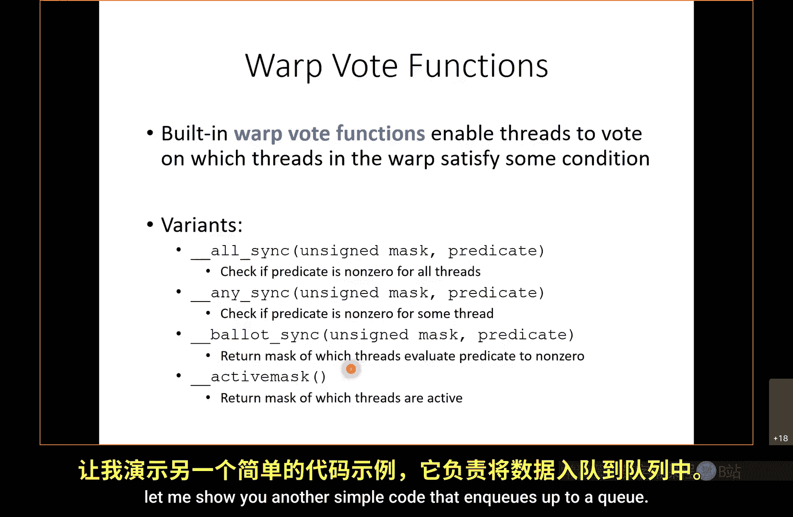

呃呃。That in queue stuff to a。 So let's go I have another。

A professor can voting in this case be useful for for debugging purposes， for example。I mean。

 usually usually when you have something like this， it's not provided for debugging。

 It's provided because it's useful in the actual computation。

 If you have some situation where you want to use it for debugging。 I mean， you can use it。

 of course， but that's not the primary objective of providing it。

 The primary objective of providing it is to be able to synchronize have threads collaborate to do something together。

 And I'm not sure an example of where it can be useful。 So here what you can do。

 I have an in Q kernel。 And if this inQ kernel does is that it takes it has some input。

 it reads a value from this input， it checks some condition on this value。

 And if the value satisfies some condition， it's going to add the value to a Q by atomically incrementing the Q size getting an index into the Q and then adding the value at that point in the Q。

😊，Okay， so we've seen queuees before。Okay， we've seen queues before with BFS。

 I didn't want to have a full fledged example here with Q just to keep things simple we just have so here we just have a Q and all the kernel does is check a condition and add something to the Q。

😊，Okay， this code could be inside of a kernel where there's much more context。

 where there's much more complex work happening before we add things to the queue。

 but I kind of I just say using this as a simple examples so that we can avoid having all the noise from other examples and then just and just focusing on the action of adding to a queue。

Now， why is this interesting for shuffle instructions， Well， as you can see in this example。

All the threads in the thread block are incrementing the same variable to add to the Q Okay and so they're atomical incrementing the same global variable to find where they need to add the queue and then they add to the queue。

 Now previously we optimized this using using privatization where we declared a private queue and shared memory and then had all the threads add to that shared queue and then wrote that shared queue out to global memory Another thing we could have done is we could have had rather than every we could have looked at each warp and rather than every thread in the warp doing an atomic ad。

😊，We can have the threads of the warp collaborate with each other to figure out how many threads of the warp want to add to the queue and then have only one thread in the warp do an atomic ad and then have all the threads of the warp write out their result to the queue at the location that the leader thread or that one thread that did the atomic ad reserve。

Okay。Let's see how we can do this。 Is it clear to everyone what this optimization we want to do is。

Rather than having all threats in the war， each of them increment the global counter。

 I'm going to have them collaborate with each other to find out what is the total number of values that this warp wants to add to the queue。

 and then we do one atomic ad for the entire war， and then we have all the threats in the war。

 collaborate to store their result at the right point in the Q。Okay， the clear。

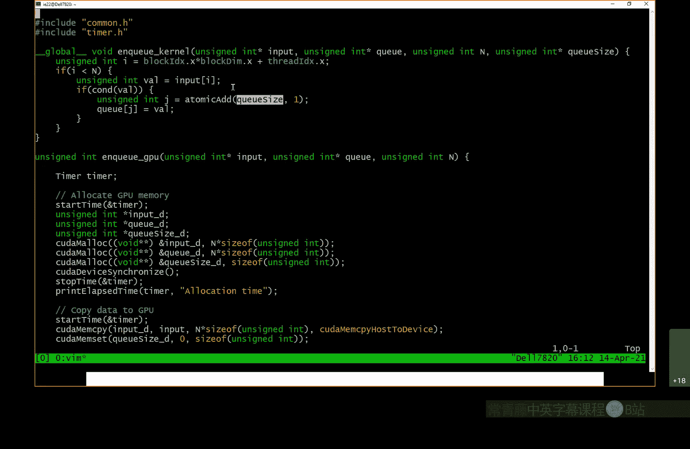

Okay， well， let's see how we can do this。First of all。

 this is the original inQ code that I just showed you and we observed that the atomic ad here。

 we have all the threads contending on the same variable to reserve space in the queue and what we want is to optimize this by doing one atomic ad per word。

So here's what we can do。 We can optimize this with warp votes。

 so we can have only one thread in the warp， increment the global counter on behalf of the others and then and then have all of them door to the queue。

 And here are the steps that we're going to follow to do this。

 The first thing we're going to do is we're going to assign a leader thread。

 So we're going to assign one thread in the warp that's going to be a leader thread that's going to lead all the other threads in the warp。

😊，Then what we want to do is we want to find how many threads is the warp1 to add to the cube。

Once we know how many threads of the work want to add to the queue。

 we're going to have the leader thread perform an atomic operation to reserve that much space in the queue。

And then once the leader thread reserves that space in the queue。

 the leader thread is going to broadcast its result to all the other threads。

And once we broadcast the results to all the other threads。

 each of the thread is going to figure out its offset for its own result from the location that the leader thread reserved and it's going to store that result。

Okay， is this sequence of steps clear， I'm going to show you how we' going implement each of these using the warp vote functions。

 but is this clear。Okay， so let's start with the first step， which is assigning a leader thread。

 So we'd like to do is we'd like to assign a leader thread。

And the way that we can to assign a leader thread， we can can we just say that thread zero is the leader？

😡，Right， can we say that thread 0 is always the leader。Yeah。

 you have to make sure that it doesn't drop out。

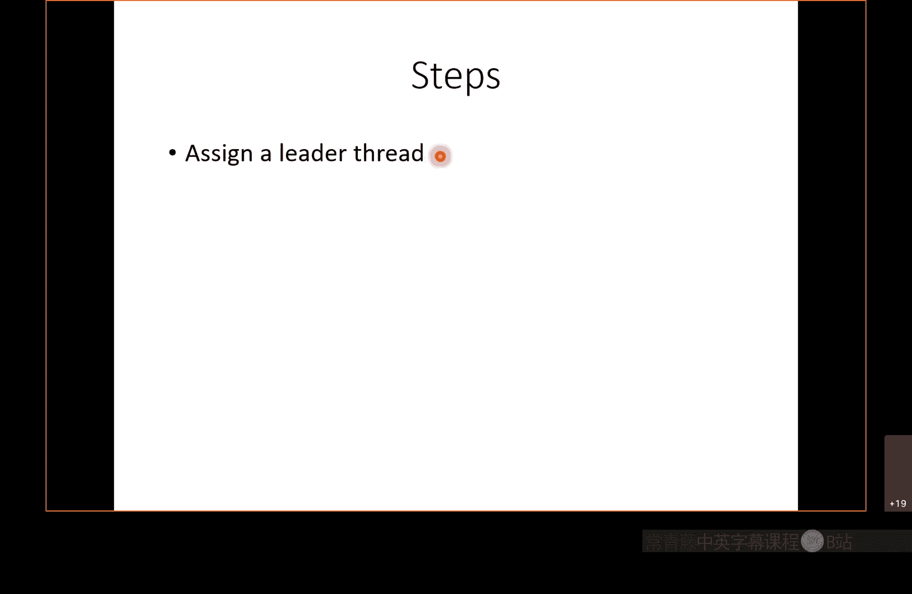

Right， exactly。 So here I want to replace this atomic ad code with code that that that has， you know。

 has one thread do on behalf of all。 So here first thing I want to do is I want to assign a leader thread So somebody said that we had to make sure that thread zero is we couldnt say thread  zero because thread0 may not pass the condition。

 So the thread zero may not reach this point。Okay， for zero may not reach this point in the code so what we want to do is we want to assign a leader thread and the way we can assign a leader thread is we going identify which threads are active。

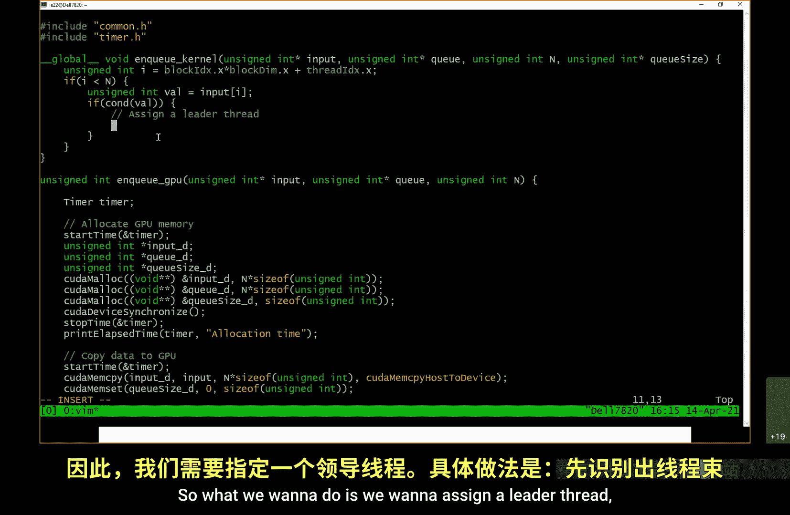

And then we're going to pick the first active threat in the war。Okay。

 we're going identify which threads are active， and we can pick that first and third of the word。

 So how do I identify which threads are active， We saw a word vote function that that that gives us that。

 What was it， Does anybody remember it。Any sink or ballot sink。No， it was the no， it wasn't ball。

 it was active maths。Okay， so we're going to find which threads are active using the active mask。

 so the active mask is going to contain a bit set for each thread that is active。

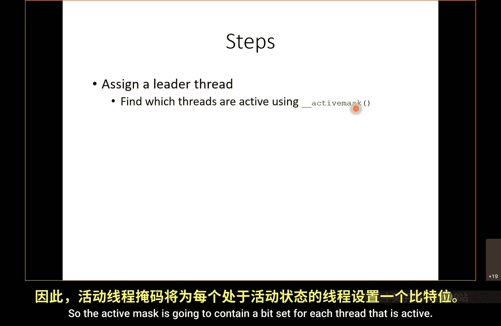

Okay， the way we're going to do that is as follows as we're the to right unsign and。Active math。ok。

Is the equal to or let me the avoid computer， I'm going to call this active threads is the equal to underscore。

 underscore。Active mask， okay just don't and name it the same name as the function itself。Okay。

 so by calling active mass， this returns a 32 bit integer。

That has a bit set for each of the items nobody has a question。As you said。

 it has one1 bit assigned per active for each active thread。 So。

 so shouldn it be a bite instead of an int。No， because we have 32 threads in the war。

 so I need a 32 bit be an unsed。ok。Okay， now that I know the active threads in the war。

 the next thing， so for example， if threads one， two， four and five are active。

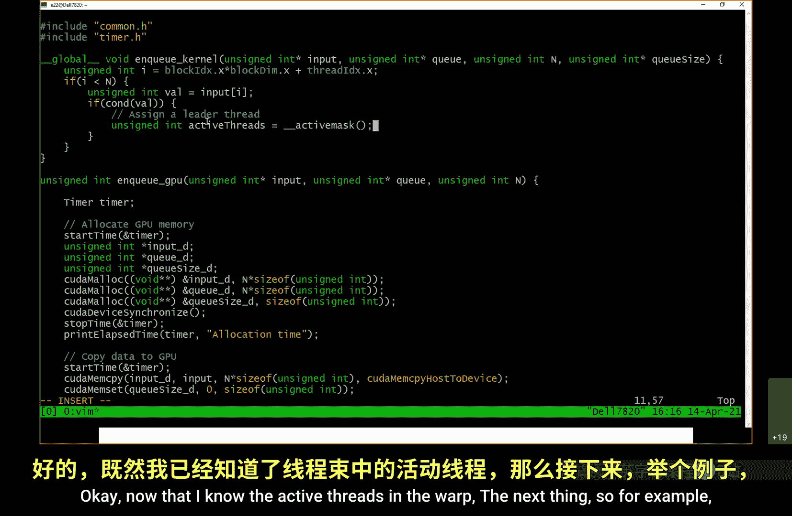

Then the active mass is going to look like this。 I'm going to have the zeros for the inactive threads。

 and I'm going to have ones for the active thread。 So here turnss1，2。

4 and 5 will have their active will have their bit set and the active mass。诶。

Here I'm using an8 bit example， but in practice you have 32 threads in the worm so you're going to have a 32 bit mass that gets。

Okay， now what I want to do is I remember I'm trying to assign a leader here。

 so what I want to do is I want to pick one of these threads to be the leader。Okay。

 how can I pick one thread to be the leader？I can simply pick the first thread in the war to be the leader and to do that。

 there is actually an intrinsic function that tells us that gives us the first bit that is set in a particular value Okay so I want to designate the first active thread as the leader and to do that and what I want to do is I want to find the first set bit in the active mask。

 so in this case I want to thread one to be the leader So I want to find because because the first set bit of the active mask is the one that corresponds to thread one。

Now there is a built in built in intrinsic function that does that and it's called FFS find first set and F FS find first set。

 this is not a warp level intrinsic。 Okay， this is just an intrinsic function。

 but it's not a warp level thing。 Each thread executes its own FFS。

 The threads are not collaborating here。So if the FFS takes some 32 bit value and tells you what is the first bit that is set in that value。

 it's going to return the index of the first set bit in the mask。 Now。

 one thing to note is that the index that it returns starts from one。 Okay。

 so if0 is if third0 or if the value at position 0 is the first set bit， it's going to return one。

 if the value at position one is the first set bit iss going to return2。 If the value at position 2。

 the first set bit is going to return 3。 The reason is that the return it could be possible that none of the bits are set。

Okay， and in this case， we want to return zero。Okay， so if none of the myths are set。

 it's going to return zero， and then if bits  zero is set， it will return one。

 if the one is set to return two， etca。Okay， so in this case。

 what will be my result when I call FFS on this active mask？

2 big2 right that's going to be two because the first set is one。 it will give me two。

 So the index thing starts from one。 So for me to identify what is my leader thread。

 I'm going to call FFS So I'm going to write unsigned in。

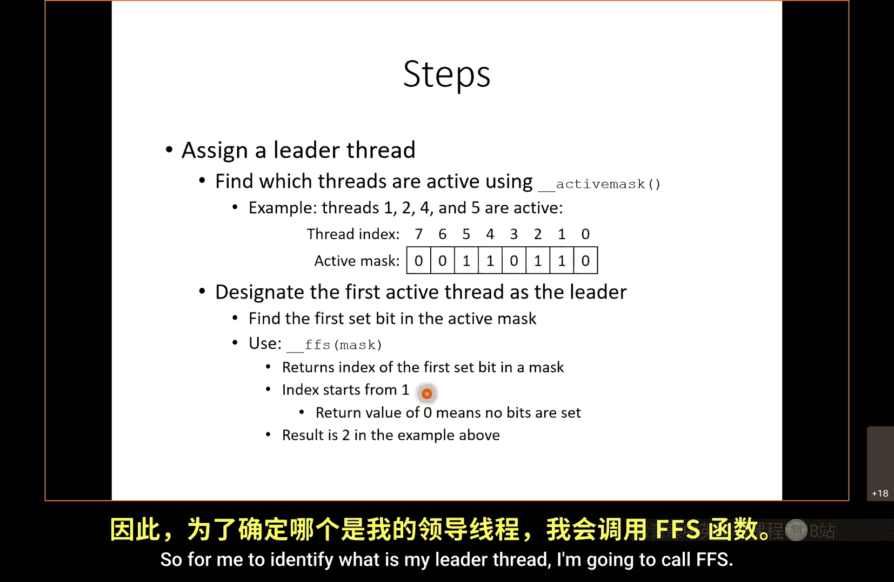

Leader， so this is going to be the index of the leader Thr in the warp。Okay， and right。

 leader is going to be underscore underscore FFS with point1 set of the active threads mask。Okay。

 and then what do I need to do this room or this is indexed by one。

So I'm going to have to subtract one from it。Okay， so that I get a value this index by zero so here if thread zero was the first if the threads zero was the first。

Sorry if bit zero is the first active bit， then the leader is going to be threat at zero。

 so FFS will return one and it subtract when I gets zero。If if bit1 was the first active bit。

 then FFS of active thread will return two and then 2 minus1 will be one， so the leader will be one。

Okay， so now what I've done is I have assigned a leader for the threads in my work that are active inside of this condition。

Now I'm going to have assign a leader。

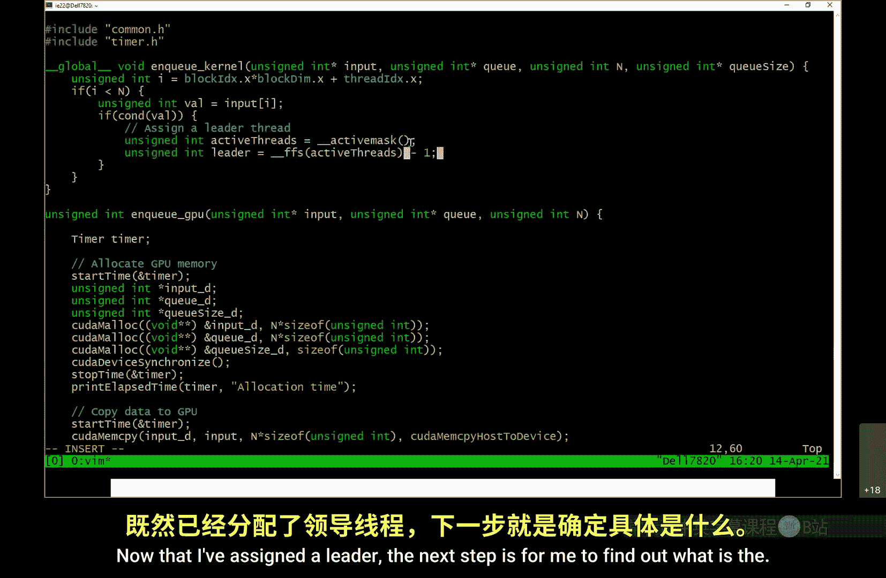

Is for me to find out what is the the reason I'm assigning a leader is because I want the leader to allocate space in myQ on behalf of all my other threads。

ok。😊，What I will do next is'm going I want to find out how many these threads need to add to the queue。

 so I'm going to what I want to do。I want to allocate space for all the threads to store。

 so I want to find out how many threads I need to have an queue。

 so the way I will do that is by how do I find out how many threads it thread to be？

I have the number of threads that are active， or I know which threads are active。

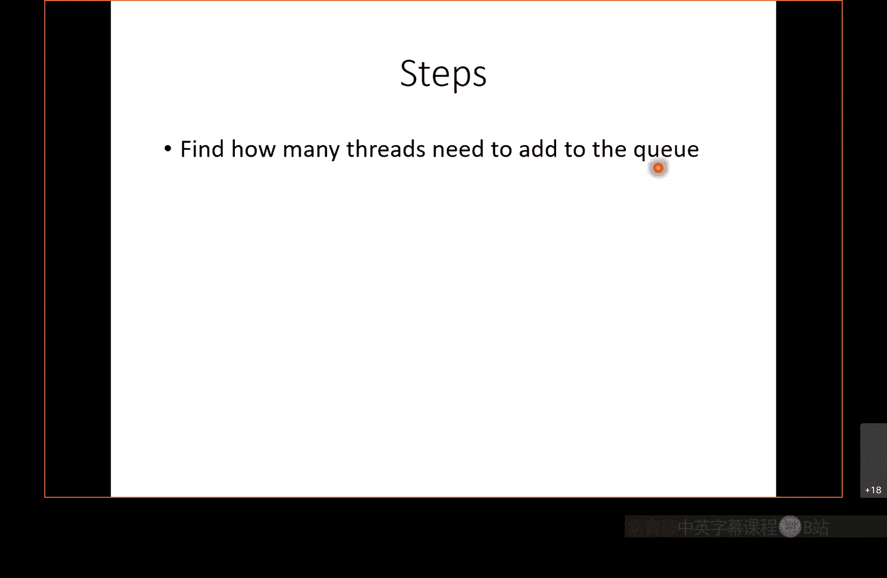

So how can I know how many threads are active？We need to count the number of ones。Right。

 we need to count the number of bits that are set in my active threads path Okay。

 so we need to count the number of set bits in the active maps and there's actually another intrinsic that takes a 32 bit value and counts the number of bits that are set in that value does anybody know it's actually it's the popular name it's not just on GPU。

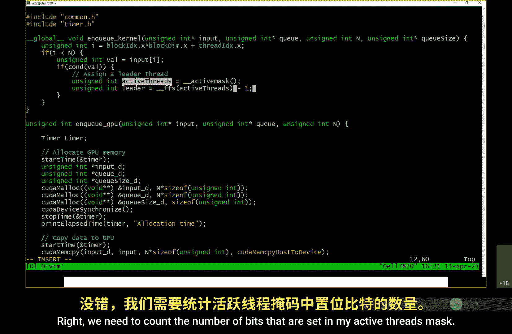

So it's called population counts， Are you guys familiar with population count？So。

 so population count pop C is an intrinsic that takes 32 bit value and returns the number of bits that are set in that 32 bit value Okay。

 and the previous example here， if I call pop C on this active active math it's going to give me four because there are four bits that are set Okay。

 in general， pop C will give me however many bits are set in that value。

 and that's going to be the number of thirds that are active， which is basically the number of。

Excuse me， it's basically the number of elements that I would like to reserve in my。诶。

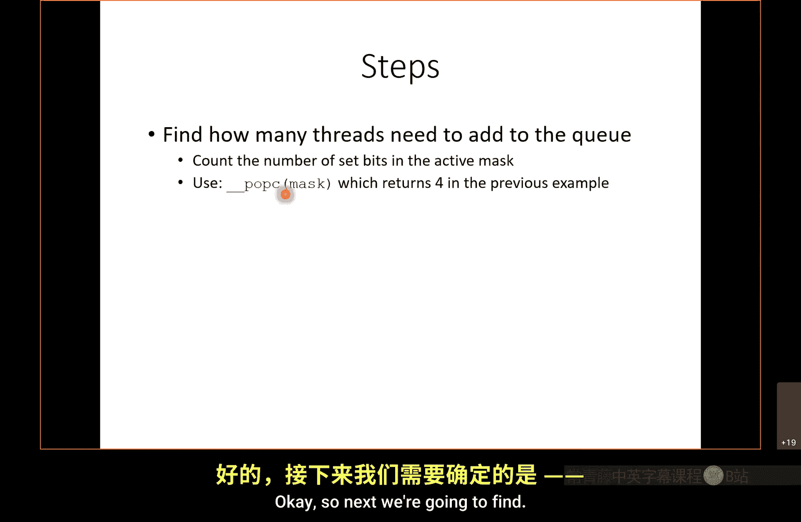

So next we're going to find。喂。How many。Ps are。Active and the way we do that is as follows we can write unsign and。

Dubactive is equal to。Population count of。Active。Red。Okay。

 now that I know how many threads are active， I want the leader thread and we're going to have the leader thread perform the atomic operation Okay。

 but again， the leader thread perform the atomic operation。

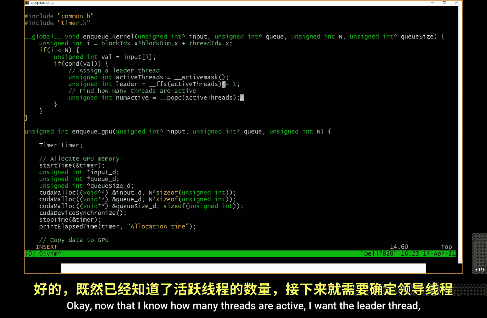

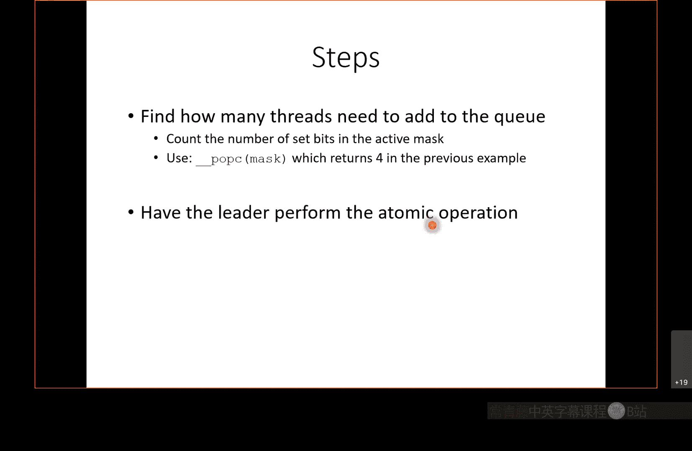

So how much does the We tag need to allocate in the queue will need to allocate non active element。

Hey， so we're going to have。你睇。Alloccate and queue。Okay。

 so we're going to have unsigned N J J is going to be the position where the leader is going to allocate the queue。

 and we're going to check if the thread is the leader， so I'm going to write if。Bread index。

 the next， remember， I want the index of the thread within the warp， not within the block。

 So how do I get the thread index of the thread within the warp。Moulular website right， exactly。

 If I do translate mod。Warb size， I should define warb size up here。Okay。

 I'm going to do3 sex modular work， and if that is equal to the leader。Okay。

 so here only the leader thread is going to pass this check。And then if thread has the x mod size。

 is if the thread is the leader， what this I going to do， it's going to do atomic a。

And it's going to add to the Q size here， the Q size tells me how many elements are in the Q so far。

 so I'm going to increment the Q size by the number of active threads。

 which is the number of elements I want to add to my Q and the return value is going to be the old value of Q size。

 which is the position that I want to inq all the wars value， so I'm going to set this to J。ok。😊。

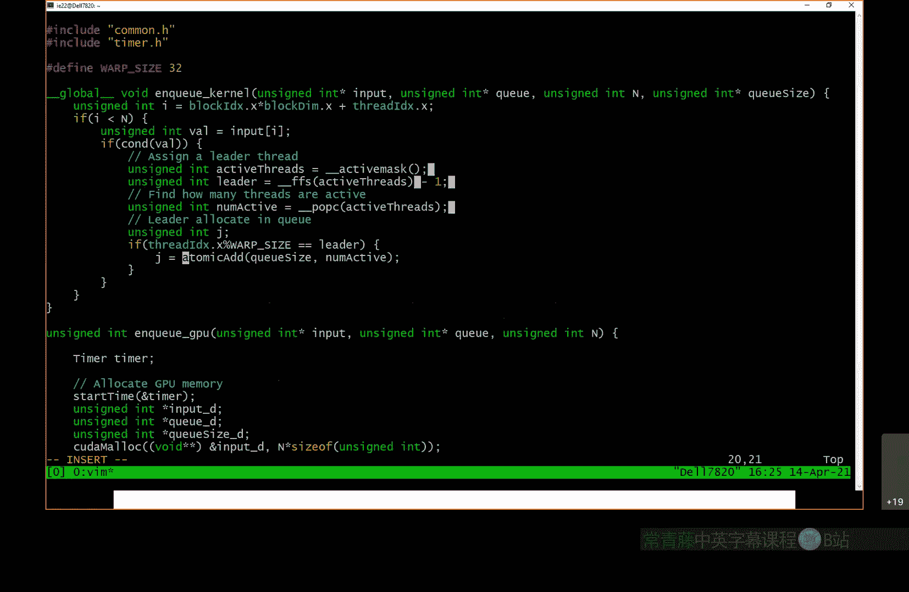

Now that I do this， what I want to do is I want to broadcast。The result to the other threats。Yes。

 soever whatever the legal thread is， I' want to take that result and broadcast it to all of the other threads。

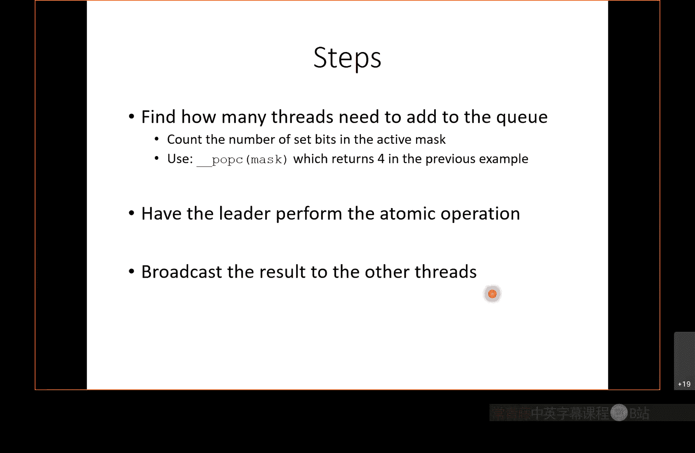

what can I do to do that orb zero has a value which is J or not or zero。

 the leader orb sorry the leader thread has a value which is J and it wants to send this value to all the other threads so what can it do that what can it do to do that？

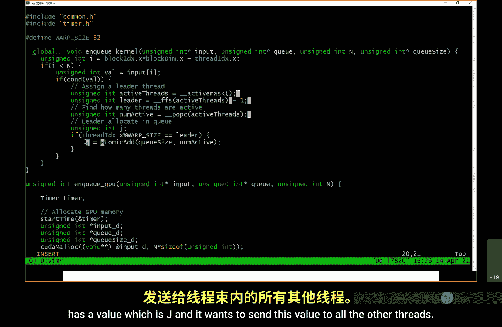

就分 up。Well真舒。

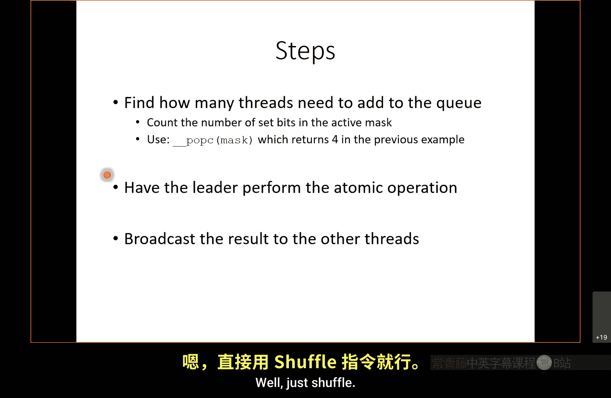

Make just。So remember， what we're going to do is we're going to write。A is equal to。

Shuffle so here for at this point only only the leader thread has the right J I want all the threads to have the right J so I'm going to write J is shuffle st。

Okay。And I need to provide a mask with the threads that are going to be involved in the shle instruction。

 I need to write the value that I want to shuffle， which in this case is J。

 and I need to provide it where the way shuttle sequences because they provided the index of the lane I want to shuffle through。

 which in this case is the leader。诶。😊，So what this is saying is that shuffle the value of J sh the leaders J to all the other threads and now this shuffle sake will return the leaders J for all the threads and willll disize their J to that。

Now I need to have here mask that tells me which threads in the warp are going to execute the struggle of sink instruction。

😊，So which threads in the orp execute the shop of state instruction， can I do this？No。

 it's the act that we got from active mask right， exactly。

 because not all of the thread are active at this point What I'm going to do is I'm going to provide the active threads which are part which are in the active。

 which I got from the active。Okay。In the thread case。Sorry question。Yeah， sorry。

 Can the thread shuffle to itself， will it work or do nothing。Yeah's fine。 I mean。

 here that it shovles with itself is just going to keep the same value and store。

So the leader thread is just going to shuffle its value to itself。Okay。It's notげ。ok。

So now every thread knows a starting point。Elf where it needs to store in the queue so if there are 10 threads that are active in this warp。

 the leader is going to allocate1 10 elements in the queue。Okay。

 and then this J here is going to point to the beginning of those 10 elements。

what's left for me to do is each thread needs to figure out which of those 10 elements it needs to sort to。

诶。which of those to elements it needs to start to So what we still need to do is we need to。Fine。

The position of each。Active。Rread and the cute。

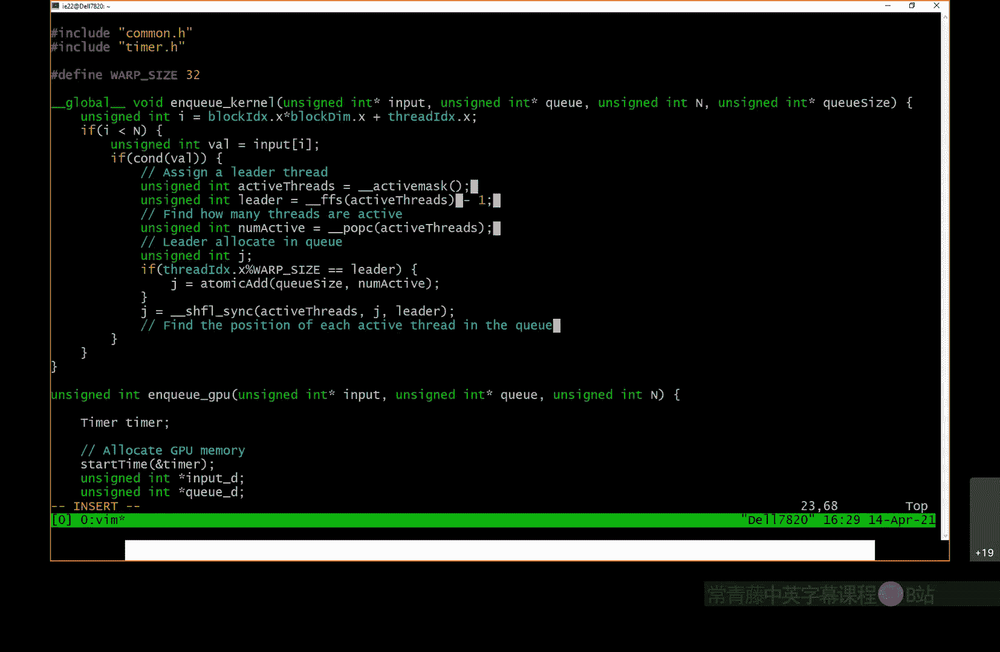

Let's take a look at how， by the way here， the broadcast how we use tru。Okay。

 next step is we're to find the offset of each active thread and store the result。

Now let's take a look at the previous example where we had this。Okay。

 we would have allocated the leader strand element strand one Str one would have allocated four elements in the queue。

And then starting from that four elements， thread one is going to store its result at an offset of zero。

 thread two stores its value at an offset of1， thread three doesn't have anything。

 so thread four is then stores the value at an offset of two thread5 and an offset of three。ok。😊。

So what each thread needs to find is。Where it needs to store its value in the queue。

 how can I do that？We need some sort of scan。Right if similar to scan。

 but we can do it more efficiently than scan but correct to observe that there's something similar to scan and that what we need to find。

Can we do an a bit wise end and select up to the thread that were at。

And then count them using the function we used before。 You're absolutely right。 absolutely right。

So basically， what we need to do is we need to find the number of previous threads that are。😡，Okay。

 what we're trying to find here is the number of previous threads that are active。So here。

 the reason thread one is zero is because there are zero active threads before it。

The reason threat2 is one is because there's only one active threat before。

 The reason threat 4 is one is because there are so the is thread4 gets2 is because there are two active threads before it。

 The reason threat 5 gets3 is because there are three active threads before。

 So what we want to do is we want to count the number of ones and the previous threads。To do that。

 what we can do is we can do a bit wise。To keep only the ones of the previous threads and remove the ones of the threads that come later。

Okay， and then after we do the bit twice than we do a population count。 Okay。

 so here what we'll do is well for an example， if we want to find more thread for。What its offset is。

We're going to do a bit twice and。With a mass that contains ones for all the threads whose index is less than four and zeros for all the threads whose index is greater than or equal to4。

 And when we do a bit twice and over here， we get the number of previous active threads。

 So this was the number of active this mass represented the active threads。

 this mass represented the previous threads and then when we do a bit twice a them。

 we get a mass that represented the。Previous active threads。

 And then once we do a population count on this， we will get the offset that we are looking。ok。

So we have an active mask， we know how to do a bit twice and and we know how to find the previous active we know how to do a population count。

 how can I get a mask that tells me what are the previous active threats？

It's the current index minus1。And decimal so you can get that index。

 So it's it not the current index， but I know what you mean。

 you're saying its the its a it's a bit set for the current index。

And then I subtract one to get a bunch of one。So here。

 if I want to get the previous threads mask for when the thread index is4。

 I'm going to start off with something where I have a value where I have one set in position four and zero otherwise。

 and then I subtract one and that gives me ones for all the other threads before the thread。Okay。😊。

So basically what we're going to do is if the threat index is four。

 we're going to shift a one by the thread index that'll give me one inqui four。

 and then we're go to subtract one that's going to give me a bunch of ones in the previous position。

Okay， so we're going to shift one by the thread index， and then we're going to subtract one。Allright。

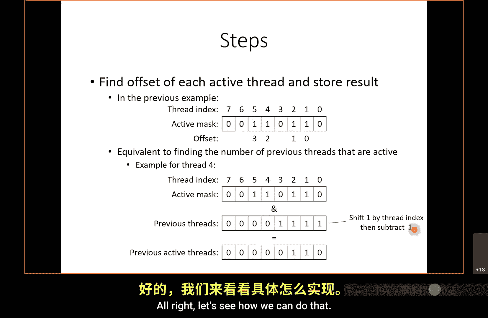

Let's see how we can do that。 I come back here。 And what I'd like to do now is I would like to do。

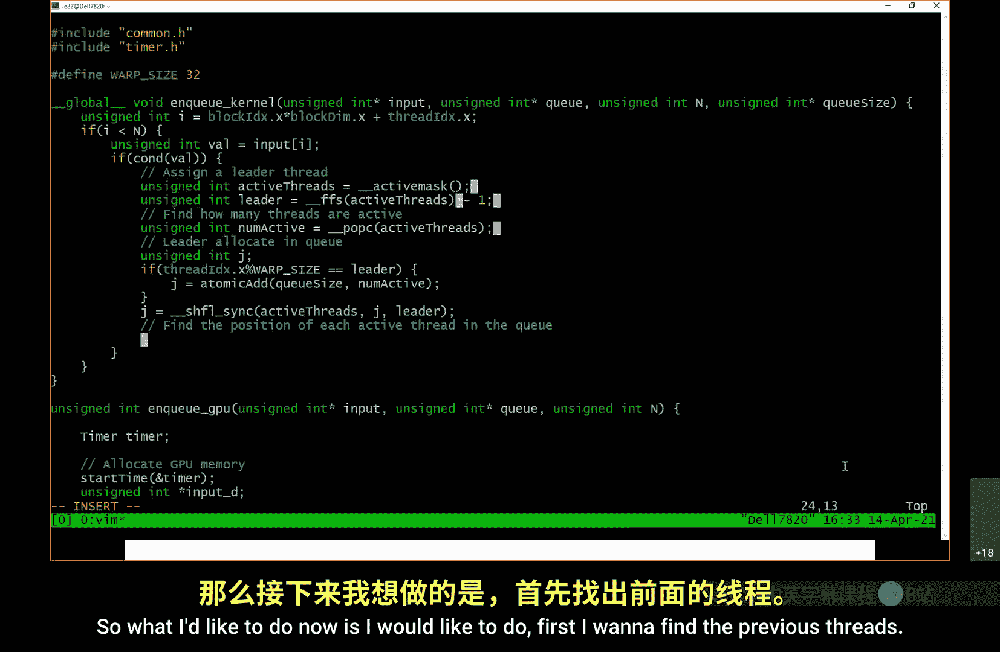

First， I want to find the previous threads。 we're going to send you little by shifting one by friend index and that subtracting one I'm going to do。

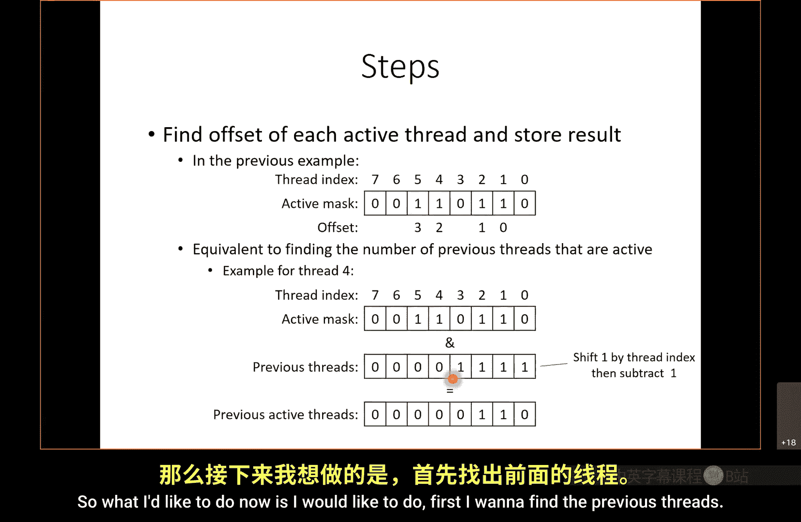

In right。Previous。Right， so this is the math going to be this and what I want to do is I want to shift take a one and I want to shift it by the thread index。

 What is the threat index。How do I find the index of the thread within thep。I've done it before。

 right？Make creditex。 X and I am doing long go the work。Okay， so I shipped a one by that amount。诶。😊。

We going put some parenthees here。你最。Clear what I'm doing。 So I get the。

 I get the index of the thread within the warp。 I take a one and shift it by that amount。

 So this value is going to give me a one set in position 4 and0 is elsewhere。

 And I'm going to subtract one from that。

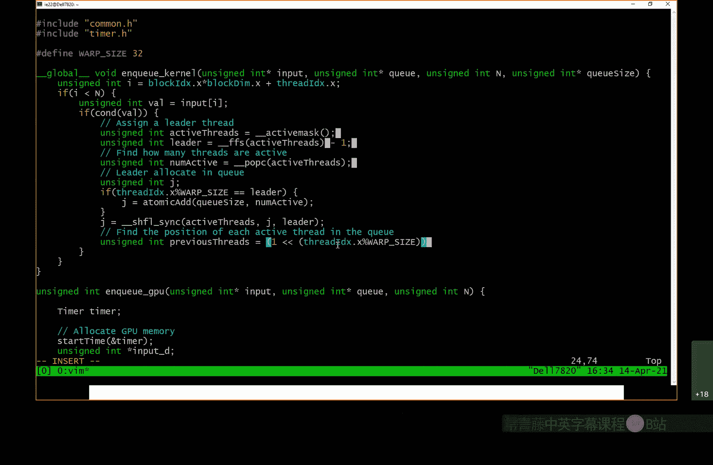

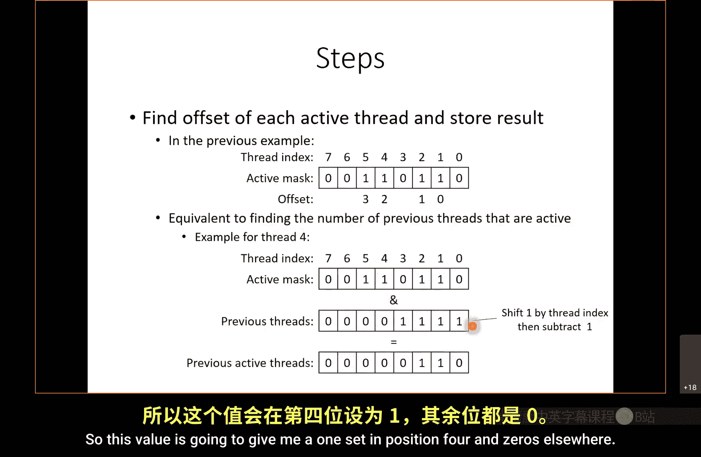

Okay。I'm going to subtract one for that， and this will give me the previous grant。

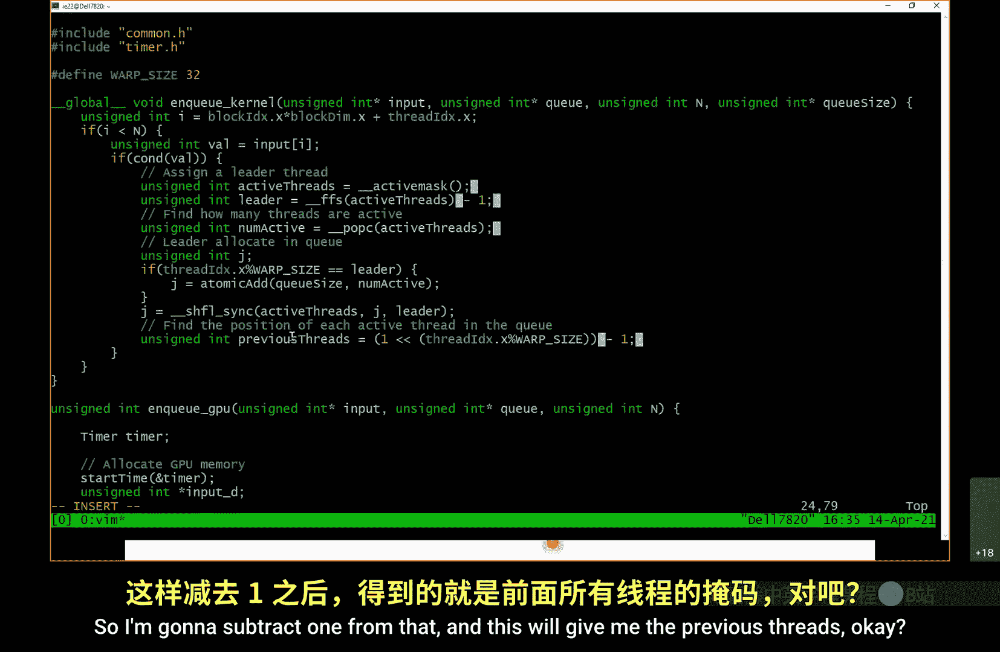

诶。😊，Now that have the previous threads， I want to find the previous active threads。

 so I'm going to do a bit twice end between the previous threads and the active。That， okay。

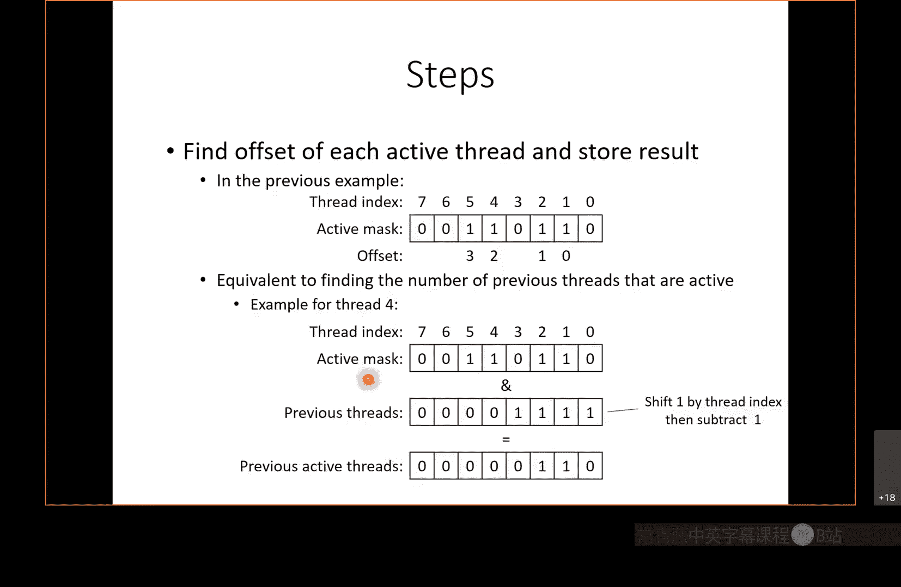

Have you had a question？Yes， don't we have arithmetic shift that way the one is replicated without having to do the minus one that's that you said right。

okay， we can't。talking about N versus uns signed then。No。

 I was talking about arithmetic shift where the one is replicated。

 but maybe maybe it's only for shift right not sure。Oh。

 I saw U so want you want to shift you want to take a one and you want to shift it3 under that x only lower size minus one time。

Where you shift and you just get a bunch of one。 That's where you Yeah， I'm actually not sure if if。

Im actually not sure if that's supported might be。Passer， there is one thing I don't understand。

 So the threads， the the T index indices are set at the block level。 We。

 we don't actually know within the warp which threads will execute， right。

We know the index of the thread within the war， which is this。

You can get it by doing modular work size。But it might so thread number two might execute along with thread number 234。

 that's no， no， becauses threads in the same work， execute and Cdy， right？Yes。

So threads 0 to 31 are in one warp。 Thrs 32 to 63 are in the next warp， et cetera。 Oh， okay， okay。

 okay， because I thought you could mix them up within the same block。 No， no， threads。

 The threads are assigned to warps based on their their， their index。 Oh okay， okay。Yeah。

 so all the threads in the same more have to be the consecutive threats。Okay。

 so now we're going to find the previous active threads by doing a bitwise n between the active threads。

And the previous threads。ok。And then after that， what we want to do is once we find the previous active threads。

 we want to count the number of ones inside of it， how do we do that？

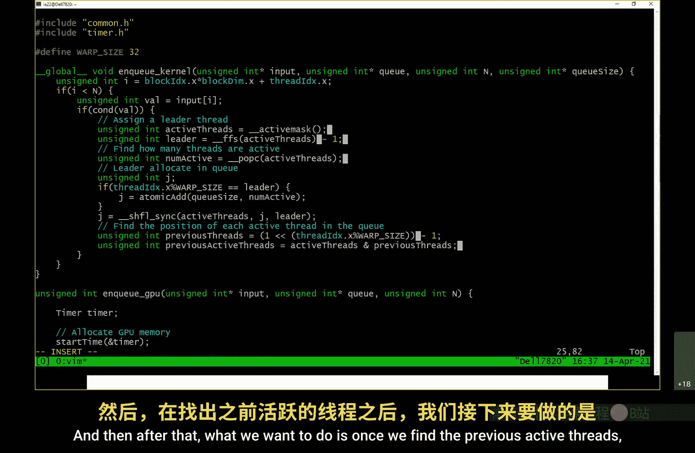

博士。Right， exactly， we're going to use a population count in order for us to count the number of set bits in the previous active press。

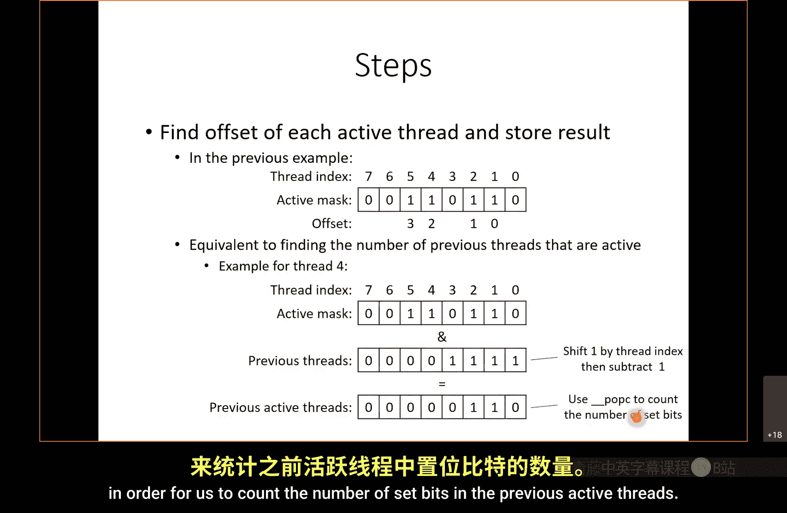

So here。The offset。Is going to be equal to the population count of the。Previous active threats。Okay。

 and then now what's left for me is to store。The result and the Q， So I will write Q。helello。

Something is equal to my value。Okay， and here what is the index into the queue？

Is going to be the starting position that the leader thread obtained。

 which is J plus the offset that each of the each thread found for itself， so J plus offset okay。

Is this clear to everyone？Questions。All right， so let's compile this and run it。

 And oh I just realized that I did the same mistake again。

 I forgot to run the version without this optimization， so let me。Let me undo all the way。

So I'm going to compile the old version of a P。And I'm going to run it。

So here you'll notice my kernel time as 0。39。And now。Let me redo。He。

 I'm going to compile now the new version。And I'm going to run in。And you。

 we actually heard performance a little bit。Okay， the reason is that for I tried to kind of have a focused example and because I had a focused example。

 the overhead of doing the warp synchronization was actually not worth the atomic operations that I avoided。

Okay， so in this particular example， it hurt performance。

 but in other examples where there's perhaps more going on and there's more context to the problem。

 this approach of collaborating across threads to do something together is actually uneffective。Okay。

 so I apologize if you're disappointed that there's a little bit of performance degradation。

 but I at least hope that this exercise gave you。And of a hint。

How we use we can use all these different we can use all these different intrinsics like the active mask。

 the fine first set， the population count， and the shuffle instructions in order for us to do some kind of collaboration between threads and the same work so that they can collectively accomplish a common objective。

ok。😊，Any questions？

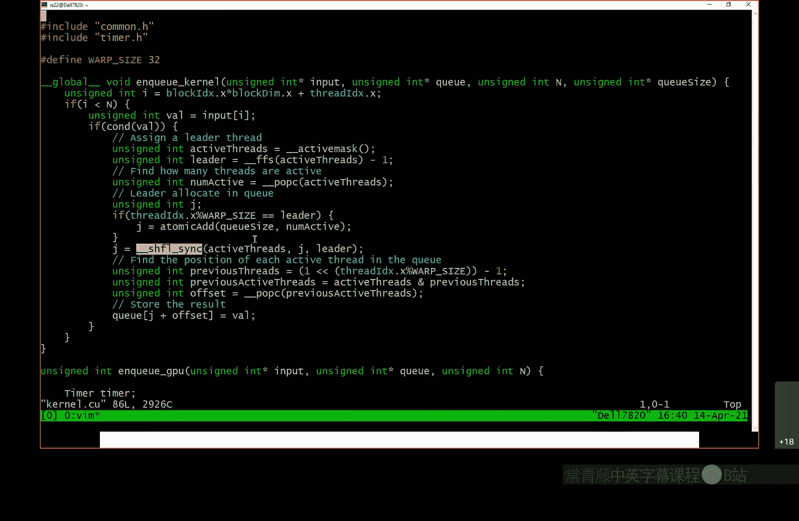

Okay， well this is the code that we just wrote and this is also the final slide I have for today。

 does anybody have any final questions before we conclude。I have questions about the project。Okay。

 sure， feel free to ask me after after。Okay， if there are no final questions。

 then it's all for today and I'll see you next time。By。

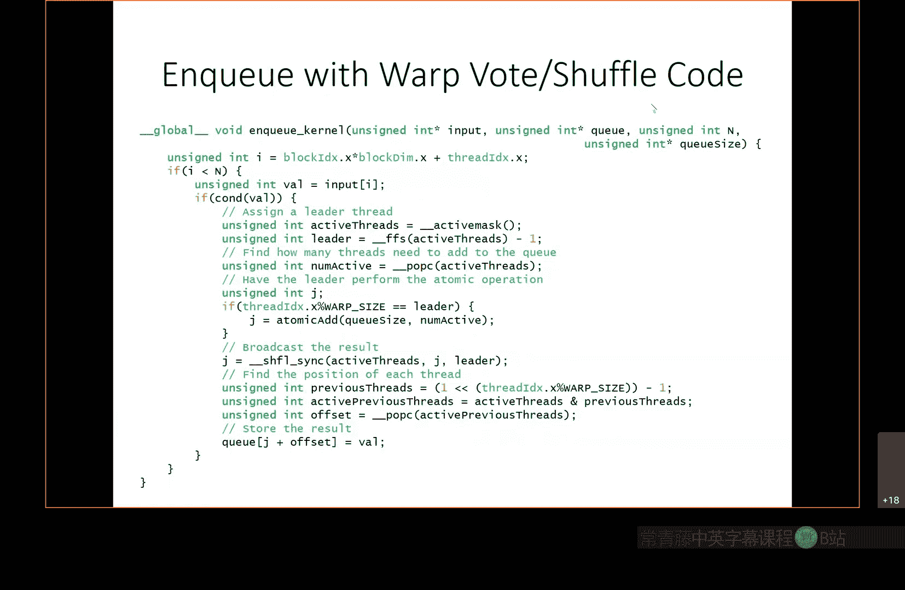