# 贝鲁特美国大学【中英⚡GPU计算｜CMPS 297S Spring 2021, GPU Computing】 p21 P21 固定内存与流 -BV1LD6BBPEjt_p21-

Hello everyone and welcome to lecture 21 of GPU computingut Today we're going to be talking about pin memory and stream。

Last time we spoke about Intro warp synchronization we said that we can take advantage of the special relationship between threads that are in the same warp to synchronize between them quickly and IU has built in functions for that and particular there's two major categories of warp synchronization permitteditives。

 there's shuffle instructions that allow us to share data across threads that are in the same warp so they can just share each other's register values with each other without having to go through shared memory and there's voting instructions where we can where threads can vote on something or and this is useful for checking which of these threads evaluate true sort of prediccateates or checking which threads in the warp are active on some branch we've started by looking at shuffle instructions and we said there's different kinds of shuffle instructions shuffle just shuffling so they can get from a direct laying sort of direct thread and other thread in the warp or they can shuffle up or down or there's an also。

Shuffle X or kind of shuffle that。It's also useful in certain circumstances。

 And we applied shuffle instructions to reductions。 So we looked at how when we had reduction。

 every iteration half the threads drop out。 And then when we got to one warp。

 we in the previous implementation for this warp， we were actually going through shared memory and doing st threads every time。

 But we realize that we actually don't need to do that。

 What we can do is we can simply use shuffle instructions to do a reduction tree within the warp without having to to go through without having to go through shared memory and without having to do any threads。

We then looked at warp vote instructions and we saw how we have different variants we have different ways we can vote。

 we can check if all the threads satisfies some predates or if one of them satisfies some predicate。

 there's a ballot where we can check which threads evaluate a pre to true and which one is evaluate false and we get a mask that tells us that and there's the active mass which tells us which threads are active on a certain branch and one thing that we saw that we can use warp vote functions for is whenever we want the threads in the warp to communicate to have one thread do something on behalf of the others so an example of that was if we were adding some elements to a queue and we want to increment and counter rather than having each thread increment counter we can have one thread in the warp increment the counter on behalf of all the others and then each thread can figure out which slot in the queue it should take from among the one。

That the leader thread allocated and we saw the different steps we're doing this。

 we assign a leader thread， then we figure out how many threads we need to add to the queue。

 then the leader thread does the atomic operation and then it broadcast the result to the other threads and then each thread。

Each active thread figures that where it stores its result and we saw how to do each of these we saw how we used active mask to figure out which threads are active and the find first set intrinsic to figure out find the first set bit and active mask in order to figure out which thread we want to assigned as the leader we saw how to use population count on the active mask to figure out how many how many bits are set so that we figure out how many space we need allocate in the queue。

 by the way， find first set and pop count are not in work synchronization primitives they're just intrinsics that each thread can call on its own。

 but they're useful when we are looking at when we are using inverent intrinsics because we can apply them to the active mask to do all kinds of interesting things。

NowSo after we figure out the number of elements we want to in the queue。

 we had the leader thread do the atomic operation and then we use shuffle sync so that each thread get in the world gets the value from the leader thread to figure out where it should lower its result and then we saw how we can do some bitwise magic in order for us to figure out the position of each thread so that each thread can add its so the position in the queue for each active thread each thread can add its results to。

So this is what we talked about last time， any questions about intra work intrinsics before we talk about today's material？

Is everything clear？Okay， so then today we're going to move on to a new topic。

 which is pinned memory。 we're going to talk about pinned memory。

 and we're also going to talk about streams。 So these are two related topics So we'll start by talking about pinned memory and then we'll see we'll talk about streams。

So first， let's talk about pin memory what is pin memory。

 So if you remember we previously had vector edition code and let me go So this is the vector edition code that we previously had。

 we basically had a vector ad kernel and what we did is we allocated memory for vectors we copied the source vectors。

 we called the ad kernel and then we copied back the the result vector and then we did coter free to free the result。

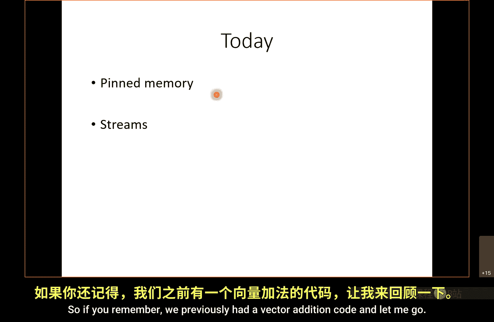

Okay， and I'm going to compile this and run it so that we get an idea， we kind of remember you know。

 how the time for executing this was divided。So here I'm going to write the backadd and I'm going to run it。

Okay and as you can see here I'm highlighting the copy time as well as the kernel time just because we're going to be interested in focusing on copy time today so as you can see the CPU time took 76 milliseconds to do this is the GPU took much more it took 169 milliseconds。

 but what you can see is that the kernel time for the GPU actually just took 3。2 millisecond。

The time the total GPU time is dominated by what？As you can see， it's dominated by the copy time。

 it took 58 milliseconds to copy the to vectors to the GPU。

 it took 94 milliseconds to copy them back。Okay， so when the vector is already on the GPU。

 obviously it's much better to do it on the GP than do it on the CPUU but the vector is on the CPUU。

 the speedup that we get from doing it on the GP doesn't really pay for the cost of doing the copying and the question that we want to ask today is can we optimize this copying Can we reduce this copy time that we are incurring every time we copy things to and from the GPU。

诶。😊，So let's see how we can do that。

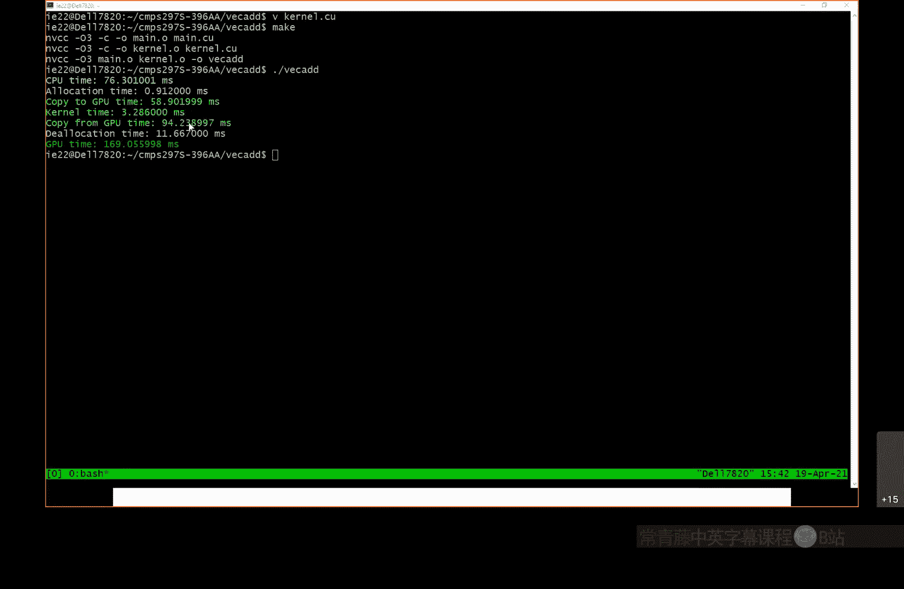

So this was the code that we wrote and like I said。

 we're trying to see what we can do to reduce this pseudoM copy time that we're spending before we do the vector edition and then after we do the vector edition to copy back。

And to talk about how we can optimize the sculing， let's first talk about what happens when we call k amount。

So what happens when you call and copy is something called direct memory access or DMA。What is DMA。

 so direct memory access or DMA， it allows some hardware some hardware unit in my hardware to access memory without involving the C。

So whenever we say that something in the hardware has DNA access， it means that it can access。

The name memory of the CPU or to access some memory without involving the CPU。

And copying between CPU and GPU actually uses DMA。 And what that means is that when I copy data from main memory to the GPU。

The CPU is not involved in this copy。 The CPU doesn't load from main memory and then store to the GPU memory。

 It doesn't， you know， doesn't loop over these era main memory and unload them and then go and store them to the GPU memory。

 What happens is there's something called a DMA engine where when the CPU does call a sc them and copy。

It just calls it and it can go and do other things and this DMA engine is responsible for reading from the main memory of the CPU and putting the result in the GPU memory。

Professor。Yes。The DMA engine， is it in the main memory or inside the GPU。

the DMA engine is part I mean， it depends so there's all kinds of different DMA engines for different things DMA in general is this idea is this idea of allowing some hardware to be able to access some memory without involving the CPU This DMA engine that does the transfer from the main memory of the CPUU to the GPU memory I believe is on the CPU。

 but obviously you have to involve the GPU driver when you do this， but that also runs on this。Okay。

 this hardware I believe， is on。Okay， so then so what's the advantage of using DMA over over having the CPU somehow if the CPU somehow had access to the GP memory to involve the CPU in the copy。

 what's the advantage of using DMA instead of using the CPU。

You can make specialized hardware that that acts very fast。 maybe。 Okay， so the DMM is specialized。

 It can probably copy much faster than having to involve the CPU in the copy。 What else。

The CPU can do other useful work of waiting for memory right exactly。

 so I don't want I don't want to waste my CPU time just you know， reading and writing。

 reading and writing Okay， so what we can do is we can have the CPU can be utilized for other things while the memory copy is taking。

Okay， so while the cu copy is happening， I can have the CT do other things。Okay。

 so this is the advantage of using DMA。 What's their disadvantage of using DMA？好啦声你诶。What's kind of。

What is something that we have to pay when we use DNA？Maybe when， when you specify， give it an order。

 you cannot stop it， maybe easily。Maybe。I mean， sure that depends on how you know that depends on the kind of access that DMA gives you。

 the DMA hardware whether gives you people who do that or not。

 I was looking more about what's the difference between accessing something from the CPU versus accessing it from a DMA engine。

CPU is faster。That's now what I'm looking for， what does the CPU do when it access this main memory？

It issues a load instruction right issues a load instruction that load instruction is an address right the address is what kind of address it caches it right that's the thing sure' going to cache it what kind of address is the CPU you use to access main memory。

Virtual address and a virtual address and what about a DMA， what's a DMA going to use？

The physical memory。Can to use the physical。Right so use the physical lab。

So the CPU uses a virtual address and the CPU does address translation right when we do address translation。

The software and the hardware that together do the address translation run on the sea view。

The DMA engine does not have the capability of doing address translation， okay。

 it doesn't have you know， it doesn't have the instructions to read from a page table and all these things。

Okay， so the DMA engine is going to use a physical address when it reads from the main memory to write to the GPU memory。

 now what's the drawback with the DMA engine using a physical address？

It doesn't It cannot reference the whole， the whole domain of the memory that's available。No， it can。

It can。You can't me around if you send something to the DMA。

So what you're saying is if the DMA is reading from something， you can move that thing around， right。

 yes？Right， exactly that， that's exactly the problem。

So the DNA is using a physical address if if the memory that the DNA is reading gets swapped out。

The DMA has no way of detecting that。Okay， a CPU can detect that because if something gets swapped out when you come and translate it。

 you're going to fit you're going to have a page fault and then you're going to swap it back in。

Whereas with DMA， when it's reading from the physical location， a physical page。

 and then that physical page gets swapped by the operating system。

 the DM agentgen has no way of knowing that， so it winds up just continuing to read the same physical page which now has new data。

😊，Okay。😊，So we don't want that obviously we don't want the DMA to read the wrong data。

 so when we give the DMA a physical address to read， to start copying。

 what do we have to do with that the memory of that physical address？Lock it。 lock it。Right。

 we have to lock it。 We have to make sure that that memory does not get moved by the OS。

 doesn't get swapped by the OS。Okay， and that is what pinned memory is。So as a recap。

 DNA uses a physical address to access memory。And because it uses a physical address。

 it cannot detect if the operating system swaps a virtual page with another virtual page at the same physical address。

 so if the operating system comes and puts a different page at the same status the DNA has no way to detect that。

 so to avoid data corruption。What the OS must do is that any pay the OS or sorry。

 the OS should not be allowed to swap pages that are being accessed by DMA。

 So we need to do to prevent the OS from accessing pages that are being accessed by DMA is that we need to lock these pages So any pages accessed by DMA needs to be page locked or in other words。

 it needs to be pinned Okay， so we have to allocate it as pinned memory so it doesn't get swapped away。

Okay， so anything that's allocateated is pin memory， these pages are going to be marked。

 there's a special way of telling the OS hey do not swap these pages。Okay。

 so now this brings us to Kum and copy。So having now known that Kumm copy uses DMA and that the DMA requires pages to be10。

How do you think K un copypy works， what is Ko un copypy？It first locks the memory it access。

 the whole memory it accesses， and then reads。So you're saying it unlock the memory and then it's going to do the DMA。

 It actually does something different than that but the idea that the memory that we're copying from needs to be locked is correct So when we allocate the。

That data is allocate using Malow。Okay， so we haven't really done anything special to lock it。

So the so we have to assume that this， the data can be swapped out。

 So what good one copy does is actually the following。When we copy from host to device。

 what the CPU is going to do is the coUuda runtime is going to have this pinned memory buffer that is' going to use and what the CPU will do is is the CPU is going to copy the data from the buffer that we want to copy to pin a pinned memory buffer。

And then the DMA is going to copy the data from the pen memory buffer to the G。And when we copy back。

 it's going to be the same， right because you know， when we read from DNA。

 we don't want the patient to be swap up， but also when we're writing to DNA and we don't want the patient to be swap up。

Sorry sorry I've been writing the main memory using DNAA we don't want the page to be swap up so when we copy from device to host。

 the DNA is going to copy from the device to a pin memory buffer and then the CPU will copy from the pinned from the pin memory buffer to the CPU buffer that was allocated by now。

So as you can see， whenever we call PM copy， we're not doing just one copy we're actually doing two copies。

 One copy is between the the kind of the regular CPU buffer and the pin memory buffer and the other copy is between the pin memory buffer and the device memory and this obviously doing two copies instead of one incur overhead。

ok。😊，So what can we do to optimize the copies， what can we do to make the copies faster？

Now that you know this。If I don't want to do two copies， I just want to do one copy。

 what can I do with my buffer？I can pin them， right？We have the buffer immediately on the device。

 and just the。Like copy to it and read from it immediately。So the pinned memory buffer is on the CPU。

 It's not on the GP。 So what we can do is we can have a pinned memory buffer on the CPU that has my original data。

 and then we just copy from that buffer as opposed to having a non pinned buffer and copying from that to the pinned memory buffer and then having the DMA copy from the pin memory buffer。

诶。😊，Professor， there is one thing I don't understand。 You said at the beginning that the C P。

 the CPU doesn't do anything。 It just calls could M M copy， and then it's done。So what I said。

 so I don't know if I said it that way， what I said at the beginning was that that when you call Pm copy right。

 you initiate a copy and then that copy kind of happens but what actually happens is what I'm telling you right now Okay maybe what I meant by that is that there's a DMA engine that's taking care of the copy so I told you that part。

 but I didn't tell you the part about the pinned memory just because perhaps it was too early to introduce these。

Okay， okay。 Thank you。a professor。Yes I can see what's the advantage of the DMA if the CPU is copying manually so like it's like we're doing more than we need to be。

有冇。Okay， good point， so in this case another role of the DNA is to access the GPU memory。Okay。

 because near the CPU does not have direct access to the GPU memory。

Okay so there's kind of a PCIE bus or maybe some other kind of interconnect and we need to copy over that interconnect and that's much slower right copying to the pinned memory is much slower than copying over the interconnect to the GPU。

Okay， so CPUU doesn't have direct access to the GPU's memory。

 and that's why you have a specialized hardware that takes care of copying things over the interconnect between the main memory and the GPU。

Okay， thank you。Get， you good observation。Okay， so what we would like to do is what we like to make our copies faster and to make our copies faster what we can do is we can just our host arrays。

 allocate them directly in pin memory so pin our host arrays。

 allocate them in pin memory rather than allocate them in a regular number okay so we can make the copies faster by allocateocating host arrays directly in pinned memory and Kuda gives us an API to do that so what we can do to allocate or delocate host data and pin memory directly is we can use Kuda analog hostt so this is just like Kuda analog。

 but we add the word host and what this tells Kuda is to allocate the data inside of pin memory buffer。

诶。And then we can use KudDa free hostst to free the data that was previously allocated inside of pinned memory。

诶。😊，So it's just like put them out and put it free。

 but instead we're going to use we have the word host at the end of it。诶。😊，Now。

 since Pumalloco is makes my copy so much faster than doing Malo use regular allocation。

 can I just go and allocate everything in print memory。Is that a good idea。

Why don't I just go and allocate'llcate all the data and memory that I want to copy to the G How much of space do we have in pen memory？

I mean， if I have my main memory， you know， I can， I can， I just， it's the same pages， right。

 the same pages in my main memory， I can pin them or I can choose not to pin them。

 So there isn't really kind of separate pin memory capacity from the regulatory。

You lose the flexibility of virtual memory。Right， exactly。 So when I pin a page。

 I'm telling the OS that you cannot swap this state down。

If I go and allocate everything in pin memory。😡，Right I'm telling the OS is that I want all my memory pages not to be swapped out。

 but what that means is that the OS is going to have less flexibility in swaping things back and forth。

So that's going to degrade system performance because when the OS now only has fewer choices when it wants to affect patient block them。

 and then obviously I cannot allocate more pinned memory than the image memory that I actually have in this。

Okay， so we have you have to use the pin memory with a lot of caution。

 it should only be used for data that we are frequently operating。

Back and forth between the CPUU and the GP。Okay，If we allocate too much pinned memory。

 this would degrade overall performance because of reducing the virtual pages available for Sw。

Alright。Now in modern systems that have a lot of memory， if you have 128 gigabytes of main memory。

 but your GPU only has four gigabytes， for example of device and memory。

 the newer ones have more than that， new has10 to 32， but I'm just kind of giving an example。

 you have if your GP has a small amount of memory， then maybe it's fine to use a lot of pin memory because even if you use a lot of pinned memory。

 you're not going to be the amount of GP memory that you have。

 you have to pin corresponding memory for on the CPU is not that much compared to the amount of memory you have on the。

Okay， but in general， you have to be careful， don't allocate everything in pin memory。

 just you should allocate the things where the copy overhead is really important。ok。😊。

Let's go and use these C malco and Cufr hosts in order for us to see what performance we get by allocating in pin memory right I'm going to switch over here and I'm allocating in the main file so I'm going to open the main file and here this is where I'm doing Cammal for the host arrays I have the X array。

 the Y array I have two arrays， there's that I'm using for the the CPUU code and there's the Z array that I'm using for the GPU。

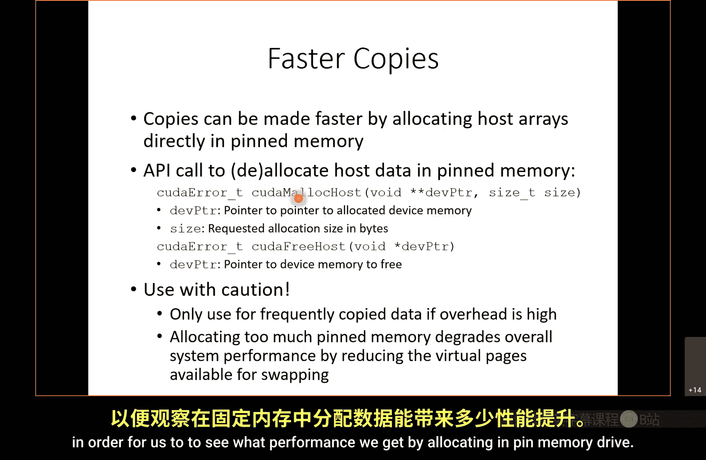

Okay， so what I'm actually going to do is I'm going to allocate pinned memory for both of them right。

 even though the GPU code one is the one I care about because that's the one I'm going to copy back into。

 but I'm also going to allocate in the CPU view because I want to show you what happens when we do that as well。

So here， rather than allocating and using Maoc， what I want to do is I'm going to replace the allocation malloc to use Ka mallloc cost。

 but I'm going to。Get rid of all of this。Okay， and I'm going to write Kuda。hel look。好。And of course。

 I need to provided a pointer to the pointer that I'm storing the result that result the pointer to the resulting allocation。

 so I will have a。Boy double star cast， and I give it Ampersand X。Okay。

 so I'm going to give it a pointer to x that knows where to allocate x。Okay。

 and I want to do the same thing for the rest， so here it's going to be y here it's going to be Z underscore CPUU and here it's going to be Z underscore G。

Okay， so what this does is that it allocates the X， Y， Z CPUPU and Z GPP raise in pin。Memory， and。

 but I need to be careful because when I allocated pinned memory。

 I need to make sure I also ded it properly because because， I pinned it。

 So I'm going to come down here where I was going make create。 And instead I'm going to do。Good的。

3e post。

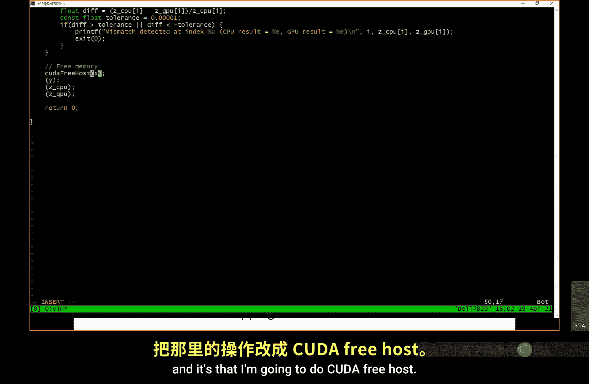

Okay。😊，So again， we use Kuda malllo host to allocate and it has the same syn as sca mallo。

 and we use scooter free host to the。

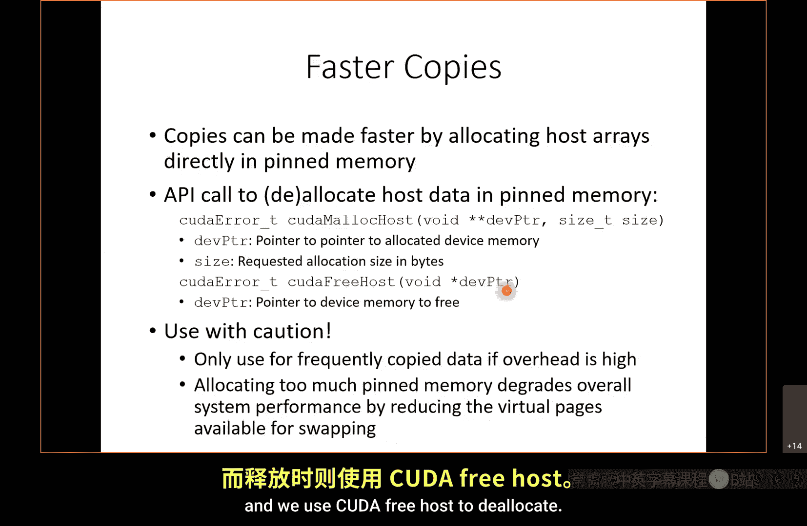

I'm going to save this， I'm going to compile it。And now I am going to run it。Okay。

 and as you can see， the GPU time has improved substantially。

It went from 1169 milliseconds to 80 milliseconds。Okay。

 and the reason is that the copy time is much less here the 58 and milliseconds became 43 milliseconds。

 the 94 milliseconds for copying back became 20 milliseconds。哎。😊。

Why did the CPU time also improve excellent observations I was going to ask you that too。

 so why did the CPU time improve when I used pin memory for the CPU buffer？Oh。

 because we're not using page we the pages pinned now。

 so the OS is not playing with it anymore Right， exactly。

 so now our CPU pages are pinned and what that means is that when I'm doing the the calculation on the CPU。

 I'm also benefiting from the pinning because I'm not going have any page faults while I'm doing my edition all my pages are going to be in era。

Okay， so we improved the GPU time， but we also improve the CPUU time。给。😊，Okay。

 so any questions about pinned memory， everything is clear。

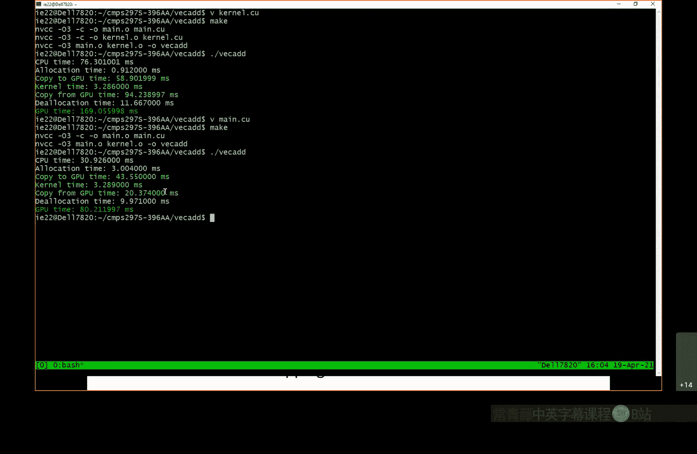

Okay， so having spoken about pin memory， this here is the code that we just wrote。

 The next thing I want to talk about is stream and talk about that。

 I want to talk about parallelism at the system architecture level。

 So we've spoken a lot about parallelism we've spoken spoken lot about data parallelism doing having different threads causes different data and parallel today I want to talk about parallelism。

 but the system architecture level， this is more related to task parallelism it's actually a form of pipeline parallel。

 So let's so when we have a typical system， you know we have a CPU， a GPU CPU has main memory。

 the GP has GPU memory， right and usually what we do is we copy over we compute on the GPU and then we copy back but the system is actually capable of simultaneously executing a grid on the GPU and copying from the host in the device and copying from the device to the host。

Okay， so the hardware that computes on the GPU is different from the hardware that comes from。

 from main memory to the GPU memory， and it's different from the hardware used to copy from the GPU memory back to the main menu。

 It says these are three different pieces of hardware。Okay， or three different resources。

 let me be or general， send these are three different hardware resources。Okay。

We can actually use these three things simultaneously。But so far。

 what we've been doing is we've been copying to the GPU， running on the GPU and copying back。

 So each time we're only using one of these resources。

 we're not leveraging all three of them and what we're going to try and do is we're going to try and leverage all three of them to fully utilize our hardware as much as we can。

 and let me show you what I mean by that。 So when we are doing a X tradition previously。

 But we've been doing is we've been copying a to the device and then copying B to the device and then we've been executing a grid to compute a plus B and store the result in C。

 and then we've been copying C from the device。Okay， so here at horizontal represents time。Well。

 if you take a look， when I'm copying A and B to the device I'm actually not using the part of my system。

That runs on the GPUs。 I'm not using the GPU itself。

 and I'm not using the resource that allows me to copy from the device that I host。

And when I execute， so here during this time， my GPU is idle and my resource that I use to copy back to from the GPU to the host is idle。

When I execute on the GPU， my hardware that does the copying to and from the GPU is idle。Okay。

 and then when I copy from the CPU from the GPU back to the CPU。

 the GPU itself is idle and the part that can copy from the host to the device from the CPU of the GPU is idle。

Okay， so what can we do to be able to utilize these hardware resources better？We can start executing。

 we can send it bit by bit and start computing as we receive and then output as we output to main memory as we finish computing。

Right exactly。 So rather than copying all of A And B and then computing and then copy all of C back。

 we can copy part of A And B。 And then while we're computing on that part。

 we can copy another part of A And B。 And then while we're computing on the other part。

 we're copy a third part of A And B。 And all that time。

 we're also copying back the parts that were're done computer。Okay， so in other words。

 that we can apply is pipeline。So we can pipeline lecture edition like this。

 we can divide my A and B and C into segments。I can copy the first segment of A and Bs of the device。

And then when the first segment of A and B are on the device。

 I can execute a grid to compute the first segments， A1 and B1， and then in the meantime。

 I can also be copying the second segment A2 and B2 from the host of the device。Okay。

 and then when I'm done computing and I'm done copying。

 I can then go and copy the result of A1 plus B1 from the device back to C1。

 and in the meantime here the copy of A2 and B2 is ready so I can execute a grid to compute A2 plus B2 and in the meantime I can also be copying the next segment A3 and B3 from the host to the device。

诶。As you can see， I can divide my array into segments and every step I'd be copying one segment I'd be paralyzing the copying of a segment with the computing of another segment with the copying back of the other segment。

 so actually this is where the parallelism is happening I'd be copying one segment while computing another segment while copying back another segment that is right。

Yes， we're going to overlap copy and computation of different sector。Okay， and this goes on。

 So here when I'm done， I can copy back B2 while I'm executing while I'm adding A 3 and B3 while I'm copying a 4 and before to the device and I keep。

系。😊，Any questions about this， is it clear？How many grids can we execute at the same time on the GPU。

It depends on the compute capabilities， so it depends on the architecture。对。So for example。

 can I start， for example， if it's small enough， can I start copying copying my data and executing many grids？

So in this case， what's really going to dominate the critical path of the pipeline is actually the copy。

Okay， so paralyzing different grids is not really beneficial， but yeah yes， I mean。Hypothetically。

 you can run different grids in parallel on the GP。This particular example， that's not very useful。

 but in general， yes， you can run multiple grids on the GPU in parallel。

But even if you were going to run these in parallel， you might as well put them in the same print。

 right？O。So that in order for us to be able to apply this pipeing to do this kind of pipelining。

 what we need to do。Is we will actually need to make these copies asynchronous。

 so we're going to need to be able to kind of start off a copy and then you know let it go。

 not wait for it and be able to do a grid execution and copy back all kind of in parallel without having to wait for any of them。

Okay， and this introduce the topic of Street。Okay， so the parallelism。

Between grids and memory copies can be achieved using stream Okay。

 and we're also going to use asynchronous copies so the ways what streams are。嗯。In Pua。

 you have these streams that contain different tasks that need to be executed sequentially。

 whereas if I put tasks in different stream， they're executed in parallel。

The tasks in different streams students are executed in parallel and tasks in the same stream are serialized。

Now， by default， if I don't specify a stream， what's going to happen is everything is going to go into the default screen。

Okay， so if I specify multiple pseudoon copies by default。

 all these pseudoon copies will go into the same stream and they will be serialized。Okays。

 same thing with kernels。 If I call multiple co copies and multiple kernels。

 all these will go in the same stream and they will be serialized。

 If I want different copies and different。Different kernels to execute and parallel right so for example on the three this slide。

 if I want this pseudo and copy back to execute and parallel with this print to execute and parallel with the scoo and copy to the device。

 these need to be put in different stream by default。

 if I just call them without specifying a streams， they all go into the same stream so they will be serialized。

ok。😊，So to put them in different streams， what we will we also also going to need asynchronous man copies。

 so to be able to overlap man copies with the host execution。

 we're going to need to have use asynchronous man copies because by default， the coM copy is not a。诶。

😊，So having as kind student copies， it allows the host to go and。

Wait for a copy to finish so that it can。Sorry， it allows the host to proceed without waiting for a copy to finish so that it can perform other things Okay。

 so when the host calls a coum copy， it doesn't need to wait for it。

 it goes and it can go and call other kernels， call otherccum copies。

 that is the benefit of using asynchronous memory recallco。Okay， let's see how we can do that。

 How can we create streams and how we can call asynchronous memory copies。

 The way to do that is using the following API calls to create a stream。

 we can call Kuda create stream and provide it with a pointer to an object of type Kuda stream under4 T and this is where the create stream will put the information the handles for the stream so the identifier for the stream that we just created。

ok。😊，To create create an asynchronous copy inside of a stream。

 we can use the same putum and copy API， but with an async at the end of it。

 so it looks the same as the co and copy API but it has an async at the end of it okay so it's called putum and copy async and what the pseudo and copy async takes as a fifth argument is a couda stream by default we don't specify the stream。

 it's going to go into stream zero which is the default stream。Okay， however。

 if we want to put the kud and copy the specific stream。

 we can specify what stream we want by providing kind of some a stream handle that we created using the Kak stream。

Okay， and then finally， if we want to launch a grid inside of a specific stream。

 we call the kernel like this we proved in the kernel configurations we we've seen two we actually saw a third as well。

 but we've mostly been using these two so far the grid dimension and the block dimension okay but include the grid configurations actually take other optional configurations and these include the share the amount of dynamically allocated shared memory that we want to have per block。

 this is by default zero and then the fourth optional argument or the fourth argument which is optional sorry the fourth configuration which is optional is the stream that we want to put the kernel in and again by default if we don't specify stream and goes into the default。

O。😊，So what we would like to do is we would like to divide our input into pieces into segments and then have a separate put copy to the device。

 a grid launch and a copy from device for each segment that goes into a different stream and let's see how to do that so I'm going to switch。

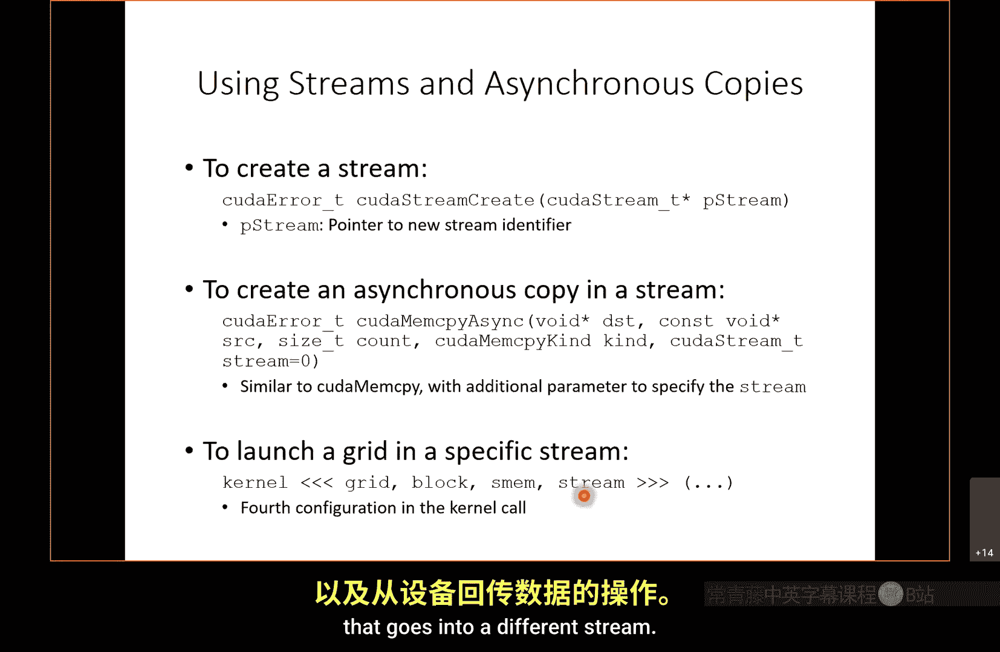

Back to my code this time I'm going to open my kernel code and here in my kernel code I have my vector edition kernel which i'm not going to change this time I'm going to be working on the host code so in the host code I do kuda Maloc。

Okay， and then over here， which is the interesting part。

 I'm doing km copy to the GPU and then I'm doing I'm calling the kernel and then I'm copying back and what I like to do is I would like to divide my input into segments based on how many streams I have and do a separate kM copy vector vectorag kernel and km copy back for each segment so let me start by creating the different streams that I would like to use in order to process these segments in parallel。

But I'm going to first set up my streams。To set up my streams。

 first let me pick a number of streams that I want。

 I'm going to create an integer un signed in numb streams。Okay， and I can。

 I can define no a different number of streams。 I'm going to use 32 streams， for example。

 So I'm gonna have 32 different streams And I'm going divide my input into 32 different segments and have a segment be done in each。

Okay， so I'm going to I want to create 32 different streams。

 I'm going to first declare 32 different streams， so I'm going to do that like this。

So QDa stream underscore T is this type of a stream。

 if I want to declare one stream I can do it like this。

 if I want to declare 32 I can simply provide 32 or non streams over here so this will be an array of a 32 different stream。

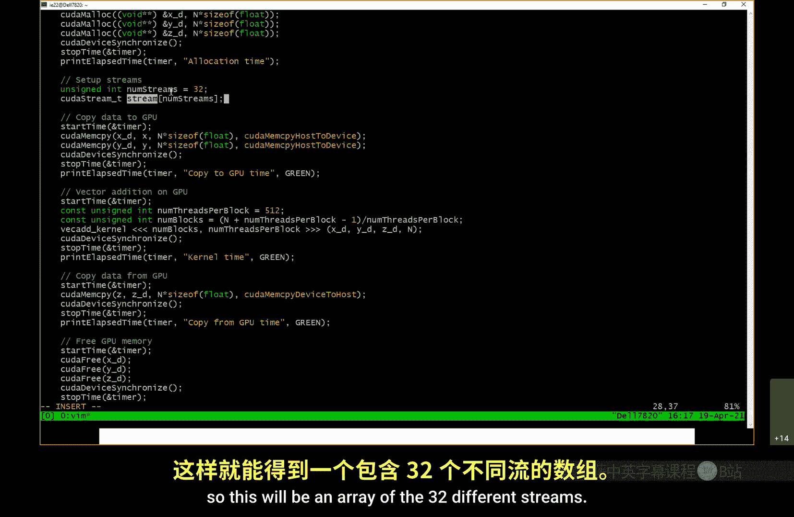

诶。😊，Now to create a stream， I need to use the Kuda stream create API call。

 so I'm going to loop over over my stream， but I'm going to create them。 I'm going to write for。

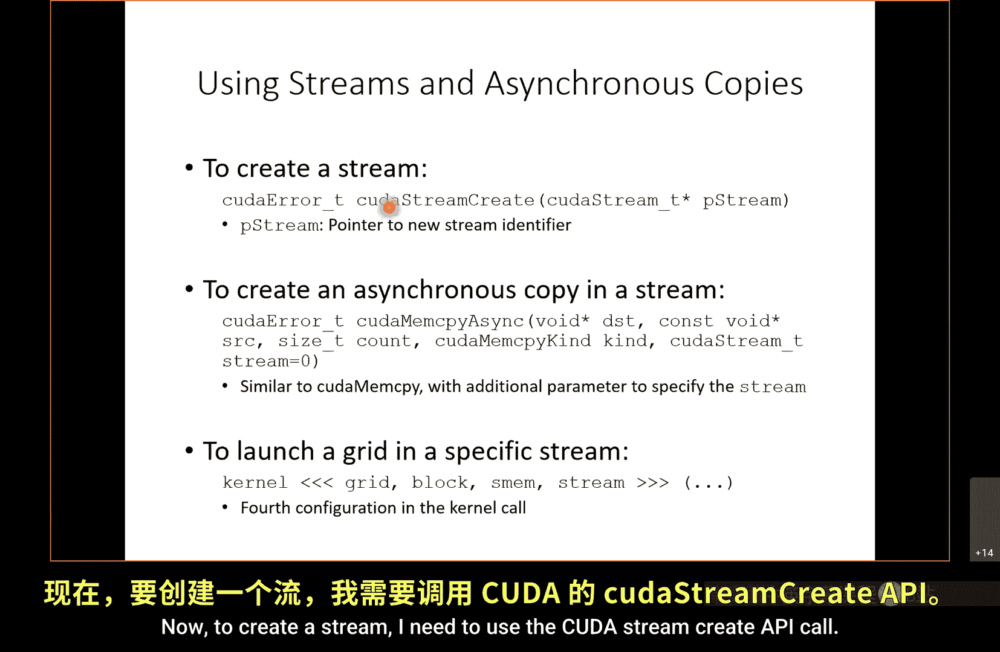

For Estein and f equals zeros here S is going to be the index of the stream that I'm creating。

Ask is left time。A number of dreams。Plus， plus add。And then for each of these， I'm going to call。

Good的。re。

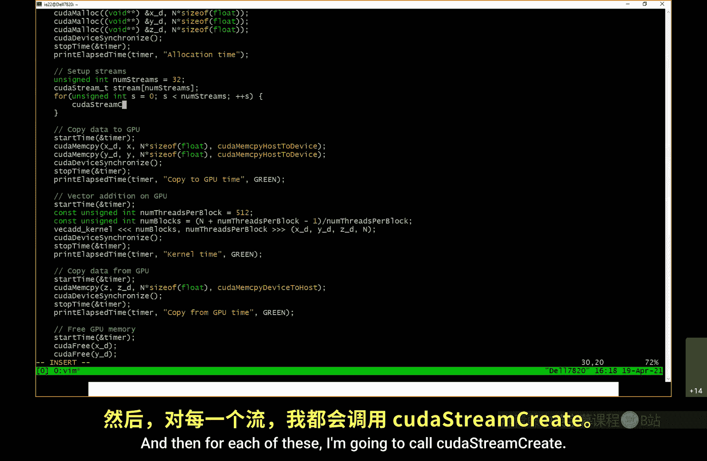

Create and here could a stream create just takes one argument。

 which is a pointer to the stream that I want that I want to create。

 So here I am going to provide it with a pointer。 So I'm going to take the address of。

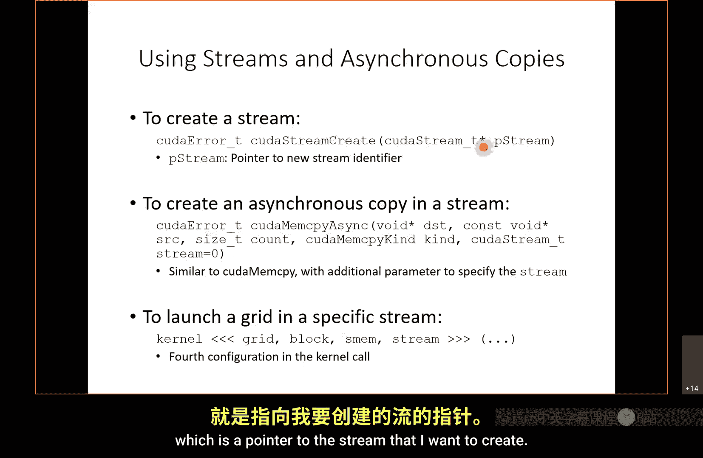

The stream。Yes。诶。😊，So now what I've done is I've created 32 different streams。Clear so far。

Any questions？What did the true 32th。I just picked it arbitrarily。

 it's you know I decided it was a good number， you can use eight streams， you can use 16 streams。

 you can use as many streams as you want。Okay， so it like making folks。

Like doing multiple processes asynchronously。I mean， the idea。Listen。

 when you forkked you're creating different CPU threads。

 So here we're not really creating different CPU threads。

 we're creating different cues in which we're going to put our the operations that we tell the GPU to do。

And we're going to print these different cues and we're going to put each thing we told the GP to do in a stream。

Okay， so if I want the GP to be able to run different grids in parallel。 Okay。

 so I have multiple different goods。 I want them to run in parallel or multiple different quantum copies。

 I want them to run in parallel。 by default， they will be they will be serialized because they will go in the same stream。

 If if I want them， be paralyzed， I need to put them in different。Okay。

 I have answered your question。Yes， yes， I thought I thought we were multi threading on the CPU。

 no no know， we're not multi threadreading。 we're using one CPU thread。

 but we're putting we're putting commands to the GPU in different streams so that to tell the GPU。

 that hey， these things can be done in parallel。Now another way to do it。

 another way to do it is to have multiple threads on the CPU and have each thread create its own stream and send its own commands to a GP。

So in that case， we would be multith so that would be another way to do it and typically you if things can if different threads are running on the CPU and each one of them is using the GPU for its own computation。

 we would typically want to create different streams。

 one for each thread so that the threads can use the GPU independent。ok。😊。

That I'm glad you asked that。Okay， so next thing we're going to do is we want to break up the input into different segments。

And we want to loop over these segments and have aum copy affect kernel and the copy back for each one of these segments okay。

Thanks I want。Okay， so here next we're going to stream the segments。Alright。

 so my number of segments is going to be same as the number of streams。

 I'm going to just create a variable。Nom segments for convenience。

As well can be the same as the number of streams。OkayAnd the size of my segment is going to be the size of the input divided by a number of strings。

对边。Segment size is going to be equal to n over。The number of segments and of course n may not be divisible here n is the size of the whole array that that I'm adding。

 but n may not be divisible by the the number of segments。

 so in this case what I want to do is I want to do a ceiling so I'm going to do that by doing n plus。

Sant minus one over noing。喂。😊，Now I can loop over my segments， I'm going to write four。

Unsigned and f equals0， S is less than the number of segments。Plus plus S。

 And now for each one of these segments， I would like to do， I would like to copy it to the GPU。

Call the grid and copy it that and by putting them in different streams。

 we will get the pipelining that we are interested in getting。Okay。

 let me first part figure out what part of the input each segment is going to process Okay。

 but I'm going to start by finding a segment bound。Okay， so the segment I have the segment size Okay。

 so every segment is going to start at the segment index times the segment size right segment zero is going to start at zero segment one is going to start at one time segment size segment two is going to start at two time segment size etc ceter。

 So the start of the segment。Is going to be at S times。Stegment size。The end of the segment。

Is going to be at the start of the segment， right plus the segment size。However。

 the end of the segment could be out of bounds。Right， so for the very last segment。

 maybe n is not divisible by the number of segments。So I need to make sure that for the last segment。

 I handle it properly， so I'm going to do a minimum between star plus segment and。And so here。

 if the end of the segment is less than n， then I just so if the start will signal size is less than n。

 then I take that as the end of the segment。Okay， otherwise， I'm in the last segment。

 so I will just use n as the end of the segment。Okay。

 and what that means is actually different segments are going to have different size in particular。

 all the segments are going to have segment size as their size except for the very last segment。

 it's going to have it's going to have a different a smaller size so so I'm going to have another variable n segment it tells me the number of elements in the segment and that's going to be n minus start Okay so for all segment。

 n minus start is going to be start plus segment size minus start so n segment is just going to be segment size but for the last segment n segment n minus start is going to be the size of the last segment which I can I could also computed as n modo the segment size。

可。😊，So now for each segment， I know where it starts。

 I know where it ends and I know the size of that segment， now I can go and modify my copy。

 my copies and my vector edition kernel and my copy back in order for me to take care of copying that segment to the GPU computing on it and copying it back。

Now before I do that， I I want to get rid of the synchronization before I was synchronizing after every co and copy after every vector edition kernel after every copy back。

 I don't want to do that because I want to be doing all these things in parallel so I'm going to move the couda device synchronize outside and I'm going to time the whole thing I can no longer time individual copies because all of the stuff is happening in parallel so I'm going to move the timer outside。

Okay， and I'm going to copy how much the whole thing takes with the copies and the kernel combined because now the copies and the kernels are happening in parallel。

Okay， so now here， I'm going to synchronize at the end and this time is going to be the copy to and from the GPU as well as the kernel times。

 it's the copy2 flash from GPU and kernel time okay。

 and I'm going to get rid of these other timing things。Okay。

 so now what I want to do is I want to modify kum copy the vector addition kernel and the clum copy back in order to。

Use asynchronous co memory copies and use a different segment set a stream for each segment Okay let's start with a com copies so for the coM copy I'm going to use kum copy a syncnc and I'm going to provide the stream at the end Okay。

 so here with am copies。

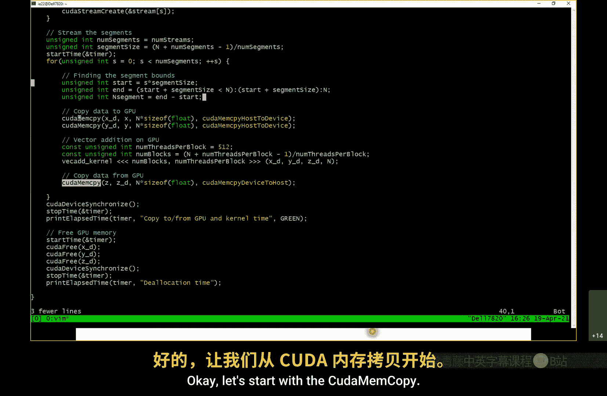

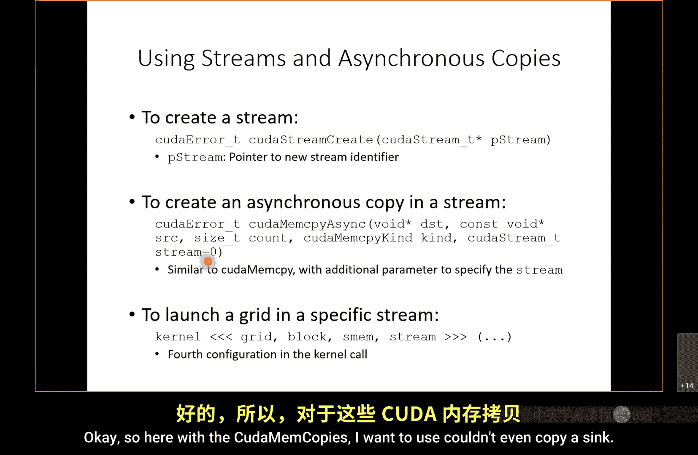

I want to use put on copy async。Okay， and we' want to provide the stream at the end so that's going to be stream of S。

Stream of S， Okay， and of course， I'm no longer going to be copying the entire input on each generation。

 I just want to copy the segment that I'm interested in。Okay。

 so here the segment starts at this is going to be X。

X underscore d plus start and y underscore D plus start。Okay， actually。

 there's a kind of a neat or way of writing this that I personally prefer。

 which is I want to return the address。Why is the dark？That just makes it clear what's going on。

 These are two different ways of writing the same thing。Okay， same thing here。

 I'm copying what this is saying is that my x of D。 I am copying at an offset of start。

 That's that's where I'm that's where I'm going to start copying and where I'm copying from is also going to be the same thing。

 I want to copy from X plus start。 reminder start is where the segment starts in the global in the entire array。

 So here I'm going to copy from x of starting an X of start and here I'm going to copy starting at Y of start。

Okay， and then the amount that I'm going to copy is no longer n。

 it's going to be the size of the segment itself， which is an segment and n segment is going to be equal to segment size for all of the segments except for the last segment。

 So here this is going to be n segment， and this is going to be。And second。O。

Same thing for the copyback， I'm going to use an asynchronous copyback。Okay。

 I'm going to provide it with the stream to put the copy back in。Okay。

 and I'm going to provide it with where to start copying from sorry where to start copying to and from。

 so here it's going to be the address of Z of start and the address of z underscore d of start。

And the amount I'm going to copy is going to be end segment as opposed to the entire end。Right。

 clear。Dr。 Ba question。Yes， so for thequium copy async。

 the way it works is that it starts the operation but doesn't wait for it to finish and it starts it but continues execution of the remaining code right exactly so it caused copy async and then it comes down here and doesn't wait for the co copy async to finish it just comes down here and cause the vector addition kernel and it doesnt and vector edition kernel the vector the kernel calls by definition asynchronous so it doesn't wait for the vector kernel to finish it just comes down here does co copy async and then it's going to go back and start with start calling co copy and vector edition for the next segment without waiting for the previous segment to finish。

Okay， and what did for some reason， the good copy didn't like one data element didn't finish for the for the addition current start。

So copy so for the same segment， thesekuM copies and this back ad kernel are going to go into the same stream。

Okay， okay， so they will be serialized by that stream。

 this V ad kernel is not going to start before the the Kum copy complete。Okay， however。

 it's going to be ended because it's going to be on the same stream， however。

 it's going to be independent of the kum copies that are going to be called in other iterations of this loop and that are going to be put in different stream。

Okay， good。 good question。 So you'll see So so that that brings me to the V ad kernel。

 So the V ad kernel， I will also want to put it in the same stream as the put copies that correspond to it。

 Okay， so here。I did not give identity penalty to any shared memory。

 and I'm going to provide the stream that's going to be stream with us。So now for the same stream。

 the copies。Okay， and the kernel and the K copy back are all going to go into that stream。

So everything that's ifs called in iteration one is going to be serialized with respect to each other。

 but they're going to be completely independent from everything that's being called in the other iteration。

诶可啊。And of course now for the yes question。Yeah， there's a typo for the ons site and should be a question mark the first one。

 I think。After the Oh yeah。Right here。Yes， this is a big question。明。Okay， and then here now again。

 I want to give each V ad kernel its own segment， so I'm going to give it rather than giving x of D。

 I'm going to give it the address of x of D start。The address of Y of G start。

And the address of Z ofD。Start。And I'm going to give it as well and second。诶。😊。

Is it clear at everyone where we just did any questions about this code that we wrote？

So we're basically looping over the segment。And for each segment。

 we are inqueing a equiomic copy to the device， a V add kernel and equi copyback in the same stream so that these will be done sequentially。

However， we're not going to wait for any of these to finish。

 we're going to move on to the next segment and also a its copies and kernel call and we're going to do that for all the segments so now I have all my streams loaded with quantum copies and kernel calls and then I'm going to stitch here I'm going to wait for all of them to finish before I move on。

That's what device I synchronize。Were are any questions？Yes。

 if you want to measure the kernel time only， how can we do that？

SoSo if you want to measure the kernel time only without interfering with the performance。

 you can use something called K an event。where you can actually add an event into a stream and what the event does is it basically takes a constant of when something in the stream started orpha okay so you you can add a coum of copy to a stream。

 you can poly kernel into a stream， you can also add an event to a stream and by taking the time difference different event。

 you can tell how long something in a particular stream。

Okay but we're not looking at we're not going to look at the events。

 but you can look at those and can look those up in the documentation and read about how but that's a great question。

 so if I want to I want to look at how long a particular operation in a particular stream took I can use two the events to do that。

Okay。Im professors。Yes。😊，Yeah， sorry， I was wondering this will only shave off time from the kernel time right since in most cases。

 the memory is the bottle leg。Like the gain time will only come from a reduction in the kernel time。

So what we're going to be doing is we're going to be overlapping the copy time with kernel。

So the copy two time with the kernel time with the copy back time。

So whichever takes the most time is going to hide the la this is how pipelineing works right the state that dominates that has the highest efficiencyency in the pipeline is going to be what dictate how long something takes on your pipeline so yeah whatever takes long in this case is' the copy to that's what's going to dictate how long this whole thing going to take and we're actually going to run the profiler to visualize all of it so can hold on you'll have a very visual tense to your question。

Okay， thank you。 you。Professor just yes a quick question， so when we in queue some task。

 let's say Kuda M copy acing does it like if we have the resources available， does it just start？Yes。

 it goes into the queue and it will start。F resources are available。Okay。

 and then the rest of the waiting will be just waiting for the resources to become available right exactly but I can I can look through and add my tasks to my screen faster than my screen can complete。

That' is why when I have this， I loop over all the segments and I put everything in the streams and then I know I just to hard wait for all of them to finish。

In the meantime I I can have the CPU go and do other things if I want。

 maybe I can have the CPU ad add its own part， maybe I can assign one of segments the CPU itself and have the CPU ad part of the segment rather than sit here and wait and do not。

诶。Okay， thank you。All right， so let's run this and see what kind of performance we get。

 So I'm going to compile。HeAnd I'm going to run。So as a reminder。

 the GPU time previously took 80 milliseconds now when we run。It takes 60 millisecond。Okay。

 and and here what you can tell is that the copy2 from and kernel time。

 So remember we'retying them all together because we can't separate them。

 Now this is taking 49 Louisie Sukins， which is a little bit more than the copy2 time。

 So here the total copy two time was 43 milliseconds。 The total kernel time was 3 milliseconds。

 The total copy back time was 20 milliseconds。Okay。

 so this whole thing than was more than 60 milliseconds now it's taking 49 milliseconds。

 we can tell that this is quite close to the copy two time so we hide the latency of these other phases with respect to this。

O。And let me kind of show you that visually， what I'm going to do is I'm going to profile this code in order to kind of show you what's happening in the timeline of the code。

 so I'm going to call enV Prof。And output a timeline。Okay。

 so I'm going to call back add and this time I'm going to call it with NV Prof。哎。😊。

And I'm going to do the same thing， I kind of saved a version that does not use the original version that doesn't use streams。

 I'm going to compile that。And I'm also going to call it with enV Prof。Okay。

 so now we have a timeline for the one without streams and for the one with streams。

 so now let's go to the visual profiler and open these timelines and see what they look like。

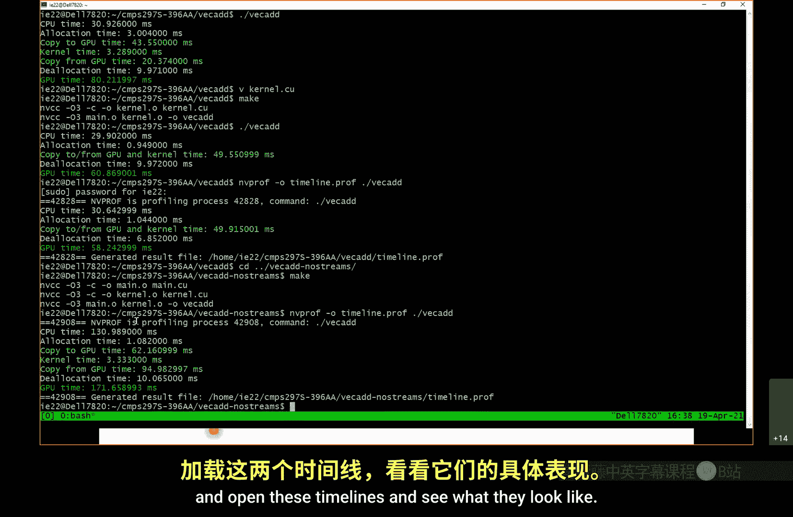

So we switch to the profiler and now what I'm going to do is I'm going to import the timelines that we just generated using NV Pro I'm going to import。

Next。Next。We're going to get the timeline data。Hey， first， we're going to get the timeline data。

For the one without streams。Theyy， finish。Okay， so now here this is the beginning where we were doing the Kuda device synchronous at the beginning and the Kuda malocco and these kinds of things。

 so we're going to go to the end over here， let me zoom in a little bit。Okay。

 so here where this is where everything's happening。 As you can see， this is， again。

 this is the version without streams。 I have a km copy。😊，Host a device。

 and then it couldn have copy host the device。 and then I have my kernel call that's executing and then I have couldn have copy device to host and notice how here now you know what this means here it tells you the stream in which everything is being is being executed。

 So here it organizes things by the kind of operation that's happening down here。

 it tells you the the stream that everything's being executed as as you can see it says that all this stuff is happening in the default stream。

 So here the host the device。The host the device and then the grid execution and then the device to host。

 all of this is happening in the default stream。诶。😊。

Now let's go and import the version that we used with streams with multiple streams going import。嗯。

Yeah。Go'm to browse this time I'm going to go to the version we implemented the uses streams and get the timeline for this。

诶。😊，Finish。Okay， I'm going to zoom in again。Okay， and as you can see。

 let me zoom in a little bit more。So there a little live delay。There we go。So as you can see。

 our men copy hosted device， now it's all these little pieces。咦。😊。

And our long copy device to host is all these little pieces。Okay， and our compute。

 the grid calls is all these little pieces。And you can tell that the copying from host to device。

And the copying from device to post。And the compute is all being done in parallel with each other。

Okay， so we've effectively hidden the copy from device to host and the compute behind the copy from host to device。

 which is what dominates perform。And if you want to see this as in the streams。

Please you let me hand this a little bit。Now you can see what's happening inside of each stream。

 so in each stream I have accm copy。😡，And then a grit， I have two put on copies。

And then I have a grid call， and then I have a put of them copy back。But as you can see here。

 theseku copies are and on the grid call， this grid call is overlapped with the kum copies of this other street。

And then this root column is overlap thequium copies of this。Okay。

 and then this grid cause overlapped with the coum copy of this stream and it goes on okay and then we come back here and you'll see how our repM copies are all overlapped with other grid calls and pM copy back So here you can see how this coM copy back is overlapped with the grid call of this stream and it's overlapped with the coum copy2 of this stream。

Okay， again， all the coudum copies are overlapped with the coudum copy back and the grid。

We've effectively pipeline our operation so that we hide the latency of the grid or most of the latency of the grid execution and the copyback behind the copy to the device。

Okay， is it clear？Any questions about this diagram？professorfes。Yes。😊。

TheThe interconnect that gets data to the GPU is different and the one that brings data back from the GPU。

 No it's the same interconnect， but it has different lane。

And these lanes don't over like there is no lane that can do both。Yes。

 you have lens copy from the CPU to the GP and lenss the copy back。Oh， I see。

 because So that explains why we can save on the。On the device to host， right。

 Because had they been the same， then we couldn't have pipelined both in the same time frame， right。

 right， If the copy two and the copy back are using the same hardware resource。

 then you wouldn't be able to paralyze the copy to in the copy back。

 But because they use different hardware resources， That is why you can paralyze。ok。

 nice see thank you。 yeah you are okay。Doctor。Yes。😊。

I think ECIE has a lot of flames and for the GPU here for everyday GPUs， they we use NV link， right？

So it depends it depends on the kind of CPU you have some CPU support NVlink and some them so if your're a CPU supports NV link then you use NVlink but the older CPUs and also some even some current CPUs。

 they don't all support NVlink。So if they don't support end the link kind of the more wider standard is PCIE。

 but if you do have a CPU that supports MVlink， M link is usually passed。Okay。

 and the one more thing we have multiple lanes right like not only one for copy to and one from copy for copy from so we can have multiple even multiple streams running at the same time right you mean there's multiple lanes the PCIE bus has multiple lanes for copy right so multiple of these lanes will be used to copy two and multiple of these lanes will used to copy from but you shouldn't confuse the PCIE lanes with the stream because one stream could be using multiple lanes while doing the copy。

Okay， okay， Profes， one question about memory in the GPU。So instead of copying to and from。

 cant we take the GPU memory and make it act as a cache？

So there's something calledified unified memory， and we will talk about this in a later lecture where you can kind of allocate something in the CPUU and then access it from the GP。

And this gives us the convenience of not having to do any of these food copies。

 And that's widely used。 We don't show it to you just because we want to understand what's going on under the hood。

 But now that you understand this， later on， I'm going to show you how to use or I I'm going talk to you about unified virtual memory where you can just allocate things on the CPU and run them on the GP and access them on the GP。

 But underneath the hood， depending on the architecture you have。

 what might be happening is what what we have over here。

 Something will get copied from the CPU to the GP memory on demand or backwards。

 There are other architectures where they integrate the CPU and the GP on the same chip。

 So they actually access the same memory， But for for for the GPs that are kind of large and have very high performance。

 these are usually discrete and they have their own independent memory from the。The CPUU。

 but we can kind of simulate the feeling of them having the same exact memory using unified memory。

ok， thank you一样。Okay， so so having now that we've seen things in the profiler。

 let's switch back to the slides。So these are the API calls again that we use to create a stream and then do the asynchronous memory copies and this is the code that we wrote to do with streaming and then this is an illustration of the profiling results that we got I know they're a little bit different from what what we saw in the profiler because I generated these on a different machine than the one we were using during the lecture。

Okay， and with that， you can read more about what we covered today in chapter 18 of the textbook Does anybody have any final questions before we end。

Okay， if not， then the' solve for today and I'll see you next time。5。

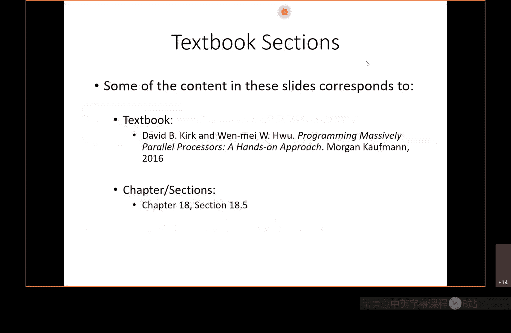