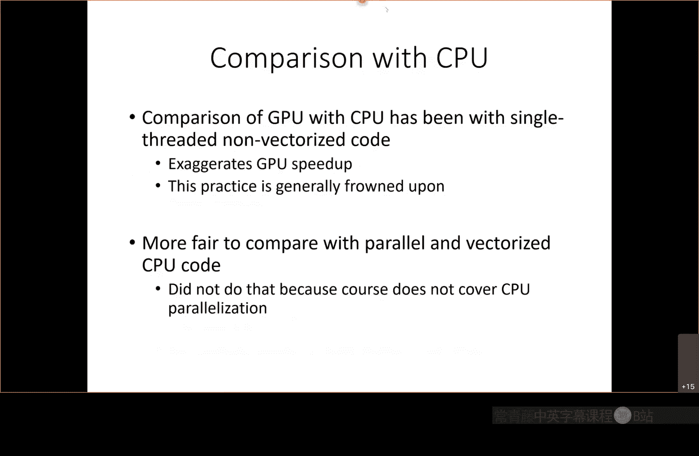

# 贝鲁特美国大学【中英⚡GPU计算｜CMPS 297S Spring 2021, GPU Computing】 p23 P23 综合专题 -BV1LD6BBPEjt_p23-

Hello everyone and welcome to lecture 23 of GPU computing Today will be our final lecture and unfortunately because we have a limited time in the course。

 is there was a limited set of topics that we could covered so there's plenty of other topics that we haven't covered a lot of patterns that we could uncover that we didn't cover and also some advanced features of GPUs or other kind of useful things that we didn't uncover so what I will do today is I will just go through a potry of some of the remaining features that we haven't covered so that you guys are aware of it in case you you ever want to use features like that or in case you have a see code that's using these features so that you know what they are。

 but we're not going to go into any details about each of them so we're just going to kind of go through a potry of remaining topics that we haven't covered and and conclude with that Okay so this is a kind of list of topics that I'm going to briefly。

😊，Touch on today and so we'll get started with we'll go through these in orders。

 we'll get started with multi GPU programming。So multi GPU programming。

 we can have multiple GPUs on the same note okay so so far the model that we've been dealing with is where we have a CPU and a GPU and then the CPU offerss work to the GPU。

 but in fact we can actually have a CPUU connected to multiple GPUs and if we have a CPUU connected to multiple GPUs。

 the CPUU will need to somehow tell each GPU what to do and orchestrate the work across the GPU。

So there is support for doing this inside of KUudDa you can figure out how many GPUs you have on the node using something like KudDa get device count so this API this API call tells you how many GPUs you have and then you can use PUDa set device to select one of them so you can have different devices if you want to for example。

 launch a kernel on GPU0 you can set a device to zero and then launch the kernel if you want to launch the kernel or call the kernel to launch a grid on GPU1。

 then you can do KudDa set device for GPU1 and then launch the grid on GPU1。

Now typically when we use multiple GPUs and a single CPU。

 we also use multiple CPU threads and we have the CPU thread。

 each CPU thread being responsible for operating one of the GPUs or calling kernels or copies or whatever for one of the GPUs and for multithing。

 we usually use something like OpenMP or theres other multitering libraries that you could also use。

 so you can use multiple CPU threads and each CPU thread would select one of the GPUs and operate one of the GPUs and then you can also synchronize across the different GPUs using the CPU or as we'll see later we can also use shared memory across the GPU。

😊，ok。😊，Now this is one way to synchronize one form of multi GPU programming is where we have multiple GPUs attached to one CPUU。

 but we can also have multiple GPUs on multiple different nodes in a network so we can have multiple CPUUs connected via a network。

 and then each of these CPUs could have multiple GPUs。

 and in this case I would want to coordinate work not only across multiple GPUs that are connected to a CPU。

 but I also have multiple GPs connected to different CPUUs on a network。And in this case。

 we typically use something like MPI， which is the message Pass the Interface library or MPI allows us to be able to program multiple CPUUs connected over a network and we can have an MPI we have something called a rank。

 so an MPI rank is like different threads on the CPU but a rank would be running on different CPUUs and we can have each MPI rank we can also have multiple ranks on the same CPU。

 so each one of these would correspond to a process that's running on the same CPU。

 and we can have each rank interacting with one of the GPUs。Now。

 one important consideration when we do multi multi GPU programming on a network is that so when when we're using。

When we're programminging multiple GPUs on a CPUU， these GPUs。

 if I want to kind of share data across them， I can do it through the CPU memory or I can do it directly across the GPUs depending on how my system is configured。

 but oftentimes I can copy data from one GPU to another GPU using the CPUU and that's。

Fast relative to if I want to copy data across the network。

 so if I want to share data from a GPU on one side of the network and one CPU on the network and a GPU on another CPU in the network what I would need to do is I would not I cannot just copy from one GP directly to another GPU I would need to copy the data from the GP memory to the CPU memory then over the network to the other CPU memory and then over the network to the other GPU and this takes a lot of time right if we want to communicate across the GPU and attached to one CPU and a GP potential noise CPU going over the network takes a lot of time So one of the important considerations when we are paralyzing across multiple GPs is how to overlap the communication across the network with the computation on the GPU and one example of this。

 for example， is if we have some kind of stencil computation。

And we divide the space that we're doing the stencil computation on across multiple GPUs and each GPU does a portion of the space well we have to share the halo elements across the different GPus The one thing people usually do is they will compute the elements of the boundary and then while they're computing the internal elements they would do the communication of the boundary elements across the network so this is one example of how we can overlap the communication across GPUs with the execution of kernels on the GP。

Okay， so this just hint at how we program multiple GPUs and some of the challenges that we face when we do that。

😊，Another topic that we haven't really dolved much into is interconnect。

 So when we have when we have a CPU that's connected to the multiple GPUs。

 how are they connected Well they're connected via an interconnect and one common interconnect that is used is PCIE so PCIe is a type of interconnect that's used in many systems to connect CPUs and GPUs together。

😊，And CPIE is a very kind of general kind of interconnect， we use it to connect CPUUs to GPUs。

 but we can also use it to connect CPUUs to other kinds of devices like FPGAs for example。

 and because PCIE PCIE is general it's commonly used in many systems but there's also other kinds of interconnect like NVlink for example。

 and EnVlink actually provides faster interconnect and we can use it to connect multiple GPUs together or we can use it to even to connect a GPU to some kinds of CPUUs that support the enVlink interconnect PCIE is very widely supported。

 so most CPUUs would support PCIE， most GPUs would support PCIE。

 however something like NVlink only some CPUUs support NVlink and only some GPUs particularly certain generations of NviIdia GPUs。

 between the later generations of NVD GPUs。EnVilink so PCIE is the general one EnVlink is more specific to NviA GPUs and later generations of them and is always supported by some CPUs and give you faster and it's a faster interconnect so we can get higher bandwidth when we you are copying data between GPUs or between GPU and GPU howevers not it cannot be used for anything so if I want kind of something general that works for any CPUU and GPU then PCIE is usually the general interconnected people use。

😊，Okay， any questions so far， multi GPU or interconnect？Okay。

 another topic is unified virtual addressing so what is unified virtual addressing Well so far what we've been doing is we've had a CPU that had access to its main memory and we've had a GPU that had access to global its own global memory and we've been reading each of these as if it were its own address space so the main memory is an independent address space from the global memory on the GPU so if I have a pointer that points to an address that pointer we've been assuming could point to know that pointer value is going to be used here in main memory or it's going to be some global memory and this would be its own virtual address space and this would be its own virtual address space so the pointer would point to different things if I used it here or if I used it here but in fact what later GPU systems or。

😊，The GPP systems did is they have something called a unified virtual address space。

Where we have a single virtual address space， we still have two separate physical memories。

 the main memory of the CPUU and the global memory of the GPU or the device memory of the GPU。

 we slap separate physical address space， but we have a unified virtual address space where the same virtual so we have the same virtual address space that is used across the hosts and devices and what that means is that an address。

 a memory address that points inside the range of addresses that's supported by the main memory of this CPUU is mutually exclusive from the range of addresseses that's supported by the GPU。

 so the same memory address cannot be valid in both places its either valid in the CPU or valid on the GPU。

Of course， even though when we didn't have a unified virtual memory。

 it's probably not a good idea to use the same memory address here and here because if I allocated some memory on the CPUU and it incidentally pointed to valid on the GPU。

 that doesn't mean I should be using that， okay。Using the memory however。

 because the only reason that a pointer would be in the other address space is if I accidentally had two things mapping to the same address location。

 but that's not even a concern in when we have unified virtual address spaces and the reason is that the address ranges are mutually exclusive now what's the advantage of having a pointer having a unified virtual address space across CPUUs and GPUs in other words having the address ranges mutually exclusive such that such that pointers cannot I can't all use pointers across。

Well， the advantage is that。When I know that the CPUU is going to use a separate virtual address range from the GPU。

Then I know I can tell the where a pointer points to。

 whether it points to that CT memory or GP memory from the value of the pointer itself okay so the data location is known from the pointer value so if I have a pointer。

 I can look at the value of this pointer and I can say oh。This range of adveraces is the CPU memory。

 this range of adveracses is the GPU memory， so by simply looking at the value of the pointer I can tell if this pointer points to the CPU or the GP。

And the advantage of that is that when I do QamM copy， remember when we did QM copy。

 we had to specify whether we want to copy from host the device or we're copying from device to host or maybe there was device to device or host to host well with unified virtual addressing we actually with a unified virtual address space we don't need to tell the runtime system whether whether a pointer points to the device or points to the host because the runtime system can tell from the value of the pointer whether the pointer points to the device or the so if we are using unified virtual address space。

 then when our Q ofM copies， we would not need to specify device to host or host the device。

 we can simply write QM copypy default and from the value of the pointer。

The runtime could figure out whether this points or points to the device or the。

So this is the advantage of having a unified virtual address space across GPU and GPU。

 where the main memory of the CPUU uses a certain address range and the virtual address space and then the GP。

 the device memory in the GPU uses a separate address range in the virtual address。ok。😊。

Is it clear to everyone any questions？Now there's another advantage of unified virtual addressing。

 which I will show you， I will also show you， but let me first introduce another topic which is zero copy memory。

 so what is zero copy memory zero copy memory enables to have threads running on the GPU device threads directly access the host memory。

Okay， what does that mean I have before so far we've been saying that threats on the GPU cannot access data that that's in the main memory of the CPU。

 I have to copy the data from the CPUU to the GPU。Well。

 it turns out that we can use something called zero copy memory。

 And what that does is that here0 copy refers to the fact that we don't have to do any co and end copies。

 Instead， what we can do is we can have。A thread that is running on the GPU。

Access data directly access data that is in the CPU memory。

What happens when we do something like that is that when a thread running on the GPU。

Triries to access a memory address range a memory address that points to data that is on the CPU。

 the runtime system on demand will copy that data from the CPU memory to the GP memory and serve it to that so rather than us having to do acc them and copy explicitly。

 we can just。Alllocate the data then and then of course there's a special way to do it。

 we can't just use the regular k outlook， but we can the idea is that we can allocate the data and then not copy it。

 but instead have the CPU thread once it accesses that data。

 the runtime system will copy that data from the CPU to the GPU on demand。

Now an important thing here is that if the CPU thread is going to access data that is going to access data that is on sorry if a GPU thread is going to access data that is in the CPU memory。

And that data is going to be copied on demand。That means I'm going to be using a DMA to copy that data right so what does that tell me about the data that's in the CPU memory that I'm accessing where does it have to be？

Inpen the memory。And pin memory exactly so the memory for zero copy memory to work。

 the data that I want to be able to access from the GP the data that I want to be able to access from a GPU thread in the CPU memory should be allocated pinned memory。

Okay， and the way we do that is using an API call that is Ka host hour。

Okay kuda host All so this command kuda host Alloc when we use it to allocate memory what happens is that it gives us a certain memory range in the GPU that in the CPU that is pinned and not only is it pinned but also if I try to access this data from the GPU the runtime system will automatically copy this data for me from the CPUU to the GPU Now without unified virtual memory。

 what we need to do is we need to get the data that we want to access in the CPU memory。

 we need to have it also mapped to the address space of the GPU。

So what we can do is we can use a command called Kudahost Gett device pointer that takes a pointer that was allocated using KudDahost Alloc that points to a pinned memory on the CPU and gets a corresponding pointer on the GPU that the GPU can use to access this data。

However， this over here is unnecessary if we our system supports unified virtual address。😊。

So if I have unified virtual addressing， that means the pointers on the CPU and the GP are mutually exclusive。

Okay so the pointer that I get from couda hostst Allc。

 I can simply give that to the GPU and when the GPU derefers this pointer。

 the GPU knows from the value of the pointer that this memory is actually in the CPUU not in the GPU so it knows that it has to go to the CPUU and fetch that data on demand however。

 if I did not support unified virtual addressing， then the GPU would not be able to know from the value of the pointer whether this point to CPUU memory or GPU memory。

 so this is why we would need to use something like KUahost device coulda hostt get device pointer to translate the pointer that points the CPU memory into something that into a pointer that's usable on the GPU that the GPU can use to figure out that it has to go to the CPUU to get that memory。

ok。😊，Is this clear any questions about zero copy memory？professor。Yeah。

 would this give us some kind of like automatic pipelining of some sort or or not really？So the。

The combination of zero copy memory andified virtual address unified virtual addresses。

 the combination of these two things enables you， it gives you the feeling that the CPU and the GPU are accessing the same memory location。

😊，Right， you don't have to。 you don't have to worry about copying back and forth。Now。

 your point is very is a very good point。 Does this give us automatic pipeing。 And it kind of does。

 because what happens is since I'm not copying and the copying happens on demand。

 then what happens is when， when some threads get scheduled on the GP and they start accessing the CPU memory。

 what's going happen is that that CPU memory is gonna get copied。

 when those threads execute when those threads are requested。 So here， because you have this。

This kernel that's running and this memory is being copied on demand some of the threads they will make a request that request will be served and as soon as that request that data is copied from GPU from the CPUU to the GPU those threads can start executing without waiting for all the other threads data to get served and then the other threads will then later on come and make requests and their data will start getting served and what that means is that we're not no longer waiting for all the copy to happen all the input to get copied before any of the threads start working then the copying the copies will happen on demand when the threads request。

So the threads that request them earlier， the data will be copied earlier。

 and then the threads that come and request later， their data will be copied later while the earlier threads are doing their computation。

 So yes， you are right and that this gives us the feeling this somehow does some of the pipeing for us now whether。

This will be as efficient as as doing the pipeline in yourself where you' you have more control over what's getting overlapped with what that's something that you would need to try and see whether you can。

You can whether using zero copy number and unified virtual addressing will give you as much of a benefit as doing something like doing the manual pipeing yourself。

 but it is a very good observation that we do get some kind of pipelining when we use zero copy number and unified virtual address。

Okay， thank you。Yeah， you。Professor。Yes。😊，When we we use zero copy memory。

 do we get better performance than if we had copied everything ourselves to the GPU。

 like are we guaranteed almost an improvement？So it depends it really depends on the situation。

Right if you have a if you have a case where you have this huge data set and you you're only going to use。

A small portion of this data set， but you don't really know ahead of time which portion of the data set you're going to use。

 that's going to depend on some runtime information。So in this case。

 using zero copy memory is useful because you're going to be copying at runtime so you end up copying only the data that you actually need as opposed to having to copy everything and then only use someone。

Also， you get this automatic pipeing that somebody else pointed out where you have this automatic pipeline that's taking place and you get more overlap between computation and copying by using them。

However， you have the trade off in that when you use Put copy。Right you're doing the copy in bulk。

 so there's some overhead that the system can amortize across the copy when you're doing this copy in bulk。

😡，whereasas having to do the copy， in pieces and pieces at a time。

 maybe each of those individual pieces will be faster。

 but there's going to be kind of a price that you're going to pay every time you need to copy a piece。

Okay， so you have less amortization of that fixed product so it really depends on the situation。

 whether you know， doing the copy in bulk and then computing is faster or doing the copy on demand as fast。

Okay， and that relates to how many portions of your data what percentage of your data set do you need。

 or are youre going to be using all of it or you're going to be using only a small part of it that you don't know ahead of time and also how important is overlapping copying with。

I see。 So for something like matrix multi matrix matrix multiplication。

 it's hard to say from the start， whether the bulk copying。Compensates for the。Like。

For having to copy into the GPU in the first place， right？Right， so for matrix multiplication。

 the co copy takes a very small fraction of time compared to the actual computation。😊。

Because the data you copy is uns squared， but the computation is un cubeed。However。

 if you're going to use zero copy memory， it means you're going to incur this copy every time you want to access this matrix。

 or maybe it gets cached however， it's hard to reason about you would need to try it out。

 but it's hard to reason about whether you would actually get benefit from using zero copy of memory there just because the copy doesn't really take much time compared to the actual computation。

I see。 Okay， thank you。You you're welcome。 So one benefit， though。

 from doing this is that it makes the host code much easier， right。

 You don't have to worry about doing all these code them copies back and forth。 You just。

Alllocate data on the CPUU， then you go use it on the GPU that you come back and use it on the CPU then you go back and use it on the GPU and the system is taking care of doing the copies back and forth for you whenever you need so in terms of the ease of programming it makes your application much simpler if you unified virtual memory and in practice unified virtual memory or unified virtual adacy and zero copy memory used is used very widely and a lot of times people consider that if it was going to have a performance penalty that performance penalty would be small enough that the benefit you get from making your code simpler is worth it so this is actually use very commonly the reason we don't teach it to you at the beginning of this semester is because we want you to be aware of what's going on underneath we want you to be aware of the lowlevel details that's why we teach。

Youlude them and copy in the course， however， and real applications。

 unified virtual lit and zero copy memory together are used very frequently for people to simplify their code and also in some cases maybe even get good perfect。

Okay。😊，Weer。😊，Okay， thank you。屌我咁。Okay another topic is event so so far in all the code that we've been writing we've been synchronizing after every copy and kernel called in order for us to collect timing information and I've been doing this just to keep the code simple because I didn't want to introduce the events from the very beginning because I would have had to introduce streams at the very beginning and I didn't want you guys to worry about streams from the very beginning so we've been we've been synchronizing after every copy and or kernel call in order for us to collect the timing information but in practice this this approach interferes with the execution and closed close things down I really don't want to synchronize across across you know every time I have。

😊，Every every time I do a copy or a kernel call， especially if I'm using multiple streams and these kernels are supposed to be executed in parallel with each other or the copies are supposed to be executed in parallel with each other so the way that we can collect timing information without having to do a something like Eku a device synchronize is using events and events can be used to collect timing information without synchronizing by simply you know you know adding the events to streams in order for us to collect timestamps whenever something in that stream starts or finishes so the way we can use events like this we can write coa event create for example to create an event we can write coa event record to record an event and we provide the stream we want to record into okay so here we can。

If we add an event to a stream， what we do is the event will simply capture the time when it's the events turn in the stream and then we can do something like KUDa events synchronize so wait for some event to happen so if I have multiple things inside of if I put multiple things in a stream and then I put an event and then I put multiple things after the event but and then later on I want to wait for the event to finish but I don't care about waiting for the things after the event to finish I can do something like KUDa events synchronize which waits for a particular particular event in the stream to finish without waiting for the things that are after the。

And and this is better than just the could device synchronize。

 which basically waits for everything that passed to finish。

 so maybe I want to wait for certain things in the past to finish without other things in the past to finish and I can use events to do that rather than having to wait for every。

We can also get the elapsse time between events so we can reduce coa event elapsse time to get the time in between two events。

 so for example， if I want to get the time between if I want to take time how long it takes to do a certain kluM copy but I don't want to synchronize after that com copy it could be an asynchronous coM copy and I don't want to synchronize the time it I just want to take time how long it takes without having to synchronize before it or after it what I could do is I could record an event before before the coM copy and record an event after the coM copy and then get the eappsse time between these two events and this tells me how long that coumm copy took without me having to synchronize it and interfere with the asynchronous behavior that I'm trying to。

And， of course， I can use Kuta event destroy to destroy an event that I that I previously created。

 Now， a lot of this， we can also， a lot of this information we can also collect in the profilers。

 The profiler also tells us how long kernels take to run or how long。

MM copies take to run so this information all it can be collected use in the profiler。

 but if for whatever reason I would also like to collect this information in the code itself。

 maybe I want to use it to make some kind of decision in the code， I could use events。诶。😊。

Is it clear any questions about events， you guys see where they're useful？Okay。

Another topic is tensor cores。 So tensor cores were introduced with the  Vol of U 100 architecture and tensor cores are basically programmable matrix multiply and accumulate units inside of our Ss。

 So each S has tensor cores that can be used to do a small matrix multiply and accumulate operation in one instruction。

 And the reason Tensor cores are so important。 Tensor cores are especially important when。😊。

When deep learning took off， it was very important for accelerating deep neural network workloads and the reason is that a lot of these deep learning workloads are just doing matrix multiplication。

Okay， and and you know， we've saw much how good GPUs are at performing matrix matrix multiplication。

 but in fact， we can do even better by using Tensor course。

 which are the specialized hardware that does you know a matrix matrix a small matrix multiplication and accumulate in one instruction rather than having to execute multiple load and multiple add and multiplep instruction to do the operation。

So the Tensor cores give us a lot of speedup when we use matrix multiplication。

 but we have to use them explicitly using a certain API so in the Volta V100 architecture we have 640 tensor cores since we have ATSMs there's actually eight tensor cores per SMM and each one of these8 tensor cores is capable of doing a 4 by four matrix multiplly so it can do a D equals a times b plus d operation。

停。😊，Here D A B， P are all four by form。Any questions about this？Okay。

The next topic we didn't get a chance to talk about is libraries。

 so there's many libraries that are part of KUDa or that are popularly used with KUDa that have common parallel primitive。

A lot of the primitives that we actually use in the course are provided in libraries。 So。

 for example， there's a library called Str。That contains primitives like reductions， can。

 filter and stored。Okay a lot of we implemented a lot of these manually in the course。

 and that was an important exercise because we wanted to teach you how how these different primgitives work。

 where they're performance， where they're not a performant。

 and just the principles that go behind optimizing them， but in practice。

 if you are writing an application， you probably wouldn't write a reduction or a scan or a sort operation yourself manually as part of your application。

 you can just call a library like thrust or there's also a which which thrust uses the cu is another one。

You can call one of these libraries like thrust or Cb and and they would just do the reduction or the scan or the sort or the filter operation for you you wouldn't have to do it manually yourself so a lot of times some of the primitives that we're implementing in the course you wouldn't have to worry about implementing them yourself in a fullfledged application you would just call some of these libraries to do it for you but you know the course wasn't about teaching you libraries it wasn't about teaching you concepts behind reasoning about how to paralyze code and that's why we went and we implemented these ourselves。

喺。😊，Another one is CUBS， so CBLS is used for basic dense linear your algebra like vector addition matrix vector multiplication。

 matrix matrix multiplication， a lot of these operations again。

 we implemented matrix matrix multiplication in class and the purpose of that was to teach you about some of the some of the decisions and the challenges that go into paralyzing something like that。

 but in practice if you're using matrix matrix multiplication or matrix vector multiplication in your application。

 you would probably be not implement it from scratch you would probably use a library like2BLs that already has a lot of very highly optimized implementations of these basic dense linear your algebra root。

😊，There's also NVBLS， which is a multi GPU library that can do these dental linear algebra operations on multiple GPUs and this is implemented on top of。

Another one is to use sparse to see if sparse does sparse does linear algebra so again we looked at very in the course we looked at how to do ST andB and we looked at different sparse matrix storage formats and it turns out that we actually have a library that does all kinds of sparse and linear algebra routines for us so in practice if you have an application that has sparse matrix operations that you need to perform you could just use these builtin functions to create these matrices and to operate on them instead of implementing yourself from scratch but again the reason we taught to you about them is so that you can appreciate the kind of the kind of kind of process that you need to go through when you're optimizing these kinds of workloads and these principles are also useful in other kinds of workloads that you would want to paralyze that may not necessarily。

Involved forly。Another one is CU solver， so CU solver is useful for factorization and solve routines so if we're doing matrix factorization and CU solver is actually built on top of COUB and COU Sprse。

 another one is COUDNN and COUDNN is popular in deep is used in deep neural networks。

 it implements a lot of routines that are useful for deep neural networks and as a matter of fact the frameworks that some of you are probably familiar with if you've worked with deep learning before。

 so a lot of these frameworks like CAfe MXNe Tensorflow plytorch these frameworks a lot of them give you the option of running on the GPU。

😊，And the way that these frameworks are able to take your models and run them on the GPU is that underneath what they do is they call CODNN so a lot of these frameworks for deep learning that are popular and that they use GPU to make your different networks much faster。

 they simply use CODNN to。To accelerate your code CDNN is actually a very popular library used indirected by these framework and CDNN itself also uses something like C blue。

because the DNs themselves do all kinds of density or algebra and other operations。ok。😊。

Another one is NV graph NV graph is useful for graph processing it gives you different representations of graphs and operations you can do on graphs there's CUFFT for the Fast Fourier transform if you're interested and interested in doing any operations that involve FFTs and there's also NPP so NPVP is useful for all kinds of signal image and video processing。

😊，So all of these libraries are very useful and very widely used and whenever you're writing GPU applications a lot of the parallel letters that we covered in this course are actually implemented within these libraries so a lot of times you would not need to implement these parallel patterns from scratch you would be able to just use these libraries to do these operations for you and building an application involves composing together a lot of the functions that you can find in these different libraries but again the reason we went through all these parallel patterns is。

😊，So that you guys can learn about what are the challenges that we face and all the optimizations that we can apply when optimizing GPU code in general。

 and these principles that you learn are also useful for you if you want to implement some other custom application that is not necessarily built into any of these library。

Okay， any questions about these libraries？Okay， the next topic is about other programming interfaces。

 So in the course we've been focusing on Kuda， however。

 Cuda is not the only interface for programming GPUs。

 there are other programming interfaces out there as well one of them is open C open C is similar to Quda however。

 it is open sourced and also it's more portable across noninvidia GPU。

 So if you're there are other hardware vendors out there， there are other GPs besides Nvidia GPUs。

 I will talk about those on the next slide。 However。

 if you're interested in targeting GPs that are if you're interested having one the same code to be able to run on NviDdia GPs as well as non nvidia GPUs open C presents a more portable portable。

😊，Programming interface whereas KUa is very specific to NviDdia GPUs。 In fact。

 openCL code is not just portable across different GPUus。

 it's also portable across different devices so they're actually compilers out there that compile openCL to CPUs and there's also compile highle synthesis tools that compile openCL to FGs So if you're interested if you're interested if you're only interested in running on NviDdia GPUus。

 maybeUa Kuda gives you is a little simpler than openCL So if you're interested in just running on Nvidia GPUus。

 maybe kUa is enough， but if you want your code to be portable across different kinds of GPus and also you want to also be portable across GPU and other hardware like FGAs and CPUs。

 then openCL is a popular interface programming interface to use。😊。

Okay another interface is open ACC and openACCC is a directivebased GPU programming interface so here directive my directivebased I mean something similar to openM where you just take take your regular sequential code that has a bunch of loops and you can annotate these loops in a certain way similar to the way you annotate them for paralyzing onQs use OpenM and by simply annotating your loops in the right way using openACCC the openAC compiler takes care of automatically taking your sequential code and paralyzing it to run on the GPU of course assuming that the loops you're annotating are paralyzable in everything。

😊，Okay。😊，So directivebased programming is very popular in parallel programming。

 it's popular on CPUUs， people use OpenM all the time to paralyze work on CPUUs rather than using lower level threading libraries like P threads。

 and then similarly， if you don't want to have to worry about allocating memory and calling it kernel and dividing the work across blocks and all these things。

 you can use openACCC to annotate loops in your sequential code in order for you to paralyzed to have that code automatically ported to run。

ok。😊，Another library， yet another library is P++ Amp and C++ Amp is a library then where you can use that you can use to implement GPU programs inside of C++ so you can in your site you C++ code。

 you can use Lambda functions and things like that and certain specialist syntax in order for you to implement code that would run on the GPU directly in P++ without having all these KUD extension。

Okay， so that' any questions about programming interfaces？

Okay the next topic is other GPU hardware so in the course we've been focusing on Kuda and we've also been focusing on discrete Nvidia GPUs Nvidia GPUs meaning GPs that are manufactured by NviIDdia which is a popular GPU manufacturing company and by discrete what I mean is GPUs that are not kind of integrated with a CPU on the same chip you have a GPU that is a chip that is separate from the CPU that's what I mean by discrete the GPU is a own independent chip but in fact we have other GPU hardware besides NviDdia GPUs AMD manufactures GPUs if you might be familiar with radian GPUs these are manufactured by AMD and these are also a very popular for Nvidia GPUs are popular for gaming and they're popular also for for high performanceform computing and AMD GPUs are also popular for gaming and they're also popular。

Or high performance。Arm manufacturers GPUs， you might have heard of Mali GPUs and arm。

 some of these GPUs are used， you know arm is very popular in mobile devices。

 so some of these GPUs and mobile devices will are manufactured by well there are arm GPUs。

 sorry I shouldn't say the manufacturer by arm， there's many different companies that manufacture arm processors。

 but the GPUs use are kind of follow the arm market。And then also there is Intel GPU。

 so Intel actually manufactures GPUs as well。Even though Intel is very known for CPUUs。

 but Intel also manufactures its own GPUs， a lot of these actually come integrated in your machine。

 so you probably if you have an Intel processor you probably also have an Intel GPU in your system that's used for controlling some of the graphics on your screen。

Besides beside other GPU hardware， like I said， we've been focusing on discrete GPUs。

 but they are actually integrated GPUs where you can have CPUU and GPU on the same chip and in this case the CPUU and the GPU would share the same physical memory and the advantage of this is that we don't have any data transfer over PPIE right you actually share you can access the same physical memory from both the CPUU and the GPU because they are on the same chip。

Okay， and arm I mean， sorry AMD is kind of one of the pioneers in manufacturing these。Okay。😊。

Any questions about this？Okay， and then the last thing I would like to mention is a disclaimer about all the comparisons I've been doing with CPUU throughout the course so so far in the course what I've been doing is we've been comparing GPU with CPUU but we've been using a single threadreaded nonveized CPUU code and what this does is it exaggerates a GPU speedup that we've been we've been seeing and you know for the purpose of this course maybe that's okay。

 but in general this practice is frowned upon if you're publishing a paper for example。

 on where you're reporting your speedup between CPU and GP if we really want to do a fair comparison between GPUs and CPUUs it would be more fair to compare our GPU implementation to a parallel CPU implementation that uses vectorized CPUU code because just like a GPU can run money thread blocks in parallel。

or many warps in parallel a CPU can run many threads in parallel and also a every CPU core for many CPUs every CPU core has a vector unit where we can vectorize the CPU code rather than just having having kind of a single thread running on the core so we did not do this in the course and the reason we not do this in the course is because the objective of the course is not to focus on CPU parallellyization it's to focus on GP parallellyization so I didn't want to trouble you with parallel computing on the CPU as well this is something that you can cover in another course perhaps you've taken a course on this before this course or you might take a course on later after this course。

 however， I want to say this because I just wanted to take the comparisons that we've been doing with CPU with a grain of salt because in fact just like we've been paralyzing and vectorizing on the。

We can also do the same on the CPUU， so a more fair comparison which CU would have been to compare to paralleled CPUU code that uses vectorization。

ok。😊，So with that said， I've reached the end of the course。

 I'm sorry that I had to rush through all these topics today and we didn't get the chance to look at them with more depth。

 but unfortunately this is the number of lectures that we have in the course and we've run out on time so does anybody have any final questions before we conclude？

😊，Okay， well if there are no final questions then thank you guys for attending and it was a pleasure having guys in this course and I look forward to seeing you in other courses or perhaps other research projects。

😊，Byone。

