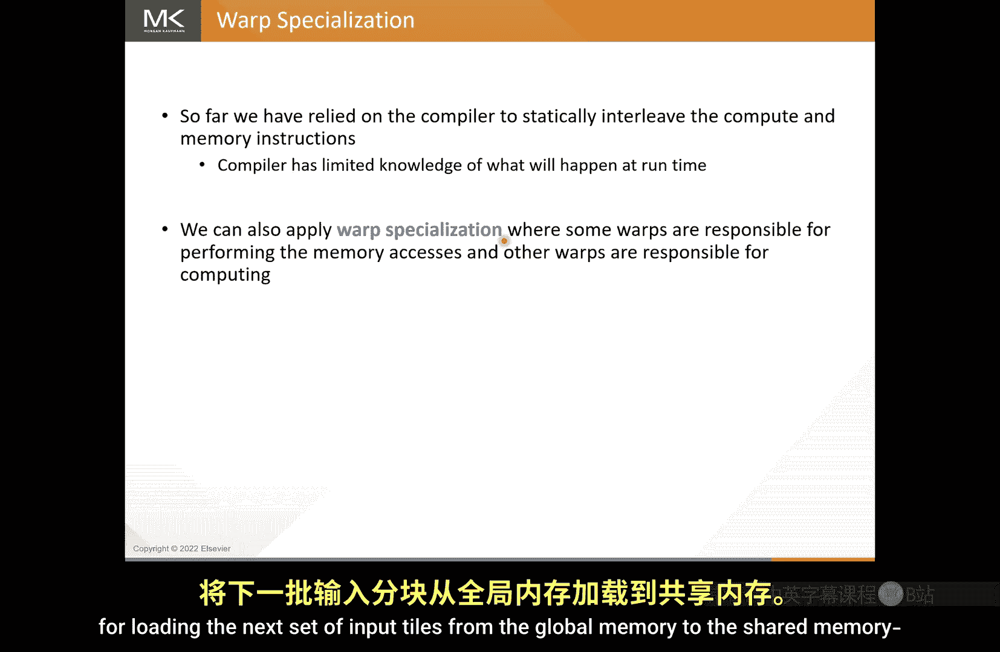
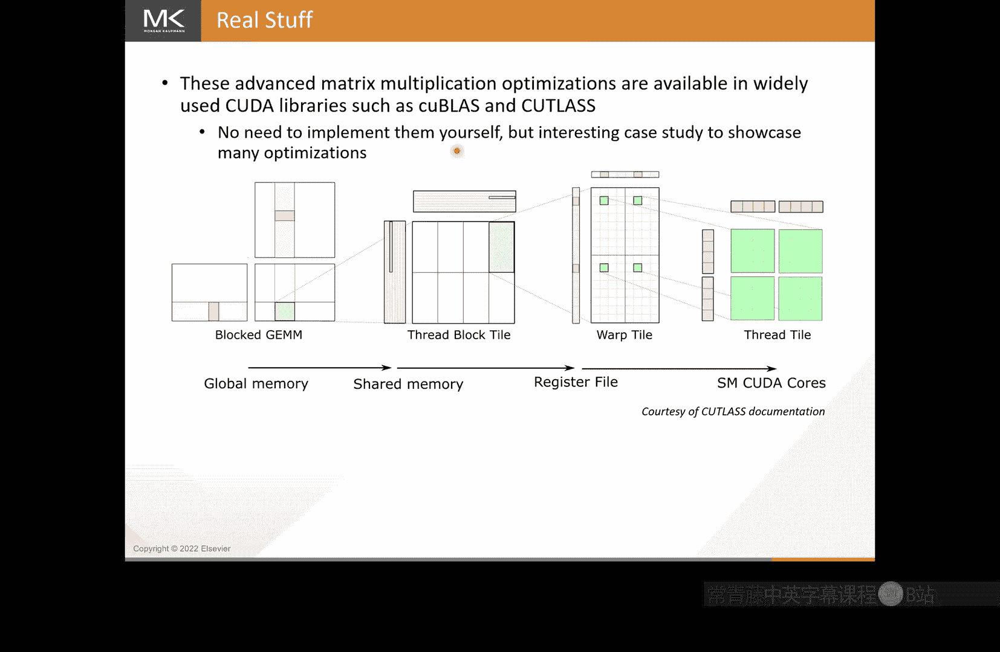

# 贝鲁特美国大学【中英⚡GPU计算｜CMPS 297S Spring 2021, GPU Computing】 p24 P24 矩阵乘法的高级优化 -BV1LD6BBPEjt_p24-

You see my screen。

Yes， they do。Okay so so the lecture I'm going to give today is about advanced optimizations for matrix multiplication。

 I'm using the template slides for the for for the the fourth edition of the book but this lecture isn't in the fourth edition。

 It's actually a lecture that we are planning to introduce to in the fifth edition。

 So the next edition of the book this is going to be a new chapter and this material the material I'm going to cover today is going to appear in the next chapter。

 So you're kind of one of the first groups to see this new material So I appreciate any feedback that you might have on。

On this lecture after we go through it。Okay， so， so。What's matrix multiplication。

 I think everybody here knows what that is if I have I want to multiply two matrices A and B to get a matrix C what we do is we have a matrix C and we have two matrixrices A and B and every element in matrix C is going to be the dot product of the corresponding row and matrix A and the corresponding column in matrix B and the way we paralyze this or a very simple way to paralyze this。

 which I assume that you've seen in an earlier lecture in the course is you can assign a thread to every output element in matrix C and that thread can iterate through the row of a in the column of B do the dot product and store the results。

 This is a very simple way of paralyzing it。 Of course。

 this is not the most efficient way of paralyzing this and to do that let's just analyze how this implementation behaves in terms of accessing the number B。

So if we look at if we calculate the arithmetic intensity of this kernel。

 we find that it comes out to be memory bound So in this kernel what every thread does is it's loading two values from global memory and then it's multiplying them and then doing an addition operations so we're loading two values each values is 4 bytes that's 8 bytes and we are we are doing two floating point operations and multiplication addition so we have two over8 our arithmetic intensity is 0。

25 floating point operations per byte Of course I'm ignoring you also have a store that you do after the loop I'm ignoring that because it's negligible compared to the amount of memory that we that we load so you can see so 0。

25 floating point operations per byte is very low compared to the kind of arithmetic intensity that you need to be compute bound and a modern GP like an H100 GPU for example。

 you would need around 20 floating point operations or byte to be compute bound。In practice。

 this arithmetic intensity would be higher because of caches。

 the caches do a fairly good job at keeping some of that data close so that you don't actually go to global memory every time you load。

 but still even with the caching， you tend to be if you don't have any kind of manual interventions and optimizations。

 this implementation will still be memory bound on a modern GP。

But we know that matrix multiplication is a fundamentally compute bound computation。

 so let's look at the potential for matrix multiplication in terms of its compute boundness。

 so matrix multiplication has the potential to be highly compute bound。

 that's why it's such a successful computation on GPUs if we have an n by n square matrix for example。

 let's assume we have a perfect implementation that loads every input value that it needs only once。

 the amount of data or loads are stored， so accesses。

 the amount of data that we would need to access is going to be we have 3D matrices we're loading two input mates and we're storing the third one each one of these matrices is n by n。

 so we have n squared values and every value is4 bytes。

 so we're going to have 12 n squared bytes that we need to access。

The number of operations that we're gonna to perform are n cubed times2。

 so we have n squared is the size of the output matrix and for each one of those elements we're going to do n multiplications and n additions to do the dot product So we end up with  two n cube floating point operations and if we take the ratio of that we end up with 0。

67 n operations per byte so a perfect implementation that loads every value or stores。

 every value it needs only once can achieve this kind of arithmetic intensity So if we have a 1024 by 1024 matrix for example。

 and somehow it's not realistic but somehow were able to load every value only one that we need only once and reuse it as much as we need it we can get 171 operations per byte so you can see that this is much higher than 20 operations per byte which you need to be compute on a modern GPU so we have the potential to be highly compute band when we execute。

Marance multiplication on the GPU。And then the question is。

 how can we achieve that Now you've already seen， and I'll review it quickly。

 You've already seen shared memory tiling as one way to increase the arithmetic intensity。

 So what happens with shared memory tiling is let's say a threat block is assigned to this colored output tile over here。

What we do is we are going to divide the input matrices into tiles and we're going to load the tiles of input matrices one pair of tiles at a time。

 so let's say we have this pair of input tiles over here we're going to load those from global memory to shared memory。

And then once they're in shared memory， what we do is we have the threads that are responsible for this output tile。

 use the values from shared memory to compute their contribution to its own element and usually this output tile is in registers right every thread is going to have this accumulator where it accumulates the result of the dot product in of some kind of register。

Now the advantage of shared memory timingling is that instead of loading each one of these input instead of this thread loading each one of these input values from global memory every time。

 or sometimes it'll hit the cache， but there's no guarantee to that we are loading it from shared memory so we load each one of these values once from global memory to shared memory and then we reuse it across the threads that need it。

So let let's calculate what improvement to arithmetic intensity we have if we apply shared retling。

 so over here， let's say we have an end by end output tile。

And we are iterating through input tiles that are also each end by end insights。

So if we have n by n square tiles。We need to load two input tiles， so we have two input tiles。

 each one of them has n by n values so n squared values and each value is four bytes。

 so we have8 n squared bytes and again I'm ignoring the store just because it's negligible because we load many input tiles and then we finally store one output tile so so I'm neglecting it for now。

And then in terms of the operations that we do so once I load these two input tiles and I want to calculate their contribution to this output tile。

 we're going to do n by end dot products and each dot product is going to B of size and so we have n squared dot products and then we're going to do n as and n multiplication so that gives us two n cubed floatinging point operations per byte and get when we take the ratio we get an arithmetic intensity of 0。

25 n lowercases n a floatinging point operations per byte Now usually in a simple implementation of shared memorytyling what we do is were going to have 32 by 32 tiles just because the largest block that you can have on a GPU is 1024 which is 32 by 32 so if you do a simple approach of assigning oneth to every output element in one threat to every input element in your loading then you're going to have 32 by 32 tiles。

This gives us eight floating point operations per。Which is good right but still it this is still and practice is going to be larger because of caching again。

 but still8 floating point operations per by， it's much higher than 0。

25 floating point operations per， but it's not in the range where we fully utilize the compute resources of the GPU because we're compute bond remember for an H100 for example we need around 20 floatinging point operations per bite to be able to kind of be in the compute bond range。

So the question is， how can we increase this ratio and clearly。

 if I want something higher than floating point operations provide what I need to do is。

I need to increase n right， In other words， I need to increase the sizes of these tiles in order for me to be able to get better arithmetic intensity in order for me to push the implementation into the compute bound range so that I can fully utilize the GPU resources Now。

 what does increasing n mean Well， if these two input tiles are going to be placed in shared memory。

And this output tile is going to be placed in registers。

So increasing a means I'm going to need more shared memory for my input tiles。

And I'm going to need more registers for my auto。And we all know that there's a limited amount of shared memory and there's limited number of registers that you can have on an individual SMM and therefore there's a limit to how much we can increase N before we run out of the resources okay so let's see first how we can increase N and what our limits are going to be towards increasing N。

Okay， but the main idea here is that increasing n improves the output intensity。

Any questions so far about the arithmetic intensityline analysis， everything clear？Okay。

 so before I look at how we can implement a kernel where we increase n so far I've been assuming square tiles。

 but let's not assume square tiles let's assume that we have an m by n tile and then let's assume that each one of our input tiles。

 this one is going to be n by K and then this one is going to be K by M。Okay。

 and let's redo our arimetic intensityden analysis with this in mind。So over here。

 if we look at how much data we need to load from the global memory to the shared memory。

 we have an m by K input tile and a K by n output tiles that's M by K plus k by n values and each value is four bytes。

 so in total I have four M times k plus K times n bytes that I need to load。Again。

 I'm ignoring the biketes that we need to store because you know we do this many times in a loop。

 but we only do the store once at the end so it we can ignore it。And then finally。

 the operations that we perform， we have M by n output elements so that's m by n dot products and each dot product is going to be K multiplications and K additions。

 so we have M by n by K by  two that's the number of floating point operations that we're going to perform so if we take the ratio of these we get 0。

5 M by n over m plus n floating point operations provide。Okay。

 and the interesting thing about this ratio is that K is not included in the ratio。 So K。

 this is the width of the style and the height of the second input tiles。

Hey is not part of this ratio。 Okay， and the intuition is that to increase the arithmetic intensity。

 I want to take a value that I loaded， and I want to reuse it as much as possible。 In other words。

 I want my output tile so N by n or the dimensions of the output tile。

 I want my output tile to be as large as possible so that any input value that I load。

 I reuse it as many times as possible for to compute different elements of the output tile。

But having large input tiles is exactly is not exactly impactful for increasing my earth intensity。

 and that's the intuition behind why K does not appear。

 and what that means is that if I want to increase M and N without straighting my shared memory。

 what I can do is I can simply make K smaller。I can make k small， so if I make n four times larger。

 I can make K4 times smaller and that way I haven't increased the total amount shared memory that I'm using for my input task。

So just to recap on what I said， increasing M and N improves my arimetic intensity and I don't need to increase k。

 So what we can do is we the intuition is that having large output tiles allow allows us to reuse the same input value to compute more output values and there's no advantage of having large input tiles。

 So what we can do is we can keep K small and this limits this prevents us from strain in the shared memory。

 However， what we do put strain on when we increase M and N is the registers。

 Okay remember every thread。Places these accumulators in its registers and if I'm increasing M&N if I'm increasing of the output tile every thread is going to have to be responsible for multiple output elements and therefore it's going to have to put it's going to have to use multiple registers to store its portion of the output tile we're going to see this later on。

 so we're going to have higher demand on registers overall。Just to give you an idea of sizes。

 typical values that we might use for M and N are 128。

So we can have a 128 by 128 output tile and with 128 by 128。

 this gives us a reuse if we plug that in over here。

 we'll get a reuse ratio of around 32 floating point operations per。

 which does put us in the compute bound range on a modern G。Okay。😊。

So next I'm going to look at how to actually， like I said。

 the typical sizes are 128 by 128 and over here we have 128 by 8 and 8 by 128 because that comes out to be 11024 elements or four kbytes。

 which we have plenty of shared memory to accommodate that。Okay。

 so before I get into the implementation of how we do this， does anybody have any questions？Well。

 I do actually。Yeah，So you said that like it doesn't matter how if if if co is a small。

 if k is a small or large right， so can we select is it practical to select k equal to one or。

's that's a great question。 So it doesn't matter， but you still want to select a K where when you want to load these values。

 you don't， you don't underutil your cache。 Okay， okay。

 so you don't want K to be too small because if this if this is stored in a row major order。

 you want to be able to to kind of when you access this row of the tile。

 you want to be able to fully utilize your cache line。

 You dont want to load that partial cache So so yeah。

 you don't want to make K too small So Or it doesn't matter right but practically K should be like。

Nots not too small Yes， yes for for cash consideration purposes Okay all right， thank you， yeah。

 thanks。Any other questions？Okay so now let's talk about implementation details so basically what we need to do is we're going to have to iterate through these input tiles on pair at a time。

 we're going to have to load the two input tiles from the global memory to the shared memory okay so I'm going to use BM so here we have M by K and K by N to indicate the size of the matrices I'm going to use BM and Bk to indicate the size of the tile that we're going to load for the whole block and Bk by Bn as well to indicate the sizes of the tiles。

So for each it over the tiles， we're going to load the input tiles from global memory to shared memory and then every thread is going to be responsible for a bunch of elements in the output tile right so every thread is going to have its own thread level output tile and that thread is going to go through the input elements in shared memory to compute their contributions to its output tile。

The typical sizes here again， we have 128 by 8 here we're going to have 8 by 128。

 and then this output tile is going to be 128 by 128。And for reasons we'll talk about later。

 because we use a lot of registers， we can't have full occupancy。

 so typically a threat block is going to have 256 threads。

What that means is we can have a 16 by 16 thread block and if I have a 128 by 128 tile divided across 56 threads。

 every thread is going to have to take around 64 is going to take 64 elements every thread is going to be responsible for an8 by8 output tile and remember this8 by8 output tile is going to be in the registers So every thread is going to have 64 registers that it dedicatedates to store these output accumulators okay。

What does the code for this look like so this is kind of a kernel that implements the strategy that we just discussed first every thread block is going to identify what output tile it's responsible for within the output matrix then every thread is going to kind of identify what output tile it's responsible for within the block's output tile so this identifying the thread level tiles。

Then every thread is going to declare a TM by TN or an8 by8 output tile that it's going to use to accumulate its output elements。

 we're going to clear that and then we're going to iterate over the input tiles one input tile at a time here we're going to load the two input tiles A and B from global memory to shared memory we sync threads to wait for the loading to finish and then every thread is going to do a matrix multiplication of the two input tiles。

To calculate the value of its output tile we sync threads again and we keep iterating and then once we're done every thread is going to write its output tile from the from the global memory sorry from from its registers to the global memory okay so I'm using multiple helper functions here there's the clear function to initialize the tile to zero we have loading tile from global to shared memory we have the matrix multiplication and then we have writing the tile from the registers to the global memory and next what I'm going to do is I'm going to look at each of these helper functions and how they're implemented but any questions about this high level code I think should be。

Fairly clear if you have implemented a shared shared memory title for matrix multiplication already。

Okay let's start with declaring and initializing an output tile so the way that we declare we want to have an eight by8 output tile for each register for each thread。

 so the way that we declare the output tile is like this， we're going to have float。

 know we're going to give it a name we're going to call CR here just indicate it matrix C it's in the registers and these are the sizes but what we know is that by default when you declare a local array like this。

 this does not go in the registers this goes in the local memory which ultimately gets placed in the shared in in the global memory and gets cacheched。

But what we want to do is what we want the compiler to promote this local array into the registerries and for the compiler to be able to promote the local array into the registers。

 its size has to be constant。And all access Cs to this local array have to have constant indices。

 So the way we do that is whenever we are going to iterate over this array。

We're going to unroll those loops so that when you unroll the loops。

 you're no longer using a variable index， you're going to be using a constant index to access this array and by unrolling the loops。

 that's how we make sure that the compiler eventually places this local array into the actual registers So loop unrolling the variable inices become constant indices which allows the compiler to chrom this registers。

 So for example， this clear function right here it's going to iterate over this array and it's going to just initialize it all to0 So we're going to have a loop that its over the rows of the array thats over the columns of the array and then initialize it to zero but by putting a pragma unroll over here and making sure that the loop bound is constant。

 So here M and n are going to be defined as constants in the earlier parts of my code or it's going to be it's going be a template parameter。

 this ensures that this rule these loops get fully unrolled and then this CR is placed inside of the registers and you're going to see later on that whenever I iterate over this。

Aray， I'm going to make sure to enroll those loops in order for the to always be constant。

 is that clear？Questions。Okay， so next we have loading the tiles from the global memory to the shared memory。

 So we have this load tile function that we need to implement。

 So the idea of loading the tiles is that were we have this tile in global memory and we want to load it into the shared memory。

 But remember the typical size for this style is going to be 128 by 8。 so that's 1024 elements。

But recall that in my thread block， I'm only going to have 256 threads。

And what that means is that every thread is going to have to load four elements Okay and now what we want we want to make sure that the aes are coalesed。

 so what we're going to do is we're going to divide this and we're going to improve this later on。

 but for now we're going to divide this input tile into four subtles and we're going to have the threads iterate over the subtles and load each subtile in a coalesced way。

Okay， so this is what this function load tile over here does。

 It takes the the address of a and shared memory in global memory。

 and then where we're going to put it in。In shared memory。

 it takes the leading dimensions to be able to do the indexing and it takes the height and the width of the tile and then over here we calculate how many subtles we have in this example it's four subtles and then we iterate over the subtles we calculate the index of the element within the subtile that every thread needs to load and then we load the value from global memory to the shared memory and of course we have a boundary check so that if this tile is somewhere close to the boundary。

 the elements that are out of bounds we just write to zero instead so this is how this load tile function works。

呃Now。Just to see how we call this function and what parameters we pass to it so again we're loading from global memory to shared memory。

 so what does this load tile function need， it needs the address of the array in global memory that's what this is。

RightIt needs the leading dimension so that it can index this array。 So that's K right here。

 It needs the bounds to make sure that we're not out of bounds over here。

 It needs the horizontal bound to make sure we don't access anything out of bounds。

 It needs the address of this input this where we're loading to in shared memory It needs the leading dimension for this array。

 And of course， it needs the dimensions for the tile overloading。 So these are。

 well we are passing to this load tile function in order for it to load successfully。Okay。

I'm not going to go through the kind of the details of the indexing it's a little tedious。

 but I think you if you're already familiar with straight memory retling。

 you should be able to figure out these indices on your。Okay。

 so this is how we implement the slow tile function。 Next， we go to the matrix multiply。

 So with the matrix multiply， now we have our tiles and shared memory。

And what we need to do is we want every thread to do a matrix multiplication of its pare portion of the input tiles to calculate their contribution to the output tile。

Okay。😊，So here what you're going to call matrix multiplication。

 we're going to pass to it the dimensions of the output tile that we are calculating。

 we're going to pass to it inner dimensions， this is basically how long the size of the dot products is the inner dimension of the input tiles to know how long it could to iterate to do the multiply an ad we're going to pass to it the starting address of the first input tile and the leading dimension of the first input tile。

 the starting address of the second input tile and the leading dimension of the second input tile and finally we're going to pass to it the starting address of the output tile。

Of course this is a starting address， but once all the code gets in line and all this will be promoted to register。

s not going to have an address anymore， it'll all get promoted into registers。

But this abstraction kind of helps us with the coding。Any questions？

Now the implementation of matrix multiplication is very simple。

 it's just three nested loops that iterate over the output elements and then iterate through the input tiles and do a multiply net。

Okay， so if there' are no questions now let's talk about writing the output tile。

 So once all the threads are done computing their output tile。

 So they're done iterating over all the input matrices and they finished computing their output tiles。

 they need to write their output tile from the from their registers to the global。 Okay， so for that。

 we implemented a right tile function and this right tile function。

It took it took the so the right tile function takes the adveracies of the input tile and the output tile and simply it just iterates over the input tile。

 this input tile right here， so its for every row for every column and again we unroll them to make。

Didit into registers， does a boundary check。 And if the value is within balance。

 it simply writes it from the registers to the global memory。

 Okay so this is a simple function to implement how we call it。

 So what we need to pass to this function is the starting address of the the threads style in the global memory。

 So there's some some you know involved the index calculation here where you use the starting address of the blocks style and you add to it the starting address of the thread the index the thread style。

 you multiply that by the leading dimension， and then you also include the column sorry sorry the row and the column of the blocks in the threads。

So that's how you get the starting address of the threads output tile in global memory you need to find you need the leading dimension of the output tile you need to have the bound so here we make sure that we pass the bounds so that if our output tile somehow correspond lies on the bound reading and some of it is out of the bounds we make sure we don't do any other bounds at to cease and of course the starting address of the threads output tile and again。

 once this gets in line and and unrolled this is going to become registers but the address is just helpful for the abstraction and of course the height and the width of the output tile that we are writing okay。

So this is how we implement this right tile function。Okay。

 I know this was a little tedious going through the code。

 but you know I just wanted to make sure that we go through some of this just that you have an idea of what's going on so that once we move on to discuss the other optimizations。

 but I'll do less code and more conceptual optimizations going forward。

Now any questions before I move on？Just another question for me。😊。

Like when it comes to different GPU models。Where like they have like different kind of like number of registers。

 do we need to tune this algorithm like for a specific model or it can be like scalable depending on the on the GPU hardware。

So yes， of course， you know， different GPs， they're gonna to have different shared memory resources and depending on how many registers you have in shared memory。

 for example， sorry different Sm resources。 So depending on how much shared memory。

 how many registers you have on the S， you will need to tune tune these values of course another thing is if you're using different precision。

 So everything I've been doing here has been assuming FP32 right So 4 byte values。

 But if you're using different precisions like 16 bit or 8 B， the elements are going be smaller。

 So the number of elements that you can accommodate is going to be larger。

 So these dimensions will also differ depending on the precision that you're using even within the same GPU。

And by the way， can we upload this kind of computation that you're doing in the registers to the Tenor course？

OhYes， yes， I'll talk about that thank。Yeah， thank you。Other questions？Okay。

 so now let's talk about optimization， So there's a number of optimizations that we can still apply to make sure this implementation is more efficient。

 Yeah some of you probably picked up that there were certain things that we were already doing that were not very efficient when it comes to memory aes。

 So let's talk about these computations。 So one is vector loads in stores I don't know if you've covered vector loads and stores。

 but that's basically when a thread instead of loading four bytes it can load or store4 byte。

 it can load 16 bys at a time call that a vector load or store 16 byte we call that a vector store。

NowAnother one is register tiing。 So this。This is when you become bound by the shared memory access latency。

 you want to make sure to reuse values that you load from shared memory as much as possible to avoid the to shared memory every time。

Making sure our stores are coalesced so far they haven't been coalesced so we want to make sure that those stores are coalesced bank conflicts when you access shared memories we're going to talk about those another one is software pipeing and warb specialization so that's something we're going talk about as well this is particularly important in tolerating the fact that we are going to be working at low occupancy and're going to cover that when we talk about software pipeing and then finally using specialized hardware unitss like the Tensorium accelerator and the Tensor course okay so for the rest of lecture I'm basically going to go through this list of optimizations and see how we can apply them within the context of this matrix multiplication implementation that uses these large large piles。

So let's start with vector loads， so if you go back to when we were loading our input tile from from the global memory to the shared memory。

We said that we have four times as many elements that we need to load as we have threads。

 so our kind of initial naive implementation was to iterate over the input to divide the input divide the inputile to subtles and iterate over it one subtile at a time and then load each subtile on its own from the global memory to the shared memory。

ok。Now with vector loads， so without vector loads of what we were doing before per scalar loads。

 if we track what one thread is doing。This thread， for example。

 it's going to load this in the first for the first sub。

 it's going to load this4 byte value from the glow memory to the shade memory。Of course。

 the thread adjacent to it and load the next value， the thread to load next value。

 So these loads will be coalesced。 Okay， but then it's going to load this value。

 then load this value， then load this value and then load this value。

 So this thread is going to do four load instructions and the index calculations that are associated with it。

 and each load instruction is going to load one element， which is4 by。

Now we know that GPUs let us do vector loads where every thread can actually load four four byte elements or 16 bytes so with vector loads instead of the thread iterating over these four elements and loading the one at a time what the thread can do is issue one vector load instruction and load 16 consecutive bytes from the global memory to the shared memory So in this case what every thread instead of dividing our output tile into four subtileles。

 we're just going to our input tile into four subtles。

 we're going to treat the input tile as one large tile and every thread is going to load four consecutive elements of that tile with one single load instruction。

Now， what's the advantage over here， The main advantage is that we are loading more data with fewer instructions。

 but both of these both of these result in coalescent memory accessities。

 so we're not impacting the coalescing。Right， but what we are impacting is that instead of having to do four load instructions to load four different values。

 we are able to load 16 by using just one instruction。

 And that allows us to kind of send memory requests to our the memory system at a faster rate。

 And this is gonna to be important because we're operating a low occupancy。

 And I'll come to this point later。 Okay， is this clear。😊，Okay， so vector loads are useful。 Now。

 vector stores are going to be even more useful because remember， we said that every thread。😊。

Is responsible for this8 by8 output time。Now， if you think of what happens when we are storing these when the thread。

 remember when we did the right tile function， the thread was iterating over these elements in its registers and it was writing them from its registers to the global memory。

 now if you think of what happens。So when we do scalar stores。

 every thread is going to iterate through its eight by8 output tiles。

 so it's going to issue 64 store instructions。And every store instruction is going to ride4 bytes。

And if you think what threads in the same warb are doing。

 you're going to have this thread is going to write this these four bytes and then the thread next to it in the same morb are going to write these four bytes that are eight elements away。

Okay， so they're they're far away。 So， so， so the scalar stores。

 we're going to have 64 scalar stores。 Each store is gonna to store 4 Bs。

 and the coalescing is going to be poor。😊，Whereas when we do vector stores。

 what every thread is going to do is it's going to use a vector store to store four elements in one instruction。

What the M is is that instead of having to do 64 scalar stores， we're going to do 16 vector stores。

 right， we're going do four elements at once or 16 bys at once。 Okay。

 and each store is going to store consecutive 16 bys。 So there's two advantages here。

 The first advantage is that we're going to store more data with fewer instructions。

 So we have less instruction execution overhead。 And again， this is important。

 we're going to see why this is important later on because we operate a low occupancy。

 But then another advantage is coalescing。 So we have better coalescing。

 because now this thread is going to store these four consecutive bytes。😊。

We're going to skip these four consecutive bytes and then the thread that's next to it in the same warp is going to store four consecutive bytes so the coalescing we are still not perfectly coalesced。

 but the coalescing is not as bad as it was before。Okay， is that clear？Any questions？

And later on we're going to improve on this so we're going to make this even better later on。

 we're going to have better coalescing than we have over here because right now we still have this gap between these two consecutive threads。

Any questions？Okay， so now let's talk about register tiling。So remember。

 we said that once we in our initial implementation。

 once we loaded our input tiles into the shared memory。

 so here I have a and B tiles inside of my shared memory。

 every thread is going to iterate through its output elements and for each output element。

 it's going to iterate through the input tiles and load these elements from shared memory and calculate their contribution to the output element that's currentlyly computing。

But one thing we notice is that every element that we load from shared memory is actually used by use to calculate multiple output elements。

 So this input element over here。😊，This thread is going to load it multiple times to calculate each of these output elements。

 So the thread is going to load the same element from shared memory multiple times。Similarly。

 this element right here is going to be loaded from shared memory multiple times for each of these output elements。

 right now we know that shared memory is fast， right， shared memory is faster than global memory。

 however， once once all your data isn't shared memory and you're doing everything in the assignment。

 you're not touching the global memory， the shared memory all of a sudden becomes slow relative to the other things that you are doing right。

 So there's something that's faster than shared memory and that's the registers， right。

 So the idea is that instead of loading this value。😊。

From shared memory multiple times for each of these output elements。

 what I'd rather do is I'd rather load it once and reuse it for computing each of these output elements。

 And to do that， we're going to use the same strategy we used to minimize accesses to global memory。

 which is we did tiling and shared memory， we're going to do the same thing。

 but this time to minimize accesses to shared memory， we're going to do tiling in our registers。

 So what we're going to do is for for these segments of these sections of the input tiles that the thread is going to access。

 we're going to iterate through them in strips。😊，So we're going to iterate through our input tile one strip so every thread is going to iterate through the input tile one strip at a time。

And for each strip， what the thread will do is it's going to load these input elements from the shared memory into its registers。

 so it's going to declare kind of a strip a local array that will eventually get promoted into registers。

 it's going to load these from shared memory to registers。

 It's going to load this strip from the shared memory to the registers。

And then for these output elements， it's going to calculate the contributions of these two strips to into all of these registers。

 So it's kind of like doing an outer product。Okay。So the typical size of this is going， so remember。

 this is8 by8 typically， so this is going to be an eight by one strip。

This is going to be a 1 by8 strip， and then this is going to be an 8 by8 output tile。

 and all of these are going to be in registers， right。

 which means that the thread is going to load the script to register。

 it's going to load the strip to registers， and then the thread is going to iterate through all of these output elements and find the corresponding input elements。

 do a multiply and do an add。And of course the loops will get enrolled。

 everything will get promoted from local areas to registers， and this operation right here。

 this other product operation is going to be all done using registers。

 which means you're basically going to have 64 multiply and add operations in your code one after the other。

Okay， and as you can imagine， if you have 64 multiply and ad operations one after the other。

 this is what lets you fully utilize your compute resources on the S。

 The fact that you' you you're not spending a lot of time accessing memory anymore。

 You're not spending' you got rid of your four loops。

 the branch instructions because you've already your four loops and you just have multiply ad multiply ad multiply ad multiply and multiply ad and this is what allows you to reach that high compute utilization with maybe it's not publication。

 Is this clear。Any questions？Yeah， just another question from me。

 is there any reason that we don't use like square tiles here？😊。

Ex similar to what we did for like the shared River tiling。Wait。

 so we are using do you mean a square output tile or the scripts input idea？Oh。

 so the input strip again， we want to use as few registers as possible。

 So just like we want to save on how much shade memory we use for the input tile。

 we want to save on how many registers we use for the input strips。

 And that's why we are going to load from shared memory registers one strip at a time。Yeah， I mean。

 why we don't consider the strips to be like a square， not like this rectangular。

Oh because if the strip was square， I'm going to need more registers to store it。Yeah。

 but what if we like choose it such that it fits the registerify but but registers are a very scarce resource here you're going to see we're already so think about it we're using 64 registers already for our output elements。

😊，And we've added eight registers here that's 72 and 8 registers here that's 80。

 So this operation on its own is using 80 registers where we need 8 registers just for the input strips and the output type right and of course。

 the code use as all kinds of registers for all kinds of other things like intermediate values。

 especially that we're doing unrolling So we are really constrained for how many registers we have when we are doing this operation And that's why we want to conserve registers as much as possible。

 So we are going to make these strips as thin as possible。Okay， I see that， thank you。Yeah， okay。

Okay， any other questions？Okay， so now we've seen how we do register tiling。

 Let's now talk about coalescing the store instructions。

 So remember we improved coalescing by using vector stores。 Okay。

 so every thread is going to do a vector store where it's going to store store four consecutive values but even with the vector stores。

 the rights from the registers to the global memory are still not completely coalesced why。

 because if you think what adjacent threads are doing。

 this thread is going to store these four consecutive elements to global memory and then you have a gap of four elements。

 and then you have the next thread is going to store four consecutive elements。

 So this gap right it means that you you're not fully coalescing your stores。Okay。

 so the problem is that a vector store can store up to44 consecutive elements， which is 16 by， right。

 So we can store up to 4 consecutive elements， but the T width is 8。😊，Okay。

 and the next thread is going to have another8。 Okay， so because the tile width this8。

 but we can only store for consecutive elementss， this is where the Smiths match comes from。

In order for me to fully utilize to fully coalesce my operation。

 what I need to have is I need to have this thread store four consecutive elements and the next thread be responsible for the next four consecutive elements and next third would be responsible to the next four consecutive elements。

 which means that my tile should not be eight， my tile should be four the width of my tile should be four。

 not eight。However， we've seen that in order for us， we want the tile to be as large as possible。

 We want threats to have an8 by8 tile， because the larger the tile。

 the better the higher the arithmetic intensity。But the fact that my tile is8 in width is causing problems。

 I'd rather to have four to be to be four in width so that I can coalesce my stores。

 So what were going to do is were going to really arrange。

The the thread tiles so that instead of the thread being responsible for a monolithic 8 by 8 tile。

 the thread is going to be responsible for multiple4 by four tiles。Okay。

 and what that does is that it allows a threat to still have 64 elements that is responsible for computing to still benefit from that high arithmetic intensity。

 but at the same time allows it to have coalesced stores。 Okay。

 so let's see how we are going to rearrange the tiles to achieve this。

So now we're going to talk about wars。What we're going to do is we're going to divide this output tile across warps every warp is going to take a certain remember we have  two56 threads so that's going to be eight warps so every warp is going to have its own its own output tile so every warp is going so from this 128 by 128 block output tile every warp is going to have a 64 by 32 warp output tile。

Okay， and now when the threads iterate through the input strips in order for them to to compute their their output tiles。

 you can think of threads in the warp as collectively。This is just logical。

 but you can think of the threads of the same work as collectively iterating through the input strips as they compute their individual portions of the warp output okay。

So you think of every warp has an output tile and every warp is going to iterate through the shared memory one strip at a time。

 Okay now let's now that we've seen what warps are doing。 this is the warp。

 this is the block output tile。 This over here is the warp output tile。

 the wars are iterating through the one strip at a time。

 Now let's zoom in on what the warp how the warp is going to divide its work across threads。

 Okay remember， we said that we don't want the threads to be responsible for a monolithic8 by8 output tile because that is causing my store not to be coalesced。

 So instead what we're going to do is we're going to divide the warp output tile into four quadrants。

And we're going to have every so if here if if I have a 64 by 32 verb output the tile。

 every quadrant of the warp is going to be 32 by 16 elements。

And then every thread is going to be responsible for a four by four tile inside of each quadrant。

Okay， so instead of the thread having a monolithic 8 by8 output tile。

 it's going to have four output tiles that are each four by four in size。Okay。

 and now what the thread so so so now you can think of the threads 8 by8 output tile。

 It's logical 8 by8 output tile as being composed of。

 these four4 by four output tiles that are coming from different quadrants。

 So this is what a block does this over here， this how a block device things across wars。

 this is how a warp device things across threads。 And this is this shows you the threads。

 and you can think of now these strips that every thread is loaded。

 instead of it being a contiguous8 by one strip， it's going to be two separate4 by one strips that are loaded from different parts of the shared memory。

 Is that clear。Any questions？So now every thread to load is going to load four values from here。

 four values from here， four values from shared memory to the registers。

 four value from here from the shared memory to the registers。

 and then every thread is going to calculate the contributions of these values to its output tiles and then now when the thread is done and it wants to store these output tiles from its registers to the global memory。

 when it does a vector store， the vector stores stores all these elements of the output the width of its subtile of the output tile in one store。

 so if you can think of the threads when the threads of the warp are storing this quadrant of the war output tile。

 every the adjacent threads are going to store adjacent adjacent chunks of four elements and this gives you coalesc stores when threads in the same war are storing。

The output type。 So the threads in the work were going to store this quadrant altogether together in in a coalesed way。

 Then they store this entire quadrant in a coalesed way。 then this quadrant in a coalist way。

 then this quadrant in a coallesed way。 Is that clear。Any questions？Okay， great。

 So now we've kind of figured out how to make our input accesses coalesced and as use as a few structures as possible with the vector loads。

 And now our writing of the output tile is is coalesced and we're using vector stores to write them out and also our computation is very efficient because we are bringing the values to registers。

 and then most of our computation is happening directly inside of the registers。 Okay。

 we have one more optimization at the kind of at this level of the memory aes。

 And and then we're going to talk about occupancy issues。

 So so the last one is eliminating bank conflict。 So bank conflicts。

 I don't know if you're familiar with bank conflicts that bank conflicts basically occur when multiple threads are accessing shared memory and their elements fall into the same memory bank right。

 the shared memory has 32 banks。😊，So the data and the shared memory is is stored in different banks and and you could have multiple elements being the same bank。

 So if the threads are not making continuoustiguous access to shared memory。

 they're access shared memory in a stride way。 You could have multiple threads try to access values from the same bank。

 And then they have a bank conflict and you can' serve both values。

 You have to serve one value and then the other。 and this slows down the accesses to shared memory。

 So let's see。If we have any bank conflicts and what we can do about those bank conflicts in our implementation。

So here， let's focus on on this first input tile。 Okay， so on the first input tile。

 we're loading it from global memory to shared memory。 That's great。 And then over here， when we。

 when we want to this this here is just logical， right。

 So this input strip for the war is in shared memory。

 Then every thread wants to load its portion of the input strip from these shared memory to the registers。

 So you can think of different threads are all trying to load their strips from shared memory to registers。

 let's see what happens when these app threads try to load registers。

 Let's focus on one quadrant for now。😊，And let's sees when the threads in the same war。

 when they're trying load when they're trying to load this input strip for this quadrant， okay。

 so these are the threads in the warp。Okay， every thread is responsible for a different4 by four output tile in the quadrant。

Okay， and every thread wants to load four consecutive elements from shared memory to to the their registers。

 Okay， so these threads start0， thread  one， thread2 and thread 3。

 they want to load the strip that goes0 to4 sorry sorry0 to3 So I want to load element one，2 and3。

 So over here， the threads that are in the same row of the quad。

 They're going to load the four elements from here。Okay。

 so these threads are load the same formula as the strip。 Okay。

 so when they're loading first element， for example， index of that element。 if we。

 if we think of this whole。Input tile being in shared memory Okay。

 and we want to load this strip of the file from the shared memory to the registers Okay。

 these instrument are going to load at01，2，3。These threads are going to load elements 4，5，6 and 7。

 These threads are going to load elements，8，9，1011， etc cetera。 Okay， remember。

 this tile is going to be stored in row major order inside of my my shared memory and the width of the tile is 8。

 remember this is a 128 by 8 output file。 So load a strip。

The first element is going to be at index 0。 The second element is going to be at index 8。

 The element is going to be at x 16。 The next element is going to be at index 4。

 So these threes are going to low elements 0，8，16 and 24。This tri load element 32。40， et cetera。

 Okay， these threads the element starting at 64。 These threshold the element starting at 96。

 et cetera。 So when， when we look at when each thread goes to the first element that is going to function memory in input strips。

These formulas are going to load the element0。This hazard are going to load element4 in the strip。

 which is going to be， but every row is eight elements so it's going to be element 32 input in the whole file。

This thread is going to element 64 these thread are going to hold elements 9 element 96。

 etc ceter now if we look at which banks these elements fall into。

 they're all going to fall into banks。Okay， all of them are multiples 32 right we the elements are right way across the mix。

 So you you 0 to 32 and then go back to 0 to 32 and then go back to 02， etc ceter。

 So all the elements at index 32 who's in the multiple of 32 going go in bank 0。

 So what happens here is that when these threads in the same work go to load this element from the shared memory they're going experience a bank conflict。

Right， all of them are the same bank。 So we can serve them all at the same time。

 So we're going to solve them Ser them one after another。

 And this means the shared memory act very slow。 Okay， so to this bank confirm， what do we do。

We want to make sure that these elements are not at all as of 32 don't。

 these elements will all be 32 away from each other。Typically。

 the way we solve bank conflicts is by adding padding。 So even though this array has with eight。

 what we can do is we can add。Element of pack to the same that we don't actually use。

 It's an empty value。 But what this does is that it makes。

It makes the this this next element than being at index8 is at index 9 and the next rather than being at index 16 it's going to be at index 16。

 et cetera。 So here this element of being at index 32 is going to be at index 36。

 which is going to fall in bank 4。This element instead of being at index 64。

 it's going to be at index 72。 It's going to fall in Bank 8。 So by adding this setting。

 we kind of shifted all the input elements a little bit to the right。

 They became they landed in different banks。 and we don't have any bank conflict when we're doing the accident。

 Is this clear。Any questions？Okay， so now let's look at the second array so for the second input。

 we have this value， this input array that we loaded to shared memory and then logically the ones are going to iterate through the strips and shared memory。

 we have this strip and shared memory that we're now focused on and every thread is going to load two parts of the strip。

From the shared memory registers， so let's focus on the threads are letting this of the input strip from shared memory registers。

Again here all these threads are going to load the elements of the strip go is one，2 and three。

 These threads are going to load elements from the strip5，6 and 7。

 these lens will thrust over here will 8，9，1，11 its。Now。

 if this input in row major order right these elements are going to just four elements apart So if all of them are going fall into different then So here we don't have and then conflict Okay。

 by the way， this was by design right when we divided。We divided the tile across wars。

We made the wars this way， we made the warp output tile all in this way so that we can avoid conflicts here。

Right， but if we divided the block toile in a different way。

 we could have divided the block theile such that each dwarp takes a very long。

Striip of the of the output tile。 sorry sorry， a very wide strip of the output tile。

 But if we did that， we would have had bank conflicts。

 So when I was rearrange the tile to solve the coalescing of the stored issue。

 we kind of eliminated bank conflicts whening the second input tile in that rearrangement。

 Ha is that clear。Any questions？Okay， so now let's talk about occupancy and how we can deal with occupancy。

 So software applining is an optimization that we're going to apply to deal with occupancy。

 But first， let me talk about why occupancy is an issue。

So these advanced matrix local location kernels usually have very low occupancy because they use so many registers Why do we use so many registers。

 so remember we have we did register timing for the output tile So if we have a 64 by 64 output tile that means every。

Every thread is going to have 64 registers just for storing the atva。

We also did register tiling for the input strips so that adds more registers to our register usage。

And another thing to remember is that we did a lot of group loop androll。

And when you do loop unrolling， what happens is that if compiler starts moving the instructions around to interleave them to minimize the dependencies between consecutive instructions so that you don't have stalls in the pipeline when you are doing your computations。

And because of that， because of loop unrolling， you end up using a lot of registers to store the intermediate values。

And because of intermediate these registers， you also get very high register usage。

So for a typical matrix multiplication kernel， each thread ends up using the maximum allowed registers in KDup。

 so the maximum number of registers that you're allowed to use is 255 registers per thread and a typical matrix multiplication kernel is going to use 255 registers per thread。

Okay。Now， when you use 255 registers per thread and you have a 64K register file per SM。

 what that means is that your occupancy is going to be limited to 256 threads per S。Okay。

 now remember， the SM can have up to 2048 threads。 so when you're using 256 threads in the S because your occup is limited by the registers。

 you're only going to be operating at 12。 a5 percent occupancy。Okay， which is very low occupancy。

And it's not just low occupants here。're going to only have one block right because remember。

 we said we're going to have 256 threads per block。

 The reason we have to6 threads per block is that that's the max but we can have on the SM。 Okay。

 so we're just going to have one block on the S and and remember this point becausere it's going to be important in a little bit。

Okay， okay， now now this was intentional， right， we wanted to use a lot of registers in order for us to increase the earthquakeritic intensity to be compute bound。

 Okay， and the fact that we that were compute bound you know helps us fully utilize the cores。

 but having low occupancy is going to be an issue。 What are the drawbacks of low occupancy。

 low occupancy gives us gives us two issues， right。

 the first issue is that we're going to have much fewer warps available to to hide our core latency。

 remember that the way GPUs hide latency is that you know， when one warp stalls。

 you bring in instructions from another warp， but the other warp stalls。

 you bring in from another warp and you keep bringing from other warps the more warps you have。

 the better able you are to hide latency。So when I have very low occupancy like this。

 the hardware scheduler has much fewer rewards to choose from when it wants to hide latency in the course okay？

The other drawback of low occupancy is that you have fewer warps available to issue memory requests to hide the memory latency。

So remember one of the advantages of high occupancy is having a lot of instructions to choose from in your course。

 but another advantage is the more threads you have。

 the more memory requests you can issue at the same time。

And that helps you fully utilize your memory bandwidth right You can't fully utilize your memory bandwidth if you have only a small number of threads because you're gonna be limited by how fast you can issue memory operations to be able to fully utilize your memory bandwidth。

 you need to make sure that you are sending a lot of memory requests at the same time to the memory so that you can hide the memory access latency and to do that。

 you need to have a lot of threads So when you have fewer threads。

You're going to be able to issue fewer memory instructions simultaneously and what that means is that you're going to be less able to hide the memory axis latency so these are the two drawbacks of low occupancy。

Okay， now how do we overcome this， right？ How do we overcome the fact that we are operating a low occupancy。

 Well， we need to resort to other techniques in order for us to hide the latency。Okay， and in fact。

 we've already done two things， right The first one is loop unrolling。

 So when you do aggressive loop unrolling and you reorder the instructions。

 you are creating more distance between instructions that are dependent on each other。

 And what that does is that it reduces how frequently a warp is going to stall Okay and when you reduce how frequently a warp is going to stall。

 you reduce how often you're going to need to go and look for other wars to schedule。

 So loop unrolling already helps us。😊，With with tolerating the latency in the course。

Another one is vector loads and stores。 So remember。

 I talked about vector loads and stores and the importance of being able to issue more memory requests with fewer instructions。

 Well this is precisely the reason if I have fewer threads。Able to issue memory instructions。

 What I'd like is I'd like for these fewer threads to issue memory instructions faster。

 And in order for me to fully utilize my memory bandwidth。

 and the vector loads and stores help us do that。 They help the same thread。😊。

Issue memory instructions， loader store instructions at a faster rate in order for us to cope to be able to have more。

 more memory request and flight to be able to hide the memory latency。 Okay。

 so these are two things that we've already done in order for us to hide the latency to compensate for the fact that we have low occupancy。

One more thing that we're also going to do is well a couple things are software pipeing and workp specialization。

 So these are also software optimizations that we can do in order for us to cope with the fact that we are operating at low latency Okay。

 and let me explain what these what these are。So let's go back and this is kind of a simplified version of the code that by any questions about these occupancy considerations before I explain software pipeline planning。

 is it clear to everyone？6屏。So let's go back， so remember we the main part of our code is we had this loop over the input tiles。

And in every iteration of the loop， what we're doing is we're loading to input tiles。

 we sync threads， and then we calculate the contribution of these input tiles and then we sync threads。

 and then we keep repeating。Okay， so what happens is we're going to have this， right。

 We're going to have different iterations。In each iteration。

 we're going to have some instructions that load from global memory to shared memory。

 and then we have a sync threads， and then we're going to have some instructions that are going to compute right So here I load I load tiles 0。

 So a0 and B0 here refers to tile0 of the A and B matrices and then I sync and then Im going to compute the contribution of a0 and B0 to my output tile and then I'm going to sync and the next iteration I load the next pair tiles and then I compute next iteration of next pair tiles and I compute next generation next ver tiles and compute etcter。

Okay， now we were saying that all these optimizations that we did made our computation compute bound。

 right， because I do much more compute than memory aes。But that's not the that's not the full story。

 Look So what what what what we have over here is actually not a compute band computation。

 but we have a computation that has phases， a memory band phase and a compute band phase。

 So over here， when we are doing this loading。From a0 to B0， we're using the memory。

 but we're not using the AL use。So we have a memory bound phase and then over here when we're computing with the values that we loaded from memory。

 from global memory to shared memory， here are AL user busy computing right and our memory is idle。

Okay， so we don't have a fully compute bound computation。

 We actually have a computation that has phases， a memory bound phase and a compute bound phase。 Now。

 because of what we did， the compute bound phase is going to dominate the memory bound phase。

 But we still have phases， the memory bound phase is not being hidden by the compute bound phase。

 Now， ideally， what we would like is we would like for the A use and the memory to be busy at the same time。

 So that all the memory aes are hidden behind the compute。 Okay。

 that's what we would like to have ideally。 and。😊，And so we wanted both the memories and the L to be busy。

 And if we had multiple blocks on the Sm， that would be the case because when one block is in its memory bound phase。

 another block is will be in its compute bound phase and vice versa。

 So and as long as the memory bound phase is less than the compute bound phase， right。

 the the Sm is always going be busy with compute either from this block or from that block。 Okay。

 so if we had multiple blocks， this would not be an issue。

 But because we have low occupancy And because we only have a single block， right。

 we're not going to have a fully compute bound computation。

 We're gonna have these phases where we have memory bound then compute bound。

 then memory bound than compute bound， then memory bound than compute bound okay。😊。

So because of that and we don't like that， right， we want to be able to hide the memory operations behind the compute operations so that the SN is always busy computing because that's how we maximize how much we utilize the hardware。

Now， to be able to do that， what we need to do is we need to overlap the compute operation。

 the memory operations with the compute operations in order for us to be using the memory and the compute at the same time。

 now can we do that right and and the answer is yes。

 we can and let's see how we can do that Okay so let's take a look。So if we look at this iteration。

 can I overlap the loading of a 0 and B 0 with the computation of a 0 times B 0。 No， I can't。

And the reason is that I need to wait for the load to finish。Before I do the computation。However。

 can I overlap this computation with the loading of the next tiles。And the answer is yes， I can。

And the reason I can is because the next this computation is independent of these next styles。

 What I can do is while doing this computation， I can start loading the nextiles。

 but the way I've written the code over here prevents that from happening and let's look at why。😊。

So if we look at our sync threads， we have two different kinds of sync threads here。

 we have the sync threads that are waiting for the load before doing the compute and we have the think sync threads that are waiting for the compute to finish before doing the next load。

The first sync threads is enforcing what we call a true dependence。

 It's a true dependence because we need to wait for the data to be loaded before we can compute with the data。

 right， the dependence is a real dependence。 the compute truly depends on the load。

But the second sync threads is enforcing what we call a false dependence。

We don't really need to wait for the computing of the first style to finish before we start loading the next style。

The only reason we are waiting is because we are using the same memory buffer to store these input tiles that we are using to store these input tiles and for that reason we are having to wait for this compute to finish consuming the input tiles before we can overwrite that memory location with the same input with the new input tiles and this is a false dependence。

 right， we don't really need to wait， we're only waiting because we're waiting for that memory to be consumed before we can reuse it。

And the solution for this is simple。 The solution is for this is something called double buffering and the idea of double buffering is instead of using the same memory location for tiles a0 B0 and tiles A1 B1 I can use a different memory buffer for the other tiles and a different memory buffer for the even tiles and that way after I load tiles a0 and B0 while I'm computing a0 and a0 times B0。

 I can start loading a1 and B1 into a different memory location And that way I can get rid of this sync threads because now I no longer need to wait for a0 and B0 to be consume before I write a1 and B1。

😊，Okay， so using different area of buffer helps us eliminate the sync threads right here。 However。

 we still have an issue that prevents。 so now we no longer have the sync threads。

 which means that these instructions and these instructions can be overlapped with each other so that I can do the memory instruction I I can use the memory to do the load while using the A use to do the compute。

But what's so preventing this from happening is the fact that these instructions and these instructions are in different iterations。

So we can't really interleave instructions across the iteration boundary。 So to do that。

 what we do is something called software pipelineing where because these the instructions need to be kind of come after each other in the same iteration for me to be able to interleave them。

 So we're going to do is rather than having the iteration load sync and then compute we're going to start the iteration here where the iteration computes。

And without a sync is going to load the next tiles and when we do this。

 now we have exposed the compute and the memory instructions to each other without a sync thread separating them and what that does is allows the compiler to reorder the instructions to interleave the memory instructions and the compute instructions with each other so that during this iteration we're using the memory and the compute at the same time。

Okay， is that clear？Any questions。Okay， so this is software pipeline。 Now。

 one thing about software pipeline is that is that it relies on the compiler。

To interleave these instructions， right So once I've rewritten my code to where I have in the same iteration。

 I am computing and I'm loading the next style， the compute and the loader independent。

 the compiler now comes and it starts interleaving these instructions with each other。

 So this relies on the compiler to do a good job at interlaving these instructions。

 But the problem is that the compiler doesn't always have an accurate The compiler can make good estimates of how long each instructions needs to take and how many instructions I need to put between these two instructions that depend on each other to make sure that I have no stalls。

😊，But there's always a limit to how much information the compiler has right The hardware is usually better at interleaving instructions Okay。

 so what can I do to have the hardware interle instructions GPUs don't have out of order execution they do in order execution so but what GPUs do is that they can what the hardware is good at is interleaving instructions from different wars。

And if I want the hardware to interleave the compute instructions and the memory instructions based on how these instructions behave at runtime。

 right rather than relying the compiler， what I need to do is I am going to have to put the compute instructions and the memory instructions in different warps。

 and that's what warp specialization So so far we've relied on the compiler to interleave the memory and the compute instructions in order to hide the latency。

 but the compiler has limited knowledge， So we can do is we can apply warp specialization where we have。

Some warps in the block be responsible for computing the output tiles and then a different set of wars be responsible for loading the next set of input tiles from the global memory to the shared memory and then rely on the hardware to interleave the execution of these different warps during the code if we go back actually know I just remember I don't have the code for this visible。

Okay， so here we're allowing the hardware to leave the computerary instructions from the different workss dynamically。

 so all this we have done in order for us to cope with the fact that we're operating at low occupancy because of our high register usage。

 any questions。Is everything clear？Okay， so at last。

 I'm going to talk briefly about some specialized hardware units。

 especially the Tensor Re Acccelerator and the Tensor core。So for the testor memory accceerator。

 you know how we spoke about the importance of overlapping the memory access with the compute。

OkayAnd we did that by having， you know different first， you know。

 by interlea the instructions and later by having different wars。

 some be responsible for compute and some be responsible for load for the memory access。 Well。

 what the tensor memory accelerator is is this came out in recent GPUs is it's kind of a it's a data copy engine that can be used for transferring large blocks of memory from the global memory to the shared memory。

OkayAnd what the means is is that instead of having to rely on executing S instructions。

 sorry load instructions and store instructions， even vector load instructions and vector store instructions to transfer the data from the glory into shared memory。

 what we can do is we can just have the tensor memory accelerator do that transfer for us。

 we tell it， hey， we want to transfer this much data from globe memory to shared memory。

 can you please do that for us and then this engine will take care of doing that copy in the background while the cores take care of computing and this further improves how much we can overlap the compute with the memory access so that we can completely hide the laency of the memory access and make sure the compute is always busy。

😊，So there's two advantages of using the Tensor remember accelerator。

 the first is that instead of busying our compute course with doing data copy instructions and the index evaluation for those data copy instructions。

 we off those to the Tensor member accelerator so the compute course can focus on doing the matrix multiplication computations。

So this gives you better overlap between the computation and the data transfer。

 but then also it avoids using registers， so remember when we load from global when the threads load from global memory to shared memory。

 the way they do it is by loading from global memory into registers。

And then storing from the registers to the shared memory。

And also when you store from shared memory to global memory。

 you load from shared memory into the registers and you store from the registers into the global memory。

 So when the threads are taking care of the transfer between global memory and shared memory。

 they are using registers all the time。 however， when Tensor memory accelerator does it it's not using any other registers and that frees up a lot of registers for the threads to use for improving the computation so these are important advantages of using the Tensor memory aelerator and of course we have tensor cores。

So we've done a lot of so far we've been using the regular FP32 compute cores in order for us to do these computations。

 but query GP also come with specialized tensor cores that can perform small so these small when we multiply two small tiles to to get another tile are there are tensor cores that allow us to do these computations that are much faster rate。

 So instead of having to be limited by multiply ad multiply ad multiply ad instructions。

 we just have one instruction that does a very big matrix not a big a small matrix matrix multiplication but bigger than a single multiply ad and。

Using using just one instruction okay， and typically these these are used in libraries like C B and cutlalesss。

So all the techniques that I talked about in this lecture。

 these advanced techniques that are widely used in code libraries like CBs and cutlesss and actually this image right here that I kind of I had a very similar image that we went through as I was going through the different optimizations this image right here comes from the cutless documentation。

 So it kind of shows you that what we've explained in this lecture is inspired by a lot of the techniques that are used in cutless to optimize the matrix matrix multiplication So typically you don't need to implement matrix matrix multiplication yourself on a GPU all these optimizations that I explained today these are already implemented and in very well optimized libraries like CB and cutla So so you don' you rarely need to implement a matrix multiplication on your own is always better to use the libraries however。

 the reason it's kind of。Interesting to go through those lecturers first。

 you understand how these libraries work。So that you can use them more effectively。

 but also matrix multiplication is such an important computation and it's a great way to showcase a lot of these different optimizations that I've presented in the lecture that you may be able to use in other computations that maybe don't have a library and that you're trying to optimize。

😊，So kind of part of the objective of this lecture was not just to teach you how to optimize matrix multiplication because you're unlikely to do that。

 but it's to show you how to think about approaching applying different optimizations to push the performance of a computation to the limit to make it as compute bound as possible and deal with all these memory access issues and these occupancy issues。

 okay？And with that， I am done with the lecture and I'm happy to take any any final questions if anybody has any yes。

 one question we I was previously familiar with the normal just naive tiling with end by end tiles and output tile all of these other optimizations that you described。

 how big of a speed up can you expect from them。You can expect very significant speed up compared to the don' I don't have a number in my head。

 but you can expect you know an order of magnitude speed up from these optimizations。

 because the shared the one that use shared memory tiling is still know it' it's still limited by memory bandwidth。

 you're not reaching the kind the highest utilization that you can achieve for of the compute course。

 but what with these optimizations， you really get the memory bandwidth out of the way and that's where you reach a point where your course are just flying with with multiplies and ads。

 So you can expect quite a significant speed up from these optimizations I apologize you don't have a number in my head。

 but if you're interested， you can compare the shared memory implementation that you had with just calling C B and。

And comparing their performance， and you can kind of get an idea for what the difference is like。

Alright， thanks。 Yeah， welcome。Okay， is there any questions， any other questions？All right。

 unfortunately， we are running out of time。So and I asked my question during the lecture and it was a very interesting presentation。

 in my opinion， since it gave us。😊，You gave us a lot of ideas about what's happening and what's going on under the hood in these like how performance linear algebra libraries and I just want to emphasize here that this presentation focuses on single GP optimization but they are also likere like if your input data and your matrices are so large you probably want to distribute them into different machines and then that comes to distributed linear algebra。

😊，And also， do you have a lot of optimization there？

Okay so with that I would like to thank you very much is that for the very nice and interesting presentation and we hope we can have you in other courses as well like in the next periods so thank you very much yeah my pleasure thanks for the invitation it's nice to meet you all yeah thank you Okay so I think we can wrap up this lecture and I hope it was useful for everybody so have a good rest of the day and see you next time。

😊，嗯。Thank you， bye bye， thank you bye。喂。

