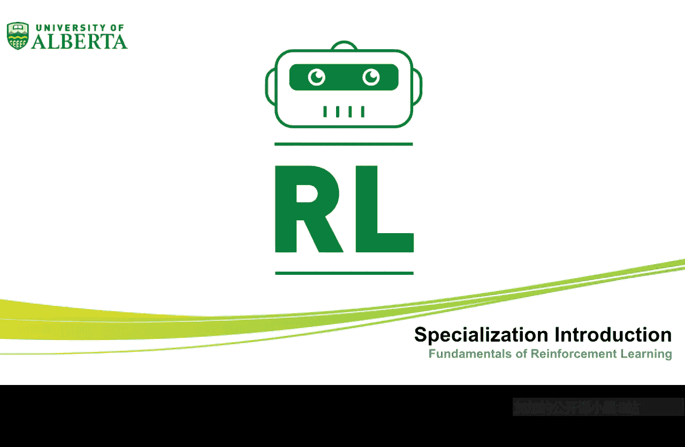
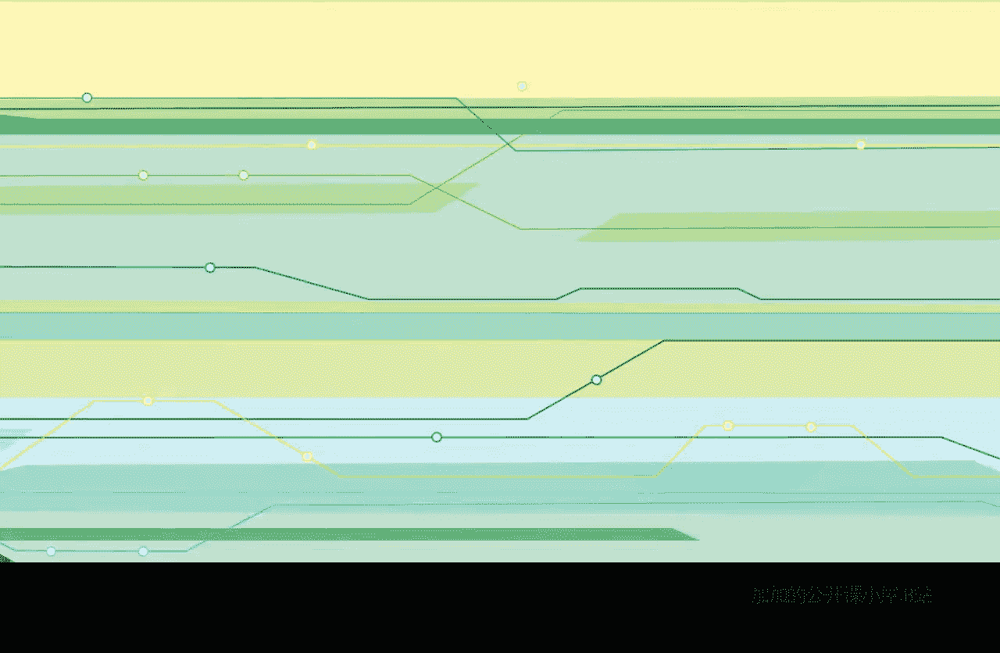

# 阿尔伯塔大学【中英⚡强化学习｜Reinforcement Learning Specialization】 p01 P1 01_专业介绍 -BV1CdGrzuEJU_p1-

Hey Adam， what are you doing The team has been working a lot of late nights testing our new algorithm researchers。

 as you know， are fueled by pop and pizza。And well， the lab's starting to look like a scrapyard。

So are you going to ban food in the lab， No， you monster。

I was thinking of programming a robot to drive around the lab and collect empty cans。

 That sounds cool。 How would it work。 Well， I think we need a vision system to recognize cans。

 obstacles and people。The robot will also need to build a map and localize itself in the lab。

Then we need to write some surveyvoing routines too I'm going to have to stop you right there I think there might be an easier way to do this Let's solve it with reinforcement learning。

All right， Rl。How would you do it， Martha Well the reward could be the number of cans a robot collects。

 the agent could simply learn how to collect as many cans as possible through trial and error In principle。

 it wouldn't even need a map of the lab， they could learn everything from scratch。

