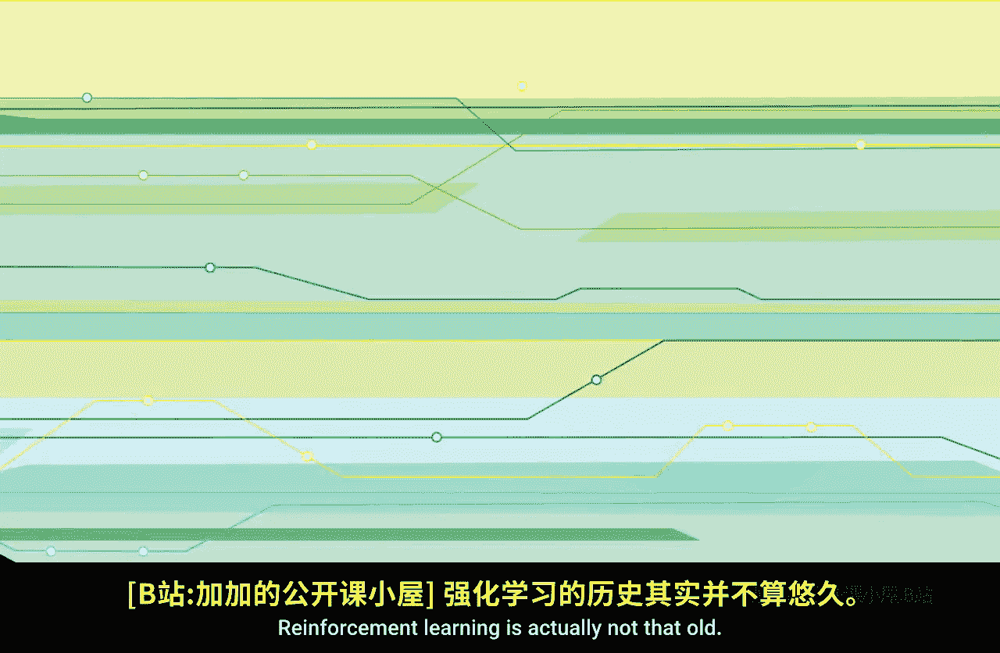
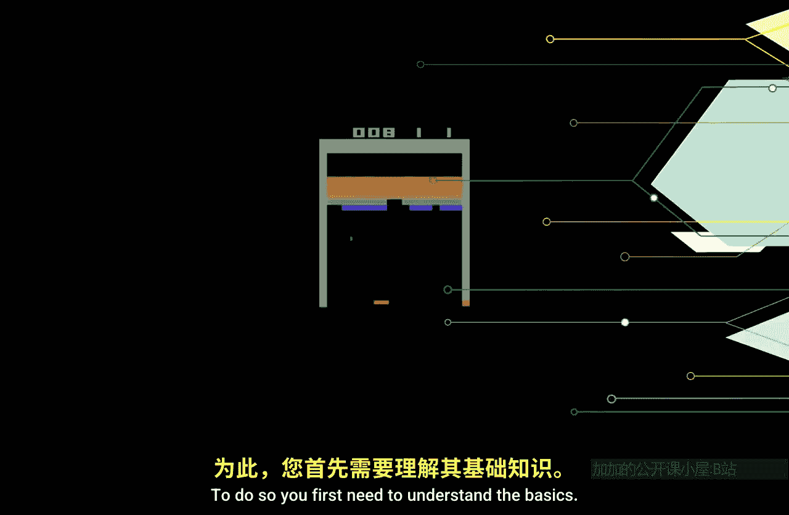

# 阿尔伯塔大学【中英⚡强化学习｜Reinforcement Learning Specialization】 p02 P2 02_课程介绍 -BV1CdGrzuEJU_p2-

Reinforcement learning is actually not that old When I started back in the mid 2000s。

 it was a lot different than it is now。There were only a handful of labs around the world that focused on reinforcement learning。

Almost nobody was using Ar and industry， and the practical successes of Ar were limited to a handful of applications。

 Reinforce learning could fly a helicopter upside down better than any human could。

 OurL methods could beat the world's best back amm players and schedule elevators pretty well。

But Rl was not the best way to get robots to do useful things。

 And the idea that a cu learning agent could play video games better than people was almost unimaginable。

Yet we held out hope， hope because we thought reinforced learning was the best way to make progress towards AI。

The promise of Ar is almost intoxicating， that a learning agent can figure out how the world works by simply trying things and seeing what happens。

After all， that's what we think people and animals do。 So why not simulate that on a computer？

If we could do it。Then would be useful in almost any application， and as a nice side effect。

 we might learn a good deal about how our own minds work， too。

You might wonder what's the difference between supervised learning， unsupervised learning。

 and reinforcement learning？The differences are quite simple。In supervised learning。

 we assume the learner has access to labeled examples， giving the correct answer。In RL。

 the reward gives the agent some idea of how good or bad its recent actions were。

You can think of supervised learning as requiring a teacher that helps you by telling you the correct answer。

 a reward on the other hand， is like having someone who can identify what good behavior looks like。

 but can't tell you exactly how to do it。Unsupervised learning sounds like it could be related。

 but really has a very different goal unsupervised learning is about extracting underlying structure in data。

 it's about the data representation。It can be used to construct representations that make a supervised or RL system better。

 in fact， as you'll see later in this course， techniques from both supervised learning and unsupervised learning can be used within RL to aid generalization。

In our， we focus on the problem of learning while interacting with an ever changing world。

 We don't expect our agents to simply compute a good behavior and then execute that behavior in an open loop fashion。

We expect our agents to get things wrong to refine their understanding as they go。

The world is not a static place， we get injured， the weather changes。

 and we encounter new situations， and our goals change。

An agent that immediately integrates its most recent experience should do well。

 especially compared with ones that attempt to perfectly memorize how the world works。

The idea of learning online is extremely powerful and is a defining feature of RL。

The way we introduce concepts is dictated by this fact， For example。

 we introduce the ideas of bandits and exploration first and get to ideas from supervised learning later。

 This might feel backwards for you if you have a background in machine learning。

 but as you'll see the hard part is learning online rather than just learning from data。

Getting comfortable with the online setting requires a new perspective。Today。

 the field of reinforced learning feels like it's changing at a breakneck pace。

 There are almost weekly posts about new algorithmic developments and improvements in state of the art performance in benchmark domains。

😊，Search companies， online retailers and hardware manufacturers are exploring ourL solutions for their day to day operations。

 They are convinced that online learning will make them more efficient。

 save the money and keep humans out of dangerous situations。

I would never have guessed that there would be companies dedicated to the study and application of reinforced learning。

 It's really quite amazing。😊，However， the more quickly things change。

 the more important it is to focus on the fundamentals。

 some of the ideas in RL can be traced as far back as Pavlov and his drooling dogs。

🎼Take almost any modern RL system and take a closer look。

 It's built from ideas and algorithms that predate this specialization by a decade or two。

For example， at its heart， DQN combines Q learning， neural networks， and experience replay。

Getting good performance out of these systems， however， required significant innovation。

 We would never downplay the importance of that work。 In fact。

 we want you to come to understand these complex and large learning systems。To do so。

 you first need to understand the basics。

And that's where this course starts with the fundamentals in this specialization we will cover most of the main ideas used in modern RL systems and by the end you will implement a neural network learning system to solve an infinite state control task。

But we will start with small problems， we'll spend time discussing the fundamental challenges in reinforced learning and our best ideas for solving them。

The problem of sequential decision making represents one of the greatest prizes of our generation。

 it seems appropriate to take our time and get the details right。

We begin our study with a special case of the reinforcement learning problem called multiar bandandits。

The agent must decide which choice generates the best outcome or reward on average。

 This simpler instance of the full R L problem is perhaps the best setting to understand and solve challenges fundamental to R L。

This module provides an introduction to estimating values， incremental learning， exploration。

 nonstationity and parameter tuning we continue to develop and combine these ideas in different ways over the next four courses let's get started。

