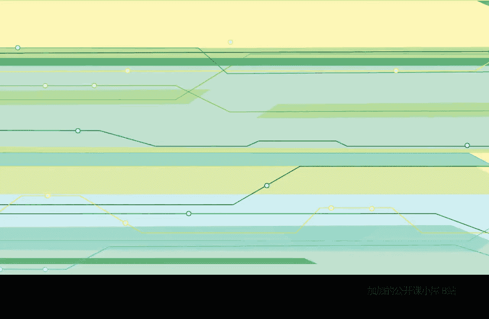
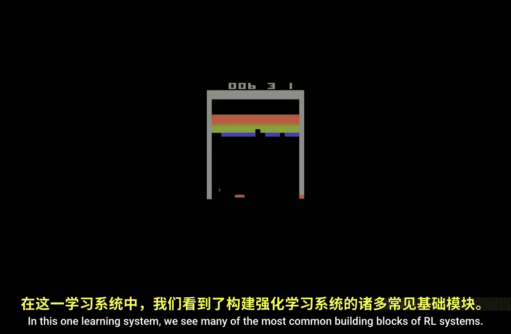

# 阿尔伯塔大学【中英⚡强化学习｜Reinforcement Learning Specialization】 p04 P4 04_你的专业学习路线图 -BV1CdGrzuEJU_p4-

Reinforcement learning is a hot topic， it seems like every week I hear about a new algorithm or new application of reinforcement learning On the other hand。

 the fundamentals of RL are much the same state of the art learning systems are often constructed from a few well-known ideas which are actually not that complicated Take DQN for example。

 this learning system combines Q learning， epsilon greedy action selection。

 neural network function approximation and a few other ideas to achieve superhuman scores and Atari games。

In this one learning system， we see many of the most common building blocks of RL systems。

This course will closely follow Sutton and Barto's new edition of reinforceinforment Learn and Induction。

The first edition trained two generations of Ral researchers， including Martha and myself。

The RL book and this specialization adhere to a simple principle。

 introduce each idea in the simplest setting it arises In this spirit we begin our study with multi arm bandit problems。

Here we get our first taste of the complexities of incremental learning。

 exploration and exploitation。After that， we move on to markup decision processes to broaden the class of problems we can solve with reinforcement learning methods here we will learn about balancing short term and long- termm reward We will introduce key ideas like policies and value functions used in almost all RL systems We conclude Cose1 with classic planning methods called dynamic programming。

These methods have been used in large industrial control problems and can compute optimal policies given a complete model of the world。

In course2， we build on these ideas and design algorithms for learning without a model of the world。

 we study three classes of methods designed for learning from trial and error interaction。

We start with Monte Carlo methods and then move on to temporal difference learning。

 including Q learning。 We conclude course2 with an investigation of methods for planning with learned models。

In course three， we leave the relative comfort of small finite MDPs and investigate RL with function approximation。

Here we will see that the main concepts from courses1 and two transfer to problems with large or infinite state spaces。

We will cover feature construction， neural network learning， policy gradient methods。

 and other particularities of the function approximation setting。

You'll notice that the specialization starts off with basic material， but by the end of course3。

 you'll see how much we build on simple concepts introduced early on you'll finish course three and wonder how it is you learn so much when it all seemed pretty simple at the time。

The final course in the specialization brings everything together in a capstone project。

 throughoutout this specialization， As in Rich and Andy's book。

 we stress a rigorous and scientific approach to R L。

 We conduct numerous experiments designed to carefully compare algorithms。

 It takes careful planning and a lot of hard work to produce a meaningful， empirical result。😊。

In the capstone， we will walk you through each step of this process so that you can conduct your own scientific experiment。

Well explore all the stages from problem specification all the way to publication quality plots。

 This is not just academic， and real problems It is important to verify and understand your system。

After that， you should be ready to test your own new ideas or tackle a new exciting application of RL in your job。

We hope you enjoy the show half as much as we enjoyed making it for you。

