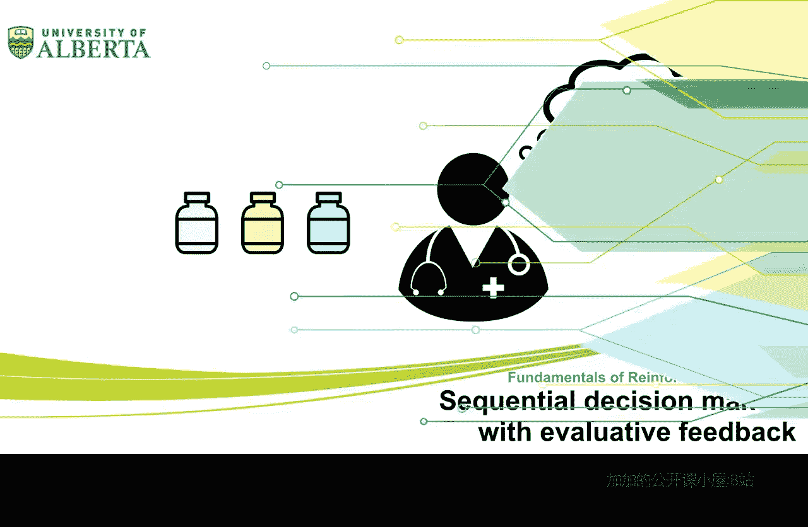
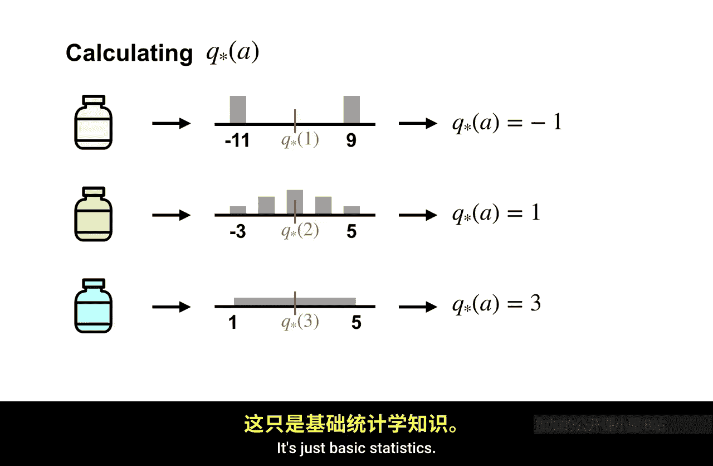

# 阿尔伯塔大学【中英⚡强化学习｜Reinforcement Learning Specialization】 p05 P5 03_基于评估反馈的序贯决策 -BV1CdGrzuEJU_p5-

In reinforcement learning， the agent generates its own training data by interacting with the world。

The agent must learn the consequences of its own actions through trial and error。

 rather than being told the correct action。In this first module。

 we will study this evaluative aspect of reinforcement learning。

We will focus on the problem of decision making in a simplified setting called Bits。In this video。

 we will formalize the problem of decision making under uncertainty using KR bandits。

And we will use this band problem to describe fundamental concepts in reinforcement learning。

 such as rewards， time stepss， and values。Imagine a medical trial where a doctor wants to measure the effect of three different treatments。

Whenever a patient comes into the office， the doctor prescribes a treatment at random。

The doctor then monitors the patient and observes any changes to their health。After a while。

 the doctor notices that one treatment seems to be working better than the others。

The doctor must now decide between sticking with the best performing treatment。

Or continuing with the randomized study。If the doctor only prescribes one treatment。

 then they can no longer collect data on the other two。

Perhaps one of the other treatments is actually better。It only appears worse due to chance。

If the other two treatments are worse， then continuing the study risks the health of the other patients。

This medical trial exemplifies decision making under uncertainty。

The medical trial example is a case of the K arm banded problem。In the KR bandit problem。

 we have a decision maker or agent。Who chooses between K different actions？

And receives a reward based on the action it chooses。In the medical trial。

 the role of the agent is played by our doctor。The doctor has to choose between three different actions。

To prescribe the blue， red or yellow treatment。Each treatment is an action。

Choosing that treatment yields some unknown reward。And finally。

 the welfare of the patient after the treatment is the reward that the doctor receives。

For the doctor to decide which action is best， we must define the value of taking each action。

We call these values the action values or the action value function。

We can make this definition more precise through the language of probability。

We define the value of selecting an action as the expected a reward we receive when taking that action。

 By the way， if you haven't seen the dot equal symbol， it simply means is defined as。

So we can read this as Q star of A。Is defined as the expectation of R T。

 given we selected action A for each possible action。1 through K。

This conditional expectation is defined as a sum over all possible rewards。Inside the sum。

 we have multiplied the possible reward by the probability of observing that reward。

This could be extended to the continuous rewardwork case by switching the summation to an integral。

The goal of the agent is to maximize the expected reward。

If the agent selects the action that has the highest value， it achieves that goal。

We call this procedure the AGm or the argument which maximizes our function Q star。

To understand Qstar better， let's go back to our medical trial example。Previously。

 we said rewards could be the patient's welfare after receiving treatment。But for this example。

 let's use something which is easier to measure。Perhaps the change in blood pressure after receiving the treatment。

Each treatment may yield rewards following different probability distributions。

Perhaps one is Bernoulli， one is binomial， and one is uniform。

Q star is the mean of the distributions for each action。

You can easily calculate the expected value of the reulli distribution。

Simply multiply the probability of failure by the reward when failed。Plus。

 the probability of success times of reward when succeeded。It's just basic statistics。

There are many examples of making decisions under uncertainty。For instance。

 the medical trial example that we have already discussed。

Other examples include content recommendations like what movie to watch or what song to listen to。

Even ordering food at a restaurant， you can't be certain what you will like。

 but you make the best choice you can。Why are we considering the bandit problem first？

Because it is best to consider issues and algorithm design choices in the simplest settings where they arise。

For instance， maximizing reward and estimating values are important subprobles in both bandits and reinforce learning。

In this video we introduce you to the Bit problem。We showed how decision making under uncertainty can be formalized by the KR bandit problem。

In bandits， we already see the fundamental ideas behind reinforced learning。Actions， rewards。

 and the value function。