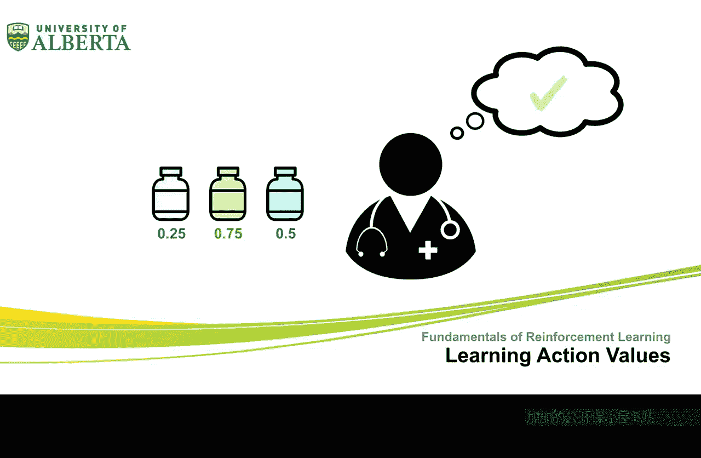
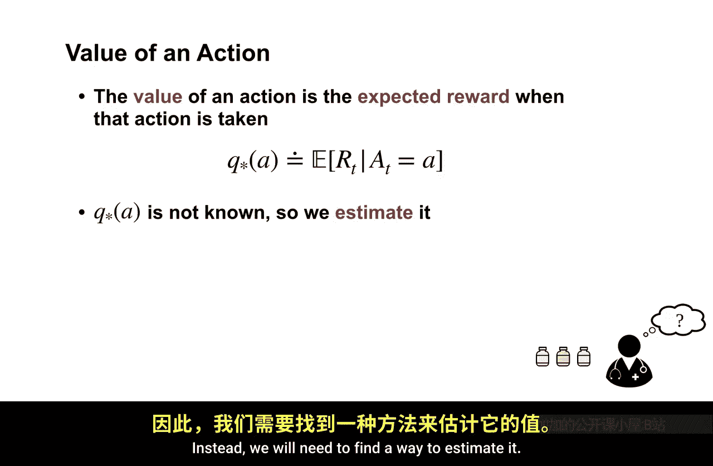
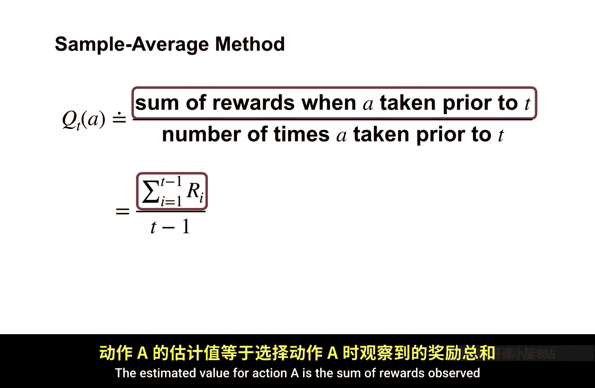
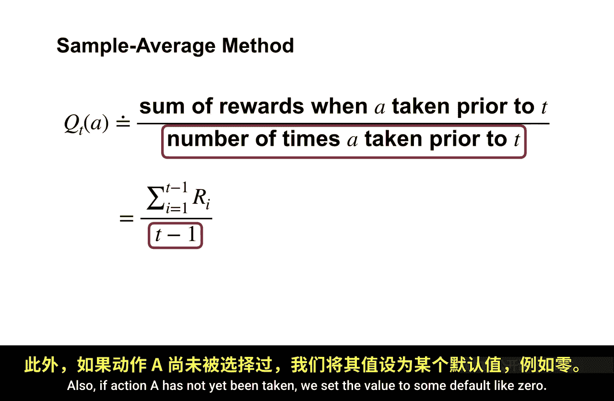
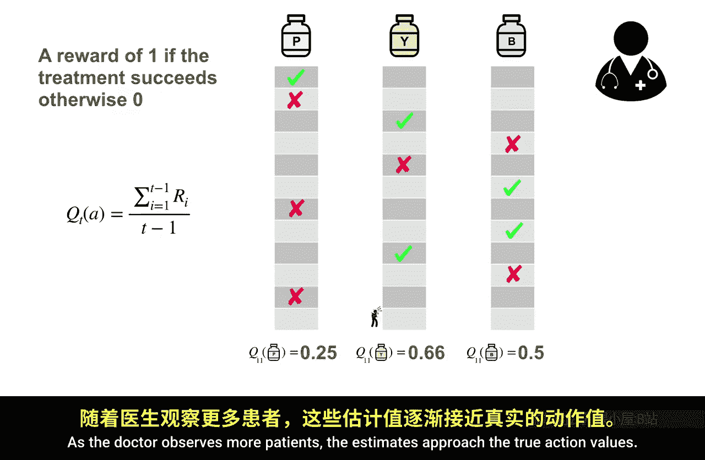

# 阿尔伯塔大学【中英⚡强化学习｜Reinforcement Learning Specialization】 p06 P6 01_学习动作价值 -BV1CdGrzuEJU_p6-

Remember our doctor running the medical trial？What would happen if this doctor already knew the long term outcome of each treatment？

Choosing the appropriate treatment would be trivial。Unfortunately， this is often not the case。

 usually the doctor will run many trials to learn about each treatment each day the doctor could use all the previously collected data to estimate which treatment they believed to be the best。

Let's learn how that might work。Today we will discuss a method for estimating the action values called the sample average method。

We will use this method to compute the value of each treatment in our medical trial example。

Then we will describe greedy action selection， and finally。

 we will introduce the Expation Expation dilemma in reinforcement learning。Before we get started。

 let's recall the definition of an action value。The value of selecting an action Q star is the expected reward received after that action has been taken。

Qstar is not known to the agent， just like the doctor doesn't know the effectiveness of each treatment。

Instead， we will need to find a way to estimate it。

One way to estimate Q star is to compute a sample average。

 we simply record the total reward for each action and divide it by the number of times that action has been selected。

To understand the sample average estimate intuitively， let's look at one action， action A。

The estimated value for action A is the sum of rewards observed when taking action A。

Divided by the total number of times action A has been taken。

We use T minus1 because the value at time T is based on actions taken prior to time T。Also。

 if action A has not yet been taken， we set the value to some default like zero。

Let's go back to our medical trial example， our doctor must decide which of the three possible treatments to prescribe。

If the patient gets better， the doctor records a reward of one。Otherwise。

 the doctor records a reward of zero。

Let's say we know Kousstar， but our doctor does not。

The doctor gives the first patient treatment P on time step1。And the patient reports feeling better。

The doctor records a reward of one for that treatment and updates the estimate of the value。

So far there is only one data point， so the estimated value for treatment P is1。

A second patient arrives。The doctor randomly prescribes treatment P again。It fails。

The doctor records a reward of zero and updates the value estimate for treatment P to 0。5。

The estimated value for the other actions remains zero since we define the initial estimates to be zero。

Let's fast forward time a little bit。After each treatment has been tried a few times。

 we can calculate the estimated values from the observed data。As the doctor observes more patients。

 the estimates approach the true action values。

In reality， our doctor would not randomly assign treatments to their patients。

 instead they would probably assign the treatment that they currently think is the best。

We call this method of choosing actions greedy。 The greedy action is the action that currently has the largest estimated value。

Selecting the greedy action means the agent is exploiting its current knowledge。

It is trying to get the most reward it can right now。

We can compute the greedy action by taking the argmax of our estimated values。Alternatively。

 the agent may choose to explore by choosing a non greedy action。

The agent would sacrifice immediate reward， hoping to gain more information about the other actions。

The agent cannot choose to both explore and exploit at the same time。

This is one of the fundamental problems in reinforced learning， the exploration exploitation dilemma。

We will discuss this more in an upcoming video。That's it In this video。

 we introduced the sample average method for estimating action values and we define the greedy action as the action with the largest value estimate。

 See you next time。