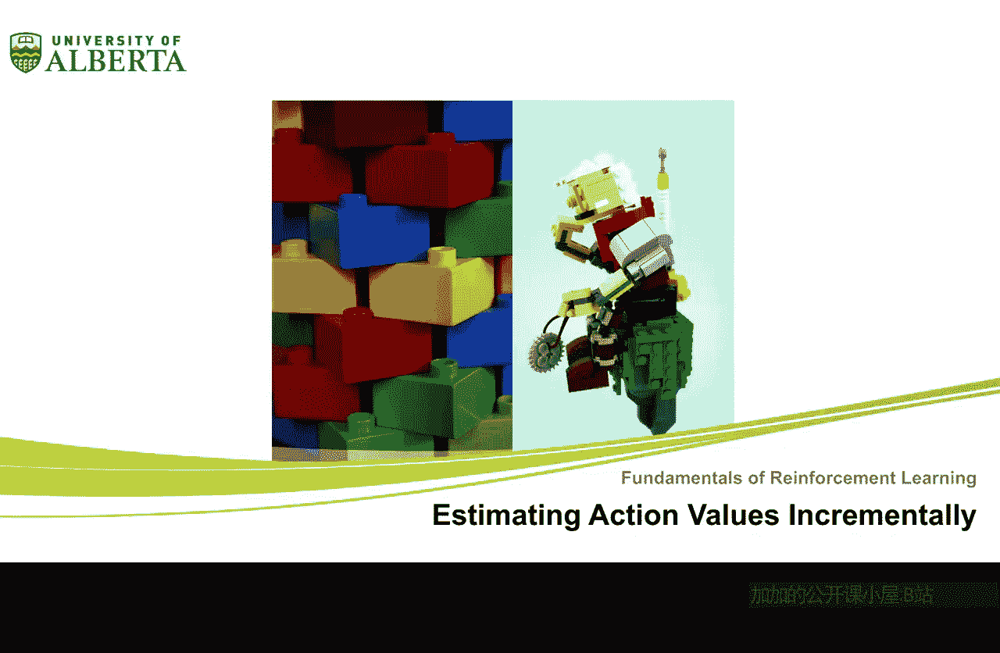
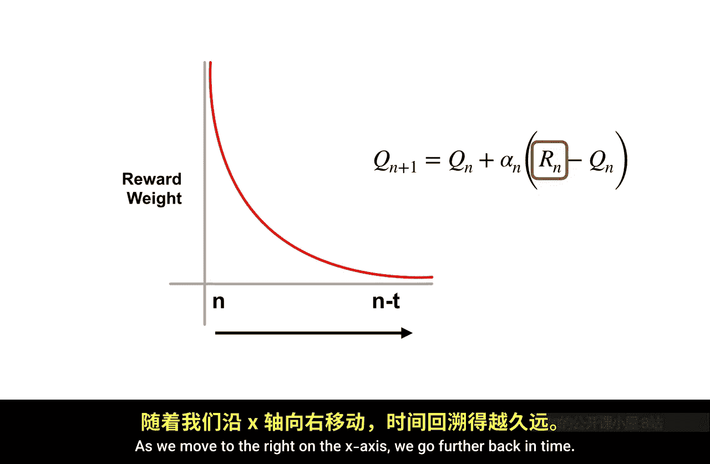

# 阿尔伯塔大学【中英⚡强化学习｜Reinforcement Learning Specialization】 p07 P7 02_增量式估计动作价值 -BV1CdGrzuEJU_p7-

Imagine you maintained a website that received millions of hits a day。

You can frame this as a KR band problem。The estimated values correspond to the total amount of money generated by each ad。

And your goal is to display the ad， which will generate the most money。

How can you keep your value estimates up to date without storing the data for millions of clicks？

By the end of this video， youll be able to describe how action values can be estimated incrementally。

Identify how the incremental update rule is an instance of a more general learning rule。

And describe how the general learning rule can be used in non stationary problems。

The sample average method can be written in a recursive manner。By doing so。

 we can avoid storing all the previous data。Let's see how that works。To do so。

 we are going to pull the current reward out of the sum。

Now the sum only goes until the previous reward。We write our next value estimate in terms of our previous value estimate To do so。

 we multiply and divide the current sum by n minus1。By multiplying and dividing by the same thing。

 we are effectively multiplying by one。The circle term should look familiar to you。

This is just our definition of QN， the current value estimate。

We can simplify this equation a little further。We distribute QN to get this form。Finally。

 we pull NQN out of the sum and multiply by one overed。

Now we have an incremental update rule for estimating values。

This equation is of a form that will show up many times throughout the course。

Let's define some of these terms。The error in the estimate is the difference between the old estimate and the new target。

Taking a step towards that new target will create a new estimate that reduces our error。Here。

 the new reward is our target。The size of the step is determined by our step size parameter and the error of our old estimate。

We now have a general rule for updating the estimate incrementally。

The step size can be a function of n that produces a number from 0 to 1。

In the specific case of the sample average， the step size is equal to1 over n。

Let's go back to our friendly doctor。What if one of the treatments was more effective under certain conditions？

Specifically， let's say the treatment B is more effective during the winter months。

This is an example of a non stationary bandit problem。

These problems are like the banner problems we've discussed before。

 except the distribution of rewards changes with time。The doctor is unaware of this change。

 but would like to adapt to it。One option is to use a fixed step size。If alpha n is constant like 0。

1， then the most recent rewards affect the estimate more than older rewards。

This graph shows the amount of weight the most recent reward receives versus the reward received T time steps go。

The waiting fades exponentially with time。As we move to the right on the X axis。

 we go further back in time。

To see why this is true， let's take a look again at the incremental update equation。

Like's first distribute alpha and rearrange。We can write the next value as a weighted sum of the reward and the last value。

Notice the recursive form。We can substitute the definition of QN into this equation， and we get this。

Then we can distribute1 minus alpha。And we get an equation that shows the relationship between Rn and Rn minus1。

We can unroll this recursive relationship further。We continually replace Q with its definition until we get all the way back to the initial value Q1。

Finally， let's clean up this long equation。We write it as our initial value of Q plus a weighted sum of the rewards over time。

What does this equation tell us？It relates our current estimate of the value。

 QN plus1 to Q1 and all the observed reward。The first term tells us that the contribution of Q1 decreases exponentially with time。

The second term tells us the rewards further back in time contribute exponentially less to the sum。

Taken all， we see that the influence of our initialization of Q goes to zero with more and more data。

The most recent rewards contribute most to our current estimate。In this video。

 we derived an incremental update for the sample average method。

We generalize the incremental update rule into a form that will be revisited throughout the course。

 and finally we discussed how a constant step size might help solve nonstationary bandit problems。

