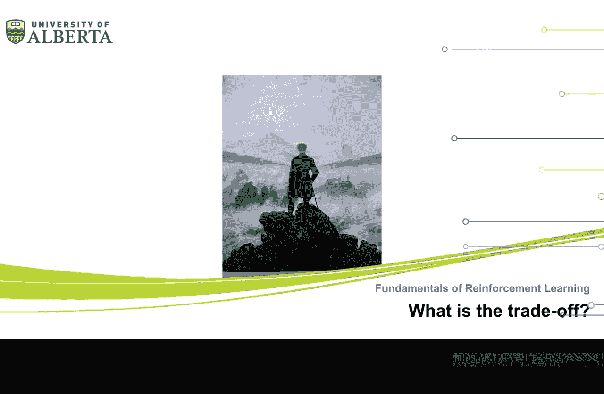
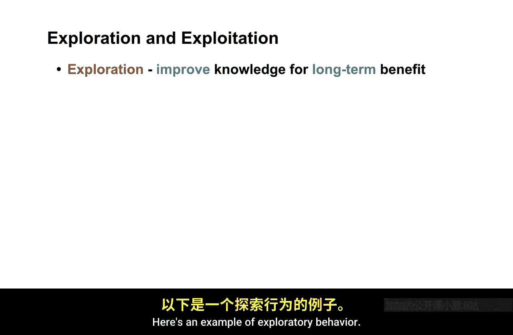
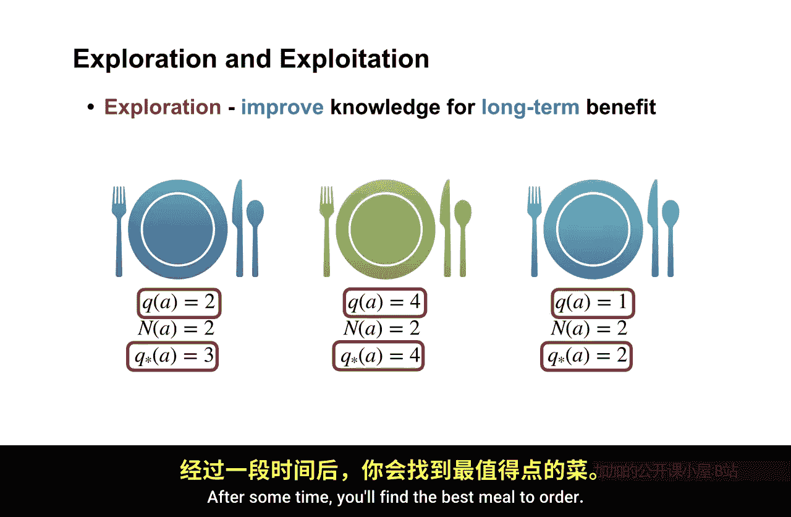
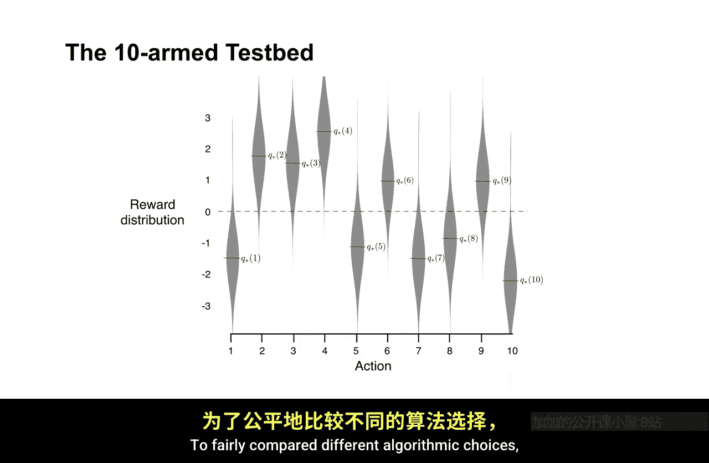
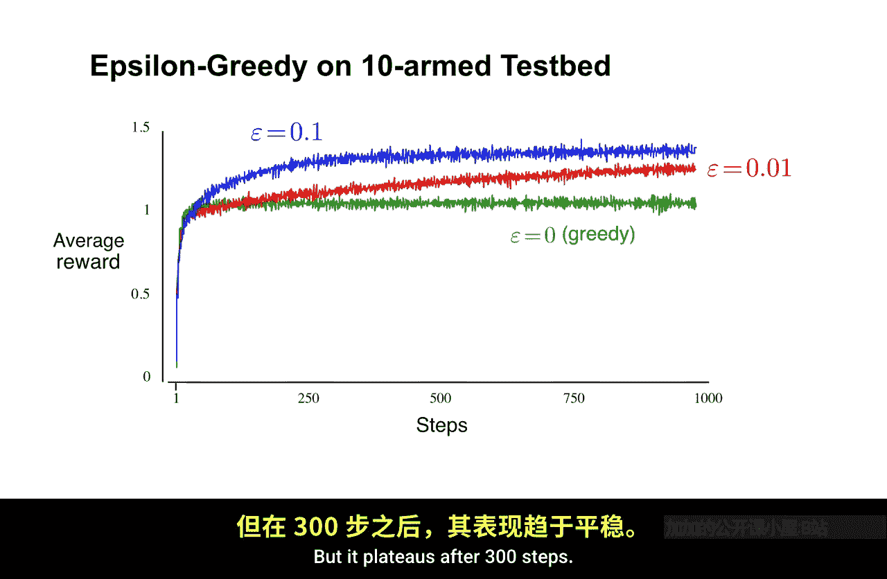

# 阿尔伯塔大学【中英⚡强化学习｜Reinforcement Learning Specialization】 p08 P8 01_权衡取舍是什么 -BV1CdGrzuEJU_p8-

Imagine that you're going out to eat with your friends tonight。When you get to the restaurant。

 you will have to decide what to order。You've been there a few times before and you always order the same thing。

 so you know that you will be quite happy if you order it again。Many of the other items， though。

 look really tasty。How do you decide when to order the same good meal again or try something new？

By the end of this video， you will be able to define the exploration exploitation tradeoff。

 and you will be able to define Epsilon greedy， which is a simple method to balance exploration and exploitation。

Before discussing the trade off， let's first talk about when we would want to explore and when we would want to exploit。

Exploration allows the agent to improve its knowledge about each action。

 hopefully leading to long term benefit。By improving the accuracy of the estimated action values。

 the agent can make more informed decisions in the future。Here's an example of exploratory behavior。

Let's say each of these plates represents a meal at your favorite restaurant。

 and you're trying to choose which meal to order。Q of A is the estimated value for picking that meal。

N of A is a number of times you have picked that meal。Q star of a is the value of each meal。

Each time you visit this restaurant， you follow a strict regimen and choose each meal in a round robin fashion。

Perhaps a meal is sometimes cooked particularly well， so you are highly rewarded for ordering it。

After some time you'll find the best meal to order。

Exploitation， on the other hand， exploits the agent's current estimated values；

 it chooses the greedy action to try to get the most reward。

But by being greedy with respect to estimated values， may not actually get the most reward。

Let's look at how pure greedy action selection could lead to suboptimal behavior。

Imagine the agents likes the first meal。The agent received a positive reward。

 making the value for that meal higher。The estimate of values for the other actions are zero。

So the greedy action is always the same to pick the first meal。

This means the agent never saw any samples for the other meals。

 The estimated values for the other two actions remain far from the true values。

Which means the agent never discovered the best action。

This naturally introduces the Exp Expation dilemma。

 how do we choose when to explore and when to exploit？When we explore。

 we get more accurate estimates of our values， When we exploit， we might get more reward， we cannot。

 however， choose to do both simultaneously。One very simple method for choosing between exploration and exploitation is to choose randomly。

We could choose to exploit most of the time with a small chance of exploring。For instance。

 we could roll a dice if it lands on one， then we'll explore。 Otherwise。

 we'll choose the greedy action。We call this method epsilon greedy。

 or epsilon refers to the probability of choosing to explore。In this case。

 epsilon would be equal to1 over6。We can write Epsilon greededy in the following way。

The action that we select on time step T。Is the greedy action with probability 1 minus epsilon？

Or is a random action with probability epsilon？We can demonstrate the effectiveness of Epsilon greedy action selection on the 10 arm test bed from the textbook。

The 10 arm band problem has 10 actions here shown along the x axis。On the Y axis。

 we'll show the distribution of rewards。Each reward is sampled from a normal distribution with some mean Q star of a and variance 1。

Each Q star of A is drawn from a normal distribution with mean0 and variance 1。

Each time we run the 10 arm test bed， Q star will be redrawn from a normal distribution。

 Notice how much randomness is involved in this experiment。

 Q star is randomly sampled from a normal distribution。

The rewards are randomly sampled based on Q star， and the actions are randomly taken on exploration steps。

To fairly compare different algorithmic choices， we will need to perform many independent runs。

Let's take a look at a single run of an epsilon greedy agent in the 10 Ar test bed。For this agent。

 we set epsilon equal to 0。1。The time step is on the X axis。

The Y axis is the reward received on that time step。

Notice how noisy this curve is with several sharp peaks。

We sort of see a slight upward trend in the center of these peaks， but with this amount of noise。

 it is hard to make any conclusions。If we run another agent with a different random seed。

 we get another noisy curve。And a third run。For every time step。

 we can take the average of each of these three rewards we've seen on that time step。

This will produce a single line that represents the average reward received for each of these three runs。

For example， here's what happens when we take 20 such runs and average the reward。

Notice that the spikes in the curve are much less pronounced。

If we take 100 runs and average them together， we see a much more clear shape to the curve。

There's a noticeable increase in reward in the first 200 steps。And doing this with 2，000 runs。

 we get a clear picture of the performance of this method。

What this result says is that this way of behaving obtains this much reward in expectation across possible stochastic outcomes。

Throughout the specialization， we used the average performance over many independent runs to make scientific comparisons。

Without using summary statistics like the average， it would be difficult to make fair comparisons between algorithms。

In this example， the random seed is the only difference between runs of this epsilon greedy agent。

 and yet the performance looks quite different。Okay。

 let's go back to the experiment on the 10 arm test bed。

We are going to compare epsilon greedy agents with different epsilons。

Let's start by investigating the average reward obtained by each algorithm。

The time step is shown on the X axis， the average reward over 2，000 runs is on the Y axis。

Here is the performance of epsilon equal to0。When Epsilon is zero。

 the agent performs no exploration steps， only greedy steps。

Here's the performance of Epsilon equals 0。01。Notice that the average reward keeps improving over time。

 This method explores 1% of the time and eventually converges to taking the optimal action99。

1% of the time。The agent with epsilon equal to 0。1 obtains more reward earlier on average than the other methods。

 but it plateaus after 300 steps。

🎼In this lecture， we discussed the trade off between exploration and exploitation。

We also discussed Epsilon greedy， which is a simple method for balancing exploration and exploitation。

Later， we will discuss more sophisticated methods for choosing between exploration and exploitation。

