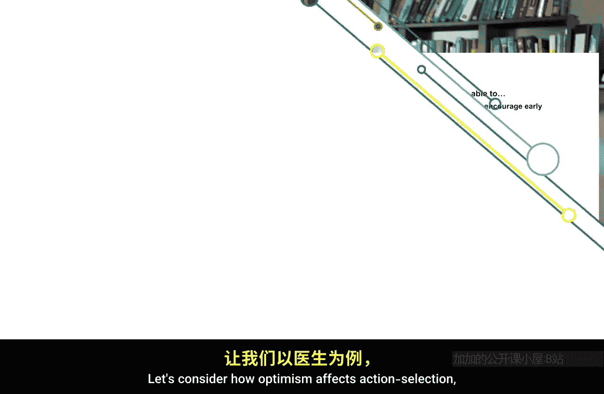
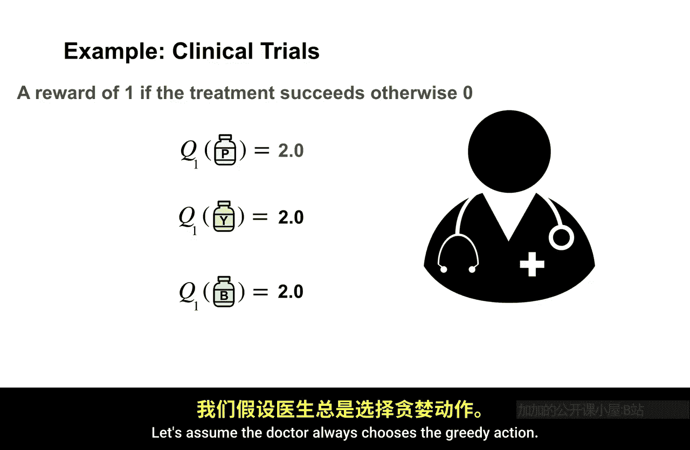
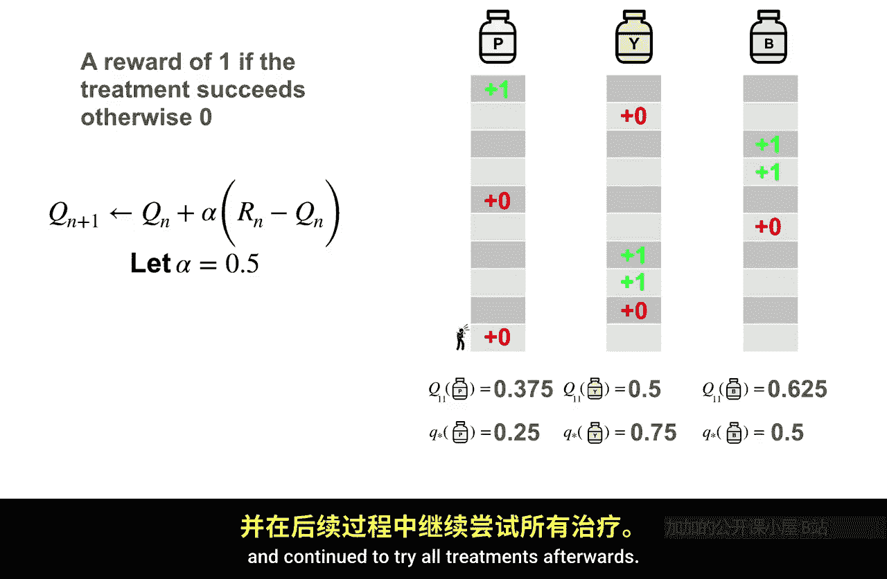
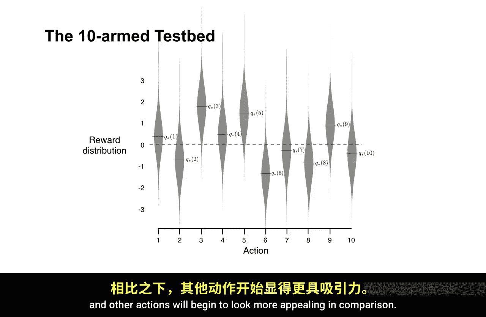
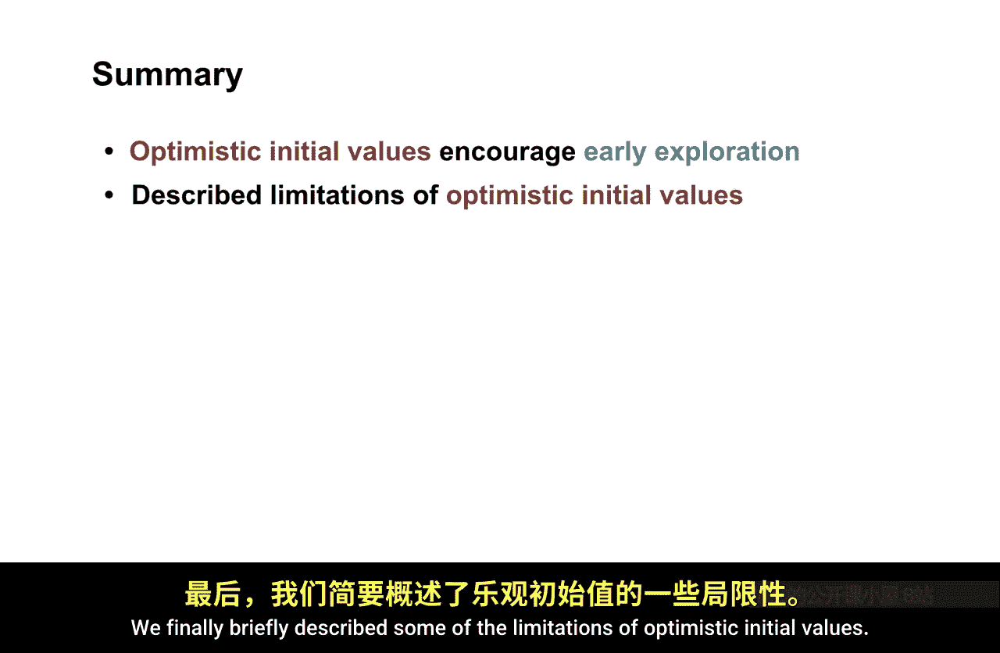

# 阿尔伯塔大学【中英⚡强化学习｜Reinforcement Learning Specialization】 p09 P9 02_乐观初始值 -BV1CdGrzuEJU_p9-

What if our doctor performing medical trials was initially very optimistic about the outcome of each treatment？

This principle of being optimistic in the face of uncertainty is a common strategy for balancing exploration and exploitation。

Today we'll discuss how to implement this idea using optimistic initial values。

By the end of this video， you will understand how optimistic initial values encourage early exploration。

And be able to describe some of the limitations of optimistic initial values as an exploration mechanism。

Let's consider how optimism affects action selection， using our doctor again as an example。

Perhaps the doctor starts with the assumption that each treatment is 100% effective until shown otherwise。

Our doctor would begin prescribing treatments at random until one of the treatments fails to cure a patient。

 The doctor might then choose from the other two treatments at random。 Again。

 the doctor would continue until one of these treatments fails to work。

The doctor will continue this way， always assuming that treatments are maximally effective until shown that the estimated values need to be corrected。

Let's see how this works with explicit values。Previously。

 the initial estimated values were assumed to be zero， which is not necessarily optimistic。Now。

 our doctor optimistically assumes that each treatment is highly affected before running the trial。

To make sure we are definitely overestimating， let's make the initial value for each action too。

Let's assume the doctor always chooses the greedy action。

Recall the incremental update rule for the action values shown to the left。

Let's take the alpha equal to 0。5 for this demonstration。The first patient comes in。

Because the values are all equal right now， the doctor chooses a treatment randomly。

The doctor prescribes treatment P。And the patient reports feeling better。

Notice that the estimated value for treatment P decreased from 2 to 1。5。

 even though the treatment was a success， this is because the reward was one。

 which is less than our initial optimistic estimate of the value。The next patient arrives。

 the doctor chooses amongst the treatments with the highest estimated value。

 treatment Y or treatment B。The doctor randomly chooses to prescribe treatment Y。

The patient reports that they do not feel better， giving a reward of zero。

And the doctor lowers their estimated value for treatment Y。The estimated value decreased to1。

 lower than the current estimated value for treatment P。 a third patient comes into the clinic。

Treatment B has the highest estimated value， and so the doctor prescribes treatment B。

The patient reports feeling better， so the estimated value only decreases to 1。5。

Patients keep coming in and the doctor continually provides treatments and refines the value estimates。

From this example， we can see that using optimistic initial values encourages exploration early in learning。

 the doctor tried all three of the treatments in the first three time steps and continued to try all treatments afterwards。

Let's look at another example， this time the10 Ar bandit problem from the textbook。

The values for each action are sampled from a normal distribution For this problem。

 an initial estimated value of 5 is likely to be optimistic。 In this plot。

 all the values are less than 3。Whenever the agent selects an action。

 the first time that action is selected， the Ob reward will likely be smaller than the optimistic initial estimate。

The estimated value for this action will decrease and other actions will begin to look more appealing in comparison。

Let's run an experiment to see how an agent behaves with optimistic initial values。As a baseline。

 we can run an epsilon greedy agent with epsilon equals 0。1， an initial value estimates set to0。

 which are not optimistic。We also run a greedy agent with optimistic initial values。

We plot the percentage of time that the agent chooses the optimal action， averaged overruns。

In early learning， the optimistic agent performs worse because it explores more。

Its exploration decreases with time because the optimism in its estimates washes out with more samples。

Using optimistic initial values is not necessarily the optimal solution for balancing exploration and exploitation。

One limitation is that optimistic initial values only drive exploration early in learning。

This means the age will not continue exploring after some time。

This leads to issues in nons stationationary problems。 For example。

 one of the action values may change after some number of time steps。

 An optimistic agent may have already settled on a particular action and will not notice that a different action is better now。

Another potential limitation is that we may not always know how to set the optimistic initial values。

 because in practice we may not know the maximal reward。Regardless of some of these limitations。

 optimistic initial values has proven to be a very useful heuristic。

 We will continue using this approach， often in combination with other exploration approaches throughout the rest of this course。

😊，In this video， we discussed the effects of our initial value function estimates we described how optimistic initial values encourage early expiration and we demonstrated this through a couple of examples We finally briefly described some of the limitations of optimistic initial values。

See you next time we will talk about another strategy to balance exploration and exploitation。

