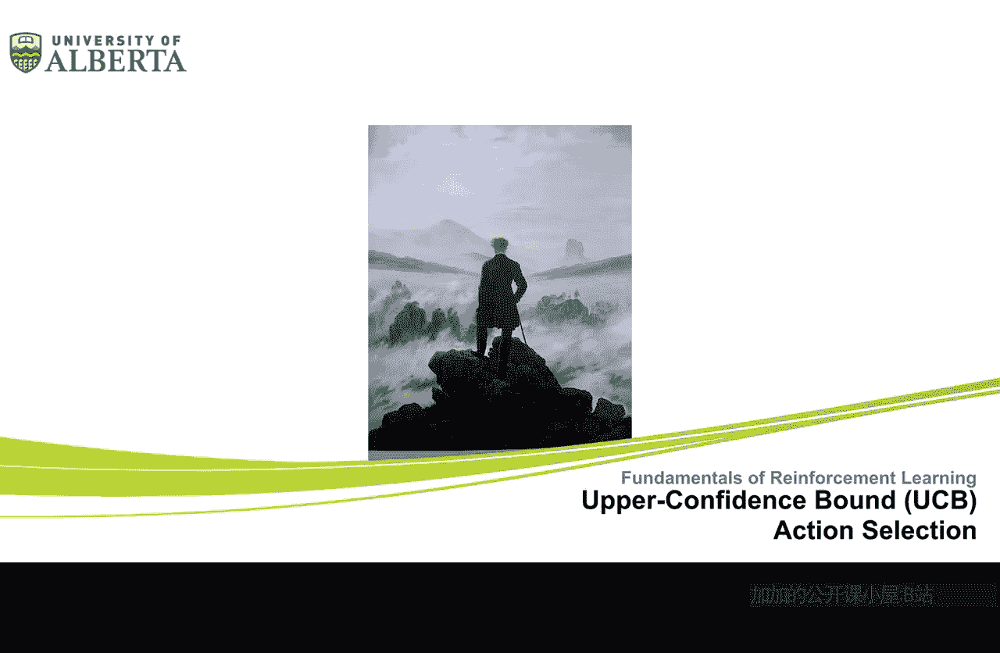
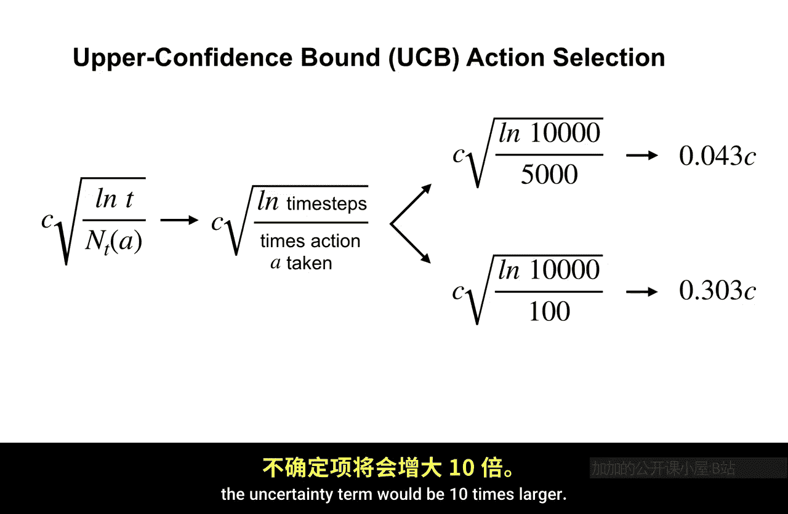
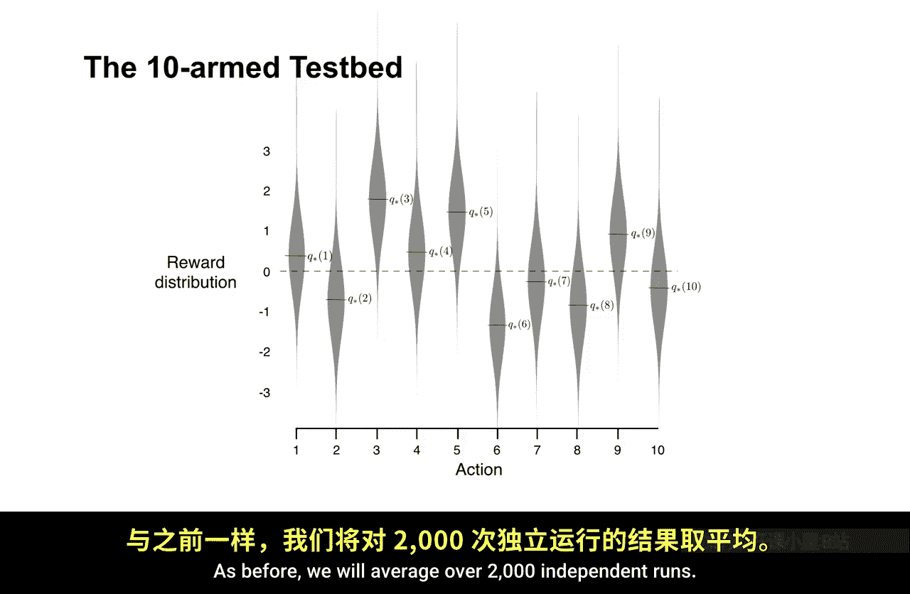
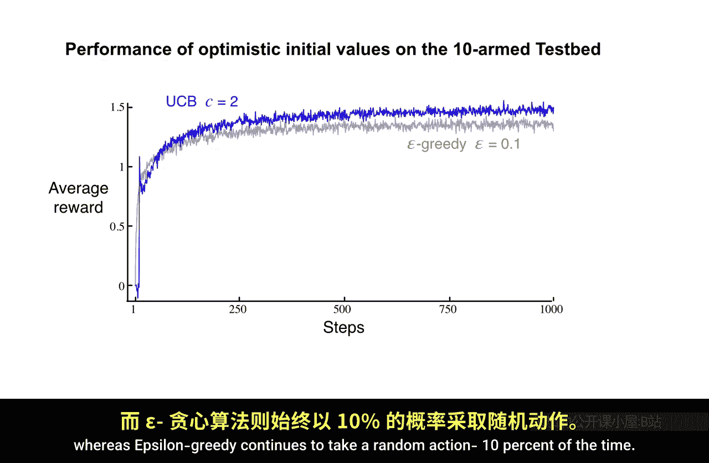

# 阿尔伯塔大学【中英⚡强化学习｜Reinforcement Learning Specialization】 p10 P10 03_置信上限（UCB）动作选择 -BV1CdGrzuEJU_p10-

We've discussed a few methods for balancing exploration and exploitation。

Because we are estimating our action values from sampled rewards。

 there is inherent uncertainty in the accuracy of our estimate。

We explore to reduce this uncertainty so that we can make better decisions in the future。

In this video， we will discuss another method for selecting actions to balance between exploration and exploitation called UCB。

By the end of this video， you will understand how upper confidenceence Bo action selection uses uncertainty in the estimates to drive exploration。

Recall the Epsilon greedy A selection method that we discussed previously。

This method chooses exploratory actions， epsilon percentage of the time。

The exploratory actions are selected uniformly， Can we do better？

If we had a notion of uncertainty in our value estimates。

 we could potentially select actions in a more intelligent way。

What does it mean to have uncertainty in the estimates？

Q of A here represents our current estimate for action A。

These brackets represent a confidence interval around Q star of a。

 They say we are confident that the value of action A lies somewhere in this region。For instance。

 we believe it may be here。Or here。The left bracket is called the lowerer Bo。

And the right is the upper bound。The region in between is the confidence interval。

 which represents our uncertainty。If this region is very small。

 we are very certain that the value of action A is near our estimated value。If the region is large。

 we are uncertain that the value of action A is near our estimated value。In UCB。

 we follow the principle of optimism in the face of uncertainty。

This simply means that if we are uncertain about something。

 we should optimistically assume that it is good。For instance。

 say we have these three actions with associated uncertainties。 Our agent has no idea which is best。

 so it optimistically picks the action that has the highest upper bound。😊。

This makes sense because either it does have the highest value and we get good reward or by taking it。

 we get to learn about an action we know least about， like the example on the slide。

Let's let the algorithm pick one more action。This time。

 Q2 has the highest upper confidence bound because its estimated value is highest。

 even though the interval is small。We can use upper confidence bounds to select actions using the following formula。

We will select the action that has the highest estimated value， plus our Op confidence Bo Exp term。

The upper bound term can be broken into three parts， as we will see in the next slide。

The C parameter is a user specified parameter that controls the amount of exploration。

We can clearly see here how UCB combines exploration and exploitation。

The first term in the sum represents the exploitation part。

 and the second term represents the exploration part。

Let's look at a couple of examples of the exploration term。Let's say we've taken 10，000 steps so far。

Imagine we've selected action A 5，000 times the uncertainty term here would be 0。

043 times the constant C。If instead we had only selected action A 100 times。

 the uncertainty term would be 10 times larger。

Let's investigate the performance of upper confidence bound action selection using the 10 Ar test bed。

We will use the same setup as before。The Q star values for these actions are normally distributed with mean 0 and standard deviation 1。

The rewards are sampled from a Uniifvari normal with mean Q star。As before， we will average over 2。

000 independent runs。

To compare UCB to epsilon greedy on the10 arm bandit problem。

 we set C equal to2 for UCB and set epsilon equal to 0。1 for epsilon greedy。

Here we see that UCB obtains greater reward on average than epsilon greedy after about 100 time steps。

Initially， UCB explores more to systematically reduce uncertainty。

UCB's exploration reduces over time， whereas Epsilon greedy continues to take a random action。

 10% of the time。

In this video， we discussed upper confidence Bo action selection。

 which uses uncertainty in the value estimates to balance exploration and exploitation。

