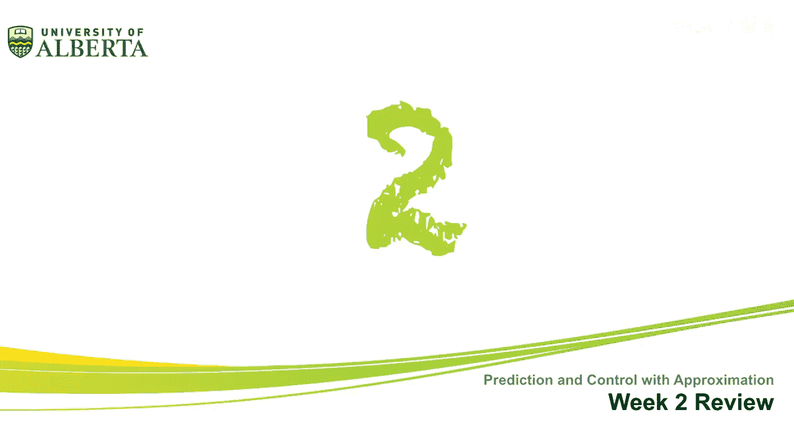
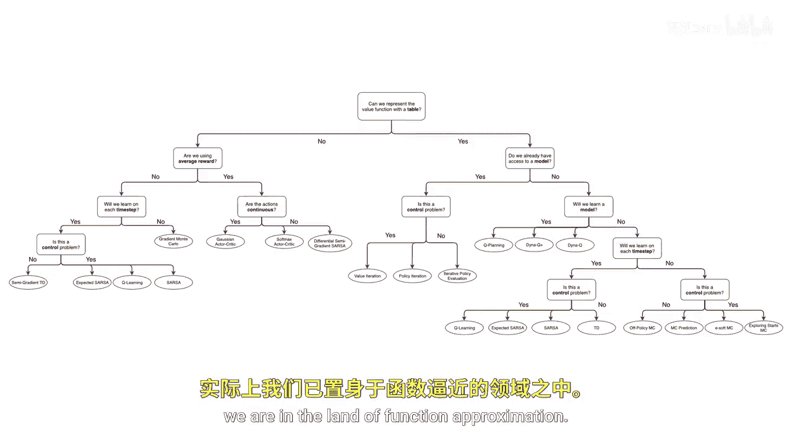
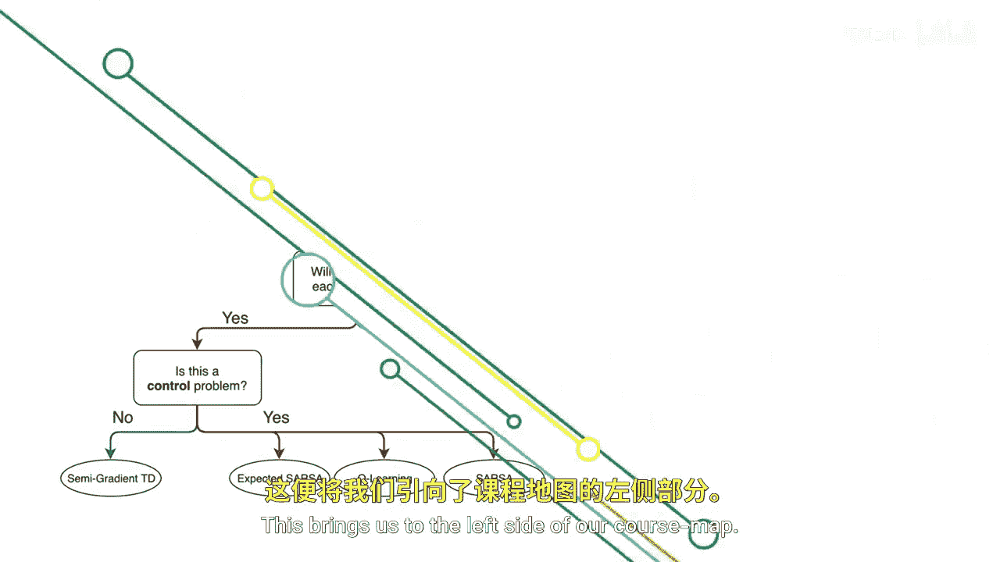
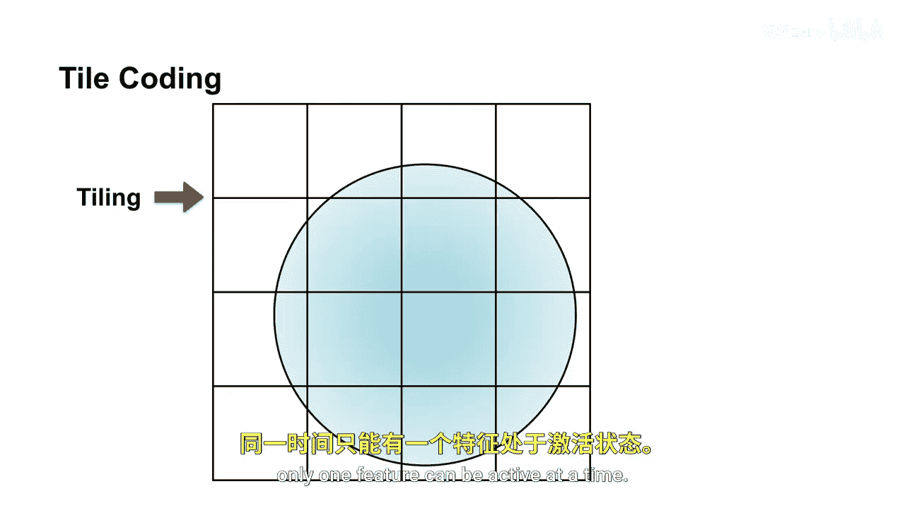
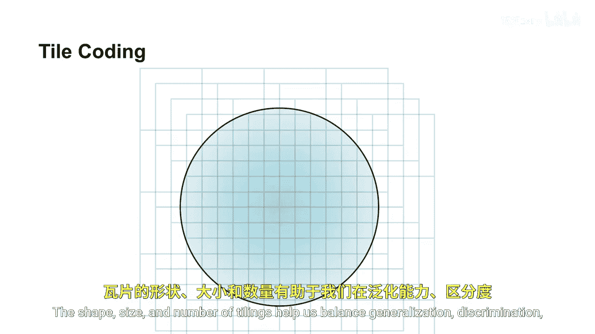
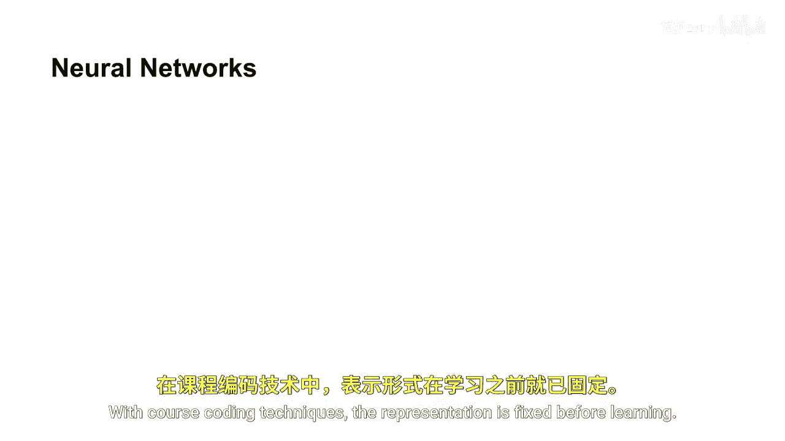
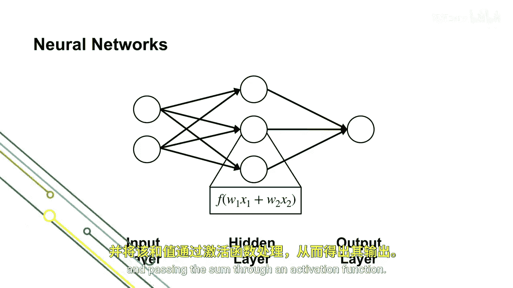
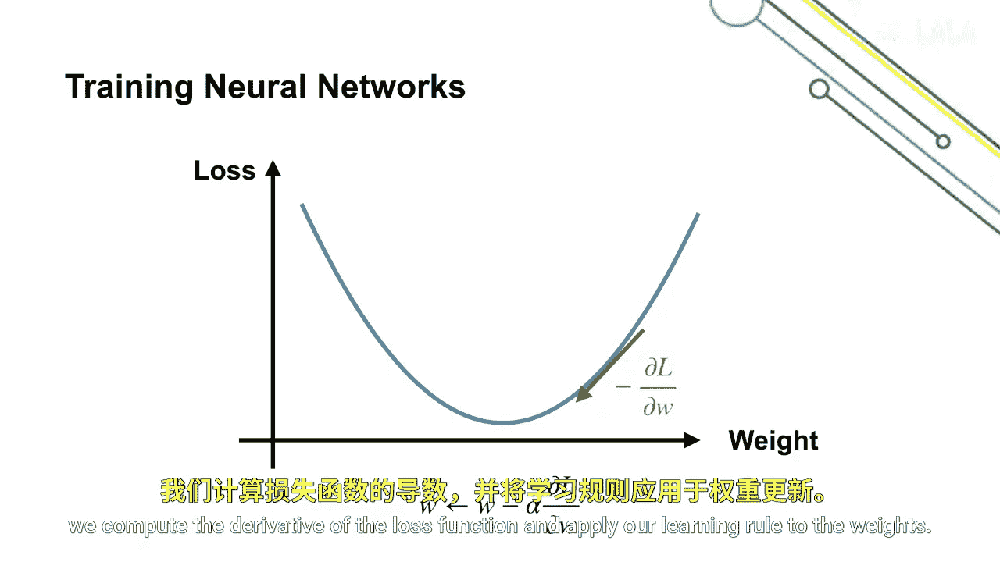

# 阿尔伯塔大学【中英⚡强化学习｜Reinforcement Learning Specialization】 p103 P103 04_第2周复习 -BV1CdGrzuEJU_p103-

This week we discuss methods for representing large and possibly continuous state spaces。

 ways to construct features。A representation is an agent's internal encoding of the state。

The agent constructs features to summarize the current input。

Whenever we are talking about features and representation learning。

 we are on the land of function approximation。

This brings us to the left side of our course map。

First， we introduce course coding course coding is related to state aggregation。

 it groups together neighboring states where each grouping can have an arbitrary shape。

One particular example of a two dimensional course coding is represented by these overlapping circles。

Each circle is a feature that is one when the state is inside the circle and zero when the state is outside the circle。

Next， we discuss a particular type of course coding called Tau coding。

Tg coding generates features using a set of overlapping grid。Each grid is called a tiling。

 a tiling itself has no overlap or space between the squares。

 only one feature can be active at a time。

By stacking multiple offset tilings， we can discriminate between different states。The shape， size。

 and number of tilings help us balance generalization， discrimination， and computational efficiency。

We then discussed a way to learn the representation online with neural networks。

With course coding techniques， the representation is fixed before learning。

A feed forward neural network uses a series of layers to produce a representation。

In each layer multiple neurons receive the same input and produce distinct outputs；

 these outputs are then fed to the next layer and the process repeats。

Each neuron computes its output by taking a weighted sum of the inputs and passing the sum through an activation function。

To train a neural network， we use an iterative process called gradient descent。

 we pass the inputs into the network to produce predictions。

Then we compare those predictions to the outputs and compute our loss function。Finally。

 we compute the derivative of the loss function and apply our learning rule to the weights。

Next week we'll talk about learning to maximize reward with function approximation。

