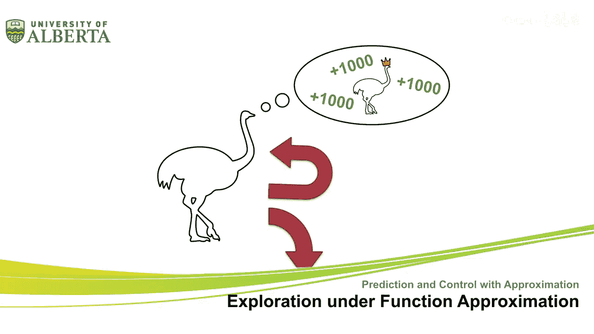
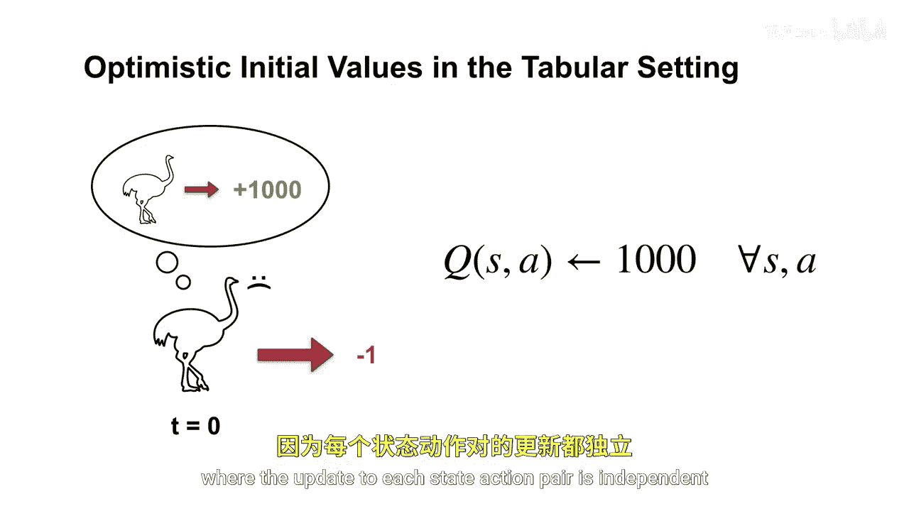
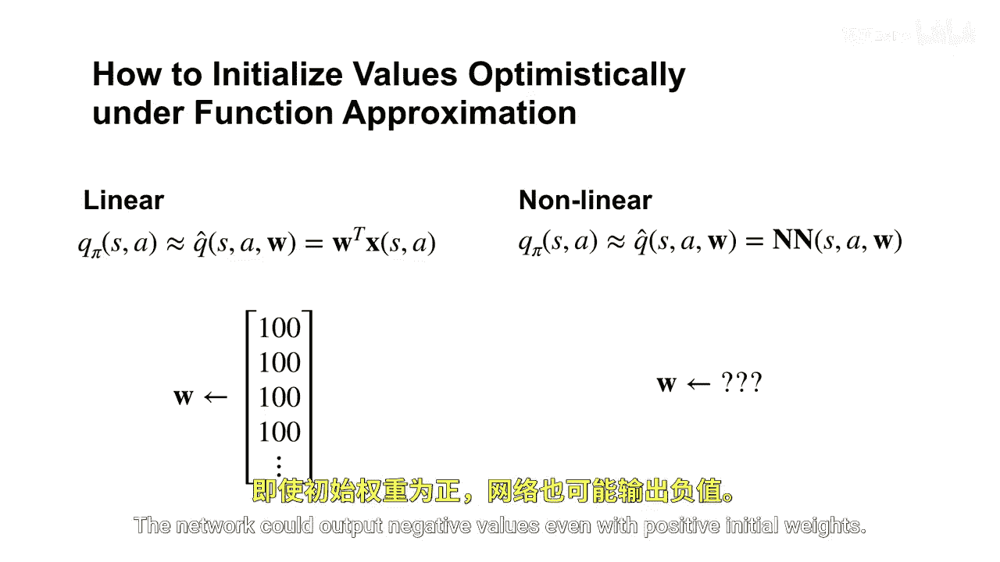
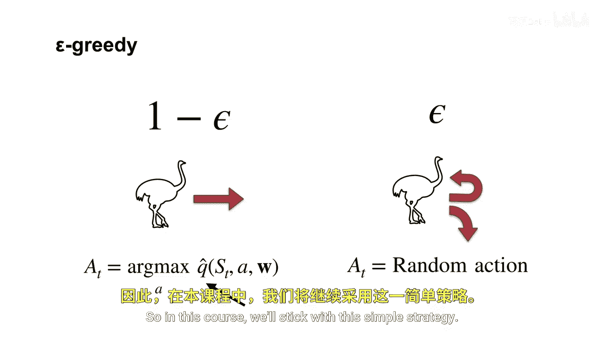

# 阿尔伯塔大学【中英⚡强化学习｜Reinforcement Learning Specialization】 p107 P107 01_函数逼近下的探索策略 -BV1CdGrzuEJU_p107-

The need to balance exploration and exploitation is one of the defining characteristics of the sequential decision making problem。

 We've talked about several simple ways to promote exploration in bandits and tabular reinforcement learning。

 But what about function approximation， Is there anything special about exploration there。 Today。

 we'll find out。😊，By the end of this video， you'll be able to describe how optimistic initial values and epsilon greedy can be used with function approximation。

Let's do a brief refresher on how we use optimistic initial values in the tabular setting。

We initialize our values to be greater than the true values。

 This is like the agent imagining that it can get more reward by taking that action than it actually can in reality。

😊，Typically， initializing the value function this way causes the agent to systematically explore the state action space。

As the agent's values become more accurate， they are impacted less and less by this initialization。

This is straightforward to implement in a tabular setting where the update to each state action pair is independent of all the other state action pairs。

🎼In function approximation， optimistic initial values corresponds to initializing the weights。

 such that the resulting values are optimistic。 In some cases， this is straightforward。 For example。

 when the features are binary， we simply initialize each weight to be the largest possible return。

 then as long as each state has at least one feature active。

 the value will be optimistic and likely overly so。In many cases， however。

 it is difficult to initialize optimistically。 For example， in a neural network。

 the relationship between the final values and the features can be quite complicated。

Imagine a network composed of 10h activation functions。

 the network could output negative values even with positive initial weights。

But this isn't the whole story。Depending on how our features generalize。

 optimistic initial values may not result in the same kind of systematic exploration we see in the tabular case。

 consider an extreme example where we have only one feature that is always one。

We can initialize optimistically， but every update will change the value for all states。

 This means that before some states are even visited。

 the value will already have decreased such that it is no longer optimistic。

To facilitate systematic exploration， changes to the value function need to be more localized。

 For example， function approximation with T codingd can produce such localized updates。

Neurural networks can also provide local updates， but neural networks may also generalize aggressively。

In practice， without special consideration， a neural network will lose its optimism relatively quickly。

Epsilon greedy is generally applicable and easy to use。

 even in cases with nonlinear function approximation。

The only thing Epsilon greedy needs are the action value estimates。

 independent of how they are initialized or approximated。However。

 Epsilon grity is not a directed exploration method。

 It relies on randomness to discover better actions near states followed by the current policy。

 It is therefore not as systematic as exploration methods that rely on optimism。

Improving exploration of the function approximation setting remains an open research question。

 so in this course we'll stick with this simple strategy。

In this video， we talk about how there are many subtleties when combining optimistic initial values and function approximation。

 and how epsilon greedity can be combined with any function approximation。See you next time。

