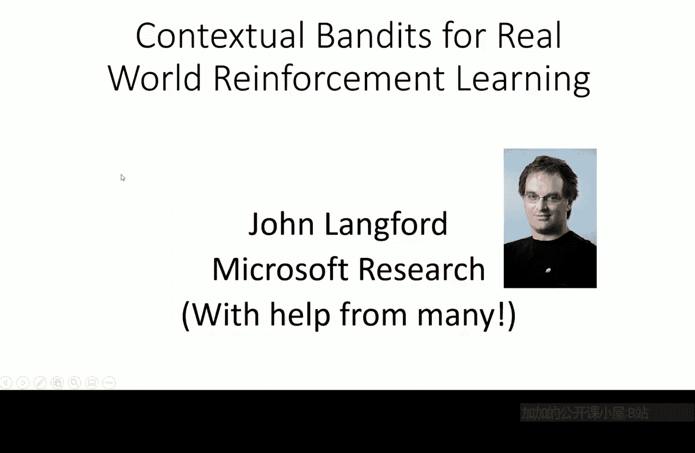
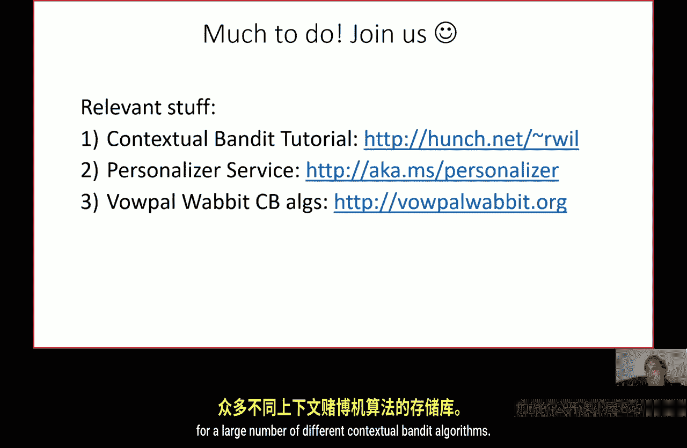

# 阿尔伯塔大学【中英⚡强化学习｜Reinforcement Learning Specialization】 p11 P11 04_乔纳森·兰福德：现实世界强化学习中的情境赌博机 -BV1CdGrzuEJU_p11-

Hi， my name is Joan Lnkford and I want to tell you about potential Ban for realw world reinforcement learning。

It stems from a long term project they've been working on for more than a decade。

 resulting in many real world deployments and in general。

 potentialile bandits are the way that reinforcement ring is to deployed in the real world these days。

Let's start with why we want to think about the real world and in general。

 how reinforcement really often differs from the real world。

Typically right now reinforcement ordering works with a simulator。

 the simulator provides observations， and then a learning algorithm has a policy which chooses an action and the simulator then processes and returns some sort of reward。

This is what happened when you do reinforcement learning for gameplay， for example。Now。

 when you want to apply this to the real world， there's a real question about how these things align。

 so for example， when an observation comes from the real world。

 is it like the observation from the simulator， typically it differs in various ways。

When the action is taken， based upon an observation， is it the same， Often it differs because。

Nature of the observation is different， which leads to different action， even given the same policy。

And then is the reward that you get back from the real world similar to what you get in the simulator and often the answer is no。

 it is not similar。So given this， there's a divergence。

 there's a gap between the simulator and the reality。So while you can try to learn in simulators。

The applicability of what you learn in simulators to the realroad applications is unclear。

 and in often， many cases， maybe even not even possible。

So given that you have this gap between simulator based reinforcement learning。

 which is where much of reinforcement learning is and real world based reinforcement learning。

 how do you do real world reinforcement learning？I think the key answer is kind of a shift in priorities。

So you want to shift your priorities to support。Real world reinforcement learning applications。

So as an example。Tyipical credit assignment， in other words。

 which we've lost the game is really important to reinforcement learning。

 but maybe it's a little bit less important， maybe generalization across different observations is more important。

In a simulator， it's easy for the reinforcement learning algorithm to control the environment I can say。

 step forward one step， please。But in the real world， typically the environment controls you。

 This is a fundamental import in terms of what your interfaces need to be for working with the real world。

Comle efficiency is the key limiting concern in a simulator because you have as many samples as you can compute。

But in the real world， statistical efficiency is the greater concern because。

You only have the samples that the real world gives you。

And so you must use those samples to achieve the greatest impact that you can。

In simulator based reinforcement learning， we often think about state。Right。

 in state is kind of the fundamental information necessary in order to make a decision。

But in the real world， often you have some sort of very complex observation。

 which may be may have much more information that necessary to make a decision if you have a megapixel camera。

 maybe you don't need all those pixels to make a decision。

 and maybe it's important to distinguish between。Thinking of all of those different possible pixel settings as a state in。

 and making a decision in other ways。When you're in the。Real world。

Something it becomes important to be able to do off policy evaluation。So in contextual Ban。

 which I'll talk about in a moment， there are algorithms which just do learning and their algorithms do learning。

 but also as a byproduct produced the kind of data that you can do off false evaluation with。

Naturally， these off policy evaluation supporting algorithm rooms are just preferred for actual applications。

Another distinction has to come with which policy you care about in a simulator。

 maybe you run for a long time and it's the last policy that you care about。But in the real world。

 every data point youre gathering involves some sort of interaction with the world where you want that performance to be pretty good。

And so you really care about the entire trajectory of policies。

 the sequence of policies as you learning in the real world。All right。

 so let's think about personalized news， this is a very natural application for reinforcement learning in the real world。

😊，Maybe you have a set of possible news articles， which are the ones of interest today。

Some user comes to a website， you would like to choose some news article that they'd probably be interested in。

 then you get some sort of feedback about whether or not they actually read the article。

So this is a very natural reinforcement learning structure。

 and this is in fact even simpler it's a contextual band structure。

So let's think about what contextual band are。 And contextual balance， what happens is。

You observe some features， maybe this is the geolocation of the user。

 maybe it's some sort of profile based upon the way the user has behaved in the past。

 maybe it's features of the possible actions which are available as well。Based upon this。

 you choose in action and then you get some reward。

 your goal is to maximize the reward in this setting。Okay， now。

 this sounds like full reinforcement learning and it is to a large extent。

 but there's one severe caveat， which is that we're imagining there's no credit assignment problem。

So the news article displayed that is displayed to you does not influence the way I will behave when the news article is displayed to me。

The industry of this is actually pretty recent。Something where the world has changed a great deal over the last decade。

So in 2007 there was the first contextual banit algorithm called Epic greed。

 which is kind of essentially a version of epsilon greed that buries the epsilon dependingping on how much you know。

 we rapidly discovered there's an even earlier paper on the HPP4 algorithm。

 which in some is even more efficient statistically but it's horrifically bad computationally。

In 2010， we had our first application of personalized news that was deployed in the real world when I was at Yahoo research。

In 2011， we had the first marriage of E greedy style learning in EP4 style learning。

To achieve something that was computational and statistically efficient。In 2014。

 we had an even better algorithm we came up with that you can actually use today。And then in 2016。

 we created the first version of a decision service。

 which is a general service cloud service you could use to create your own contextual band learn。

2019 we have this eventually led to an reinforcement learning service product。

 theure cognitivetive services personalizer。Based upon this service。

 you can go and personalize your website or its layout or。Many other things。

 it's a general service you can feed in arbitrary features。

 choosing an action and then send it an arbitrary reward with it learning。Based upon this system。

 we actually have 22019 AI system of the year。All right。

 so can I don't have time to go into great detail here。

 but if you're interested in more details about contextual banits。

 wass a tutorial that Alexec Agraw and I did in 2019， which recommend taking a look at it。

If you're interested in the personalizer service， that's available at this URL。

 and then if you're interested in the algorithms behind the personalizer service and in general implementations of contextual Maned algorithms。

 both a Webet has become a repository for a large number of different contextual banded algorithms。

Thank you。