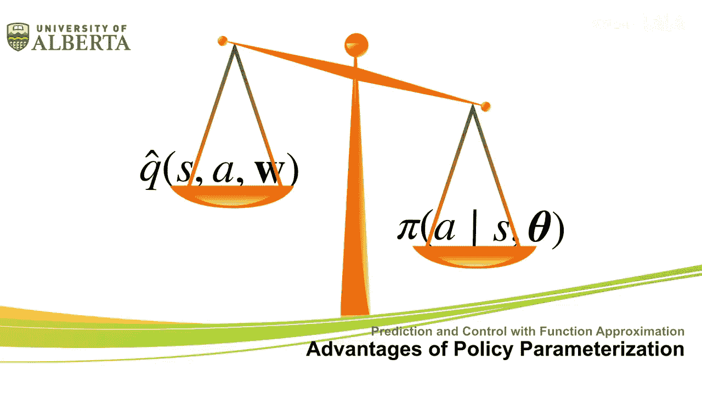
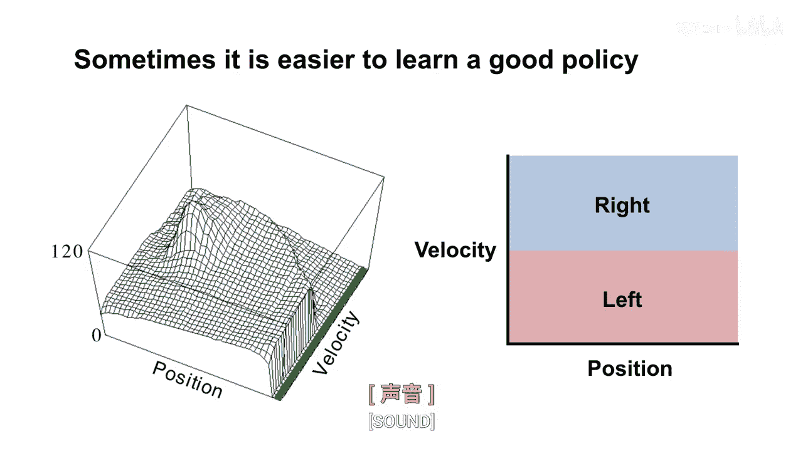

# 阿尔伯塔大学【中英⚡强化学习｜Reinforcement Learning Specialization】 p112 P112 04_策略参数化的优势 -BV1CdGrzuEJU_p112-

You now know it's possible to learn parameterized policies directly。

 this means we can have more flexibility in how we solve our problems。

Now we consider learning approximate values and learning approximate policies。

 but is it really helpful to directly learn policies？After watching this video。

 you'll be able to understand some of the advantages of using parameterized policies。

There are many advantages to directly learning the parameters of a policy。First。

 the agent can make its policy more greedy over time， autonomously。Why would you want that， well。

 in the beginning， the agent's estimates are not that accurate。

So you would want the agent to explore a lot。As the estimates become more accurate。

 the agent should become more and more greedy。Recall the epsilon greedy policy we used before。

The Epsilon step chooses a random action to ensure continual exploration。However。

 the Epsilon probability puts a cap on how good the resulting policy can be。We could， of course。

 switch to degreey policy when we think the agent has explored adequately。

But we want our ages to be autonomous。We don't want them to rely on us to decide when explorationir is done。

We can avoid this issue with parameter policies。 The policy can start off stochastic to guarantee expiration。

Then， as learning progresses， the policy can naturally converge towards a deterministic。

 greedy policy， a softm policy can adequately approximate a deterministic policy by making one action preference very large。

In the tabular setting， we learn there is always a deterministic optimal policy。

In function approximation， we may not be able to represent this deterministic policy。Instead。

 the optimal approximate policy might be a stochastic policy。

This suggests it might be useful to learn stochastic policies。

We can see why this is true by considering an example。Imagine the agent is in a corridor。

 it always starts in the far left state。In the left and right states。

 the actions left and right have their usual consequences。In the middle state， however。

 the left and right actions are switched， moving left will take the agent right。

 moving right takes the agent to the left state。The reward is minus1 in every step。

 and the task is episodic。 Imagine the function approximation treats all these states as the same。

All three states share the same approximate value。If we choose to limit ourselves to deter this policies。

 we would have no choice but to pick the same action in all the states。

This would give us just two choices。Always move left or always move right。If we always move left。

 we will never leave the start state。 So the expected return for that policy is negative infinity。

If we always move right， we will reach the middle state and then move back to the start state and continue this forever。

So the expected return is also negative infinity。If we are allowed to choose actions stochically。

 however， we can do much better。We may get stuck for a while。

 but as long as each action has a nonzero probability， we will eventually reach the terminal state。

In fact， the best policy under this function approximation is a little particular。

Choose the right action 59% of the time and the left action the rest of the time。

This policy achieves an expected return of around minus 11。6， clearly better than negative infinity。

This example may seem a bit contrive， but similar situations can arise in the real world。

 For example， in our own lab， a robot had stuck in the corner of the room because it had a deterministic policy and a limited function appximator。

Sometimes the policy is more simple than the value function。Remember the mountain car problem。

 we spent a lot of time designing a value based agent to learn an optimal policy。However。

 in this problem， the energy pumping policy we saw previously is nearly optimal。

The agent simply selects its action in agreement with the current velocity。

If the velocity is negative， then the agent takes the accelerate left action。

If the velocity is positive， then the agent takes to accelerate right action。

This policy allows the agent to quickly escape from the valley。As you can see。

 this is quite a simple policy。The value function on the other hand， is quite complex。

That's it for today， you should now understand that parameterized stochastic policies are useful because they can autonomously decrease expiration over time。

They can avoid failures due to deterministic policies with limited function approximation。

And sometimes the policy is less complicated than the value function。In upcoming videos。

 we'll see if there is not a strict distinction between action value methods and policy based methods。

In fact， we can use action values to make it easier to learn a parameterized policy。See you then。

