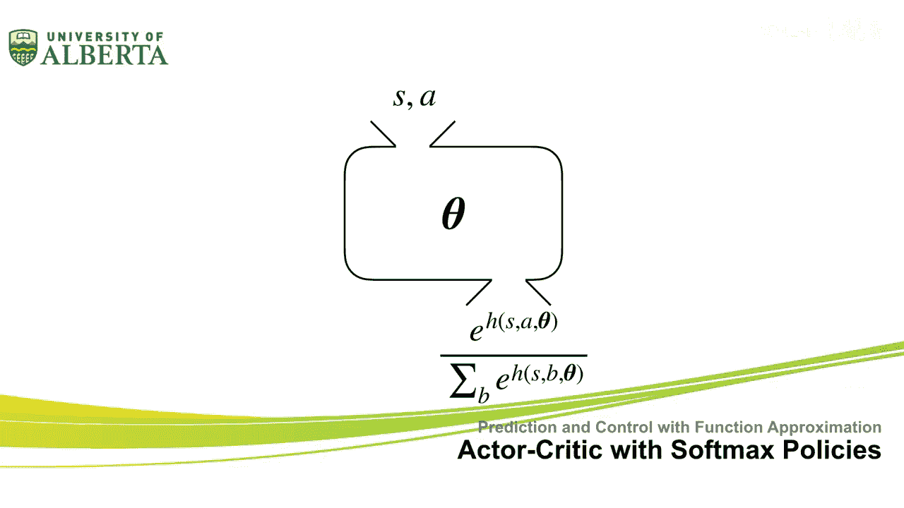
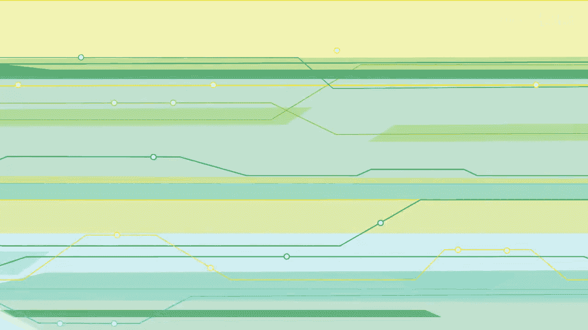
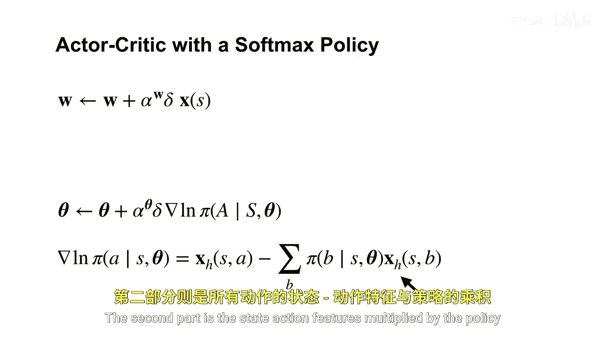

# 阿尔伯塔大学【中英⚡强化学习｜Reinforcement Learning Specialization】 p117 P117 01_基于Softmax策略的演员-评论家算法 -BV1CdGrzuEJU_p117-

Acctor critictic elegantly mixes direct policy optimization， value functions。

 and temporal difference learning。The a critictic method we discussed previously was quite general。

 we didn't specify the function approximation， nor the policy parameterization。

Today we discuss one specific implementation， actor critic with linear function approximation。

 and a soft max policy parameterization。

By the end of this video， you'll be able to derive the a critictic update for a Softmax policy with linear action preferences and implement this algorithm。

Previously we introduced the Actctor Critic algorithm， that algorithm combines policy evaluation。

 which is the critic， and the policy gradient rule to update the policy， which is the actor。

The critic uses semi gradient TD。The actor uses the TDR from the critic to update the policy parameters。

All of this is a little bit high level and abstract， let's consider a specific implementation。

Let's build an algorithm for a finite set of actions and continuous states。

A common choice of policy parameterization for finite actions is the softmax policy we discussed before。

We can use function approximation to represent the preferences。

The parameters of this function are the policy parameters denoted by theta。

 so our policy grading learning rule will update theta。

 We use a softm policy that expentiates the preferences and divides by the sum。

This guarantees the resulting action probabil are positive and sum to1。

Notice the policy is written as a function of the current state。

 this is like having a different softmax distribution for each state。

Watch the agent move through the state space。The state dependent action preferences give rise to potentially different distributions for each state。

To select an action， we follow a simple procedure in the current state we query the softm for each action。

This generates a vector of probabilities， one entry for each action。Given this vector。

 we pick an action proportionally to these probabilities。

Now let's discuss how our parameterization choices impact the value function， the action preferences。

 and our update equations。Let's use the same features for our value estimates and the policy。

Remember， the critic updates an estimate of the state value function。

So the critic only requires a feature vector characterizing the current state。

The actor's action preferences depend on the state and action。

So our action preference function requires a state action feature vector。

We have encountered this issue before。We use the same strategies before， stacked state features。

 that is we use a copy of the state feature vector for each action。

The size of the policy parameter vector theta is larger than the weights W used by the critic。

 since there are three actions， this is three times larger。

Now let's look at the update equations for the actor and the critic with our linear Somax parameterization。

The first one is easy。The gradient of the linear value function is just the feature vector。

So the critic's weight update is just alpha times the TDR times the feature vector。

Same old semi gradient TD， the actor's update to the preferences requires a bit more thought。Luckily。

 the gradient is not so bad。 We will leave out the derivation and just give you the final result。

 You can verify it， if you like。The gradient has two parts。

 the first is the state action features for the selected action。

The second part is the state action features multiplied by the policy summed over all actions。

That's it for this video Today we discuss a specific implementation of actor critictic。

Now you know everything you need to know to implement this algorithm on your own。

Next time we'll try this algorithm mode and see how it works。 I can't wait。

