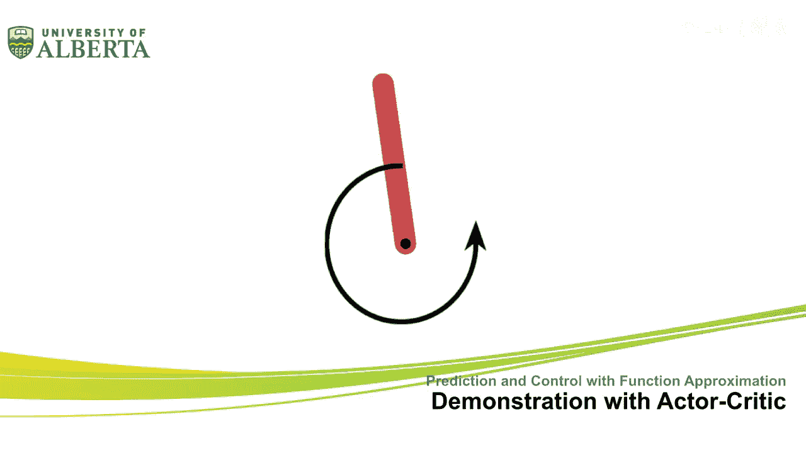
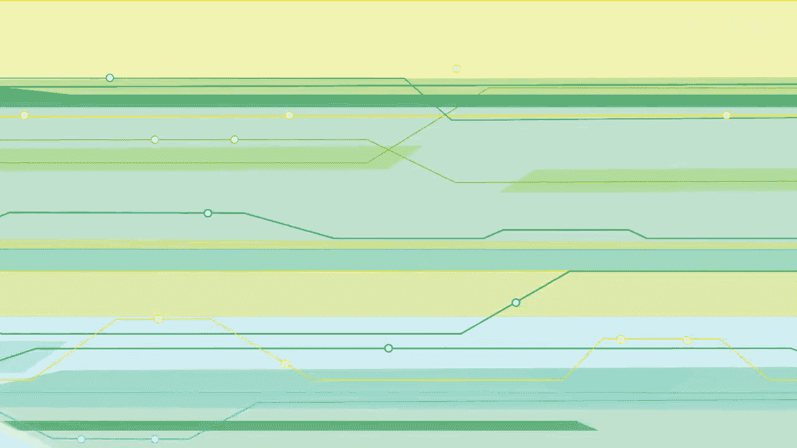
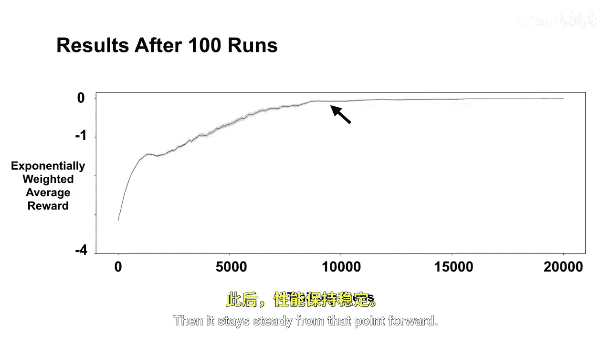

# 阿尔伯塔大学【中英⚡强化学习｜Reinforcement Learning Specialization】 p118 P118 02_演员-评论家算法演示 -BV1CdGrzuEJU_p118-

In this video we will see how the akugom works on a classic control task。

 the pendulum swing up problem。By the end of this video。

 you will be able to design a function appximator for an average reward actic algorithm and analyze the performance of an average reward agent。

Today we'll investigate the pendulum swing up task。The agent controls a pendulum；

 The controls are simple， the agent can apply torque on a pivot point， marked by the black dot。

The goal is to get the pendulum to balance upright。 The pendulum starts in its rest position。

 hanging down with no velocity。The pendulum can move freely。

 subject only to gravity and the actions applied by the agent。

The state of the pendulum is the angle of the pole and the angular velocity。

Both are real valued quantities。Our simulation has just three discrete actions。

 apply a constant angular acceleration clockwise， counterclockwise， or apply no angular acceleration。

We use a soft max policy for this task because the action space is discrete。Later on。

 we'll use a different parameterization for a continuous action variant of the pendulum task。

The next step is to find the reward function。The goal is to get the pendulum pointing directly up and keep it that way。

So the reward is equal to the negative absolute angle from vertical。

If the pendulum reaches a large angular velocity， then it could damage the system， that would be bad。

To avoid this， we constrain the range of the angular velocity to between minus2 pi and2 pi。

If this limit is exceeded， then we reset the pendulum to the resting position。

The goal is to keep the pendulum as close to operate as possible at all times。

This continues indefinitely， there are no episodes and no terminations。

So it makes sense to formulate this as a continuing task。

The pendulum is interesting for a few reasons， the actions are not strong enough to move the pendulum directly to the vertical position from the resting position。

A good policy must apply actions that move the pendulum away from the desired position in order to gain enough momentum to swing up。

Finally， the vertical position is unstable， so a good policy must continually balance the pole。

Let's supply our softmax actor Cri algorithm to our simulated version of the pendulum task Before we can do that we have to design our function appximator and our policy parameterization。

The pendulum task is a low dimensional state， just the angle and angular velocity。

This two dimensional problem is a good fit for tile coding。

The approximate value function and the action preferences will be linear in the tile codingd。

 but nonlinear in the state variables。The first step in setting up a tau codinging is to figure out the range of each of the state variables。

This is easy for the angular position， it just has to be between pi and minus pi。

The angr velocity will lie between two pi and minus 2 pi due to the constraint we discussed earlier。

Its usually good to use large tiles and many tilings。

 the broad tiles enable considerable generalization and thus fast early learning。

While many tilings help with discrimination， this should result in an accurate approximation of the value function and the action preferences。

We use 32 tilings of size 8 by8。Remember， for action preferences。

 we need a feature vector for each state action pair。As before。

 we simply use a separate copy of the state features for each action。

What about the step sizes for the average reward， the actor and the critic？

That's quite a few parameters， and each of them have a big impact on performance。

We performed a systematic sweep to determine a good setting for each。

This matches the general rhythm that we want the critic to update at a faster rate。That way。

 the critic can accurately critique the more slowly changing policy。

There are a few other details required to get good performance on this task。For the sake of time。

 we will skip those， but don't worry， you'll learn all about this implementation in your assessment。

Let's look at a video of the agent as it first begins interacting with the pendulum environment。

 the agent begins by acting randomly， but it quickly learns to add energy to reach states closer to vertical。

Let's skip ahead a bit， the final behavior looks something like this。

We added random perturbation to demonstrate the robustness of the learned policy。

This is like flicking the pendulum with your finger every once in a while。

The perturbations were introduced only after the agent had learned a good balancing policy。

Their perturbations are shown with black arrows in the video。

 we can see how the trained agent is able to recover smoothly and is robust to these flicks。

It's really satisfying to watch an agent we programmed mastering the pendulum problem。

 but we have to be skeptical scientists too。This is just a demonstration。

 does the agent successfully learn to balance every time or do we just get lucky？

How quickly and robustly does it learn？To answer these questions。

 we ran the experiment 100 times and averaged the performance。

To measure the performance of the agent， let's plot an exponentially weighted average of the reward over all time steps。

The error bars show the standard error and the mean。The error bars are quite small。

 in fact the error bars are so small， you can hardly see them at all。

 so we are pretty confident this plot accurately reflects our agent's average performance on this task with the parameters we have chosen。

The average reward starts off low， but increases very quickly off the start。After a short time。

 the rate of improvement slows， but improvement continues as the agent continues to refine its policy。

Performance peaks near zero， this means the agent is generally able to balance the pendulum upright with minor deviations。

Then it stays steady from that point forward。

That's it for today。We introduced a specific implementation of an actic learning system。

 and we tested on a classic control task。Bye for now。

