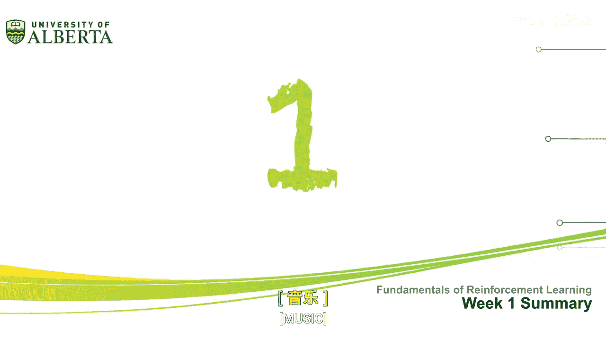
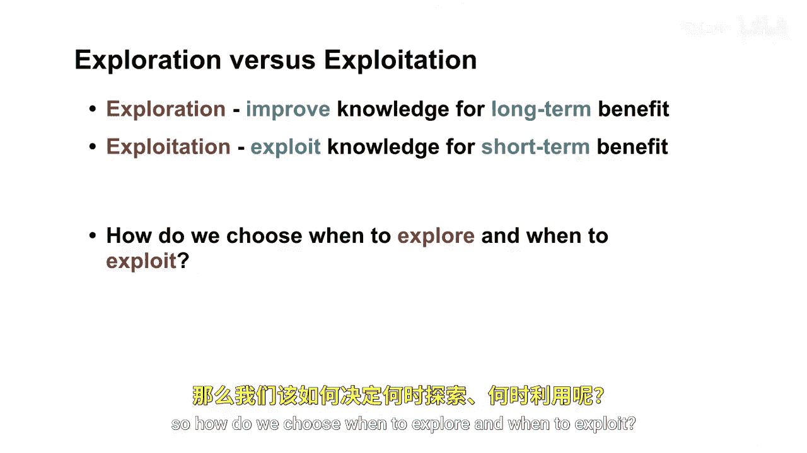
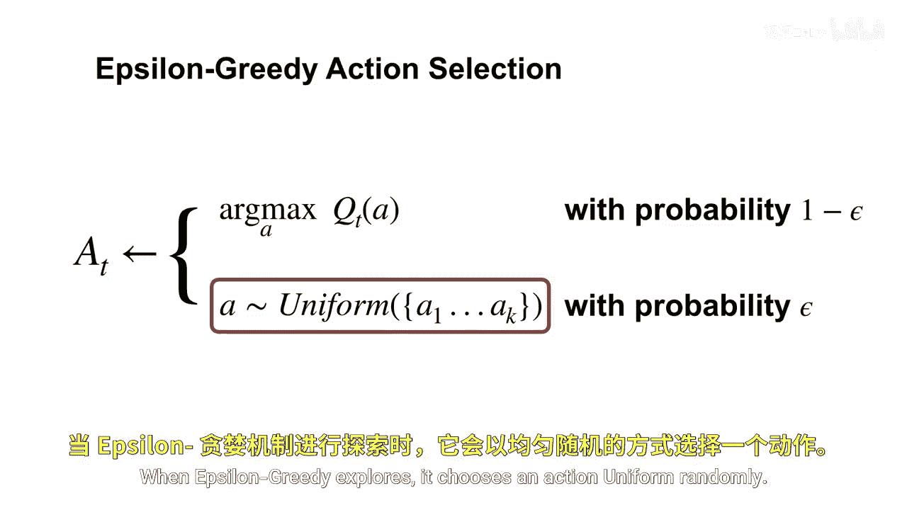
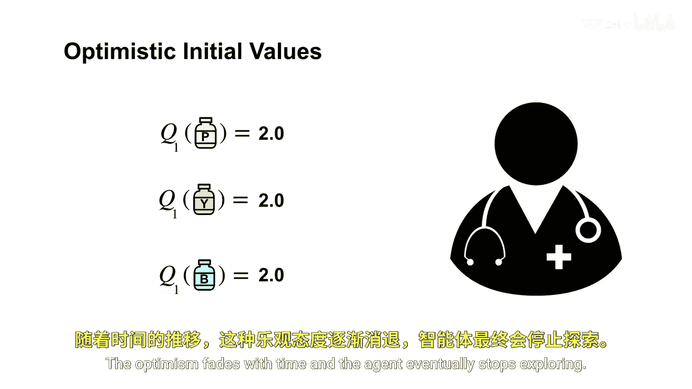
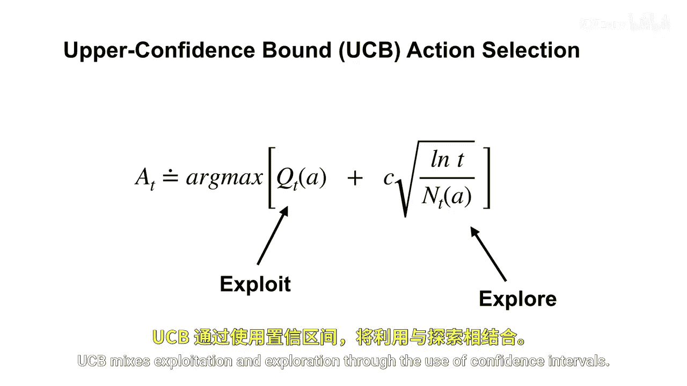
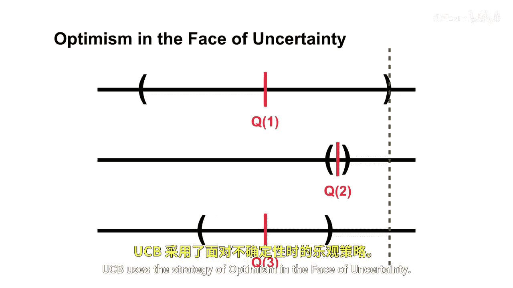

# 阿尔伯塔大学【中英⚡强化学习｜Reinforcement Learning Specialization】 p12 P12 05_第一周总结 -BV1CdGrzuEJU_p12-

嗯。

This week， you'll introduced to the KR Bit problem and several fundamental concepts in reinforcement learning。

We started by describing the problem setting。We have an agent taking actions and receiving rewards based on the action selected。

We define the value of each action as the expected reward received when taking that action。

The value function Q star is unknown to the agent。 We then introduce the sample average method for estimating Q star。

It uses the sum of rewards received when action A is taken。

 divided by the number of times a has been taken。We derived an incremental update rule by finding a recursive definition of the sample average。

By doing so， we need only store the number of times each action has been taken。

And the previous estimate。We then showed that we can make the step size more generic， and in fact。

 by using a constant step size， we could more effectively solve the band problems that change over time。

Next， we ran into the issue of exploration versus exploitation。

We defined exploration as the chance for the agent to improve its knowledge。

Some actions may be better than we realize we have to try the actions we may not think are the best to improve our estimates。

We define exploitation as the agent taking the action it currently thinks is best in the hopes that will generate the most reward。

The agent cannot explore and exploit simultaneously。

 so how do we choose when to explore and when to exploit？

To answer this question， we introduced Epsilon greededy A selection。

Epsilon greedy explores epsilon percentage of the time and exploits one minus epsilon percentage of the time。

When Epsilon greedy exploits， it chooses the action which maximizes the current value estimate。

When Epsilon Gry explores， it chooses an action uniform randomly。

We also investigated the effects of optimistic initial values。

If the initial values are larger than Q star， the agent will systematically explore the actions。

The optimism fades with time and the agent eventually stops exploring。

Finally， we discussed upper confidence Bo action selection。

UCB mixes exploitation and exploration through the use of confidence intervals。

UCB uses the strategy of optimism in the face of uncertainty。

And that's it for bandits。This week， we introduced some of the most fundamental concepts in reinforcement learning。

We can largely view the bandit problem as a subset of the larger reinforcement learning problem。

Concepts like maximizing reward and choosing actions when faced with uncertainty are key to reinforcement learning。

 We're excited to begin introducing the full reinforcement learning problem next week。

 Be sure to read the textbook for the next week's lectures。😊。

