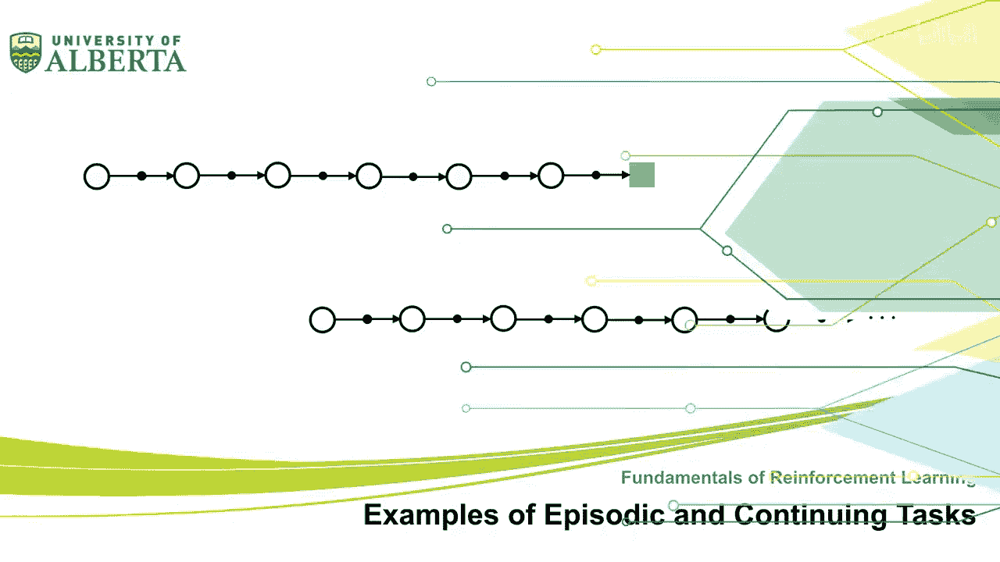
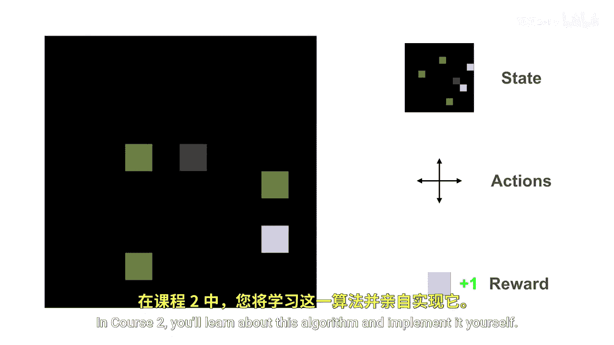

# 阿尔伯塔大学【中英⚡强化学习｜Reinforcement Learning Specialization】 p127 P127 02_回顾分幕式任务与持续性任务的示例 -BV1CdGrzuEJU_p127-

When should we formulate a problem as an episodic or a continuing task， in this short video。

 we'll discuss a few more examples that will help us understand episodic and continuing problems。

By the end of this video， you will be able to understand when to formalize a task as episodic or continuing。

First， let's look at an example of an episodic task。

 consider an agent learning to play a simple video game。The player， represented in blue。

 gets points for collecting white treasure blocks。The game ends when the player touches a green enemy block。

This game is naturally represented as an episodic MDP。

The agent tries to get a high score collecting as many points as possible before the game ends。

The state is an array of pixel values corresponding to the current screen。There are four actions up。

 down， left and right。The agent gets a reward of plus one whenever it collects a treasure block。

And an episode ends when the agent touches one of the green enemies。

Regardless of how the episode ends， the next episode will begin with the agent in the center of the screen with no enemies present。

By the way， the agent you are currently watching was trained with key learning。

 it's pretty good at this game， isn't it？In Co  two。

 you'll learn about this algorithm and implement it yourself。

Now let's look at an example of a continuing task。The agent is going to schedule jobs on a set of servers。

 suppose we have three servers used by reinforce learning researchers to run experiments。

Researchers submit jobs with different priorities to a single queue。

The state is a number of free servers and the priority of the job at the top of the queue。

The actions are to reject or accept the job at the top of the queue if a server is free。

Accepting the job runs it and yields a reward equal to the job's priority。

Rejecting a job yields a negative reward， proportional to the priority。

 and sends the job to the back of the queue。The agent should be careful about scheduling low priority jobs。

 since it could prevent high priority jobs from being scheduled later。

The servers become available as they finish their jobs。

 the researchers continually add jobs to the queue and the agent accepts or rejects them。

Since this process never stops， it's well described as a continuing task。

That's it for this video you've now seen some concrete examples of episodic and continuing tasks。

Episodic tasks break naturally into independent episodes。

Continuing tasks are assumed to continue indefinitely。

You should now be able to determine which formulation is most appropriate for a given problem。

