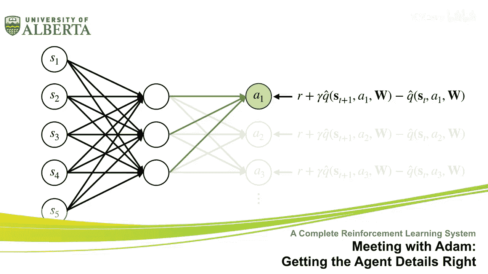
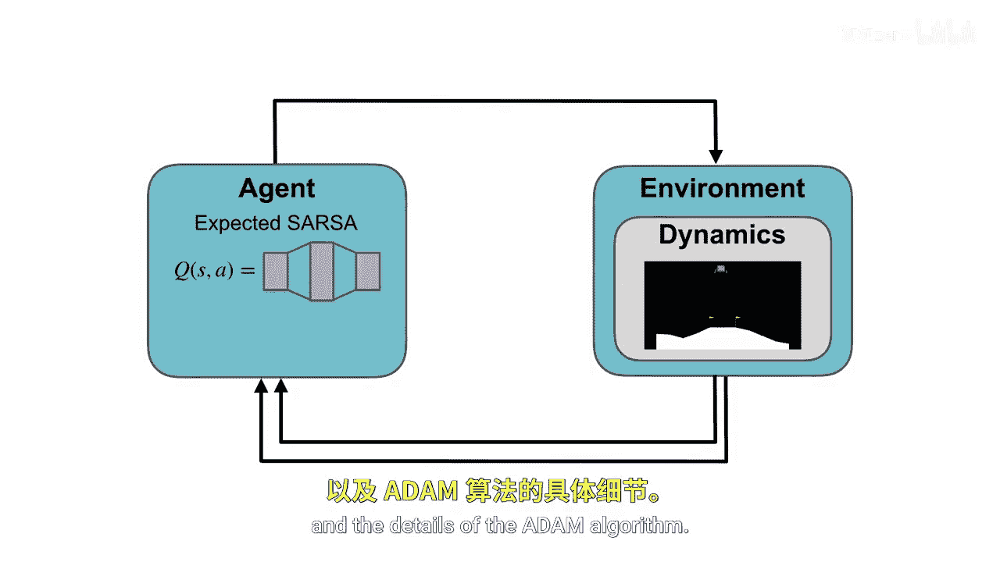
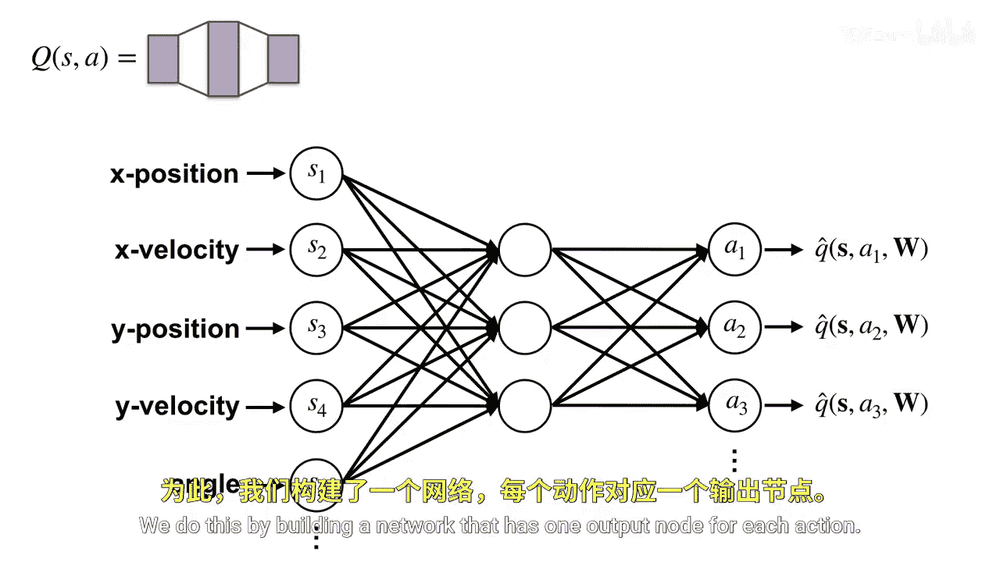
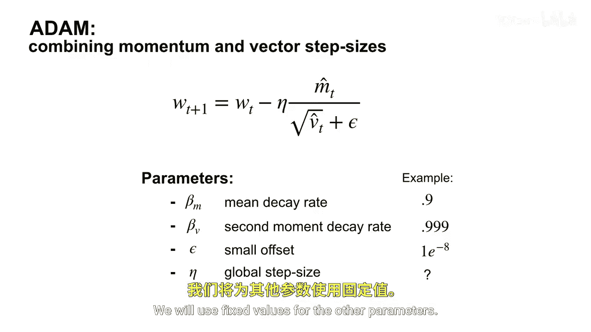

# 阿尔伯塔大学【中英⚡强化学习｜Reinforcement Learning Specialization】 p139 P139 01_与Adam的会议：完善智能体细节 -BV1CdGrzuEJU_p139-

嗯。

Welcome to the second last week of the Capstone Project。

 this is an exciting time because you finally get to start building your agent。

Last week we brainstormed some of the high level agent design choices this week we will discuss a few implementation details regarding the network and how to update it。

In practice， these decisions can have a big impact on performance。

Today we will discuss how we will update our estimates of the action values and the details of the atom algorithm。

We decided to use a neural network for the action values。

 but let's refresh our memory on how that works。You may recall from Co3 that the neural network takes the state and produces a new representation。

For instance， in this case， the state would be composed of things like the position and velocity of the lander。

We'll then use the resultant representation to estimate the value of each action。

We do this by building a network that has one output node for each action。

Let's discuss how to train this neural network to approximate the action value function。

We will use the TDR to train the network。More precisely。

 we will modify the weights to reduce the TD error on each time step。

We will only update the weights for the output corresponding to the action that was selected。

 we simply do not update the weights in the last layer for the actions 2 and3。You might ask。

 is this a problem， in general no， but there are some nuances to consider here？

For linear function approximation， we also maintained separate weights for each action value。

 we only updated weights for the action that was taken。With the neural network。

 each time an action is updated， the shared representation for all the actions is also changed。

But during learning， the result of each action might cause different。

 possibly conflicting updates to the representation。But this is actually something that we want。

 we want the neural network to learn a representation that is useful for all the actions。

 features that are good for multiple predictions are often features that generalize better。

In contrast， we could instead learn completely separate neural networks， one for each action。

But then the representation for each action is learned with fewer samples。

 and we can gain the potential benefits from learning a shared representation。

The other decision we made was to use the atom algorithm。

 this algorithm combines both vector step sizes and a form of momentum。

In course three we discussed a vector of step sizes。

 each way of the network has its own step size adapted based on the statistics of the learning process。

This means we can make larger updates to some weights and smaller updates to the others。

This might be useful if the loss is flatter in some dimensions。Alternatively。

 we can take smaller steps in other dimensions where the loss changes more sharply。

 We also discuss how to use momentum to accelerate our learning。

Especially if we find ourselves in a flat region of our loss。

Remember that taking repeated steps in the same direction builds momentum while taking steps in a different direction will kill the momentum。

The atom algorithm combines both of these idea。 It keeps a moving average of the gradients to compute the momentum。

The beta M parameter is a metparmeter that controls the amount of momentum。

 atom also keeps a moving average of the square of the gradient。

 This gives us a vector of step sizes。This update typically results in more data efficient learning because each update is more effective。

 You may have noticed that we just introduced several new meta parametersa that we will need to set。

We have the two decay rates， the size of the small offset in the denominator， and a global step size。

So we haven't achieved meta parameterameter free learning here。In fact。

 we have introduced four metaparas in place of one。

 Fortunatelyly it is typically not too difficult to find good settings for these meta parametersas using rules of thumb。

But better performance can usually achieved by tuning them individually。

Many people are working on methods to reduce the sensitivity to meta parametermeter choices and reinforcement learning。

 but this is still very much an open problem。In this capstone。

 you will investigate the impact of different choices of the global step size。

 we will use fixed values for the other parameters。

And that's it for this week， you should now have all the tools you need to implement your agent。

 next up， landing a shuttle on the moon with reinforcement learning。

