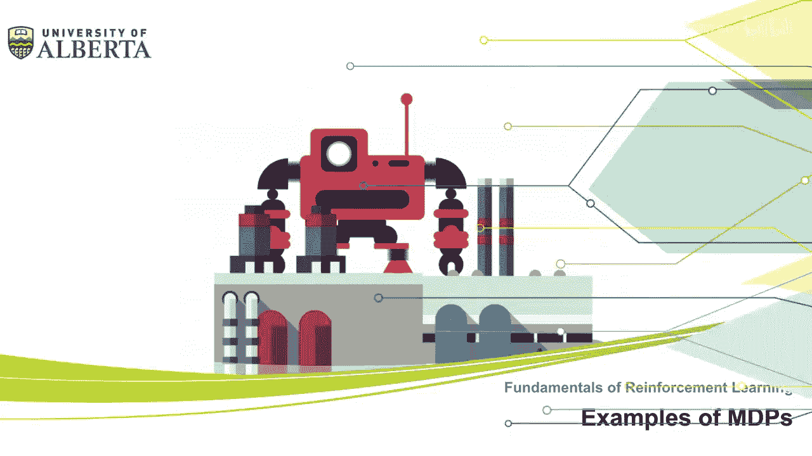
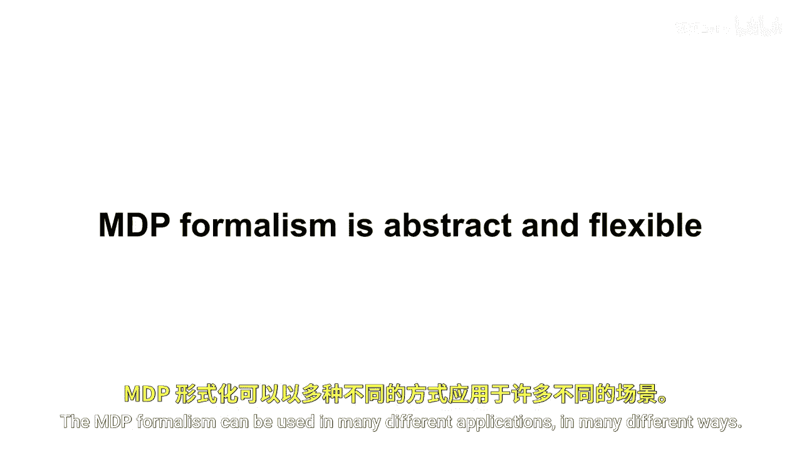

# 阿尔伯塔大学【中英⚡强化学习｜Reinforcement Learning Specialization】 p14 P14 04_马尔可夫决策过程示例 -BV1CdGrzuEJU_p14-

In this video， we will explore the flexibility of the NDP formalism with a few examples。

By the end of this video， you will gain experience formalizing decision making problems as MDDPs and appreciate the flexibility of the MDP formalism。

Consider a recycling robot which collects empty so cans in an office environment。

It can detect sodaans， pick them up using a gripper， and drop them off in a recycling bin。

The robot runs in a rechargeable battery。 Its objective is to collect as many cans as possible。

 Let's formulate this problem as an MDP。We will start with the state's actions and rewards。

Let's assume that sensors can only distinguish two charge levels， low and high。

These charge levels represent the robot's state。In each state， the robot has three choices。

 It can search for cans for a fixed amount of time。

It can remain stationary and wait for someone to bring it a can。

 or it can go to the charging station to recharge its battery。

We only allow recharging from the low state because recharging is pointless when the energy level is high。

Now let's consider the transition dynamics。First， let's try the states using open circles。

Searching for cans when the energy level is high might reduce the energy level to low。

That is the search action in the state high might not change the state。

Let's say with probability alpha。Or the energy level might drop to low with probability 1 minus alpha。

In both cases， the robot search yields a reward of our search。For instance。

 our search could be plus 10， indicating that the robot found 10 cans。The robot can also wait。

 Waiting for cans does not drain the battery， so the state does not change。In both cases。

 the weight action yields a reward of our weight。For example， our way could be plus1。

Searching when the energy level is low might deplete the battery。

 then the robot would need to be rescued。Let's write this probability as 1 minus beta。

If the robot is rescued， then its battery is restored。However。

 needing rescue yields a negative reward of our rescued。For example。

 our rescue could be minus 20 because we are annoyed with the robot。Alternatively。

 the battery might not run out。 This occurs with probability beta。

 and the robot receives a reward of our search。Taking the recharge action restores the battery to the level high and receives reward of zero。

And that's it， we have completely specified the NDP for the recycling robot problem。

We have discussed one example where an MDVP is used to precisely specify a problem。

 but you might wonder how general is this framework？

The MDVP formalism can be used in many different applications in many different ways。

States can be low level sensory readings， for example， in the pixel values of the video frame。

They can also be high level， such as object descriptions。Similarly， actions can be low level。

 such as the wheel speed of this robot， actions can also be high level。

 such as go to the charging station。Time steps can be very small or very large。 for example。

 they can be one millisecond or one month。Let's look at one more application。

Suppose we want to use reinforce and learning to control a robot arm in a pick and place task。

 The goal of the robot is to pick up objects and place them in a particular location。

There are many ways we could formalize this task。 here's one possibility。

The state could be the readings of the joint angles and velocities。

The actions could be the voltages applied to each motor。

The reward could be plus 100 for successfully placing each object。

But we also want the robot to use as little energy as possible。

 so let's include a small negative reward corresponding to the energy used。That was not so hard。

To recap， the NVP framework can be used to formalize a wide variety of sequential decision making problems。

